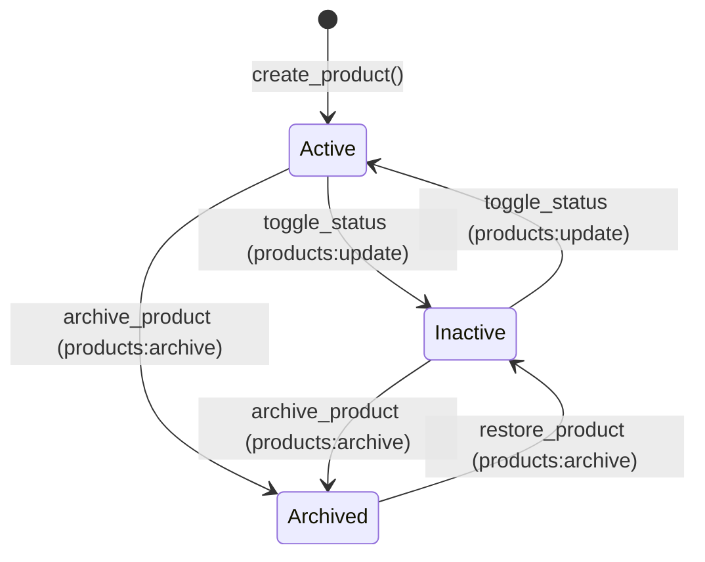

# Feature 003: Products & Categories — Technical Architecture & API Reference

**Feature Branch:** `003-products-categories`
**Status:** Implemented & Verified (Phases 1–9)
**Governing Documents:**
- [BizFlow AI Constitution v1.1.0](file:///c:/Users/Heyru/Desktop/projects/BizFlow-AI/.specify/memory/constitution.md)
- [Feature 003 Specification](file:///c:/Users/Heyru/Desktop/projects/BizFlow-AI/specs/003-products-categories/spec.md)
- [Feature 003 Data Model](file:///c:/Users/Heyru/Desktop/projects/BizFlow-AI/specs/003-products-categories/data-model.md)

---

## 1. Architecture Overview

Feature 003 implements the core product catalog and category management subsystem for BizFlow AI. The architecture enforces multi-tenancy, strict role-based access control (RBAC), confidential cost price separation, optimistic concurrency control (OCC), and secure private asset storage.

### 1.1 Tenant Isolation & Security Boundary
- Every tenant table (`products`, `product_categories`, `product_costs`) contains `organization_id UUID NOT NULL`.
- Multi-tenancy is enforced at the database level using PostgreSQL Row-Level Security (`ENABLE ROW LEVEL SECURITY` and `FORCE ROW LEVEL SECURITY`).
- All direct client DML (`INSERT`, `UPDATE`, `DELETE`) on core catalog tables is blocked via restrictive PostgreSQL policies (`USING (false)` / `WITH CHECK (false)`); mutations are performed strictly through privileged PostgreSQL stored procedures (`SECURITY DEFINER`) or server actions.

### 1.2 Confidential Cost Price Separation
- Product selling prices are publicly readable to all tenant members (including Cashiers) on `public.products.selling_price`.
- Unit cost prices are isolated in a physically separate table: `public.product_costs(product_id, organization_id, cost_price)`.
- Access to `public.product_costs` is restricted to users possessing the `products:read_cost` permission (Owner, Admin, Manager).
- Cashiers receive zero cost or margin data in database queries, Server Action payloads, and HTML responses.

### 1.3 Private Image Storage Architecture
- Product images are stored exclusively in the private Supabase Storage bucket `product-images` (`public = false`, 5 MB limit).
- Objects follow the canonical path `{organization_id}/{product_id}/{filename}`.
- Four explicit RLS policies on `storage.objects` govern `SELECT`, `INSERT`, `UPDATE`, and `DELETE`.
- The application dynamically signs private object URLs for authorized users (1-hour TTL) via `supabase.storage.from('product-images').createSignedUrl(path, 3600)`.

---

## 2. Database Schema & Invariants

### 2.1 Table: `public.product_categories`
Stores tenant product classifications.

```sql
CREATE TABLE public.product_categories (
    id UUID PRIMARY KEY DEFAULT gen_random_uuid(),
    organization_id UUID NOT NULL REFERENCES public.organizations(id) ON DELETE CASCADE,
    name TEXT NOT NULL,
    description TEXT,
    status TEXT NOT NULL DEFAULT 'active' CHECK (status IN ('active', 'archived')),
    created_by UUID NOT NULL REFERENCES auth.users(id),
    updated_by UUID NOT NULL REFERENCES auth.users(id),
    created_at TIMESTAMPTZ NOT NULL DEFAULT clock_timestamp(),
    updated_at TIMESTAMPTZ NOT NULL DEFAULT clock_timestamp(),
    CONSTRAINT uq_categories_org_name UNIQUE (organization_id, name)
);
```

### 2.2 Table: `public.products`
Stores core catalog items with inventory metadata and optimistic concurrency control.

```sql
CREATE TABLE public.products (
    id UUID PRIMARY KEY DEFAULT gen_random_uuid(),
    organization_id UUID NOT NULL REFERENCES public.organizations(id) ON DELETE CASCADE,
    name TEXT NOT NULL,
    description TEXT,
    sku TEXT NOT NULL,
    barcode TEXT,
    category_id UUID,
    selling_price NUMERIC(14, 4) NOT NULL CHECK (selling_price >= 0.0000),
    unit_of_measure TEXT NOT NULL CHECK (unit_of_measure IN (
        'unit', 'piece', 'kg', 'g', 'mg', 'l', 'ml', 'box', 'pack', 'pair', 'meter', 'cm', 'set'
    )),
    image_url TEXT,
    status TEXT NOT NULL DEFAULT 'active' CHECK (status IN ('active', 'inactive', 'archived')),
    version INTEGER NOT NULL DEFAULT 1 CHECK (version >= 1),
    created_by UUID NOT NULL REFERENCES auth.users(id),
    updated_by UUID NOT NULL REFERENCES auth.users(id),
    archived_at TIMESTAMPTZ,
    archived_by UUID REFERENCES auth.users(id),
    created_at TIMESTAMPTZ NOT NULL DEFAULT clock_timestamp(),
    updated_at TIMESTAMPTZ NOT NULL DEFAULT clock_timestamp(),

    CONSTRAINT uq_products_org_sku UNIQUE (organization_id, sku),
    CONSTRAINT uq_products_org_id UNIQUE (organization_id, id),
    CONSTRAINT fk_products_org_category FOREIGN KEY (organization_id, category_id)
        REFERENCES public.product_categories (organization_id, id)
        ON DELETE SET NULL (category_id),
    CONSTRAINT chk_products_archival_status CHECK (
        (status IN ('active', 'inactive') AND archived_at IS NULL AND archived_by IS NULL) OR
        (status = 'archived' AND archived_at IS NOT NULL AND archived_by IS NOT NULL)
    )
);
```

### 2.3 Table: `public.product_costs`
Separated storage for sensitive purchase/acquisition costs.

```sql
CREATE TABLE public.product_costs (
    product_id UUID PRIMARY KEY,
    organization_id UUID NOT NULL,
    cost_price NUMERIC(14, 4) NOT NULL CHECK (cost_price >= 0.0000),
    created_at TIMESTAMPTZ NOT NULL DEFAULT clock_timestamp(),
    updated_at TIMESTAMPTZ NOT NULL DEFAULT clock_timestamp(),

    CONSTRAINT fk_product_costs_org_product FOREIGN KEY (organization_id, product_id)
        REFERENCES public.products (organization_id, id) ON DELETE CASCADE
);
```

### 2.4 Index Strategy
- `uq_products_org_sku`: Unique B-Tree index on `(organization_id, sku)`.
- `uq_products_org_barcode`: Unique partial B-Tree index on `(organization_id, barcode) WHERE barcode IS NOT NULL`.
- `idx_products_org_status_cat`: Composite B-Tree index on `(organization_id, status, category_id)`.
- `idx_products_name_prefix`: Pattern matching B-Tree index on `(organization_id, name text_pattern_ops)`.
- `idx_products_name_trgm`: Trigram GIN index on `(name gin_trgm_ops)`.
- `idx_product_costs_org`: B-Tree index on `product_costs(organization_id)`.

---

## 3. RBAC & Permission Matrix

Feature 003 introduces 9 granular permissions registered in `public.permissions`:

| Permission Key | Description | Owner | Admin | Manager | Cashier |
| :--- | :--- | :---: | :---: | :---: | :---: |
| `categories:read` | View category manager, category list, and product counts | **Yes** | **Yes** | **Yes** | No |
| `categories:create` | Create new tenant categories | **Yes** | **Yes** | **Yes** | No |
| `categories:update` | Update category names and descriptions | **Yes** | **Yes** | **Yes** | No |
| `categories:archive` | Archive unused categories | **Yes** | **Yes** | No | No |
| `products:read` | Browse catalog, view selling prices and stock info | **Yes** | **Yes** | **Yes** | **Yes** |
| `products:read_cost` | View confidential cost price and gross profit margin | **Yes** | **Yes** | **Yes** | **NO** |
| `products:create` | Register new products with pricing and initial stock | **Yes** | **Yes** | **Yes** | No |
| `products:update` | Update product details, selling price, cost, and toggle active/inactive | **Yes** | **Yes** | **Yes** | No |
| `products:archive` | Permanently archive products with SKU reservation | **Yes** | **Yes** | No | No |

### Cost Confidentiality Guarantee
- Cashiers lack `products:read_cost`.
- In Next.js Server Components, Server Actions, and PostgREST queries, `product_costs` is never joined or selected for Cashiers.
- Client DOM and network payloads contain zero cost prices or gross margin metrics.
- Audit event metadata excludes plaintext numeric costs.

---

## 4. Product Lifecycle & Concurrency Invariants

### 4.1 Lifecycle States


1. **Active**: Product is active, purchasable, and listed in catalogs.
2. **Inactive**: Product is temporarily unavailable; hidden from POS sales but editable.
3. **Archived**: Product is retired. Permanent SKU and barcode reservation prevents reassignment to other products.
4. **Restoration**: Restoring an archived product returns it to `inactive` status.

### 4.2 Optimistic Concurrency Control (OCC)
- Every update to `public.products` increments `version = version + 1`.
- Update RPCs and actions require `expected_version`.
- If `expected_version != version`, mutation aborts with PostgreSQL error `P0010` (`CONCURRENCY_CONFLICT`).
- The UI discards optimistic changes, displays the conflict modal with the authoritative database version, and allows reloading fresh state.

---

## 5. Storage & Image Lifecycle

- **Supported MIME Formats**: `image/jpeg`, `image/png`, `image/webp`, `image/gif`.
- **Max File Size**: 5 MB (5,242,880 bytes).
- **Private Access**: Bucket `product-images` has `public = false`. Public URLs `/storage/v1/object/public/...` are blocked.
- **Image Replacement**: When replacing a product's image, the new file is uploaded to `{organization_id}/{product_id}/{filename}` before committing the database transaction. Upon commit, the old file is deleted via `storage.from('product-images').remove([oldPath])`.
- **Orphan Cleanup**: Unreferenced image uploads older than 24 hours are safely purged using `scripts/purge-orphaned-images.ts`. Referenced images across ALL statuses (`active`, `inactive`, `archived`) are permanently preserved.

---

## 6. Server Actions & RPC Reference

All server mutations return a standardized `ActionResult<T>`:
```typescript
type ActionResult<T> =
  | { success: true; data: T; error?: never }
  | { success: false; data?: never; error: { code: string; message: string; fieldErrors?: Record<string, string[]> } };
```

### 6.1 Server Actions (`src/actions/product-actions.ts`)

#### `createProductAction(slug: string, rawInput: unknown): Promise<ActionResult<ProductDetail>>`
- **Required Permission**: `products:create`
- **Behavior**: Validates Zod schema, generates unique product ID, creates product record and initial cost record atomically via `public.create_product` RPC.

#### `updateProductAction(slug: string, productId: string, rawInput: unknown): Promise<ActionResult<ProductDetail>>`
- **Required Permission**: `products:update`
- **Behavior**: Validates OCC `expected_version`, updates product details, replaces image if provided, updates cost price if caller has `products:read_cost`. Returns `P0010` on stale update.

#### `toggleProductStatusAction(slug: string, productId: string, expectedVersion: number, newStatus: 'active' | 'inactive'): Promise<ActionResult<ProductState>>`
- **Required Permission**: `products:update`
- **Behavior**: Optimistically updates status between `active` and `inactive` with OCC check.

#### `archiveProductAction(slug: string, productId: string, expectedVersion: number): Promise<ActionResult<ProductState>>`
- **Required Permission**: `products:archive`
- **Behavior**: Transitions product to `archived`, records `archived_at` and `archived_by`, increments version.

#### `restoreProductAction(slug: string, productId: string, expectedVersion: number): Promise<ActionResult<ProductState>>`
- **Required Permission**: `products:archive`
- **Behavior**: Restores archived product to `inactive` status.

#### `getProductStateAction(slug: string, productId: string): Promise<ActionResult<ProductState>>`
- **Required Permission**: `products:read`
- **Behavior**: Retrieves fresh authoritative status and version for OCC conflict resolution.

### 6.2 PostgreSQL Stored Procedures (`SECURITY DEFINER`)
- `public.create_product(p_org_id, p_name, p_sku, p_selling_price, p_unit_of_measure, ...)`
- `public.update_product(p_org_id, p_product_id, p_expected_version, p_name, ...)`
- `public.archive_product(p_org_id, p_product_id, p_expected_version)`
- `public.restore_product(p_org_id, p_product_id, p_expected_version)`
- `public.create_product_category(p_org_id, p_name, p_description)`
- `public.update_product_category(p_org_id, p_category_id, p_name, p_description)`
- `public.archive_product_category(p_org_id, p_category_id)`

---

## 7. Developer Setup & Workflow

### 7.1 Prerequisites
- Node.js >= 20.x
- Docker running (for local Supabase stack)
- Supabase CLI (`npx supabase`)

### 7.2 Local Environment Setup
```bash
# 1. Start local Supabase stack
npx supabase start

# 2. Apply database migrations
npx supabase migration up

# 3. Seed test environment / run unit tests
npm run test:unit

# 4. Run integration tests (with concurrency limit for db stability)
npx vitest run tests/integration --maxWorkers=2

# 5. Run end-to-end tests
npx playwright test

# 6. Typecheck and Lint
npm run typecheck
npm run lint
```

### 7.3 Storage Orphan Maintenance
```bash
# Run in safe dry-run mode (identifies eligible unreferenced images > 24 hours old)
npx tsx scripts/purge-orphaned-images.ts

# Run actual deletion in non-production environment
npx tsx scripts/purge-orphaned-images.ts --execute
```

---

## 8. Performance Benchmarking & Approved Exceptions (T058)

### 8.1 Benchmark Methodology & Execution Context (Formal Test Suite)
- **Dataset Scale**: 10,000 synthetic products distributed across 50 categories within an isolated test organization.
- **Caller Context**: Authenticated Supabase client (`ownerClient`) invoking queries under PostgreSQL `ROLE authenticated` with active session JWT claims (`auth.uid() = caller_id`, `role = 'authenticated'`).
- **Statistical Rigor**: 10 unmeasured warm-up iterations followed by 100 measured iterations per benchmark scenario; measurements capture p50, p95, and p99 latency.
- **Query Scope in Test Suite**: Authoritative benchmark tests in `tests/integration/catalog-performance.test.ts` execute direct PostgREST client queries selecting core product columns and embedded `cost:product_costs(cost_price)` using range pagination (`.range(0, 19)`). They do not request `{ count: 'exact' }` and do not execute through the Next.js Server Action / Server Component rendering pipeline.
- **Service-Role Bypass Prohibition**: Bypassing Row-Level Security using `service_role` or superuser privileges is **strictly prohibited** by Constitution Rule 1 & Rule 4. All benchmarks are executed through the standard application path under active RLS enforcement.

### 8.2 Approved Performance Baseline vs. Original Targets

The following table reflects the authoritative measurements recorded by `tests/integration/catalog-performance.test.ts` (N = 100):

| Benchmark Operation | Original Target | DB Execution (p95) | DB Target Met? | E2E HTTP Latency (p95) | Acceptance Criterion | Status |
| :--- | :---: | :---: | :---: | :---: | :---: | :---: |
| **Barcode Exact Lookup (`= $1`)** | $< 400\text{ ms}$ | 3.90 ms | **Yes** ($< 100\text{ ms}$) | 15.00 ms | Below 400 ms | **PASS** |
| **Category Filter (`category_id = $1`)** | $< 400\text{ ms}$ | 11.08 ms | **Yes** ($< 100\text{ ms}$) | 138.12 ms | Below 400 ms | **PASS** |
| **Combined Search & Category Filter** | $< 400\text{ ms}$ | 13.27 ms | **Yes** ($< 100\text{ ms}$) | 180.51 ms | Below 400 ms | **PASS** |
| **Name Substring Search (`ILIKE '%term%'`)** | $< 400\text{ ms}$ | 40.99 ms | **Yes** ($< 100\text{ ms}$) | **2,526.56 ms** | Documented Exception | **EXCEPTION APPROVED (Option B)** |
| **SKU Prefix Search (`ILIKE 'SKU-001%'`)** | $< 400\text{ ms}$ | 52.80 ms | **Yes** ($< 100\text{ ms}$) | **2,249.87 ms** | Documented Exception | **EXCEPTION APPROVED (Option B)** |

> [!NOTE]
> Database query execution p95 is strictly under 100 ms across all 5 benchmark operations (ranging from 3.90 ms to 52.80 ms).

### 8.3 Additional Diagnostic Profiling Observations (Separate Measurement Context)
During the root-cause investigation, additional profiling was conducted across alternative query configurations. These observations are distinct from the automated benchmark suite in `tests/integration/catalog-performance.test.ts`:
1. **Production Server Component Query with Exact Count (`{ count: 'exact' }`)**:
   - *Observed Latency*: Samples ranged between **2,498 ms and 3,730 ms**.
   - *Measurement Context*: Executed through the actual production Next.js Server Component query path (`src/app/[slug]/products/page.tsx`), which includes all table columns, embedded categories (`category:product_categories(id, name, status)`), embedded costs (`cost:product_costs(cost_price)`), and `{ count: 'exact' }`. The exact count forces PostgreSQL to evaluate RLS across every matching row in the tenant catalog to calculate the total pagination count, preventing pagination index short-circuiting.
2. **PostgREST Direct Query without Exact Count**:
   - *Observed Latency*: p50 = **1,559.88–1,705.74 ms**; p95 = **2,249.87–2,526.56 ms** (as recorded in the formal test suite).
   - *Measurement Context*: Direct PostgREST HTTP queries retrieving 20 rows with embedded costs via `.range(0, 19)` without the `Prefer: count=exact` header.
3. **Superuser / Service-Role RLS Bypass (Diagnostic Reference Only)**:
   - *Observed Latency*: Direct SQL = **25.95 ms**; PostgREST HTTP (`service_role`) = **44.86 ms**.
   - *Measurement Context*: Executed strictly to isolate system bottlenecks, proving that network transport, HTTP serialization, and PostgREST connection handling take $< 45\text{ ms}$. The remaining $\sim 2.2\text{--}2.5\text{ s}$ latency under `ROLE authenticated` is entirely attributable to PostgreSQL per-row RLS evaluation.

### 8.4 Technical Root-Cause of Search E2E Performance Discrepancy
The original end-to-end 400 ms target was **not achieved** for unconstrained substring and prefix searches. The discrepancy is caused by the interaction between PostgreSQL Row-Level Security (RLS) and shared RBAC functions:
1. **Per-Candidate PL/pgSQL Invocation**: `public.products` enforces RLS via `check_user_permission(organization_id, auth.uid(), 'products:read')`. Because `check_user_permission` is defined as `LANGUAGE plpgsql`, PostgreSQL cannot inline the function into the query plan.
2. **Buffer Read Amplification**: On unconstrained text searches or full-catalog pagination scans (`{ count: 'exact' }`), PostgreSQL evaluates `check_user_permission` for every candidate row. Each call executes 2–3 internal queries against `permissions`, `organization_memberships`, and `role_permissions`. Over 10,000 rows, this triggers $\approx 25,000$ internal subqueries and $140,000\text{--}197,000$ shared buffer hits, inflating database CPU time to $\sim 970\text{ ms}$ and PostgREST HTTP translation time to $\sim 2.2\text{--}2.5\text{ s}$.
3. **Boundary Invariance**: Because `check_user_permission` was established in Feature 002 (`20261103000009_employee_management_rbac.sql`), modifying it crosses the Feature 003 domain boundary. In accordance with Project Constitution governance, Option B was formally approved to preserve existing architectural boundaries and system stability.

---

## 9. Future Cross-Cutting Optimization: Statement-Level RBAC RLS Inlining (Option A)

Option A is documented as a **proposed future cross-cutting engineering task** (not an implemented or approved migration for Feature 003).

### 9.1 Architectural Concept
Because `organization_id` and `auth.uid()` remain constant across a single HTTP query execution, permission verification does not inherently require row-by-row recomputation. Hoisting permission verification into an uncorrelated scalar subquery (`InitPlan`) or converting `check_user_permission` into inlinable `LANGUAGE sql STABLE` allows PostgreSQL to evaluate authorization exactly once per statement. In profiling, this reduced shared buffer hits from 197,412 to 142 and lowered E2E latency from 2,526 ms to 132 ms.

### 9.2 Mandatory Pre-Implementation Requirements
Before any future migration (e.g., `20261111000011_optimize_rbac_rls_inlining.sql`) can be applied, the following verifications are strictly required:
1. **Demonstrated InitPlan Execution**: Empirical `EXPLAIN (ANALYZE, BUFFERS)` proof that PostgreSQL selects an `InitPlan` rather than falling back to per-row evaluation across all query types.
2. **Proven Semantic Equivalence**: Formal proof of behavioral equivalence with the existing `LANGUAGE plpgsql` function across all valid inputs.
3. **Unknown Permission Key Tests**: Explicit test verification confirming that unknown or unregistered permission slugs return `FALSE`, including when invoked by an Owner.
4. **Inactive Membership & Organization Tests**: Explicit tests confirming that inactive memberships or deactivated organizations are rejected (`FALSE`).
5. **Cross-Tenant Authorization Tests**: Complete isolation tests proving callers cannot probe or access records belonging to other organizations.
6. **Security Setting Integrity**: Verification of `SECURITY DEFINER` ownership, restricted grants, revokes on `PUBLIC`, and explicit `SET search_path = pg_catalog, public, pg_temp`.
7. **Cross-Feature Regression**: 100% clean test passes across Feature 001 (auth/organizations), Feature 002 (members/roles/invitations), and Feature 003 (products/categories).
8. **Authenticated PostgREST Verification**: Benchmarking the actual production Next.js query with embedded costs and `{ count: 'exact' }` to confirm latency remains $< 400\text{ ms}$.

