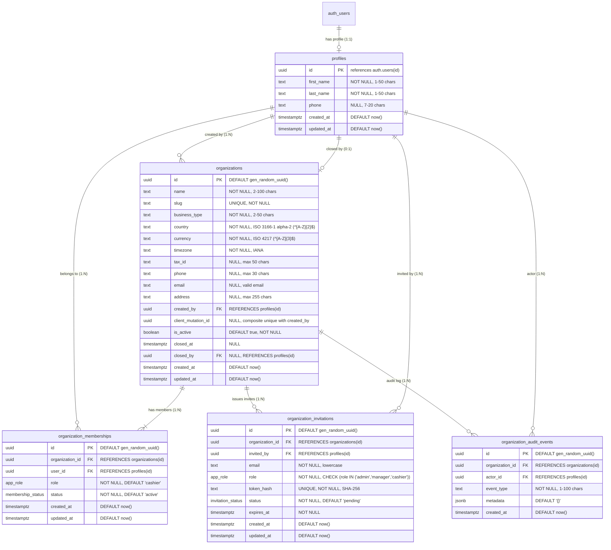

# Data Model: Authentication & Organization Foundation (Hardened Architecture)

**Feature**: `001-auth-organization`  
**Revision Date**: 2026-10-30  
**Status**: Final Authorization, Audit & Timestamp Revision (Pass 4)  

---

## 1. Entity-Relationship Overview



---

## 2. Enums and Custom Types

```sql
CREATE TYPE app_role AS ENUM ('owner', 'admin', 'manager', 'cashier');
CREATE TYPE membership_status AS ENUM ('active', 'suspended', 'revoked');
CREATE TYPE invitation_status AS ENUM ('pending', 'accepted', 'declined', 'revoked', 'expired');
```

---

## 3. Relational Schema & Table Definitions

### 3.1 `profiles`
Stores extended user profile information synchronized with Supabase `auth.users`.

```sql
CREATE TABLE public.profiles (
    id UUID PRIMARY KEY REFERENCES auth.users(id) ON DELETE CASCADE,
    first_name TEXT NOT NULL CHECK (char_length(trim(first_name)) BETWEEN 1 AND 50),
    last_name TEXT NOT NULL CHECK (char_length(trim(last_name)) BETWEEN 1 AND 50),
    phone TEXT CHECK (phone IS NULL OR char_length(trim(phone)) BETWEEN 7 AND 20),
    created_at TIMESTAMPTZ NOT NULL DEFAULT now(),
    updated_at TIMESTAMPTZ NOT NULL DEFAULT now()
);

CREATE INDEX idx_profiles_names ON public.profiles(first_name, last_name);
```

### 3.2 `organizations`
Represents an independent retail business tenant with bound creator idempotency and soft-closure tracking.

```sql
CREATE TABLE public.organizations (
    id UUID PRIMARY KEY DEFAULT gen_random_uuid(),
    name TEXT NOT NULL CHECK (char_length(trim(name)) BETWEEN 2 AND 100),
    slug TEXT NOT NULL UNIQUE CHECK (slug ~ '^[a-z0-9]+(?:-[a-z0-9]+)*$'),
    business_type TEXT NOT NULL CHECK (char_length(trim(business_type)) BETWEEN 2 AND 50),
    country TEXT NOT NULL CHECK (country ~ '^[A-Z]{2}$'), -- Strict ISO 3166-1 alpha-2
    currency TEXT NOT NULL CHECK (currency ~ '^[A-Z]{3}$'), -- Strict ISO 4217
    timezone TEXT NOT NULL DEFAULT 'UTC',
    tax_id TEXT CHECK (tax_id IS NULL OR char_length(trim(tax_id)) <= 50),
    phone TEXT CHECK (phone IS NULL OR char_length(trim(phone)) <= 30),
    email TEXT CHECK (email IS NULL OR email ~* '^[A-Za-z0-9._%+-]+@[A-Za-z0-9.-]+\.[A-Za-z]{2,}$'),
    address TEXT CHECK (address IS NULL OR char_length(trim(address)) <= 255),
    created_by UUID NOT NULL REFERENCES public.profiles(id) ON DELETE RESTRICT,
    client_mutation_id UUID,
    is_active BOOLEAN NOT NULL DEFAULT true,
    closed_at TIMESTAMPTZ,
    closed_by UUID REFERENCES public.profiles(id) ON DELETE RESTRICT,
    created_at TIMESTAMPTZ NOT NULL DEFAULT now(),
    updated_at TIMESTAMPTZ NOT NULL DEFAULT now(),
    
    -- Bound to creator: Prevents another user from claiming or discovering foreign organizations
    CONSTRAINT uq_org_creator_mutation UNIQUE (created_by, client_mutation_id)
);

CREATE INDEX idx_organizations_slug ON public.organizations(slug);
CREATE INDEX idx_organizations_is_active ON public.organizations(is_active);
CREATE INDEX idx_organizations_created_by ON public.organizations(created_by);
```

### 3.3 `organization_memberships`
Join entity linking users to organizations with assigned roles. All mutations strictly gated via stored procedures.

```sql
CREATE TABLE public.organization_memberships (
    id UUID PRIMARY KEY DEFAULT gen_random_uuid(),
    organization_id UUID NOT NULL REFERENCES public.organizations(id) ON DELETE CASCADE,
    user_id UUID NOT NULL REFERENCES public.profiles(id) ON DELETE CASCADE,
    role app_role NOT NULL DEFAULT 'cashier',
    status membership_status NOT NULL DEFAULT 'active',
    created_at TIMESTAMPTZ NOT NULL DEFAULT now(),
    updated_at TIMESTAMPTZ NOT NULL DEFAULT now(),
    
    CONSTRAINT uq_user_organization UNIQUE (user_id, organization_id)
);

CREATE INDEX idx_org_memberships_user ON public.organization_memberships(user_id) WHERE status = 'active';
CREATE INDEX idx_org_memberships_org ON public.organization_memberships(organization_id) WHERE status = 'active';
CREATE INDEX idx_org_memberships_role ON public.organization_memberships(organization_id, role);
```

### 3.4 `organization_invitations`
Stores pending team invites with SHA-256 hashed tokens and role restrictions.

```sql
CREATE TABLE public.organization_invitations (
    id UUID PRIMARY KEY DEFAULT gen_random_uuid(),
    organization_id UUID NOT NULL REFERENCES public.organizations(id) ON DELETE CASCADE,
    invited_by UUID NOT NULL REFERENCES public.profiles(id) ON DELETE RESTRICT,
    email TEXT NOT NULL CHECK (email ~* '^[A-Za-z0-9._%+-]+@[A-Za-z0-9.-]+\.[A-Za-z]{2,}$'),
    role app_role NOT NULL DEFAULT 'cashier' CHECK (role IN ('admin', 'manager', 'cashier')), -- Owner CANNOT be invited
    token_hash TEXT NOT NULL UNIQUE,
    status invitation_status NOT NULL DEFAULT 'pending',
    expires_at TIMESTAMPTZ NOT NULL DEFAULT (now() + INTERVAL '7 days'),
    created_at TIMESTAMPTZ NOT NULL DEFAULT now(),
    updated_at TIMESTAMPTZ NOT NULL DEFAULT now()
);

CREATE UNIQUE INDEX uq_pending_invitation ON public.organization_invitations(organization_id, lower(email)) WHERE status = 'pending';
CREATE INDEX idx_invitations_token_hash ON public.organization_invitations(token_hash) WHERE status = 'pending';
CREATE INDEX idx_invitations_org_email ON public.organization_invitations(organization_id, lower(email));
```

### 3.5 `organization_audit_events`
Immutable, append-only audit log for security-critical organization lifecycle events. All writes occur exclusively via `SECURITY DEFINER` RPCs; direct client mutations are denied.

```sql
CREATE TABLE public.organization_audit_events (
    id UUID PRIMARY KEY DEFAULT gen_random_uuid(),
    organization_id UUID NOT NULL REFERENCES public.organizations(id) ON DELETE CASCADE,
    actor_id UUID NOT NULL REFERENCES public.profiles(id) ON DELETE RESTRICT,
    event_type TEXT NOT NULL CHECK (char_length(trim(event_type)) BETWEEN 1 AND 100),
    metadata JSONB NOT NULL DEFAULT '{}'::jsonb,
    created_at TIMESTAMPTZ NOT NULL DEFAULT now()
);

CREATE INDEX idx_audit_events_org ON public.organization_audit_events(organization_id);
CREATE INDEX idx_audit_events_type ON public.organization_audit_events(organization_id, event_type);
CREATE INDEX idx_audit_events_actor ON public.organization_audit_events(actor_id);
```

**Defined Event Types** (extensible):
| Event Type | Trigger RPC | Metadata |
| :--- | :--- | :--- |
| `organization.closed` | `close_organization()` | `{ confirmation_name, closed_at }` |
| `ownership.transferred` | `transfer_organization_ownership()` | `{ previous_owner_id, new_owner_id }` |
| `member.removed` | `remove_member()` | `{ removed_user_id }` |
| `invitation.revoked` | `revoke_invitation()` | `{ invitation_id, email }` |
```

---

## 4. Helper Security Functions (Hardened Privileged Execution)

All helper functions run as `SECURITY DEFINER`, are explicitly owned by `postgres` (possessing the PostgreSQL `BYPASSRLS` attribute in Supabase), and enforce `SET search_path = pg_catalog, public, pg_temp;` to prevent schema shadowing attacks.

### 4.1 Non-Recursive Mechanics Explained
When `FORCE ROW LEVEL SECURITY` is enabled on `organization_memberships`, PostgreSQL applies RLS to standard users and table owners alike. However, PostgreSQL explicitly specifies:
> *"Superusers and roles with the `BYPASSRLS` attribute always bypass row security."*

In Supabase, `postgres` holds `BYPASSRLS`. By setting function ownership to `postgres`, `get_user_organization_ids()` executes under `postgres` and reads `organization_memberships` directly **without invoking RLS policies**, eliminating any possibility of recursive policy loops. Client roles (`authenticated`, `anon`) do NOT have `BYPASSRLS` and are strictly bound by RLS.

```sql
CREATE OR REPLACE FUNCTION public.is_email_verified()
RETURNS BOOLEAN
LANGUAGE sql
SECURITY DEFINER
STABLE
SET search_path = pg_catalog, auth, pg_temp
AS $$
    SELECT COALESCE(
        (SELECT email_confirmed_at IS NOT NULL FROM auth.users WHERE id = auth.uid()),
        false
    );
$$;

ALTER FUNCTION public.is_email_verified OWNER TO postgres;
REVOKE ALL ON FUNCTION public.is_email_verified FROM PUBLIC;
GRANT EXECUTE ON FUNCTION public.is_email_verified TO authenticated;

CREATE OR REPLACE FUNCTION public.get_user_organization_ids()
RETURNS SETOF UUID
LANGUAGE sql
SECURITY DEFINER
STABLE
SET search_path = pg_catalog, public, pg_temp
AS $$
    SELECT organization_id
    FROM public.organization_memberships
    WHERE user_id = auth.uid()
      AND status = 'active';
$$;

ALTER FUNCTION public.get_user_organization_ids OWNER TO postgres;
REVOKE ALL ON FUNCTION public.get_user_organization_ids FROM PUBLIC;
GRANT EXECUTE ON FUNCTION public.get_user_organization_ids TO authenticated;

CREATE OR REPLACE FUNCTION public.is_org_member(p_org_id UUID, p_roles app_role[] DEFAULT NULL)
RETURNS BOOLEAN
LANGUAGE sql
SECURITY DEFINER
STABLE
SET search_path = pg_catalog, public, pg_temp
AS $$
    SELECT EXISTS (
        SELECT 1
        FROM public.organization_memberships
        WHERE organization_id = p_org_id
          AND user_id = auth.uid()
          AND status = 'active'
          AND (p_roles IS NULL OR role = ANY(p_roles))
    );
$$;

ALTER FUNCTION public.is_org_member OWNER TO postgres;
REVOKE ALL ON FUNCTION public.is_org_member FROM PUBLIC;
GRANT EXECUTE ON FUNCTION public.is_org_member TO authenticated;
```

---

## 5. Row-Level Security (RLS) Policy Specifications

### RLS Activation (Universal `FORCE RLS`)
```sql
ALTER TABLE public.profiles ENABLE ROW LEVEL SECURITY;
ALTER TABLE public.profiles FORCE ROW LEVEL SECURITY;

ALTER TABLE public.organizations ENABLE ROW LEVEL SECURITY;
ALTER TABLE public.organizations FORCE ROW LEVEL SECURITY;

ALTER TABLE public.organization_memberships ENABLE ROW LEVEL SECURITY;
ALTER TABLE public.organization_memberships FORCE ROW LEVEL SECURITY;

ALTER TABLE public.organization_invitations ENABLE ROW LEVEL SECURITY;
ALTER TABLE public.organization_invitations FORCE ROW LEVEL SECURITY;

ALTER TABLE public.organization_audit_events ENABLE ROW LEVEL SECURITY;
ALTER TABLE public.organization_audit_events FORCE ROW LEVEL SECURITY;
```

### 5.1 Policies on `profiles`

```sql
CREATE POLICY "profiles_select_own"
    ON public.profiles FOR SELECT
    TO authenticated
    USING (auth.uid() = id);

CREATE POLICY "profiles_select_peers"
    ON public.profiles FOR SELECT
    TO authenticated
    USING (
        id IN (
            SELECT om.user_id
            FROM public.organization_memberships om
            WHERE om.organization_id IN (SELECT public.get_user_organization_ids())
              AND om.status = 'active'
        )
    );

CREATE POLICY "profiles_update_own"
    ON public.profiles FOR UPDATE
    TO authenticated
    USING (auth.uid() = id)
    WITH CHECK (auth.uid() = id);

CREATE POLICY "profiles_insert_deny"
    ON public.profiles FOR INSERT
    TO authenticated
    WITH CHECK (false);

CREATE POLICY "profiles_delete_deny"
    ON public.profiles FOR DELETE
    TO authenticated
    USING (false);
```

### 5.2 Policies on `organizations`

```sql
CREATE POLICY "organizations_select_member"
    ON public.organizations FOR SELECT
    TO authenticated
    USING (id IN (SELECT public.get_user_organization_ids()));

-- Admins and Owners can update organization metadata, but CANNOT modify is_active directly
CREATE POLICY "organizations_update_admin"
    ON public.organizations FOR UPDATE
    TO authenticated
    USING (public.is_org_member(id, ARRAY['owner', 'admin']::app_role[]))
    WITH CHECK (
        public.is_org_member(id, ARRAY['owner', 'admin']::app_role[])
        AND is_active = (SELECT o.is_active FROM public.organizations o WHERE o.id = organizations.id)
    );

CREATE POLICY "organizations_insert_deny"
    ON public.organizations FOR INSERT
    TO authenticated
    WITH CHECK (false);

CREATE POLICY "organizations_delete_deny"
    ON public.organizations FOR DELETE
    TO authenticated
    USING (false);
```

### 5.3 Policies on `organization_memberships` (Direct Client Mutations DENIED)

Direct client `INSERT`, `UPDATE`, and `DELETE` queries are completely denied. All membership state transitions MUST occur via authenticated, locked database RPCs.

```sql
CREATE POLICY "memberships_select_own"
    ON public.organization_memberships FOR SELECT
    TO authenticated
    USING (user_id = (SELECT auth.uid()));

CREATE POLICY "memberships_select_peers"
    ON public.organization_memberships FOR SELECT
    TO authenticated
    USING (organization_id IN (SELECT public.get_user_organization_ids()));

-- Direct client updates strictly DENIED; use transfer_organization_ownership(), update_member_role(), or update_member_status()
CREATE POLICY "memberships_update_deny_direct"
    ON public.organization_memberships FOR UPDATE
    TO authenticated
    USING (false);

-- Direct client inserts strictly DENIED; use create_organization_with_owner() or accept_organization_invitation()
CREATE POLICY "memberships_insert_deny_direct"
    ON public.organization_memberships FOR INSERT
    TO authenticated
    WITH CHECK (false);

-- Direct client deletes strictly DENIED; use remove_member()
CREATE POLICY "memberships_delete_deny_direct"
    ON public.organization_memberships FOR DELETE
    TO authenticated
    USING (false);
```

### 5.4 Policies on `organization_invitations`

```sql
CREATE POLICY "invitations_select_admin"
    ON public.organization_invitations FOR SELECT
    TO authenticated
    USING (public.is_org_member(organization_id, ARRAY['owner', 'admin']::app_role[]));

CREATE POLICY "invitations_insert_admin"
    ON public.organization_invitations FOR INSERT
    TO authenticated
    WITH CHECK (
        public.is_org_member(organization_id, ARRAY['owner', 'admin']::app_role[])
        AND invited_by = auth.uid()
        AND role IN ('admin', 'manager', 'cashier')
    );

-- Direct client updates strictly DENIED; use revoke_invitation() RPC
CREATE POLICY "invitations_update_deny_direct"
    ON public.organization_invitations FOR UPDATE
    TO authenticated
    USING (false);

CREATE POLICY "invitations_delete_deny"
    ON public.organization_invitations FOR DELETE
    TO authenticated
    USING (false);
```

### 5.5 Policies on `organization_audit_events` (Immutable Client-Side)

Owners and Admins can read audit logs for their organization. All write operations are denied for clients; audit entries are created exclusively by `SECURITY DEFINER` RPCs.

```sql
CREATE POLICY "audit_events_select_admin"
    ON public.organization_audit_events FOR SELECT
    TO authenticated
    USING (public.is_org_member(organization_id, ARRAY['owner', 'admin']::app_role[]));

CREATE POLICY "audit_events_insert_deny"
    ON public.organization_audit_events FOR INSERT
    TO authenticated
    WITH CHECK (false);

CREATE POLICY "audit_events_update_deny"
    ON public.organization_audit_events FOR UPDATE
    TO authenticated
    USING (false);

CREATE POLICY "audit_events_delete_deny"
    ON public.organization_audit_events FOR DELETE
    TO authenticated
    USING (false);
```

---

## 6. Business Integrity Triggers & Controlled Database RPCs

### 6.1 Consistent Lock Order Protocol
To prevent database deadlocks and concurrency race conditions, all membership-affecting RPCs adhere to a strict, uniform lock acquisition hierarchy:
1. **Lock Organization**: `SELECT 1 FROM public.organizations WHERE id = p_org_id FOR UPDATE;`
2. **Lock Membership(s)**: `SELECT * FROM public.organization_memberships WHERE organization_id = p_org_id AND user_id = ... FOR UPDATE;`

### 6.2 Owner Invariant Trigger (Final Defensive Integrity Safeguard)

```sql
CREATE OR REPLACE FUNCTION public.check_owner_invariant()
RETURNS TRIGGER
LANGUAGE plpgsql
SECURITY DEFINER
SET search_path = pg_catalog, public, pg_temp
AS $$
DECLARE
    v_org_id UUID := COALESCE(NEW.organization_id, OLD.organization_id);
    v_owner_count INT;
BEGIN
    IF (TG_OP = 'DELETE' AND OLD.role = 'owner') OR
       (TG_OP = 'UPDATE' AND OLD.role = 'owner' AND (NEW.role != 'owner' OR NEW.status != 'active')) THEN
        
        -- Acquire organization lock to serialize with concurrent demotions
        PERFORM 1 FROM public.organizations WHERE id = v_org_id FOR UPDATE;

        SELECT COUNT(*) INTO v_owner_count
        FROM public.organization_memberships
        WHERE organization_id = v_org_id
          AND role = 'owner'
          AND status = 'active'
          AND id != OLD.id;
          
        IF v_owner_count < 1 THEN
            RAISE EXCEPTION 'Cannot remove or demote the last active owner of an organization. Transfer ownership first.'
                USING ERRCODE = 'P0002';
        END IF;
    END IF;

    IF TG_OP = 'DELETE' THEN
        RETURN OLD;
    ELSE
        RETURN NEW;
    END IF;
END;
$$;

ALTER FUNCTION public.check_owner_invariant OWNER TO postgres;

CREATE TRIGGER trg_check_owner_invariant
    BEFORE UPDATE OR DELETE ON public.organization_memberships
    FOR EACH ROW EXECUTE FUNCTION public.check_owner_invariant();
```

### 6.3 Secure Idempotent Organization Creation

```sql
CREATE OR REPLACE FUNCTION public.create_organization_with_owner(
    p_name TEXT,
    p_slug TEXT,
    p_business_type TEXT,
    p_country TEXT,
    p_currency TEXT,
    p_timezone TEXT,
    p_client_mutation_id UUID DEFAULT NULL,
    p_tax_id TEXT DEFAULT NULL,
    p_phone TEXT DEFAULT NULL,
    p_email TEXT DEFAULT NULL,
    p_address TEXT DEFAULT NULL
)
RETURNS JSONB
LANGUAGE plpgsql
SECURITY DEFINER
SET search_path = pg_catalog, public, pg_temp
AS $$
DECLARE
    v_user_id UUID := auth.uid();
    v_org_id UUID;
    v_existing_org RECORD;
    v_caller_role app_role;
BEGIN
    IF v_user_id IS NULL THEN
        RAISE EXCEPTION 'Authentication required' USING ERRCODE = 'P0003';
    END IF;

    IF NOT public.is_email_verified() THEN
        RAISE EXCEPTION 'Email verification required before creating an organization' USING ERRCODE = 'P0001';
    END IF;

    -- Secure Idempotency: Bound strictly to the authenticated creator
    IF p_client_mutation_id IS NOT NULL THEN
        SELECT id, name, slug, is_active INTO v_existing_org
        FROM public.organizations
        WHERE client_mutation_id = p_client_mutation_id
          AND created_by = v_user_id;

        IF FOUND THEN
            -- Query caller's actual role dynamically (never hardcode)
            SELECT role INTO v_caller_role
            FROM public.organization_memberships
            WHERE organization_id = v_existing_org.id
              AND user_id = v_user_id
              AND status = 'active';

            RETURN jsonb_build_object(
                'organization_id', v_existing_org.id,
                'name', v_existing_org.name,
                'slug', v_existing_org.slug,
                'role', v_caller_role,
                'is_active', v_existing_org.is_active,
                'is_idempotent_replay', true
            );
        END IF;
    END IF;

    -- Create Organization
    INSERT INTO public.organizations (
        name, slug, business_type, country, currency, timezone, tax_id, phone, email, address, created_by, client_mutation_id
    ) VALUES (
        p_name, p_slug, p_business_type, p_country, p_currency, p_timezone, p_tax_id, p_phone, p_email, p_address, v_user_id, p_client_mutation_id
    )
    RETURNING id INTO v_org_id;

    -- Assign Creator as Owner
    INSERT INTO public.organization_memberships (
        organization_id, user_id, role, status
    ) VALUES (
        v_org_id, v_user_id, 'owner', 'active'
    );

    RETURN jsonb_build_object(
        'organization_id', v_org_id,
        'name', p_name,
        'slug', p_slug,
        'role', 'owner',
        'is_active', true,
        'is_idempotent_replay', false
    );
END;
$$;

ALTER FUNCTION public.create_organization_with_owner OWNER TO postgres;
REVOKE ALL ON FUNCTION public.create_organization_with_owner FROM PUBLIC;
GRANT EXECUTE ON FUNCTION public.create_organization_with_owner TO authenticated;
```

### 6.4 Atomic Ownership Transfer RPC

```sql
CREATE OR REPLACE FUNCTION public.transfer_organization_ownership(
    p_org_id UUID,
    p_new_owner_user_id UUID
)
RETURNS JSONB
LANGUAGE plpgsql
SECURITY DEFINER
SET search_path = pg_catalog, public, pg_temp
AS $$
DECLARE
    v_caller_id UUID := auth.uid();
    v_org RECORD;
    v_target_membership RECORD;
BEGIN
    -- 1. Authenticate
    IF v_caller_id IS NULL THEN
        RAISE EXCEPTION 'Authentication required' USING ERRCODE = 'P0003';
    END IF;

    -- 2. Verify email confirmation
    IF NOT public.is_email_verified() THEN
        RAISE EXCEPTION 'Email verification required' USING ERRCODE = 'P0001';
    END IF;

    -- 3. UNIFORM LOCK ORDER: Lock and validate organization
    SELECT * INTO v_org
    FROM public.organizations
    WHERE id = p_org_id
    FOR UPDATE;

    IF NOT FOUND THEN
        RAISE EXCEPTION 'Organization not found' USING ERRCODE = 'P0013';
    END IF;

    IF NOT v_org.is_active THEN
        RAISE EXCEPTION 'Cannot modify a closed organization' USING ERRCODE = 'P0015';
    END IF;

    -- 4. Lock caller membership and verify caller is active Owner
    IF NOT EXISTS (
        SELECT 1 FROM public.organization_memberships
        WHERE organization_id = p_org_id
          AND user_id = v_caller_id
          AND role = 'owner'
          AND status = 'active'
        FOR UPDATE
    ) THEN
        RAISE EXCEPTION 'Only the current active organization owner can transfer ownership' USING ERRCODE = 'P0004';
    END IF;

    -- 5. Handle same-user no-op AFTER full authorization
    IF v_caller_id = p_new_owner_user_id THEN
        RETURN jsonb_build_object('organization_id', p_org_id, 'new_owner_id', p_new_owner_user_id, 'status', 'no_change_same_user');
    END IF;

    -- 6. Lock target membership and verify active status
    SELECT * INTO v_target_membership
    FROM public.organization_memberships
    WHERE organization_id = p_org_id
      AND user_id = p_new_owner_user_id
    FOR UPDATE;

    IF NOT FOUND OR v_target_membership.status != 'active' THEN
        RAISE EXCEPTION 'Target user must be an active member of the organization' USING ERRCODE = 'P0005';
    END IF;

    -- 7. PROMOTE TARGET FIRST (count becomes 2)
    UPDATE public.organization_memberships
    SET role = 'owner', updated_at = now()
    WHERE organization_id = p_org_id AND user_id = p_new_owner_user_id;

    -- 8. DEMOTE CALLER SECOND (count returns to 1; invariant passes)
    UPDATE public.organization_memberships
    SET role = 'admin', updated_at = now()
    WHERE organization_id = p_org_id AND user_id = v_caller_id;

    -- 9. Audit event
    INSERT INTO public.organization_audit_events (organization_id, actor_id, event_type, metadata)
    VALUES (p_org_id, v_caller_id, 'ownership.transferred',
        jsonb_build_object('previous_owner_id', v_caller_id, 'new_owner_id', p_new_owner_user_id));

    RETURN jsonb_build_object('organization_id', p_org_id, 'new_owner_id', p_new_owner_user_id, 'status', 'transferred');
END;
$$;

ALTER FUNCTION public.transfer_organization_ownership OWNER TO postgres;
REVOKE ALL ON FUNCTION public.transfer_organization_ownership FROM PUBLIC;
GRANT EXECUTE ON FUNCTION public.transfer_organization_ownership TO authenticated;
```

### 6.5 Controlled Membership Role & Status RPCs

```sql
-- Role updates: Owners can update anyone. Admins can update managers and cashiers (cannot touch owner or assign owner).
CREATE OR REPLACE FUNCTION public.update_member_role(
    p_org_id UUID,
    p_target_user_id UUID,
    p_new_role app_role
)
RETURNS JSONB
LANGUAGE plpgsql
SECURITY DEFINER
SET search_path = pg_catalog, public, pg_temp
AS $$
DECLARE
    v_caller_id UUID := auth.uid();
    v_caller_role app_role;
    v_target_role app_role;
    v_org RECORD;
BEGIN
    -- 1. Authenticate
    IF v_caller_id IS NULL THEN
        RAISE EXCEPTION 'Authentication required' USING ERRCODE = 'P0003';
    END IF;

    -- 2. Verify email confirmation
    IF NOT public.is_email_verified() THEN
        RAISE EXCEPTION 'Email verification required' USING ERRCODE = 'P0001';
    END IF;

    -- 3. Parameter validation
    IF p_new_role = 'owner' THEN
        RAISE EXCEPTION 'Cannot assign owner role via update_member_role. Use transfer_organization_ownership.' USING ERRCODE = 'P0010';
    END IF;

    -- 4. UNIFORM LOCK ORDER: Lock and validate organization
    SELECT * INTO v_org FROM public.organizations WHERE id = p_org_id FOR UPDATE;

    IF NOT FOUND THEN
        RAISE EXCEPTION 'Organization not found' USING ERRCODE = 'P0013';
    END IF;

    IF NOT v_org.is_active THEN
        RAISE EXCEPTION 'Cannot modify a closed organization' USING ERRCODE = 'P0015';
    END IF;

    -- 5. Verify caller role
    SELECT role INTO v_caller_role
    FROM public.organization_memberships
    WHERE organization_id = p_org_id AND user_id = v_caller_id AND status = 'active'
    FOR UPDATE;

    IF v_caller_role IS NULL OR v_caller_role NOT IN ('owner', 'admin') THEN
        RAISE EXCEPTION 'Administrative permissions required' USING ERRCODE = 'P0004';
    END IF;

    -- 6. Lock target membership
    SELECT role INTO v_target_role
    FROM public.organization_memberships
    WHERE organization_id = p_org_id AND user_id = p_target_user_id AND status = 'active'
    FOR UPDATE;

    IF v_target_role IS NULL THEN
        RAISE EXCEPTION 'Target member not found or inactive' USING ERRCODE = 'P0005';
    END IF;

    IF v_target_role = 'owner' THEN
        RAISE EXCEPTION 'Cannot alter role of organization owner' USING ERRCODE = 'P0011';
    END IF;

    IF v_caller_role = 'admin' AND (v_target_role = 'admin' OR p_new_role = 'admin') THEN
        RAISE EXCEPTION 'Admins cannot modify peer admins or promote members to admin' USING ERRCODE = 'P0012';
    END IF;

    -- 7. Apply role change
    UPDATE public.organization_memberships
    SET role = p_new_role, updated_at = now()
    WHERE organization_id = p_org_id AND user_id = p_target_user_id;

    RETURN jsonb_build_object('organization_id', p_org_id, 'user_id', p_target_user_id, 'new_role', p_new_role);
END;
$$;

ALTER FUNCTION public.update_member_role OWNER TO postgres;
REVOKE ALL ON FUNCTION public.update_member_role FROM PUBLIC;
GRANT EXECUTE ON FUNCTION public.update_member_role TO authenticated;

-- Status updates (Suspension / Revocation)
CREATE OR REPLACE FUNCTION public.update_member_status(
    p_org_id UUID,
    p_target_user_id UUID,
    p_new_status membership_status
)
RETURNS JSONB
LANGUAGE plpgsql
SECURITY DEFINER
SET search_path = pg_catalog, public, pg_temp
AS $$
DECLARE
    v_caller_id UUID := auth.uid();
    v_caller_role app_role;
    v_target_role app_role;
    v_org RECORD;
BEGIN
    -- 1. Authenticate
    IF v_caller_id IS NULL THEN
        RAISE EXCEPTION 'Authentication required' USING ERRCODE = 'P0003';
    END IF;

    -- 2. Verify email confirmation
    IF NOT public.is_email_verified() THEN
        RAISE EXCEPTION 'Email verification required' USING ERRCODE = 'P0001';
    END IF;

    -- 3. UNIFORM LOCK ORDER: Lock and validate organization
    SELECT * INTO v_org FROM public.organizations WHERE id = p_org_id FOR UPDATE;

    IF NOT FOUND THEN
        RAISE EXCEPTION 'Organization not found' USING ERRCODE = 'P0013';
    END IF;

    IF NOT v_org.is_active THEN
        RAISE EXCEPTION 'Cannot modify a closed organization' USING ERRCODE = 'P0015';
    END IF;

    -- 4. Verify caller role
    SELECT role INTO v_caller_role
    FROM public.organization_memberships
    WHERE organization_id = p_org_id AND user_id = v_caller_id AND status = 'active'
    FOR UPDATE;

    IF v_caller_role IS NULL OR v_caller_role NOT IN ('owner', 'admin') THEN
        RAISE EXCEPTION 'Administrative permissions required' USING ERRCODE = 'P0004';
    END IF;

    -- 5. Lock target membership
    SELECT role INTO v_target_role
    FROM public.organization_memberships
    WHERE organization_id = p_org_id AND user_id = p_target_user_id
    FOR UPDATE;

    IF v_target_role IS NULL THEN
        RAISE EXCEPTION 'Target member not found' USING ERRCODE = 'P0005';
    END IF;

    IF v_target_role = 'owner' THEN
        RAISE EXCEPTION 'Cannot suspend or revoke organization owner' USING ERRCODE = 'P0011';
    END IF;

    IF v_caller_role = 'admin' AND v_target_role = 'admin' THEN
        RAISE EXCEPTION 'Admins cannot suspend or revoke peer admins' USING ERRCODE = 'P0012';
    END IF;

    -- 6. Apply status change
    UPDATE public.organization_memberships
    SET status = p_new_status, updated_at = now()
    WHERE organization_id = p_org_id AND user_id = p_target_user_id;

    RETURN jsonb_build_object('organization_id', p_org_id, 'user_id', p_target_user_id, 'new_status', p_new_status);
END;
$$;

ALTER FUNCTION public.update_member_status OWNER TO postgres;
REVOKE ALL ON FUNCTION public.update_member_status FROM PUBLIC;
GRANT EXECUTE ON FUNCTION public.update_member_status TO authenticated;

-- Member Removal RPC
CREATE OR REPLACE FUNCTION public.remove_member(
    p_org_id UUID,
    p_target_user_id UUID
)
RETURNS JSONB
LANGUAGE plpgsql
SECURITY DEFINER
SET search_path = pg_catalog, public, pg_temp
AS $$
DECLARE
    v_caller_id UUID := auth.uid();
    v_target_role app_role;
    v_org RECORD;
BEGIN
    -- 1. Authenticate
    IF v_caller_id IS NULL THEN
        RAISE EXCEPTION 'Authentication required' USING ERRCODE = 'P0003';
    END IF;

    -- 2. Verify email confirmation
    IF NOT public.is_email_verified() THEN
        RAISE EXCEPTION 'Email verification required' USING ERRCODE = 'P0001';
    END IF;

    -- 3. UNIFORM LOCK ORDER: Lock and validate organization
    SELECT * INTO v_org FROM public.organizations WHERE id = p_org_id FOR UPDATE;

    IF NOT FOUND THEN
        RAISE EXCEPTION 'Organization not found' USING ERRCODE = 'P0013';
    END IF;

    IF NOT v_org.is_active THEN
        RAISE EXCEPTION 'Cannot modify a closed organization' USING ERRCODE = 'P0015';
    END IF;

    -- 4. Verify caller is active Owner
    IF NOT public.is_org_member(p_org_id, ARRAY['owner']::app_role[]) THEN
        RAISE EXCEPTION 'Only organization owner can permanently remove members' USING ERRCODE = 'P0004';
    END IF;

    -- 5. Owner cannot remove themselves
    IF v_caller_id = p_target_user_id THEN
        RAISE EXCEPTION 'Owner cannot remove themselves. Transfer ownership first.' USING ERRCODE = 'P0002';
    END IF;

    -- 6. Lock target and verify they are NOT an Owner
    SELECT role INTO v_target_role
    FROM public.organization_memberships
    WHERE organization_id = p_org_id AND user_id = p_target_user_id
    FOR UPDATE;

    IF v_target_role IS NULL THEN
        RAISE EXCEPTION 'Target member not found' USING ERRCODE = 'P0005';
    END IF;

    IF v_target_role = 'owner' THEN
        RAISE EXCEPTION 'Cannot remove an Owner. Use transfer_organization_ownership() to change ownership first.' USING ERRCODE = 'P0011';
    END IF;

    -- 7. Execute removal
    DELETE FROM public.organization_memberships
    WHERE organization_id = p_org_id AND user_id = p_target_user_id;

    -- 8. Audit event
    INSERT INTO public.organization_audit_events (organization_id, actor_id, event_type, metadata)
    VALUES (p_org_id, v_caller_id, 'member.removed',
        jsonb_build_object('removed_user_id', p_target_user_id));

    RETURN jsonb_build_object('organization_id', p_org_id, 'user_id', p_target_user_id, 'status', 'removed');
END;
$$;

ALTER FUNCTION public.remove_member OWNER TO postgres;
REVOKE ALL ON FUNCTION public.remove_member FROM PUBLIC;
GRANT EXECUTE ON FUNCTION public.remove_member TO authenticated;
```

### 6.6 Owner-Only Organization Closure RPC

```sql
CREATE OR REPLACE FUNCTION public.close_organization(
    p_org_id UUID,
    p_confirmation_name TEXT
)
RETURNS JSONB
LANGUAGE plpgsql
SECURITY DEFINER
SET search_path = pg_catalog, public, pg_temp
AS $$
DECLARE
    v_caller_id UUID := auth.uid();
    v_org RECORD;
BEGIN
    -- 1. Authenticate
    IF v_caller_id IS NULL THEN
        RAISE EXCEPTION 'Authentication required' USING ERRCODE = 'P0003';
    END IF;

    -- 2. Verify email confirmation
    IF NOT public.is_email_verified() THEN
        RAISE EXCEPTION 'Email verification required' USING ERRCODE = 'P0001';
    END IF;

    -- 3. UNIFORM LOCK: Lock organization
    SELECT * INTO v_org
    FROM public.organizations
    WHERE id = p_org_id
    FOR UPDATE;

    IF NOT FOUND THEN
        RAISE EXCEPTION 'Organization not found' USING ERRCODE = 'P0013';
    END IF;

    IF NOT v_org.is_active THEN
        RAISE EXCEPTION 'Organization is already closed' USING ERRCODE = 'P0015';
    END IF;

    -- 4. Verify Caller is active Owner
    IF NOT public.is_org_member(p_org_id, ARRAY['owner']::app_role[]) THEN
        RAISE EXCEPTION 'Only verified organization owners can close an organization' USING ERRCODE = 'P0004';
    END IF;

    -- 5. Verify exact name confirmation
    IF trim(p_confirmation_name) != trim(v_org.name) THEN
        RAISE EXCEPTION 'Confirmation store name does not match' USING ERRCODE = 'P0014';
    END IF;

    -- 6. Execute Soft Closure
    UPDATE public.organizations
    SET is_active = false,
        closed_at = now(),
        closed_by = v_caller_id,
        updated_at = now()
    WHERE id = p_org_id;

    -- 7. Revoke all pending invitations
    UPDATE public.organization_invitations
    SET status = 'revoked', updated_at = now()
    WHERE organization_id = p_org_id AND status = 'pending';

    -- 8. Audit event
    INSERT INTO public.organization_audit_events (organization_id, actor_id, event_type, metadata)
    VALUES (p_org_id, v_caller_id, 'organization.closed',
        jsonb_build_object('confirmation_name', trim(p_confirmation_name), 'closed_at', now()));

    RETURN jsonb_build_object(
        'organization_id', p_org_id,
        'status', 'closed',
        'closed_at', now()
    );
END;
$$;

ALTER FUNCTION public.close_organization OWNER TO postgres;
REVOKE ALL ON FUNCTION public.close_organization FROM PUBLIC;
GRANT EXECUTE ON FUNCTION public.close_organization TO authenticated;
```

### 6.7 Corrected Invitation Acceptance RPC (Strict Status-Before-Expiry Logic)

```sql
CREATE OR REPLACE FUNCTION public.accept_organization_invitation(
    p_token_hash TEXT
)
RETURNS JSONB
LANGUAGE plpgsql
SECURITY DEFINER
SET search_path = pg_catalog, public, pg_temp
AS $$
DECLARE
    v_user_id UUID := auth.uid();
    v_user_email TEXT;
    v_invite RECORD;
    v_existing_membership RECORD;
    v_org RECORD;
BEGIN
    IF v_user_id IS NULL THEN
        RETURN jsonb_build_object('success', false, 'code', 'UNAUTHORIZED', 'message', 'Authentication required.');
    END IF;

    IF NOT public.is_email_verified() THEN
        RETURN jsonb_build_object('success', false, 'code', 'EMAIL_NOT_VERIFIED', 'message', 'Email verification required.');
    END IF;

    SELECT lower(email) INTO v_user_email FROM auth.users WHERE id = v_user_id;

    -- 1. Lock Invitation
    SELECT * INTO v_invite
    FROM public.organization_invitations
    WHERE token_hash = p_token_hash
    FOR UPDATE;

    IF NOT FOUND THEN
        RETURN jsonb_build_object('success', false, 'code', 'INVITATION_NOT_FOUND', 'message', 'Invalid invitation token.');
    END IF;

    -- 2. Check Existing Status FIRST
    IF v_invite.status = 'accepted' THEN
        RETURN jsonb_build_object('success', false, 'code', 'ALREADY_ACCEPTED', 'message', 'This invitation has already been accepted.');
    ELSIF v_invite.status = 'revoked' THEN
        RETURN jsonb_build_object('success', false, 'code', 'INVITATION_REVOKED', 'message', 'This invitation has been revoked by management.');
    ELSIF v_invite.status = 'declined' THEN
        RETURN jsonb_build_object('success', false, 'code', 'INVITATION_DECLINED', 'message', 'This invitation was previously declined.');
    ELSIF v_invite.status = 'expired' THEN
        RETURN jsonb_build_object('success', false, 'code', 'ALREADY_EXPIRED', 'message', 'This invitation has expired.');
    END IF;

    -- 3. ONLY IF PENDING: Evaluate Expiration with Persistent Commit
    IF v_invite.expires_at <= now() THEN
        UPDATE public.organization_invitations SET status = 'expired', updated_at = now() WHERE id = v_invite.id;
        RETURN jsonb_build_object('success', false, 'code', 'INVITATION_EXPIRED', 'message', 'This invitation has expired.');
    END IF;

    -- 4. Verify Email Match
    IF v_user_email != lower(v_invite.email) THEN
        RETURN jsonb_build_object(
            'success', false,
            'code', 'EMAIL_MISMATCH',
            'message', 'This invitation was sent to ' || v_invite.email || ' but you are signed in as ' || v_user_email
        );
    END IF;

    -- 5. UNIFORM LOCK ORDER: Lock organization and verify active
    SELECT * INTO v_org
    FROM public.organizations
    WHERE id = v_invite.organization_id
    FOR UPDATE;

    IF NOT FOUND OR NOT v_org.is_active THEN
        RETURN jsonb_build_object('success', false, 'code', 'ORGANIZATION_CLOSED', 'message', 'This organization is no longer active.');
    END IF;

    -- 6. Inspect existing membership
    SELECT * INTO v_existing_membership
    FROM public.organization_memberships
    WHERE organization_id = v_invite.organization_id AND user_id = v_user_id
    FOR UPDATE;

    IF FOUND THEN
        IF v_existing_membership.status = 'active' THEN
            RETURN jsonb_build_object('success', false, 'code', 'ALREADY_ACTIVE_MEMBER', 'message', 'You are already an active member of this organization. Role was not modified.');
        ELSIF v_existing_membership.status = 'suspended' THEN
            RETURN jsonb_build_object('success', false, 'code', 'ACCOUNT_SUSPENDED', 'message', 'Your account in this organization is suspended. Please contact the store owner.');
        ELSIF v_existing_membership.status = 'revoked' THEN
            UPDATE public.organization_memberships
            SET role = v_invite.role, status = 'active', updated_at = now()
            WHERE id = v_existing_membership.id;
        END IF;
    ELSE
        INSERT INTO public.organization_memberships (
            organization_id, user_id, role, status
        ) VALUES (
            v_invite.organization_id, v_user_id, v_invite.role, 'active'
        );
    END IF;

    -- 7. Mark Invitation Accepted
    UPDATE public.organization_invitations
    SET status = 'accepted', updated_at = now()
    WHERE id = v_invite.id;

    -- v_org already fetched and locked in step 5
    RETURN jsonb_build_object(
        'success', true,
        'organization_id', v_org.id,
        'name', v_org.name,
        'slug', v_org.slug,
        'role', v_invite.role
    );
END;
$$;

ALTER FUNCTION public.accept_organization_invitation OWNER TO postgres;
REVOKE ALL ON FUNCTION public.accept_organization_invitation FROM PUBLIC;
GRANT EXECUTE ON FUNCTION public.accept_organization_invitation TO authenticated;
```

### 6.8 User Profile Sync Trigger (`auth.users` → `profiles`)

```sql
CREATE OR REPLACE FUNCTION public.handle_new_user()
RETURNS TRIGGER
LANGUAGE plpgsql
SECURITY DEFINER
SET search_path = pg_catalog, public, pg_temp
AS $$
BEGIN
    INSERT INTO public.profiles (id, first_name, last_name, phone)
    VALUES (
        NEW.id,
        COALESCE(NULLIF(trim(NEW.raw_user_meta_data->>'first_name'), ''), 'Retail'),
        COALESCE(NULLIF(trim(NEW.raw_user_meta_data->>'last_name'), ''), 'User'),
        NULLIF(trim(NEW.raw_user_meta_data->>'phone'), '')
    )
    ON CONFLICT (id) DO NOTHING;
    RETURN NEW;
END;
$$;

ALTER FUNCTION public.handle_new_user OWNER TO postgres;

DROP TRIGGER IF EXISTS on_auth_user_created ON auth.users;
CREATE TRIGGER on_auth_user_created
    AFTER INSERT ON auth.users
    FOR EACH ROW EXECUTE FUNCTION public.handle_new_user();
```

### 6.9 Invitation Revocation RPC

Direct client `UPDATE` on `organization_invitations` is denied by RLS. Invitation revocation MUST use this dedicated RPC.

```sql
CREATE OR REPLACE FUNCTION public.revoke_invitation(
    p_invitation_id UUID
)
RETURNS JSONB
LANGUAGE plpgsql
SECURITY DEFINER
SET search_path = pg_catalog, public, pg_temp
AS $$
DECLARE
    v_caller_id UUID := auth.uid();
    v_invite RECORD;
    v_org RECORD;
BEGIN
    -- 1. Authenticate
    IF v_caller_id IS NULL THEN
        RAISE EXCEPTION 'Authentication required' USING ERRCODE = 'P0003';
    END IF;

    -- 2. Verify email confirmation
    IF NOT public.is_email_verified() THEN
        RAISE EXCEPTION 'Email verification required' USING ERRCODE = 'P0001';
    END IF;

    -- 3. Lock invitation
    SELECT * INTO v_invite
    FROM public.organization_invitations
    WHERE id = p_invitation_id
    FOR UPDATE;

    IF NOT FOUND THEN
        RAISE EXCEPTION 'Invitation not found' USING ERRCODE = 'P0013';
    END IF;

    -- 4. UNIFORM LOCK ORDER: Lock and validate organization
    SELECT * INTO v_org
    FROM public.organizations
    WHERE id = v_invite.organization_id
    FOR UPDATE;

    IF NOT FOUND OR NOT v_org.is_active THEN
        RAISE EXCEPTION 'Organization not found or inactive' USING ERRCODE = 'P0015';
    END IF;

    -- 5. Verify caller is Owner or Admin
    IF NOT public.is_org_member(v_invite.organization_id, ARRAY['owner', 'admin']::app_role[]) THEN
        RAISE EXCEPTION 'Only organization owners or admins can revoke invitations' USING ERRCODE = 'P0004';
    END IF;

    -- 6. Validate invitation is in revocable state
    IF v_invite.status != 'pending' THEN
        RAISE EXCEPTION 'Only pending invitations can be revoked. Current status: %', v_invite.status USING ERRCODE = 'P0016';
    END IF;

    -- 7. Revoke
    UPDATE public.organization_invitations
    SET status = 'revoked', updated_at = now()
    WHERE id = p_invitation_id;

    -- 8. Audit event
    INSERT INTO public.organization_audit_events (organization_id, actor_id, event_type, metadata)
    VALUES (v_invite.organization_id, v_caller_id, 'invitation.revoked',
        jsonb_build_object('invitation_id', p_invitation_id, 'email', v_invite.email));

    RETURN jsonb_build_object(
        'invitation_id', p_invitation_id,
        'organization_id', v_invite.organization_id,
        'email', v_invite.email,
        'status', 'revoked'
    );
END;
$$;

ALTER FUNCTION public.revoke_invitation OWNER TO postgres;
REVOKE ALL ON FUNCTION public.revoke_invitation FROM PUBLIC;
GRANT EXECUTE ON FUNCTION public.revoke_invitation TO authenticated;
```

---

## 7. Timestamp Convention Rationale

All `TIMESTAMPTZ` column defaults use `now()` rather than `timezone('utc'::text, now())`.

**Rationale**: PostgreSQL stores `TIMESTAMPTZ` values internally as UTC microseconds since the Unix epoch, regardless of the session `timezone` setting. The expression `timezone('utc'::text, now())` returns a `TIMESTAMP WITHOUT TIME ZONE` value, which PostgreSQL then re-interprets according to the session timezone when stored in a `TIMESTAMPTZ` column — potentially introducing conversion errors if the session timezone is not UTC. Using `now()` directly produces a `TIMESTAMPTZ` value that is stored correctly under all session configurations.

**Convention**: All comparisons against `TIMESTAMPTZ` columns (e.g., `expires_at <= now()`) also use `now()` for type consistency.