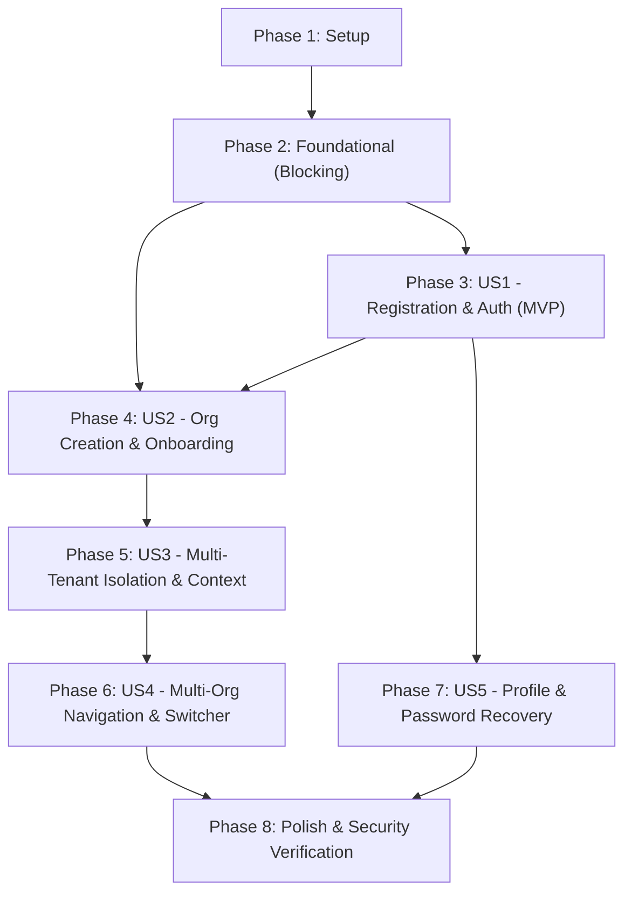

# Tasks: Authentication and Organization Foundation

**Feature**: `001-auth-organization` | **Input**: Design documents from `specs/001-auth-organization/`  
**Prerequisites**: [plan.md](./plan.md), [spec.md](./spec.md), [data-model.md](./data-model.md), [contracts/](./contracts/), [quickstart.md](./quickstart.md)  
**Scope for Current Iteration**: User registration, email verification, sign-in/out session management, password recovery, profile management, organization onboarding, atomic Owner assignment, multi-tenant PostgreSQL RLS isolation, server-side context resolution, and organization switching. (Invitations and advanced membership administration deferred to a future feature).

---

## Format: `- [ ] [TaskID] [P?] [Story?] Description with file path`

- **[P]**: Can run in parallel (different files, no blocking dependencies on incomplete tasks)
- **[Story]**: Mapped user story (`[US1]`, `[US2]`, `[US3]`, `[US4]`, `[US5]`)
- Every task includes an explicit, unambiguous file path.

---

## Phase 1: Setup (Shared Infrastructure)

**Purpose**: Project initialization, framework configuration, environment settings, and testing harness.

- [ ] T001 Initialize Next.js 15+ App Router application with TypeScript and Tailwind CSS in package.json and tsconfig.json
- [ ] T002 [P] Install core runtime and UI dependencies (@supabase/supabase-js, @supabase/ssr, zod, react-hook-form, @hookform/resolvers/zod, clsx, tailwind-merge, lucide-react) in package.json
- [ ] T003 [P] Configure Vitest unit testing framework and Playwright e2e runner in vitest.config.ts and playwright.config.ts
- [ ] T004 [P] Configure environment variable validation schema and example template in src/lib/env.ts and .env.example
- [ ] T005 Initialize Supabase local project configuration and storage settings in supabase/config.toml

---

## Phase 2: Foundational (Blocking Prerequisites)

**Purpose**: Core database migrations, Supabase SSR client utilities, RLS security helpers, and shared UI primitives.

**⚠️ CRITICAL**: Must be completed before any user story implementation can begin.

- [ ] T006 Create Supabase SSR client utilities for browser, server, and middleware contexts in src/lib/supabase/client.ts, src/lib/supabase/server.ts, and src/lib/supabase/middleware.ts
- [ ] T007 [P] Implement core database migration for enums (app_role, membership_status) and base tables (profiles, organizations, organization_memberships, organization_audit_events) in supabase/migrations/20261031000001_auth_organization_schema.sql
- [ ] T008 [P] Implement handle_new_user() database trigger on auth.users syncing into public.profiles in supabase/migrations/20261031000002_auth_triggers.sql
- [ ] T009 Implement non-recursive security helper functions (is_email_verified, get_user_organization_ids, is_org_member) with locked search_path in supabase/migrations/20261031000003_security_helpers.sql
- [ ] T010 Implement universal FORCE ROW LEVEL SECURITY and base RLS policies for profiles, organizations, organization_memberships, and organization_audit_events in supabase/migrations/20261031000004_rls_policies.sql
- [ ] T011 [P] Create shared TypeScript types, database schema definitions, and action result interfaces in src/types/database.ts and src/types/auth.ts
- [ ] T012 [P] Implement base UI component primitives (Button, Input, Form, Label, Card, Alert, DropdownMenu) in src/components/ui/

**Checkpoint**: Foundation ready — database schema, RLS policies, Supabase SSR clients, and base primitives are established.

---

## Phase 3: User Story 1 - User Registration, Verification & Authentication (Priority: P1) 🎯 MVP

**Goal**: Provide secure account registration with password complexity enforcement, automated profile generation, email verification gating, cookie-based session management, sign-out, and route protection.

**Independent Test**: Register an account with valid credentials; verify profile created in database; confirm unverified user is blocked from workspace routes and guided to `/verify-email`; confirm email verification; authenticate via sign-in; verify secure HTTP-only cookies; test sign-out and route guard redirection.

### Tests for User Story 1 ⚠️

- [ ] T013 [P] [US1] Unit tests for registration and sign-in Zod validation schemas in tests/unit/validations/auth.test.ts
- [ ] T014 [P] [US1] Integration tests for handle_new_user() trigger and is_email_verified() security helper in tests/integration/auth-trigger.test.ts

### Implementation for User Story 1

- [ ] T015 [P] [US1] Define authentication Zod schemas (signUpSchema, signInSchema) with password symbol rules in src/lib/validations/auth.ts
- [ ] T016 [US1] Implement server action signUpAction with anti-enumeration protection in src/actions/auth-actions.ts
- [ ] T017 [US1] Implement server action signInAction with email verification gate and organization routing in src/actions/auth-actions.ts
- [ ] T018 [US1] Implement server action signOutAction clearing session cookies in src/actions/auth-actions.ts
- [ ] T019 [P] [US1] Implement PKCE Auth Callback route with open-redirect sanitization in src/app/api/auth/callback/route.ts
- [ ] T020 [P] [US1] Implement Next.js session validation and route protection middleware in src/middleware.ts
- [ ] T021 [P] [US1] Build Registration page and form component with inline validation in src/app/(auth)/sign-up/page.tsx and src/components/auth/SignUpForm.tsx
- [ ] T022 [P] [US1] Build Sign-In page and form component with credential error handling in src/app/(auth)/sign-in/page.tsx and src/components/auth/SignInForm.tsx
- [ ] T023 [P] [US1] Build Email Verification pending screen with resend link in src/app/(auth)/verify-email/page.tsx and src/components/auth/VerifyEmailCard.tsx
- [ ] T024 [US1] End-to-end browser test for registration, verification, sign-in, and sign-out in tests/e2e/auth-flow.spec.ts

**Checkpoint**: User Story 1 is fully functional and testable independently (MVP Milestone).

---

## Phase 4: User Story 2 - Organization Creation & Onboarding (Priority: P1)

**Goal**: Enable newly registered and verified business owners with 0 organizations to configure their retail store, enforcing creator-bound idempotency, atomic Owner assignment, and workspace transition.

**Independent Test**: Sign in with an email-verified user belonging to 0 organizations; verify automatic redirect to `/onboarding/create-organization`; submit valid store parameters (ISO country, currency, timezone); verify atomic creation of organization and membership row with `role = 'owner'`; verify replayed submission with identical `client_mutation_id` safely returns existing organization.

### Tests for User Story 2 ⚠️

- [ ] T025 [P] [US2] Unit tests for organization creation Zod schema (ISO 3166-1 alpha-2, ISO 4217, name length) in tests/unit/validations/organization.test.ts
- [ ] T026 [P] [US2] Integration tests for create_organization_with_owner() RPC verifying creator-bound idempotency in tests/integration/create-organization.test.ts

### Implementation for User Story 2

- [ ] T027 [US2] Implement create_organization_with_owner() stored procedure with email verification check, creator-bound idempotency, and atomic Owner assignment in supabase/migrations/20261031000005_create_organization_rpc.sql
- [ ] T028 [P] [US2] Define organization creation Zod schema (createOrganizationSchema) in src/lib/validations/organization.ts
- [ ] T029 [US2] Implement server action createOrganizationAction invoking create_organization_with_owner() in src/actions/organization-actions.ts
- [ ] T030 [P] [US2] Build Organization Onboarding page and creation form in src/app/onboarding/create-organization/page.tsx and src/components/organization/CreateOrganizationForm.tsx
- [ ] T031 [US2] Implement onboarding route guard redirecting verified 0-organization users to onboarding in src/lib/auth/guards.ts
- [ ] T032 [US2] End-to-end browser test for organization creation, validation, and dashboard redirection in tests/e2e/onboarding-flow.spec.ts

**Checkpoint**: User Stories 1 and 2 operate seamlessly together. Users can register, verify, create their store, and land on their workspace.

---

## Phase 5: User Story 3 - Multi-Tenant Isolation & Server Context Resolution (Priority: P1)

**Goal**: Guarantee complete tenant data isolation using PostgreSQL Row-Level Security, resolve tenant context strictly on the server from verified session cookies, and protect tenant routes from unauthorized access.

**Independent Test**: Sign in as User A (belonging only to Org A); attempt to query Org B data via direct database query; verify PostgreSQL RLS returns 0 rows; attempt to access URL `/[org-b-slug]/dashboard`; verify server-side middleware and context resolution deny access and redirect safely.

### Tests for User Story 3 ⚠️

- [ ] T033 [P] [US3] Integration test verifying is_org_member() helper and tenant data isolation under FORCE RLS in tests/integration/tenant-isolation.test.ts
- [ ] T034 [P] [US3] Integration test verifying direct client INSERT/UPDATE/DELETE on organization_memberships are denied by RLS in tests/integration/membership-rls.test.ts

### Implementation for User Story 3

- [ ] T035 [US3] Implement server-side tenant context resolution helper getTenantContext() in src/lib/auth/context.ts
- [ ] T036 [US3] Implement tenant slug verification and active membership validation in src/middleware.ts
- [ ] T037 [P] [US3] Build Tenant Workspace layout and header shell in src/app/[slug]/layout.tsx and src/components/layout/TenantHeader.tsx
- [ ] T038 [P] [US3] Build Tenant Dashboard overview page rendering store metadata and user role in src/app/[slug]/dashboard/page.tsx
- [ ] T039 [US3] End-to-end multi-tenant isolation test verifying cross-tenant URL tampering rejection in tests/e2e/tenant-isolation.spec.ts

**Checkpoint**: Core multi-tenant boundary is active and verified. Tenant isolation is strictly enforced at database and server layers.

---

## Phase 6: User Story 4 - Multi-Organization Navigation & Context Switching (Priority: P2)

**Goal**: Support users who own or work at multiple retail stores, provide a global store switcher in the header, persist active store preference in secure cookies, and route returning users to their last active store.

**Independent Test**: Seed User A with active memberships in Org A and Org B; sign in; verify Organization Switcher displays both stores; switch context to Org B; verify `bizflow_active_org` cookie is set to Org B and dashboard reloads under Org B; sign out and sign back in; verify automatic routing to Org B.

### Tests for User Story 4 ⚠️

- [ ] T040 [P] [US4] Unit tests for organization switching Zod schema in tests/unit/validations/organization-switch.test.ts
- [ ] T041 [P] [US4] Integration test verifying get_user_organization_ids() returns all active tenant IDs for multi-org user in tests/integration/user-organizations.test.ts

### Implementation for User Story 4

- [ ] T042 [US4] Implement server action switchOrganizationAction validating membership before setting bizflow_active_org cookie in src/actions/organization-actions.ts
- [ ] T043 [P] [US4] Build Organization Switcher dropdown component in src/components/layout/OrganizationSwitcher.tsx
- [ ] T044 [US4] Integrate Organization Switcher into Tenant Navigation Header in src/components/layout/TenantHeader.tsx
- [ ] T045 [US4] Update signInAction and middleware to route multi-org users to their last active store preference in src/actions/auth-actions.ts and src/middleware.ts
- [ ] T046 [US4] End-to-end browser test for multi-organization switching and persistent routing in tests/e2e/organization-switch.spec.ts

**Checkpoint**: Multi-store navigation and switching is functional, responsive, and persistent.

---

## Phase 7: User Story 5 - Account Profile Management & Password Recovery (Priority: P2)

**Goal**: Provide secure password recovery with complexity rules and session revocation, alongside account profile viewing and editing.

**Independent Test**: Submit password reset request for registered email; verify generic anti-enumeration response; exchange recovery token via callback; reset password with strong symbol-containing password; verify existing sessions revoked; authenticate with new password; navigate to profile settings and update name/phone; verify updated data persists.

### Tests for User Story 5 ⚠️

- [ ] T047 [P] [US5] Unit tests for forgot-password, reset-password, and profile update Zod schemas in tests/unit/validations/profile-password.test.ts
- [ ] T048 [P] [US5] Integration test verifying profiles_update_own RLS policy permits updating own profile only in tests/integration/profile-rls.test.ts

### Implementation for User Story 5

- [ ] T049 [P] [US5] Define password recovery and profile Zod schemas (forgotPasswordSchema, resetPasswordSchema, updateProfileSchema) in src/lib/validations/auth.ts
- [ ] T050 [US5] Implement server action requestPasswordResetAction with anti-enumeration response in src/actions/auth-actions.ts
- [ ] T051 [US5] Implement server action resetPasswordAction updating credentials and triggering session revocation in src/actions/auth-actions.ts
- [ ] T052 [US5] Implement server action updateProfileAction for personal name and phone modifications in src/actions/profile-actions.ts
- [ ] T053 [P] [US5] Build Forgot Password page and form in src/app/(auth)/forgot-password/page.tsx and src/components/auth/ForgotPasswordForm.tsx
- [ ] T054 [P] [US5] Build Reset Password page and form in src/app/(auth)/reset-password/page.tsx and src/components/auth/ResetPasswordForm.tsx
- [ ] T055 [P] [US5] Build User Profile settings page and form in src/app/settings/profile/page.tsx and src/components/settings/ProfileForm.tsx
- [ ] T056 [US5] End-to-end browser test for password recovery, reset flow, and profile editing in tests/e2e/profile-password.spec.ts

**Checkpoint**: User self-service account management and recovery is complete.

---

## Phase 8: Polish & Cross-Cutting Concerns (Security & Invariant Verification)

**Purpose**: Execute automated verification of database security invariants, multi-tenant isolation, build integrity, and performance targets.

- [ ] T057 [P] Implement automated test suite verifying security matrix items (SEC-01, SEC-02, SEC-05, SEC-11, SEC-12, SEC-13) in tests/integration/security-matrix.test.ts
- [ ] T058 [P] Implement concurrent transaction test verifying idempotency under duplicate creation attempts in tests/integration/concurrency.test.ts
- [ ] T059 Run strict TypeScript compiler verification without any type bypasses (tsc --noEmit) in package.json
- [ ] T060 Run full linting, formatting, and end-to-end test validation across all implemented user stories in package.json

---

## Dependencies & Execution Order

### Phase Dependencies

1. **Setup (Phase 1)**: Must run first; provisions project packages, linting, and testing dependencies.
2. **Foundational (Phase 2)**: Core blocking prerequisites. Database migrations, Supabase SSR clients, and RLS helpers MUST be deployed before story code.
3. **User Story 1 (Phase 3)**: MVP Milestone. User identity and authentication foundation.
4. **User Story 2 (Phase 4)**: Depends on US1 (verified user session required to create organization).
5. **User Story 3 (Phase 5)**: Depends on US2 (requires organizations to enforce tenant context).
6. **User Story 4 (Phase 6)**: Depends on US3 (requires active tenant resolution to switch between multiple organizations).
7. **User Story 5 (Phase 7)**: Depends on US1 (requires authenticated user and profile trigger). Can run in parallel with US3/US4.
8. **Polish (Phase 8)**: Final verification of all constitutional invariants and security guarantees.

---

## Parallel Opportunities

- **Phase 1 (Setup)**: T002, T003, and T004 can proceed concurrently.
- **Phase 2 (Foundational)**: Database migrations T007 and T008 can be authored in parallel; T011 (types) and T012 (UI primitives) can proceed in parallel.
- **Phase 3 (US1)**: Unit test T013, Integration test T014, Schema T015, Callback T019, Middleware T020, and UI pages T021, T022, T023 can be authored in parallel once T006-T012 complete.
- **Phase 4 (US2)**: Unit test T025, Integration test T026, Schema T028, and UI page T030 can proceed in parallel with RPC T027.
- **Phase 5 (US3)**: Integration tests T033, T034, Layout T037, and Dashboard page T038 can proceed in parallel with Context resolver T035.
- **Phase 6 (US4)**: Tests T040, T041, and Switcher component T043 can proceed in parallel with server action T042.
- **Phase 7 (US5)**: Tests T047, T048, Schemas T049, and Pages T053, T054, T055 can proceed in parallel with Actions T050, T051, T052.
- **Phase 8 (Polish)**: Tests T057 and T058 can run concurrently.

---

## Implementation Strategy & Milestones

### Milestone 1: Minimum Viable Product (Phase 1 to Phase 3) 🎯
- **Scope**: User Registration, Email Verification screen, Sign-In, Sign-Out, Session Cookie management, and Protected Route redirection.
- **Validation**: Run `npm run test` and `tests/e2e/auth-flow.spec.ts`. Verify complete user lifecycle without errors.

### Milestone 2: Single-Tenant Business Onboarding (Phase 4 & Phase 5)
- **Scope**: Store Creation with strict ISO codes, creator-bound idempotency, atomic Owner assignment, FORCE RLS tenant isolation, and `/[slug]/dashboard` server context resolution.
- **Validation**: Run `tests/e2e/onboarding-flow.spec.ts` and `tests/e2e/tenant-isolation.spec.ts`. Confirm cross-tenant data requests return 0 rows.

### Milestone 3: Multi-Store Operations & Account Self-Service (Phase 6 to Phase 8)
- **Scope**: Organization Switcher header, last-active-store persistent routing, Password Reset with session revocation, and User Profile management.
- **Validation**: Run full security verification suite `tests/integration/security-matrix.test.ts` and all end-to-end tests.
