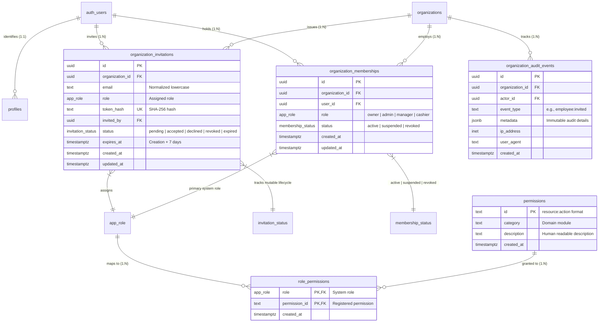

# Database Data Model: Feature 002 — Employee Management & RBAC

**Feature Branch**: `002-employee-rbac`  
**Date**: 2026-11-03  
**Status**: Completed  
**Governing Documents**:
- [BizFlow AI Constitution v1.1.0](file:///c:/Users/Heyru/Desktop/projects/BizFlow-AI/.specify/memory/constitution.md)
- [Feature 002 Specification](file:///c:/Users/Heyru/Desktop/projects/BizFlow-AI/specs/002-employee-rbac/spec.md)
- [Feature 001 Schema & Migrations](file:///c:/Users/Heyru/Desktop/projects/BizFlow-AI/supabase/migrations/)

---

## 1. Entity-Relationship Diagram (ERD)



---

## 2. Schema Specification

### 2.1 Types and Custom Enums

```sql
-- 1. Custom Enum for Invitation Status Lifecycle (Mutable State Machine)
CREATE TYPE public.invitation_status AS ENUM (
    'pending',
    'accepted',
    'declined',
    'revoked',
    'expired'
);

-- Existing Enums from Feature 001 (retained without modification):
-- public.app_role: 'owner', 'admin', 'manager', 'cashier'
-- public.membership_status: 'active', 'suspended', 'revoked'
```

---

### 2.2 Table Definitions

#### 1. `public.organization_invitations`

Stores issued employee invitations per organization. This entity represents a **mutable lifecycle state machine** (`status` transitions from `pending` to `accepted`, `declined`, `revoked`, or `expired`). Raw tokens are never stored; only their SHA-256 hash is persisted.

```sql
CREATE TABLE public.organization_invitations (
    id UUID PRIMARY KEY DEFAULT gen_random_uuid(),
    organization_id UUID NOT NULL REFERENCES public.organizations(id) ON DELETE CASCADE,
    email TEXT NOT NULL CHECK (char_length(trim(email)) BETWEEN 5 AND 255 AND email ~* '^[A-Za-z0-9._%+-]+@[A-Za-z0-9.-]+\.[A-Za-z]{2,}$'),
    role public.app_role NOT NULL DEFAULT 'cashier',
    token_hash TEXT NOT NULL UNIQUE CHECK (char_length(token_hash) = 64 AND token_hash ~ '^[a-f0-9]{64}$'),
    invited_by UUID NOT NULL REFERENCES auth.users(id) ON DELETE RESTRICT,
    status public.invitation_status NOT NULL DEFAULT 'pending',
    expires_at TIMESTAMPTZ NOT NULL,
    created_at TIMESTAMPTZ NOT NULL DEFAULT now(),
    updated_at TIMESTAMPTZ NOT NULL DEFAULT now()
);

-- Partial Unique Index: Prevents multiple concurrent pending invitations for the same email per tenant
CREATE UNIQUE INDEX uq_pending_invitation 
    ON public.organization_invitations(organization_id, lower(trim(email))) 
    WHERE status = 'pending';

-- Index for fast token lookups during acceptance and pre-flight validation
CREATE INDEX idx_invitations_token_hash 
    ON public.organization_invitations(token_hash);

-- Index for listing tenant invitations ordered by creation
CREATE INDEX idx_invitations_org_status 
    ON public.organization_invitations(organization_id, status, created_at DESC);
```

#### 2. `public.permissions`

System-wide catalog of all valid permission strings using the colon-separated convention (`resource:action`).

```sql
CREATE TABLE public.permissions (
    id TEXT PRIMARY KEY CHECK (id ~ '^[a-z_]+:[a-z_]+$'),
    category TEXT NOT NULL CHECK (char_length(trim(category)) BETWEEN 2 AND 50),
    description TEXT NOT NULL CHECK (char_length(trim(description)) BETWEEN 5 AND 255),
    created_at TIMESTAMPTZ NOT NULL DEFAULT now()
);

-- Index for category-based filtering
CREATE INDEX idx_permissions_category ON public.permissions(category);
```

#### 3. `public.role_permissions`

Associates predefined system roles (`public.app_role`) with granted permissions from `public.permissions`.

```sql
CREATE TABLE public.role_permissions (
    role public.app_role NOT NULL,
    permission_id TEXT NOT NULL REFERENCES public.permissions(id) ON DELETE CASCADE,
    created_at TIMESTAMPTZ NOT NULL DEFAULT now(),
    PRIMARY KEY (role, permission_id)
);

CREATE INDEX idx_role_permissions_role ON public.role_permissions(role);
```

---

### 2.3 Idempotent Seed Data for Permissions Catalog & Role Mappings

```sql
-- 1. Idempotently Insert Initial Employee Management Permissions
INSERT INTO public.permissions (id, category, description) VALUES
    ('employees:read', 'employees', 'View employee directory, roles, and status'),
    ('employees:invite', 'employees', 'Send organization invitations to new employees'),
    ('employees:update_role', 'employees', 'Modify assigned roles of organization members'),
    ('employees:suspend', 'employees', 'Suspend or reactivate organization members'),
    ('employees:remove', 'employees', 'Remove organization members (soft-revocation)'),
    ('employees:invitations_read', 'employees', 'View pending, declined, and revoked invitations'),
    ('employees:invitations_revoke', 'employees', 'Revoke unaccepted organization invitations')
ON CONFLICT (id) DO NOTHING;

-- 2. Idempotently Map Permissions to Admin Role (Operational workforce management)
INSERT INTO public.role_permissions (role, permission_id) VALUES
    ('admin', 'employees:read'),
    ('admin', 'employees:invite'),
    ('admin', 'employees:update_role'),
    ('admin', 'employees:suspend'),
    ('admin', 'employees:remove'),
    ('admin', 'employees:invitations_read'),
    ('admin', 'employees:invitations_revoke')
ON CONFLICT (role, permission_id) DO NOTHING;

-- 3. Idempotently Map Permissions to Manager Role (Read-only workforce directory)
INSERT INTO public.role_permissions (role, permission_id) VALUES
    ('manager', 'employees:read')
ON CONFLICT (role, permission_id) DO NOTHING;

-- Note: Cashier receives 0 employee management permissions.
-- Note: Permission resolution requires the permission key to exist in public.permissions before
--       granting access to any role, including Owner. For registered permissions, Owner receives
--       access automatically. For other roles, role_permissions is checked.
--       Unknown or unregistered permission keys are always denied.
```

---

## 3. Row-Level Security (RLS) Policy Specifications

In strict adherence to Constitutional Principle I, universal `FORCE ROW LEVEL SECURITY` is enforced across all tables.

### 3.1 RLS on `organization_invitations`

```sql
ALTER TABLE public.organization_invitations ENABLE ROW LEVEL SECURITY;
ALTER TABLE public.organization_invitations FORCE ROW LEVEL SECURITY;

-- Deny all direct client mutations (must route through SECURITY DEFINER stored procedures)
CREATE POLICY "invitations_insert_deny_direct" 
    ON public.organization_invitations FOR INSERT 
    TO authenticated WITH CHECK (false);

CREATE POLICY "invitations_update_deny_direct" 
    ON public.organization_invitations FOR UPDATE 
    TO authenticated USING (false);

CREATE POLICY "invitations_delete_deny_direct" 
    ON public.organization_invitations FOR DELETE 
    TO authenticated USING (false);

-- SELECT Policy: Authorized members (Owner/Admin) can view invitations within their active organization
CREATE POLICY "invitations_select_authorized" 
    ON public.organization_invitations FOR SELECT 
    TO authenticated 
    USING (
        organization_id IN (SELECT public.get_user_organization_ids())
        AND public.is_org_member(organization_id, ARRAY['owner'::public.app_role, 'admin'::public.app_role])
    );
```

### 3.2 RLS on `permissions` and `role_permissions`

```sql
ALTER TABLE public.permissions ENABLE ROW LEVEL SECURITY;
ALTER TABLE public.permissions FORCE ROW LEVEL SECURITY;

-- Readable by all authenticated users (to evaluate client permission contexts)
CREATE POLICY "permissions_select_authenticated" 
    ON public.permissions FOR SELECT 
    TO authenticated USING (true);

CREATE POLICY "permissions_insert_deny" ON public.permissions FOR INSERT TO authenticated WITH CHECK (false);
CREATE POLICY "permissions_update_deny" ON public.permissions FOR UPDATE TO authenticated USING (false);
CREATE POLICY "permissions_delete_deny" ON public.permissions FOR DELETE TO authenticated USING (false);

ALTER TABLE public.role_permissions ENABLE ROW LEVEL SECURITY;
ALTER TABLE public.role_permissions FORCE ROW LEVEL SECURITY;

CREATE POLICY "role_permissions_select_authenticated" 
    ON public.role_permissions FOR SELECT 
    TO authenticated USING (true);

CREATE POLICY "role_permissions_insert_deny" ON public.role_permissions FOR INSERT TO authenticated WITH CHECK (false);
CREATE POLICY "role_permissions_update_deny" ON public.role_permissions FOR UPDATE TO authenticated USING (false);
CREATE POLICY "role_permissions_delete_deny" ON public.role_permissions FOR DELETE TO authenticated USING (false);
```

---

## 4. Stored Procedure Contracts & Verification Specifications

All stored procedures use `SECURITY DEFINER`, lock search paths to `pg_catalog, public, pg_temp`, and perform internal authentication, membership, and permission verification at the database level.

### 4.1 `public.create_organization_invitation(...)`
- **Validation**: `p_email` syntax (RFC 5322), `p_token_hash` (`^[a-f0-9]{64}$`), `p_expires_at` strictly bounded (`now() < p_expires_at AND p_expires_at <= now() + INTERVAL '7 days'`, enforcing a maximum invitation lifetime of exactly 7 days at the database boundary), `p_role` valid enum.
- **Authorization**: Caller must be authenticated (`P0003`), active member of `p_org_id` (`P0004`), and hold `employees:invite` (`P0005`).
- **Privilege Escalation**: If caller is Admin, `p_role` cannot be `'owner'` (`P0020`).
- **Duplicate Checks**: Invitee cannot already be active member (`P0021`). Concurrent pending duplicates trapped via `uq_pending_invitation` returning `P0022`.
- **Audit**: Atomically records `employee:invited` in `organization_audit_events`.
- **Grant**: `authenticated`.

### 4.2 `public.validate_invitation_token(...)`
- **Purpose**: Pre-flight token check before displaying acceptance UI.
- **Validation**: `p_token_hash` format check (`^[a-f0-9]{64}$`).
- **Security & Privacy**: Returns strictly `{ "is_valid": boolean, "is_expired": boolean, "status": text }`. Strictly omits organization name, organization ID, invitee email, and assigned role.
- **Grant**: `anon, authenticated, service_role`.

### 4.3 `public.accept_organization_invitation(...)`
- **Validation & Locking**: Token hash format, `auth.uid() IS NOT NULL`, row lock `FOR UPDATE`.
- **Transaction-Safe Lazy Expiration**: If `expires_at <= now()`, updates status to `'expired'`, commits cleanly without throwing rolling-back exceptions, and returns `{ "success": false, "code": "INVITATION_EXPIRED" }`.
- **Email Mismatch Privacy**: Compares verified caller email with `lower(trim(invitation.email))`. If mismatched, returns generic `{ "success": false, "code": "EMAIL_MISMATCH", "message": "The authenticated account does not match the invitation recipient." }` without disclosing expected or actual emails.
- **Membership Assignment**: Inserts row into `organization_memberships` (`status = 'active'`). Updates invitation `status = 'accepted'`.
- **Audit**: Atomically records `employee:joined` in `organization_audit_events`.
- **Grant**: `authenticated`.

### 4.4 `public.decline_organization_invitation(...)`
- **Validation**: Token hash, row lock `FOR UPDATE`, lazy expiration check.
- **Email Mismatch Privacy**: Generic `EMAIL_MISMATCH` return if caller does not match recipient.
- **Transition**: Updates status to `'declined'`. Records `employee:invitation_declined` in `organization_audit_events`.
- **Grant**: `authenticated`.

### 4.5 `public.resend_organization_invitation(...)`
- **Validation**: `p_new_token_hash` (64 hex), `p_new_expires_at` strictly bounded (`now() < p_new_expires_at AND p_new_expires_at <= now() + INTERVAL '7 days'`, enforcing a maximum invitation lifetime of exactly 7 days at the database boundary).
- **Authorization**: Caller must have `employees:invite`. Target invitation must be `pending` or `expired`.
- **Transition**: Overwrites token hash, updates expiration, transitions status to `'pending'`.
- **Grant**: `authenticated`.

### 4.6 `public.revoke_organization_invitation(...)`
- **Authorization**: Caller must have `employees:invitations_revoke`. Target must be `pending`.
- **Transition**: Updates status to `'revoked'`. Records `employee:invitation_revoked`.
- **Grant**: `authenticated`.

### 4.7 `public.update_organization_member_role(...)`
- **Validation**: Valid UUIDs, valid role enum. Caller cannot edit own role (`P0023`).
- **Terminal Revocation Guard**: If target membership has `status = 'revoked'`, rejects with error `P0025` ("Cannot modify a revoked membership. Revocation is terminal.").
- **Privilege Escalation**: Admins cannot promote to Owner or modify an Owner (`P0020`).
- **Owner Invariant**: Trigger `check_owner_invariant` prevents demoting the last active Owner (`P0002`).
- **Audit**: Records `employee:role_updated`.
- **Grant**: `authenticated`.

### 4.8 `public.update_organization_member_status(...)`
- **Validation**: Valid UUIDs, valid status enum. Caller cannot change own status (`P0024`).
- **Permitted Transitions & Terminal Revocation**:
  - If target membership is currently `'revoked'`, rejects with error `P0025` ("Cannot modify a revoked membership. Revocation is terminal.").
  - Permitted transitions:
    - `active` $\rightarrow$ `suspended` (Requires `employees:suspend`)
    - `suspended` $\rightarrow$ `active` (Requires `employees:suspend`)
    - `active` $\rightarrow$ `revoked` (Requires `employees:remove`)
    - `suspended` $\rightarrow$ `revoked` (Requires `employees:remove`)
  - Any other transition is rejected with `P0009`.
- **Owner Invariant**: Trigger `check_owner_invariant` prevents suspending or revoking the last active Owner (`P0002`).
- **Audit**: Records `employee:suspended`, `employee:reactivated`, or `employee:removed`.
- **Grant**: `authenticated`.

### 4.9 `public.get_organization_employees(...)`
- **Authoritative Permission**: Caller must hold active membership in `p_org_id`. Evaluates `employees:read` against the system catalog: requires permission key to exist in `public.permissions`; an Owner receives access automatically; other roles check `public.role_permissions`; unknown or unregistered permission keys are always denied.
- **Projection**: Minimal operational attributes (`membership_id`, `user_id`, `first_name`, `last_name`, `email`, `phone`, `role`, `status`, `joined_at`). Excludes `revoked` memberships by default.
- **Grant**: `authenticated`.
