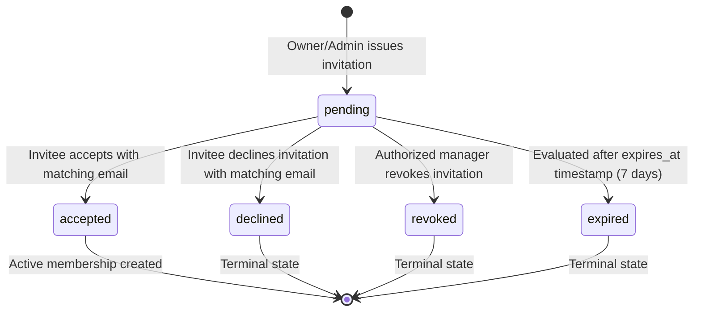

# Feature Specification: Employee Management & Role-Based Access Control (RBAC)

**Feature Branch**: `002-employee-rbac`  
**Created**: 2026-11-03  
**Status**: Draft  
**Governing Documents**:
- [BizFlow AI Constitution v1.1.0](file:///c:/Users/Heyru/Desktop/projects/BizFlow-AI/.specify/memory/constitution.md)
- [Master Project Blueprint](file:///c:/Users/Heyru/Desktop/projects/BizFlow-AI/docs/MASTER_PROJECT_BLUEPRINT.md)
- [Feature 001 Specification & Architecture](file:///c:/Users/Heyru/Desktop/projects/BizFlow-AI/specs/001-auth-organization/spec.md)

---

## Clarifications & Architectural Decisions

### Session 2026-11-03
1. **Permission Naming Convention**:
   - In alignment with Constitutional Principle IV, all permission identifiers MUST strictly use colon-separated resource-action verbs: `<resource>:<action>` (e.g., `employees:read`, `employees:invite`, `employees:update_role`, `employees:suspend`, `employees:remove`, `employees:invitations_read`, `employees:invitations_revoke`).
   - Dot notation is replaced across all requirements, scenarios, permission matrices, and future module references.
2. **Membership Removal Strategy (Soft Revocation Only)**:
   - Employee removal MUST set `organization_memberships.status` to `'revoked'`.
   - Hard deletion of membership records is strictly OUT OF SCOPE to maintain referential integrity with historical audit logs and retail transaction records.
   - Removing an employee MUST NOT revoke the user's global Supabase authentication session and MUST NOT affect their active memberships in other organizations.
   - On all subsequent requests, tenant context resolution (`resolveTenantContext()`) and database security helpers (`get_user_organization_ids()`) filter exclusively for `status = 'active'`, causing removed/revoked members to immediately fail tenant authorization (HTTP 404/403).
3. **Invitation Identity Protection & Pre-Flight Validation**:
   - The system MUST validate the invitation token hash before exposing any invitation or organization metadata to the client, preventing token fishing and tenant enumeration.
   - Both **Acceptance** and **Decline** operations MUST require an authenticated session where the user's verified email strictly matches the normalized invitation recipient email (`lower(trim(email))`).
   - Raw tokens are 256-bit cryptographically secure random values (64 hex characters) and are NEVER persisted; only their SHA-256 hash (`token_hash`) is stored in the database.
4. **Authoritative Owner Permission Resolution**:
   - The authorization engine enforces a single unified permission-resolution model bounded strictly by the registered permission catalog:
     - The `Owner` role dynamically receives all permissions that are registered in the system permissions catalog (`permissions.id`).
     - Any unregistered, unknown, or misspelled permission string MUST always evaluate to `false` for all roles, including `Owner`.
     - `Admin`, `Manager`, and `Cashier` roles receive permissions mapped deterministically through the `role_permissions` schema against registered catalog permissions.
     - Database stored procedures and server-side actions MUST enforce identical permission outcomes (`hasPermission(context, permissionKey)` verifies registration in the catalog before evaluating the role).
5. **Transaction-Safe Lazy Expiration Lifecycle**:
   - Invitation expiration transitions occur lazily without background crons or scheduled workers.
   - When an invitation is evaluated or an acceptance is attempted after `expires_at <= now()`, the database acceptance procedure MUST employ a transaction-safe expiration mechanism that ensures the `status = 'expired'` update commits durably to the database even though acceptance is rejected.
   - To prevent PostgreSQL transaction rollbacks (where raising an unhandled exception rolls back preceding table updates), the procedure MUST transition the invitation record to `status = 'expired'`, commit the transition, and return a structured rejection result (e.g., `{ "success": false, "code": "INVITATION_EXPIRED" }`), ensuring the `'expired'` status persists.
6. **Role Hierarchy & Privilege Escalation Boundaries**:
   - Role assignments and modifications follow strict hierarchy:
     - `Admin` can assign, update, and manage only `Admin`, `Manager`, and `Cashier` roles.
     - `Admin` CANNOT assign or promote anyone to `Owner`, and CANNOT modify or demote an existing `Owner`.
     - Only an active `Owner` can assign, promote, or alter the `Owner` role.
     - Self-role modification is prohibited (users cannot change their own assigned role).
     - The database trigger `check_owner_invariant` continues to protect the organization against demoting, suspending, or revoking the last active Owner.
7. **Decoupled Transactional Email Delivery**:
   - The database transaction commits the pending invitation first. External email dispatch is executed outside the database transaction.
   - If email delivery fails due to provider or network errors, the invitation record remains safely saved in `pending` status. The inviter is notified of the delivery failure and provided an immediate "Resend Invitation" option.
   - Resending an invitation invalidates the prior token hash and generates a fresh token with a renewed 7-day expiration window.
8. **Real-Time Authorization Freshness**:
   - Role updates, membership suspension, and membership revocation take effect immediately on the user's next request.
   - The application relies on server-side resolution (`resolveTenantContext()`) rather than stale client tokens or long-lived cached permissions.
9. **Employee Profile Data Alignment**:
   - Aligns directly with Feature 001's actual `public.profiles` schema: `first_name` (Text, required), `last_name` (Text, required), and `phone` (Text, optional/nullable). Note: the column name is `phone`, not `phone_number`. Email is retrieved from `auth.users`.
   - The employee directory exposes only minimal required operational fields (`first_name`, `last_name`, `email`, optional `phone`, `role`, `status`, `created_at`).

---

## User Scenarios & Testing *(mandatory)*

### User Story 1 — Employee Directory (Priority: P1)

As an organization Owner, Admin, or Manager, I want to view a list of all employees in my organization along with their roles, membership statuses, and joined dates, so that I have clear operational visibility over our workforce.

**Why this priority**: Visibility into team members is the fundamental operational prerequisite for workforce management.

**Independent Test**: Can be tested independently by logging in as an authorized user, accessing the employee directory, and verifying that all active and suspended organization members are listed with correct roles and statuses, while unauthorized members or non-members are blocked.

**Acceptance Scenarios**:

1. **Given** an authenticated user with `employees:read` permission (Owner, Admin, Manager), **When** they navigate to the employee management page, **Then** they see a table of organization employees displaying full name (`first_name`, `last_name`), email, phone (if present, or "None"), assigned role, membership status, and joined date.
2. **Given** an authenticated user with Cashier role (lacking `employees:read` permission), **When** they attempt to navigate to or query the employee directory, **Then** access is denied with a 404 Not Found response, preventing workforce enumeration.
3. **Given** an employee directory query, **When** the server fetches employee data, **Then** only the minimal required profile and membership attributes for that specific organization are returned; sensitive user credentials, internal metadata, and memberships in other organizations are never disclosed.
4. **Given** an organization with both active and suspended employees, **When** viewing the directory, **Then** employees are clearly distinguished by visual status indicators (`Active`, `Suspended`), with filtering and search capabilities by name, email, and role. Revoked memberships are excluded from the default view.

---

### User Story 2 — Invite Employees via Email (Priority: P1)

As an organization Owner or Admin, I want to invite new team members to join my store by entering their email address and selecting their initial role, so that they receive a secure invitation link to join the organization.

**Why this priority**: Enables multi-user collaboration and delegation of retail responsibilities.

**Independent Test**: Can be tested by sending an invitation from an Owner account to a valid email address with an assigned role (`Manager`), verifying that a pending invitation record is created with an expiring token hash, and verifying that the invitation email is dispatched.

**Acceptance Scenarios**:

1. **Given** an authorized user with `employees:invite` permission, **When** they submit the invitation form with a valid email and an allowed role, **Then** a cryptographically secure random token (256-bit entropy, 64 hex characters) is generated, its SHA-256 hash is persisted in `organization_invitations` with a 7-day expiration, and an invitation email is dispatched outside the database transaction.
2. **Given** an Admin attempting to send an invitation, **When** they attempt to invite someone as an `Owner`, **Then** the request is rejected with a validation error stating that only existing Owners can invite new Owners.
3. **Given** an invitation request for an email that already has a `pending` invitation in the organization, **When** the form is submitted, **Then** the system rejects the duplicate submission with an actionable message offering to resend the existing invitation.
4. **Given** an invitation request for a user who is already an active member of the organization, **When** the form is submitted, **Then** the system blocks the invitation with a notification that the user is already an active team member.
5. **Given** a successfully committed invitation where external email delivery fails, **When** the email dispatch fails, **Then** the invitation record remains saved in `pending` status, and the user receives a confirmation that the invite was created along with a notification that email delivery failed, with an immediate option to "Resend Invitation".
6. **Given** an authorized user viewing pending invitations, **When** they select "Resend Invitation", **Then** the previous token hash is invalidated, a new secure token hash is generated with a renewed 7-day expiration, and a new email is dispatched.
7. **Given** an authorized user viewing pending invitations, **When** they select "Revoke Invitation", **Then** the invitation status transitions to `revoked`, the token is immediately invalidated, and an `employee:invitation_revoked` audit event is logged.

---

### User Story 3 — Accept and Decline Invitations (Priority: P1)

As an invited employee, I want to open the invitation link in my email, verify my identity, and accept or decline the invitation, so that I can join the store workspace or decline the offer.

**Why this priority**: Completes the employee onboarding lifecycle and enables secure team member conversion.

**Independent Test**: Can be tested by following a valid invitation link, authenticating with the matching email account, clicking "Accept Invitation", and verifying that the user immediately becomes an active member of the tenant with the assigned role.

**Acceptance Scenarios**:

1. **Given** an unauthenticated visitor opening an invitation link, **When** the page loads, **Then** the server validates the token hash before rendering any details; if valid, it prompts the user to sign in or sign up without exposing the organization name or role until authentication is verified.
2. **Given** an invitation link that has expired (older than 7 days) or has been revoked, **When** a user accesses the link or attempts acceptance, **Then** the acceptance procedure transaction-safely updates the invitation status to `expired`, commits the status update, rejects acceptance with an `INVITATION_EXPIRED` result code, and displays a clear notification that the invitation has expired.
3. **Given** an authenticated user whose verified email matches the invitation recipient, **When** they click "Accept Invitation", **Then** the acceptance executes in an atomic database transaction: verifies `expires_at > now()`, transitions status to `accepted`, creates an `active` membership in `organization_memberships` with the invited role, logs an `employee:joined` audit event, and redirects to the organization dashboard.
4. **Given** an authenticated user whose email does *not* match the invited email address (e.g., signed in as `other@domain.com` for an invite sent to `invited@domain.com`), **When** they attempt to accept or decline the invitation, **Then** the operation is rejected with an explicit message indicating the email mismatch and prompting them to switch accounts.
5. **Given** an authenticated user whose email matches the invitation, **When** they click "Decline Invitation", **Then** the invitation status transitions to `declined`, no membership is created, an `employee:invitation_declined` audit event is logged, and the user is redirected safely.
6. **Given** an invitation that has already been accepted or declined, **When** a user accesses the link again, **Then** the system informs them that the invitation is no longer active.

---

### User Story 4 — Role Management & Escalation Prevention (Priority: P2)

As an organization Owner or Admin, I want to adjust an employee's assigned role as their responsibilities change, while ensuring strict security boundaries prevent unauthorized role promotion or privilege escalation.

**Why this priority**: Retail operations regularly promote staff (e.g., Cashier to Manager). Safe, audited role management is essential for long-term store administration.

**Independent Test**: Can be tested by an Owner promoting a Cashier to Manager and verifying the updated role in the database and UI, followed by an Admin attempting to promote themselves or another user to Owner and verifying that the server rejects the attempt.

**Acceptance Scenarios**:

1. **Given** an active Owner, **When** they update an employee's role from `Cashier` to `Manager`, **Then** the employee's membership role is updated in the database, an `employee:role_updated` audit event is logged, and the employee's next request reflects the new permissions immediately.
2. **Given** an Admin with `employees:update_role` permission, **When** they update an employee's role between `Cashier`, `Manager`, and `Admin`, **Then** the role update succeeds and is audited.
3. **Given** an Admin, **When** they attempt to promote any employee to the `Owner` role, **Then** the server rejects the operation with a 403 Forbidden error and logs a privilege escalation attempt.
4. **Given** an Admin, **When** they attempt to modify or demote an active `Owner`, **Then** the operation is strictly forbidden.
5. **Given** any employee (Admin, Manager, or Cashier), **When** they attempt to modify their own role, **Then** the request is rejected; self-role modification is prohibited.
6. **Given** an organization with a single active Owner, **When** that Owner attempts to demote their own role, **Then** the database trigger `check_owner_invariant` rejects the operation with error `P0002` ("Cannot remove, demote, or deactivate the last active owner").

---

### User Story 5 — Membership Status Management & Member Removal (Priority: P2)

As an organization Owner or Admin, I want to suspend an employee temporarily or remove them from the organization, so that former or inactive employees immediately lose access to proprietary business data without corrupting historical records or other organization memberships.

**Why this priority**: Essential security safeguard to immediately terminate access when staff depart or undergo disciplinary review.

**Independent Test**: Can be tested by suspending an active Cashier, verifying that the Cashier's next request to the workspace returns 404, subsequently reactivating them and verifying restored access, and finally removing them and verifying their status transitions to `revoked`.

**Acceptance Scenarios**:

1. **Given** an authorized user with `employees:suspend` permission, **When** they suspend an active employee, **Then** the employee's membership status updates to `suspended`, an `employee:suspended` audit event is logged, and the employee immediately loses access to all tenant routes and actions.
2. **Given** an authorized user, **When** they reactivate a `suspended` employee, **Then** the membership status updates to `active`, an `employee:reactivated` audit event is logged, and tenant workspace access is restored.
3. **Given** an authorized user with `employees:remove` permission, **When** they remove an employee from the organization, **Then** the employee's membership status transitions to `revoked` (hard deletion is not performed), the user's global session remains intact, their other organization memberships remain unaffected, and an `employee:removed` audit event is logged.
4. **Given** a removed (`revoked`) or suspended employee attempting to access `/[slug]/dashboard` or execute tenant server actions, **When** the server evaluates `resolveTenantContext()`, **Then** access is denied with HTTP 404 (preventing tenant existence leakage).
5. **Given** an attempt to suspend or revoke the membership of the last active Owner of an organization, **When** the operation executes, **Then** the database trigger `check_owner_invariant` aborts the transaction with error `P0002`.

---

### User Story 6 — Granular Permission Enforcement Engine (Priority: P2)

As a system architect and developer, I want a unified server-side permission checking mechanism that maps system roles to explicit colon-separated permission keys, so that all web pages, server actions, and future REST API endpoints enforce granular access control consistently.

**Why this priority**: Decouples business logic from hardcoded role names and establishes the authoritative foundation for upcoming retail modules.

**Independent Test**: Can be tested by invoking server actions with various mock role contexts and asserting that each action strictly permits only contexts possessing the required colon-separated permission key.

**Acceptance Scenarios**:

1. **Given** an authenticated tenant context for an `Owner`, **When** any registered permission check is evaluated (e.g., `hasPermission(context, 'employees:invite')`), **Then** it evaluates to `true`; **When** an unregistered, unknown, or misspelled permission string is queried (e.g., a typo like `emloyees:read` or an undefined permission), **Then** it evaluates to `false` even for an Owner.
2. **Given** an authenticated tenant context for a `Manager`, **When** checking `employees:read`, **Then** it evaluates to `true`, but when checking `employees:update_role` or `employees:remove`, **Then** it evaluates to `false`.
3. **Given** an authenticated tenant context for a `Cashier`, **When** checking any employee management permission, **Then** it evaluates to `false`.
4. **Given** any server action or API route modifying employee state, **When** executed, **Then** it explicitly evaluates server-side permission validation before reading or writing data; client UI state is never trusted as proof of authorization.
5. **Given** an employee whose role was updated or whose membership was suspended/revoked, **When** they issue their next request, **Then** permissions are evaluated against the current database state without relying on stale client tokens.

---

## Edge Cases

- **Concurrent Acceptance Race Condition**: Two requests simultaneously attempting to accept the same invitation token. The system MUST acquire a PostgreSQL row-level lock (`FOR UPDATE`) on the invitation record, ensuring only one transaction transitions the status to `accepted` while the second fails gracefully with "Invitation already accepted".
- **Transaction-Safe Lazy Expiration at Acceptance Time**: An invitee attempts to accept an invitation where `expires_at <= now()`. If a database procedure executes an update to `status = 'expired'` and then raises an unhandled exception, PostgreSQL rolls back the entire transaction, leaving the record in `pending`. The procedure MUST instead employ a transaction-safe approach: atomically update the status to `'expired'` and return a structured rejection result code (e.g., `{ "success": false, "code": "INVITATION_EXPIRED" }`) without aborting the transaction, ensuring the `'expired'` status is permanently persisted.
- **Email Delivery Failure Post-Commit**: Database creates the invitation record, but external SMTP/resend fails. The invitation remains `pending`. The caller receives an actionable error stating "Invitation created, but notification email could not be delivered", allowing them to trigger a resend or share a link directly.
- **Unauthorized Invitation Decline**: A user attempts to decline an invitation sent to a different email. The system MUST verify that the authenticated user's email matches `lower(trim(invitation.email))` before permitting a decline.
- **Concurrent Owner Demotion**: If an organization has two Owners and both submit requests to demote each other simultaneously, the row lock on `organizations` in `check_owner_invariant()` serializes execution, allowing the first demotion and blocking the second with error `P0002`.
- **Invited User Has Existing Active Memberships**: When an existing user accepts an invitation, their existing organizations and memberships MUST NOT be altered or overwritten. The new membership is cleanly appended to their account.
- **Immediate Invalidation on Role Demotion**: If a logged-in Manager is demoted to Cashier while browsing the employee list, their very next page navigation or server action MUST re-evaluate their database role, immediately denying access to employee management.

---

## Requirements *(mandatory)*

### Functional Requirements

#### Employee Directory
- **FR-001**: System MUST provide an organization-scoped employee directory accessible only to authenticated users possessing the `employees:read` permission.
- **FR-002**: Employee directory MUST display the employee's full name (`first_name`, `last_name`), email address, phone number (displaying "None" or empty if `phone` is NULL), assigned system role (`Owner`, `Admin`, `Manager`, `Cashier`), membership status (`active`, `suspended`), and joined date (`created_at`).
- **FR-003**: System MUST NOT expose private user information (password hashes, recovery tokens, internal metadata, or memberships in other organizations) in employee directory queries.
- **FR-004**: System MUST support searching employees by name or email and filtering employees by role and status.

#### Employee Invitations
- **FR-005**: System MUST allow users with `employees:invite` permission to issue email invitations with an assigned initial role.
- **FR-006**: System MUST validate invitation email syntax using RFC 5322 standard formatting and normalize addresses to lowercase.
- **FR-007**: System MUST generate cryptographically secure random invitation tokens with a minimum of 256 bits of entropy (64 hexadecimal characters).
- **FR-008**: System MUST store only the cryptographic hash (SHA-256) of invitation tokens in the database; raw tokens MUST NEVER be stored in tables or logged.
- **FR-009**: System MUST enforce a default expiration period of exactly 7 days (168 hours) from the creation timestamp on all invitations.
- **FR-010**: System MUST enforce a unique pending invitation constraint per organization and email address, preventing multiple concurrent pending invites to the same recipient.
- **FR-011**: System MUST reject invitation creation if the target email is already an active member of the organization.
- **FR-012**: System MUST disallow Admin users from inviting new members with the `Owner` role. Only existing active Owners MAY invite new Owners.
- **FR-013**: System MUST provide an invitation revocation workflow allowing authorized managers possessing `employees:invitations_revoke` to invalidate unaccepted invitations immediately.
- **FR-014**: System MUST provide a resend invitation workflow that invalidates previous tokens and issues a fresh token with a renewed 7-day expiration window.
- **FR-015**: System MUST execute external email delivery outside the database transaction. If email delivery fails, the invitation record MUST remain in `pending` status, and the user MUST be notified of the delivery failure with an option to resend.

#### Invitation Acceptance & Rejection
- **FR-016**: System MUST validate the invitation token hash before exposing any organization or invitation metadata to the visitor.
- **FR-017**: System MUST require authentication before an invitation can be accepted or declined.
- **FR-018**: Existing registered users MUST be able to accept invitations without creating a new account.
- **FR-019**: New users MUST be able to register and verify their account through the invitation onboarding flow, seamlessly returning to accept the invitation upon completion.
- **FR-020**: System MUST verify that the authenticated user's confirmed email address exactly matches the email recorded on the invitation record before permitting acceptance or decline.
- **FR-021**: Invitation acceptance MUST be atomic: in a single database transaction, the invitation status MUST transition to `accepted`, the user MUST be added to `organization_memberships` with the invited role and `active` status, and an audit event MUST be logged.
- **FR-022**: System MUST enforce a transaction-safe lazy expiration mechanism: inside the database acceptance procedure, if `expires_at <= now()`, the procedure MUST update the invitation status to `expired`, commit the transition, and return a structured rejection result (preventing transaction rollback from discarding the status update).
- **FR-023**: System MUST prevent invitation token replay: once an invitation has been accepted, declined, revoked, or expired, subsequent acceptance attempts MUST be rejected with specific, user-friendly error messages.

#### Role Management & Privilege Escalation Prevention
- **FR-024**: System MUST support the four predefined organization roles: `Owner`, `Admin`, `Manager`, and `Cashier`.
- **FR-025**: System MUST enforce server-side privilege escalation controls:
  - Users with `Admin` role MUST NOT promote any user to `Owner`.
  - Users with `Admin` role MUST NOT modify the role of an existing `Owner`.
  - Users with `Admin` role MAY only assign or update roles between `Admin`, `Manager`, and `Cashier`.
  - Users MUST NOT modify their own role.
- **FR-026**: System MUST enforce the Last Active Owner Invariant: under no circumstances MAY the last active Owner of an organization be demoted, suspended, or revoked.

#### Membership Status Management
- **FR-027**: System MUST allow users with `employees:suspend` permission to suspend an active employee, immediately cutting off access to tenant data and actions on their next request.
- **FR-028**: System MUST allow users with `employees:suspend` permission to reactivate a suspended employee.
- **FR-029**: System MUST allow users with `employees:remove` permission to remove an employee by transitioning their membership status to `revoked`. Hard deletion of membership records is strictly prohibited.
- **FR-030**: Member removal MUST NOT terminate the user's global Supabase authentication session and MUST NOT affect their access to other organizations.
- **FR-031**: When an employee is suspended or revoked, all subsequent requests to the organization's workspace MUST be rejected with HTTP 404 (Not Found).

#### Granular Permissions & Authoritative Resolution
- **FR-032**: System MUST establish a permissions catalog and role-to-permission mapping schema supporting colon-separated permission keys (`<resource>:<action>`).
- **FR-033**: System MUST enforce an authoritative permission resolution model bounded strictly by the registered catalog:
  - The `Owner` role MUST possess every permission registered in the `permissions` catalog.
  - Any permission key NOT registered in the `permissions` catalog MUST evaluate to `false` for all roles (including `Owner`).
  - `Admin`, `Manager`, and `Cashier` roles MUST have permissions resolved deterministically through the `role_permissions` mapping table against registered catalog permissions.
- **FR-034**: System MUST enforce permission checks on the server for every server action, route handler, and tenant layout without relying on cached client state.

#### Audit Logging
- **FR-035**: System MUST record immutable, append-only audit events in `public.organization_audit_events` for:
  - `employee:invited`: records invitation ID, invitee email, assigned role, inviter ID.
  - `employee:joined`: records membership ID, user ID, role, accepted invitation ID.
  - `employee:invitation_declined`: records invitation ID, invitee email.
  - `employee:invitation_revoked`: records invitation ID, revoked by user ID.
  - `employee:role_updated`: records target membership ID, previous role, new role, updated by user ID.
  - `employee:suspended`: records target membership ID, suspended by user ID.
  - `employee:reactivated`: records target membership ID, reactivated by user ID.
  - `employee:removed`: records target membership ID, previous role, removed by user ID.

---

### Permission Matrix

All permissions follow the colon-separated standard (`<resource>:<action>`):

| Permission Key | Description | Owner | Admin | Manager | Cashier |
|---|---|:---:|:---:|:---:|:---:|
| `employees:read` | View employee directory and roles | ✅ (All) | ✅ | ✅ | ❌ |
| `employees:invite` | Send employee invitations | ✅ (All) | ✅ (Non-Owner) | ❌ | ❌ |
| `employees:update_role` | Change employee roles | ✅ (All) | ✅ (Non-Owner) | ❌ | ❌ |
| `employees:suspend` | Suspend or reactivate employees | ✅ (All) | ✅ (Non-Owner) | ❌ | ❌ |
| `employees:remove` | Remove employees (set status to revoked) | ✅ (All) | ✅ (Non-Owner) | ❌ | ❌ |
| `employees:invitations_read` | View pending and revoked invitations | ✅ (All) | ✅ | ❌ | ❌ |
| `employees:invitations_revoke` | Revoke a pending invitation | ✅ (All) | ✅ | ❌ | ❌ |

*Extensibility Convention for Future Modules (Strict Colon Separation):*
- Catalog & Products: `products:read`, `products:create`, `products:update`, `products:delete`
- Inventory Management: `inventory:read`, `inventory:adjust`, `inventory:count`
- Sales & POS: `sales:read`, `sales:create`, `sales:refund`, `sales:void`
- Customer Management: `customers:read`, `customers:manage`
- Financial & Settings: `reports:read`, `expenses:manage`, `settings:manage`

---

### Invitation Lifecycle State Machine

- **`pending`**: Invitation created, 256-bit secure token active, awaiting recipient action.
- **`accepted`**: Atomically consumed. Membership record created in `organization_memberships` with `status = 'active'`. Token hash cannot be reused.
- **`declined`**: Explicitly rejected by invitee with matching verified email. Cannot be accepted.
- **`revoked`**: Canceled by store management before acceptance. Token hash invalidated immediately.
- **`expired`**: Elapsed beyond `expires_at` (7 days). Lazily transitioned upon evaluation or acceptance attempt.

---

### Key Entities

- **`organization_invitations`**:
  - Represents an issued invitation to join an organization.
  - Key attributes: `id` (UUID), `organization_id` (UUID), `email` (Text, normalized lowercase), `role` (`app_role`), `token_hash` (Text, SHA-256), `invited_by` (UUID), `status` (`invitation_status` enum: `pending`, `accepted`, `declined`, `revoked`, `expired`), `expires_at` (Timestamp), `created_at` (Timestamp), `updated_at` (Timestamp).
  - Constraints: Unique partial index on `(organization_id, lower(email)) WHERE status = 'pending'`. Unique index on `token_hash`.
- **`permissions`**:
  - Catalog of granular permission identifiers.
  - Key attributes: `id` (Text, primary key, e.g. `employees:read`), `category` (Text), `description` (Text), `created_at` (Timestamp).
- **`role_permissions`**:
  - Deterministic mapping associating system roles with permission identifiers.
  - Key attributes: `role` (`app_role`), `permission_id` (Text referencing `permissions.id`). Composite primary key `(role, permission_id)`.
- **`organization_memberships` (Existing Entity)**:
  - Connects a user to an organization.
  - Key attributes: `id`, `organization_id`, `user_id`, `role` (`app_role`), `status` (`membership_status`: `active`, `suspended`, `revoked`), `created_at`, `updated_at`.
- **`profiles` (Existing Entity)**:
  - User identity profile attributes: `id`, `first_name` (Text, required), `last_name` (Text, required), `phone` (Text, optional/nullable).
- **`organization_audit_events` (Existing Entity)**:
  - Immutable record of organization administrative events.

---

## Success Criteria *(mandatory)*

### Measurable Outcomes

- **SC-001**: An organization Owner can complete sending an employee invitation in under 30 seconds.
- **SC-002**: An invited user with an existing account can accept an invitation and access the organization dashboard in under 15 seconds.
- **SC-003**: 100% of unauthorized attempts to access employee records, self-promote, or modify roles above rank are rejected with appropriate security error codes on the server tier.
- **SC-004**: 100% of employee lifecycle events (invitations, role updates, suspensions, removals) produce an audited, immutable entry in `organization_audit_events`.
- **SC-005**: 0% probability of an organization becoming ownerless: 100% of simulated concurrent attempts to demote or remove the last active Owner are aborted by database invariants.
- **SC-006**: Suspended or removed (`revoked`) employees lose tenant workspace access immediately on their next web navigation or server action (0 seconds access propagation delay).

---

## Assumptions

1. **Transactional Email Service**: The platform has access to an email delivery service (e.g., Supabase Auth SMTP, Resend, or standard SMTP) capable of delivering invitation notifications reliably. In local development environments, invitations can be inspected via local mail logs or Mailpit. Email delivery failures do not roll back valid database invitation records.
2. **Predefined Role Model**: Four predefined system roles (`Owner`, `Admin`, `Manager`, `Cashier`) are sufficient for retail store management at this stage of the product lifecycle. Custom organization-created roles are not required for MVP retail operations.
3. **Email as Primary Identity**: Employees are identified and invited exclusively through their email addresses. The optional `phone` attribute in `profiles` is informational.
4. **Desktop and Tablet Focus**: The primary interface for employee management is the desktop and tablet web application. Native mobile screens belong to Phase 2.

---

## Explicit Scope Exclusions

The following capabilities are deliberately excluded from Feature 002:

- **Hard Deletion of Memberships**: Membership removal is soft revocation (`status = 'revoked'`) only. Hard deletion of rows is out of scope.
- **Global Session Revocation on Member Removal**: Removing an employee from one organization MUST NOT terminate their global authentication session or affect their access to other organizations.
- **Custom Role Creation**: Creating custom named roles (e.g., "Shift Lead", "Inventory Specialist") is deferred.
- **Payroll & Compensation**: Storing wages, hourly rates, salary history, or calculating payroll.
- **Time & Attendance Tracking**: Clock-in/clock-out, shift scheduling, timesheets, and overtime tracking.
- **HR & Performance Reviews**: Storing employment contracts, performance evaluations, or disciplinary records.
- **Multi-Store Shift Assignment**: Assigning an employee to specific physical registers or multiple store branches with differing roles.
- **Native Mobile Screens**: Flutter mobile screens for employee management (deferred to Phase 2).
- **Product, Inventory, and Sales Modules**: Features 003, 004, and 005.
