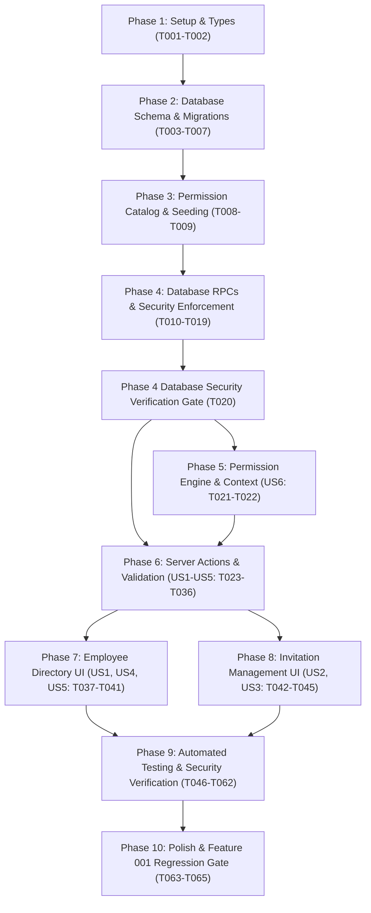

# Tasks: Feature 002 — Employee Management & Role-Based Access Control (RBAC)

**Input**: Design documents from `specs/002-employee-rbac/`  
**Prerequisites**: [plan.md](plan.md), [spec.md](spec.md), [research.md](research.md), [data-model.md](data-model.md), [contracts/](contracts/), [quickstart.md](quickstart.md)  
**Governing Principle**: [BizFlow AI Constitution v1.1.0](../../.specify/memory/constitution.md)

---

## Format: `- [ ] [TaskID] [P?] [Story?] Description with file path (Requirements)`

- **[P]**: Can run in parallel (different files, no dependencies on incomplete tasks)
- **[Story]**: Maps task to user story from `spec.md` (`[US1]` through `[US6]`)
- Every task includes the exact file path and relevant functional requirements (`FR-xxx`)

---

## Phase 1: Setup & Prerequisites

**Purpose**: Verify environment readiness and extend shared TypeScript baseline without breaking Feature 001.

- [x] T001 Verify local Supabase environment and Feature 001 migrations baseline (01 through 08) in `supabase/migrations/`
- [x] T002 [P] Extend TypeScript authentication type definitions with `PermissionKey` union and `permissions` array on `TenantContext` in `src/types/auth.ts` (FR-032, FR-034)

---

## Phase 2: Database Schema & Migrations

**Purpose**: Core database tables, enums, partial unique indexes, and Row-Level Security policies.  
**⚠️ CRITICAL**: Foundational prerequisite for all application and stored procedure logic. All tasks sequentially build the single consolidated migration file `supabase/migrations/20261103000009_employee_management_rbac.sql` without parallel file collision.

- [x] T003 Create custom `public.invitation_status` enum type in `supabase/migrations/20261103000009_employee_management_rbac.sql` (FR-013, FR-021, FR-022)
- [x] T004 Create `public.organization_invitations` table with stable database constraints (practical standard email syntax check and lowercase normalization check, exactly 64-character lowercase hex NOT NULL `token_hash` constraint, non-null `expires_at` without volatile `now()` table checks) and partial unique index `uq_pending_invitation` in `supabase/migrations/20261103000009_employee_management_rbac.sql` (FR-006, FR-007, FR-008, FR-010)
- [x] T005 Create `public.permissions` catalog table (colon notation format check) and `public.role_permissions` mapping table in `supabase/migrations/20261103000009_employee_management_rbac.sql` (FR-032, FR-033)
- [x] T006 Configure Row-Level Security (RLS) policies on `organization_invitations` enabling and forcing RLS (`FORCE ROW LEVEL SECURITY`), denying direct client mutations (`WITH CHECK (false)` / `USING (false)`), and restricting SELECTs to active Owners and Admins in `supabase/migrations/20261103000009_employee_management_rbac.sql` (FR-008, FR-034)
- [x] T007 Configure Row-Level Security (RLS) policies on `permissions` and `role_permissions` enabling and forcing RLS (`FORCE ROW LEVEL SECURITY`), granting authenticated read-only SELECT, and denying client mutations in `supabase/migrations/20261103000009_employee_management_rbac.sql` (FR-032, FR-034)

---

## Phase 3: Permission Catalog & Seeding

**Purpose**: Establish system permissions catalog and deterministic role-permission mappings.

- [x] T008 Implement idempotent seed script (`ON CONFLICT DO NOTHING`) for the 7 core employee management permissions in `supabase/migrations/20261103000009_employee_management_rbac.sql` (FR-032, FR-033)
- [x] T009 Implement idempotent seed script mapping permissions to `admin` (7 permissions) and `manager` (`employees:read`) roles in `supabase/migrations/20261103000009_employee_management_rbac.sql` (FR-032, FR-033)

---

## Phase 4: Database Stored Procedures (RPCs) & Security Enforcement

**Purpose**: Implement all 9 PL/pgSQL `SECURITY DEFINER` stored procedures with locked search paths, database-level validation, explicit execution grants, and execute security verification.

- [x] T010 Implement `public.create_organization_invitation` stored procedure in `supabase/migrations/20261103000009_employee_management_rbac.sql`: enforces active caller verification; validates practical email syntax; acquires row lock `FOR UPDATE` on any existing pending invitation for `(p_org_id, lower(trim(p_email)))` and concurrency-safely transitions it to `'expired'` with an `employee.invitation_expired` audit event if `expires_at <= now()` (ensuring partial unique index `uq_pending_invitation` does not incorrectly block valid reinvitation); traps unexpired pending duplicates (`P0022`); rejects existing active members (`P0021`); blocks Admin privilege escalation to Owner (`P0020`); enforces maximum 7-day lifetime boundary (`now() < p_expires_at AND p_expires_at <= now() + INTERVAL '7 days'`); persists 64-character hex `token_hash` constraint; and logs `employee.invited` audit event for the newly created invitation (FR-005 to FR-012, FR-035)
- [x] T011 Implement `public.validate_invitation_token` stored procedure with zero-disclosure return structure (`is_valid`, `is_expired`, `status`), omitting tenant/role metadata, granted to `anon, authenticated, service_role` in `supabase/migrations/20261103000009_employee_management_rbac.sql` (FR-016)
- [x] T012 Implement `public.accept_organization_invitation` stored procedure with row-level locking (`FOR UPDATE`), transaction-safe lazy expiration returning `{ success: false, code: 'INVITATION_EXPIRED' }`, verified email matching with generic `EMAIL_MISMATCH` privacy protection, atomic membership creation (`status = 'active'`), and `employee.joined` audit logging in `supabase/migrations/20261103000009_employee_management_rbac.sql` (FR-017 to FR-023, FR-035)
- [x] T013 Implement `public.decline_organization_invitation` stored procedure with email match verification, generic `EMAIL_MISMATCH` privacy protection, transition to `declined`, and `employee.invitation_declined` audit logging in `supabase/migrations/20261103000009_employee_management_rbac.sql` (FR-020, FR-023, FR-035)
- [x] T014 Implement `public.resend_organization_invitation` stored procedure enforcing maximum 7-day lifetime boundary (`now() < p_new_expires_at AND p_new_expires_at <= now() + INTERVAL '7 days'`), token hash reset, and `employee.invitation_resent` audit logging in `supabase/migrations/20261103000009_employee_management_rbac.sql` (FR-014, FR-035)
- [x] T015 Implement `public.revoke_organization_invitation` stored procedure transitioning status to `'revoked'` (preserving the NOT NULL 64-character hex `token_hash` constraint while ensuring token validation and acceptance RPCs reject non-pending status) and logging `employee.invitation_revoked` audit event in `supabase/migrations/20261103000009_employee_management_rbac.sql` (FR-013, FR-035)
- [x] T016 Implement `public.update_organization_member_role` stored procedure with self-modification prevention (`P0023`), terminal revoked status guard (`P0025`), Admin escalation check (`P0020`), `check_owner_invariant` trigger enforcement (`P0002`), and `employee.role_updated` audit logging in `supabase/migrations/20261103000009_employee_management_rbac.sql` (FR-024, FR-025, FR-026, FR-035)
- [x] T017 Implement `public.update_organization_member_status` stored procedure with self-modification prevention (`P0024`), permitted status transitions (`active` $\leftrightarrow$ `suspended`, `active`/`suspended` $\rightarrow$ `revoked`), terminal revoked guard (`P0025`), `check_owner_invariant` trigger enforcement (`P0002`), and audit logging (`employee.suspended`, `employee.reactivated`, or `employee.removed`) in `supabase/migrations/20261103000009_employee_management_rbac.sql` (FR-026 to FR-031, FR-035)
- [x] T018 Implement `public.get_organization_employees` stored procedure enforcing 4-rule authoritative `employees:read` permission gate, minimal profile projection (`first_name`, `last_name`, `email`, `phone`, `role`, `status`, `joined_at`), and exclusion of revoked memberships in `supabase/migrations/20261103000009_employee_management_rbac.sql` (FR-001, FR-002, FR-003, FR-033)
- [x] T019 Configure security hardening across all 9 stored procedures: lock `search_path = pg_catalog, public, pg_temp`, assign ownership to `postgres`, revoke default `PUBLIC` execution, and grant explicit execution rights (`validate_invitation_token` to `anon, authenticated, service_role`; remaining 8 RPCs to `authenticated`) in `supabase/migrations/20261103000009_employee_management_rbac.sql` (FR-034)
- [x] T020 Verify database security posture: execute automated security verification script confirming `postgres` function ownership, locked `search_path`, revoked `PUBLIC` execution, explicit role grants, `FORCE ROW LEVEL SECURITY` enablement on tenant tables, client mutation denial (`42501`), and unauthorized direct RPC invocation rejection in `tests/integration/database-security.test.ts` (FR-008, FR-034)

---

## Phase 5: Permission Engine & Tenant-Context Integration (User Story 6 - Priority: P2)

**Goal**: Establish unified server-side permission resolution engine mapping roles to registered permissions, with automatic Owner access for registered permissions and strict rejection of unknown keys.  
**Independent Test**: Assert `hasPermission` returns `true` for Owner on registered keys, `false` for unknown keys across all roles, and evaluates `Admin`/`Manager` against role mappings.

- [x] T021 [P] [US6] Implement permission catalog constants (`SYSTEM_PERMISSIONS`) and `hasPermission` authorization engine enforcing the 4-rule catalog bounding and rejection of unknown keys in `src/lib/auth/permissions.ts` (FR-032, FR-033, FR-034)
- [x] T022 [US6] Extend `resolveTenantContext` to query `public.role_permissions`, populate `context.permissions`, and automatically assign all registered permissions to active Owners in `src/lib/auth/context.ts` (FR-033, FR-034)

---

## Phase 6: Server Actions & Validation (User Stories 1 through 5)

**Goal**: Deliver secure, validated Next.js Server Actions for employee directory management, pending invitation retrieval, invitation issuance, revocation, resend, and acceptance with decoupled transactional email delivery and strict authorization gates.  
**Independent Test**: Invoke actions with authorized and unauthorized contexts; verify Zod schema validation, database RPC invocation, and structured result contracts.

- [x] T023 [P] [US1] Implement Zod validation schemas for employee actions (`updateMemberRoleSchema`, `updateMemberStatusSchema`, `removeMemberSchema`) in `src/lib/validations/employee.ts` (FR-025, FR-027, FR-029)
- [x] T024 [P] [US2] Implement Zod validation schemas for invitation actions (`inviteEmployeeSchema`, `resendInvitationSchema`, `revokeInvitationSchema`, `acceptInvitationSchema`, `declineInvitationSchema`, `validateInvitationTokenSchema`) using practical standard email validation rules in `src/lib/validations/invitation.ts` (FR-005, FR-006, FR-013, FR-014, FR-016)
- [x] T025 [P] [US2] Implement decoupled transactional invitation email dispatcher with non-blocking error handling returning partial warning on failure in `src/lib/email/invitation-mailer.ts` (FR-015)
- [x] T026 [US1] Implement `getEmployeesAction` Server Action gated by `employees:read` calling `get_organization_employees` RPC in `src/actions/employee-actions.ts` (FR-001, FR-002, FR-003)
- [x] T027 [US4] Implement `updateMemberRoleAction` Server Action validating role hierarchy, blocking self-demotion, rejecting terminal revoked memberships (`P0025`), and calling `update_organization_member_role` RPC in `src/actions/employee-actions.ts` (FR-024, FR-025, FR-026)
- [x] T028 [US5] Implement `updateMemberStatusAction` Server Action validating permitted transitions (`active` $\leftrightarrow$ `suspended`), rejecting terminal revoked memberships (`P0025`), and calling `update_organization_member_status` RPC in `src/actions/employee-actions.ts` (FR-027, FR-028)
- [x] T029 [US5] Implement `removeMemberAction` Server Action enforcing soft revocation (`status = 'revoked'`), preventing last Owner removal (`P0002`), and calling `update_organization_member_status` in `src/actions/employee-actions.ts` (FR-026, FR-029, FR-030, FR-031)
- [x] T030 [US2] Implement `inviteEmployeeAction` Server Action generating 256-bit entropy token hash, calling `create_organization_invitation` RPC, and executing decoupled email dispatch outside transaction in `src/actions/invitation-actions.ts` (FR-005 to FR-012, FR-015)
- [x] T031 [US2] Implement `resendInvitationAction` Server Action generating new 256-bit token hash, calling `resend_organization_invitation` RPC, and redispatching email in `src/actions/invitation-actions.ts` (FR-014, FR-015)
- [x] T032 [US2] Implement `revokeInvitationAction` Server Action gated by `employees:invitations_revoke` calling `revoke_organization_invitation` RPC in `src/actions/invitation-actions.ts` (FR-013)
- [x] T033 [US2] Implement `getPendingInvitationsAction` Server Action in `src/actions/invitation-actions.ts`: enforces active tenant membership and `employees:invitations_read` permission; queries `public.organization_invitations` via server-side Supabase client relying on `invitations_select_authorized` RLS policy; filters or accurately represents expired records (`expires_at <= now()`); and returns sanitized projection (`id`, `email`, `role`, `status`, `expires_at`, `created_at`) strictly omitting `token_hash` (FR-013, FR-014, FR-034)
- [x] T034 [US3] Implement `validateInvitationTokenAction` Server Action calling `validate_invitation_token` RPC with zero tenant metadata disclosure to unauthenticated visitors in `src/actions/invitation-actions.ts` (FR-016)
- [x] T035 [US3] Implement `acceptInvitationAction` Server Action calling `accept_organization_invitation` RPC, handling generic `EMAIL_MISMATCH`, and setting active org cookie on success in `src/actions/invitation-actions.ts` (FR-017 to FR-023)
- [x] T036 [US3] Implement `declineInvitationAction` Server Action calling `decline_organization_invitation` RPC with generic `EMAIL_MISMATCH` privacy handling in `src/actions/invitation-actions.ts` (FR-020, FR-023)

---

## Phase 7: Employee Directory UI (User Story 1, 4, 5 - Priority: P1 / P2)

**Goal**: Provide accessible workforce directory with status indicators, role editing, and suspension/revocation dialogs.  
**Independent Test**: Navigate to `/[slug]/employees` as Owner/Admin/Manager to verify directory rendering, search, role change, and suspension controls. Verify Cashier receives 404.

- [x] T037 [P] [US1] Create `EmployeeTable` component displaying full name, email, phone (or 'None'), role badge, status badge (`Active`, `Suspended`), and joined date in `src/components/employees/EmployeeTable.tsx` (FR-001, FR-004)
- [x] T038 [P] [US4] Create `RoleSelectorDialog` component with role hierarchy boundaries preventing promotion to Owner by Admin and blocking self-demotion in `src/components/employees/RoleSelectorDialog.tsx` (FR-024, FR-025)
- [x] T039 [P] [US5] Create `StatusChangeDialog` component for confirming suspension, reactivation, and soft revocation with last-Owner safety warnings in `src/components/employees/StatusChangeDialog.tsx` (FR-026, FR-027, FR-028, FR-029)
- [x] T040 [US1] Create employee directory page with search input, role filter, status filter, loading skeleton, and 404 Not Found authorization guard in `src/app/[slug]/employees/page.tsx` and `src/app/[slug]/employees/loading.tsx` (FR-001, FR-002, FR-004)
- [x] T041 [US1] Add "Employees" navigation link to tenant header navigation, conditionally rendered only when caller holds `employees:read` in `src/components/layout/TenantHeader.tsx` (FR-001, FR-034)

---

## Phase 8: Invitation Management & Acceptance UI (User Story 2, 3 - Priority: P1)

**Goal**: Deliver email invitation modal, pending invitations tab, and public invitation acceptance flow with authentication and account-mismatch prompts.  
**Independent Test**: Send invitation from Owner account; verify appearance in pending tab; open token link in new browser; sign in with matching account; verify acceptance and workspace redirect.

- [x] T042 [P] [US2] Create `InviteEmployeeModal` component with practical standard email syntax validation, role dropdown (preventing Owner selection by Admin), and delivery failure warning banner in `src/components/employees/InviteEmployeeModal.tsx` (FR-005, FR-006, FR-012, FR-015)
- [x] T043 [P] [US2] Create `PendingInvitations` sub-view within employee directory consuming `getPendingInvitationsAction` to display active invitations with "Resend" and "Revoke" action triggers in `src/components/employees/PendingInvitations.tsx` (FR-013, FR-014)
- [x] T044 [P] [US3] Create `AcceptInvitationCard` component displaying pre-flight verified invitation details, authenticated email comparison, and Accept/Decline action buttons in `src/components/invitations/AcceptInvitationCard.tsx` (FR-016 to FR-023)
- [x] T045 [US3] Create public invitation acceptance route page handling unauthenticated sign-in prompts, pre-flight token validation, expired link notices, and account mismatch switch banners in `src/app/invitations/accept/page.tsx` and `src/app/invitations/accept/loading.tsx` (FR-016 to FR-020)

---

## Phase 9: Automated Testing & Security Verification

**Purpose**: Execute comprehensive automated test suites verifying all security guarantees, invariants, privilege boundaries, and edge cases.

- [x] T046 [P] [US6] Unit tests verifying TypeScript `hasPermission` 4-rule resolution, automatic Owner access for registered keys, role-permission evaluations, and strict rejection of unknown or unregistered keys in `tests/unit/auth/permissions.test.ts` (FR-032, FR-033)
- [x] T047 [P] [US6] Integration test verifying bidirectional catalog consistency between TypeScript `SYSTEM_PERMISSIONS` and the PostgreSQL `public.permissions` catalog table in `tests/integration/permissions-catalog.test.ts` (FR-032, FR-033)
- [x] T048 [P] [US1] Unit tests for employee management Zod schemas validating UUIDs, role enums, and status transitions in `tests/unit/validations/employee.test.ts` (FR-024, FR-027, FR-029)
- [x] T049 [P] [US2] Unit tests for invitation Zod schemas validating practical standard email syntax, token format, and 7-day expiration bounds in `tests/unit/validations/invitation.test.ts` (FR-006, FR-007, FR-009)
- [x] T050 [US2] Integration tests for invitation lifecycle (creation, 7-day RPC boundary enforcement, token hashing, transaction-safe lazy expiration persistence, resend, revocation) and direct client INSERT denial (`42501`) in `tests/integration/invitations-rls.test.ts` (FR-007, FR-008, FR-009, FR-013, FR-014, FR-022)
- [x] T051 [US2] Integration tests for direct RPC input-validation bypass attempts: asserting database-level `P0009` rejection for malformed emails, non-hex token hashes, expiration > 7 days, and invalid UUIDs/enums in `tests/integration/invitations-rls.test.ts` (FR-006, FR-007, FR-009, FR-034)
- [x] T052 [US3] Integration tests for invitation token pre-flight disclosure restrictions: asserting `validate_invitation_token` returns only `{ is_valid, is_expired, status }` and discloses zero tenant metadata to anon callers in `tests/integration/invitations-rls.test.ts` (FR-016)
- [x] T053 [US2] Integration tests for concurrent duplicate invitation creation and expired pending invitation handling: asserting concurrency-safe transition of expired invites to `expired` with an `employee.invitation_expired` audit event before new insert so partial unique index `uq_pending_invitation` permits reinvitation while blocking active duplicates (`P0022`) in `tests/integration/invitations-rls.test.ts` (FR-010, FR-011, FR-035)
- [x] T054 [US3] Integration tests for invitation acceptance replay prevention: verifying already accepted, declined, revoked, or expired tokens reject subsequent acceptance attempts in `tests/integration/invitations-rls.test.ts` (FR-023)
- [x] T055 [US3] Integration tests for acceptance and decline email identity matching and generic `EMAIL_MISMATCH` privacy protection without leaking addresses in `tests/integration/invitations-rls.test.ts` (FR-020, FR-021)
- [x] T056 [US2] Integration tests for resend behavior when email delivery fails, verifying old-token invalidation and partial warning return in `tests/integration/invitations-rls.test.ts` (FR-014, FR-015)
- [x] T057 [US4] Integration tests for role hierarchy escalation prevention (Admin cannot promote to Owner or modify Owner) and concurrent Owner changes with last-Owner protection via `check_owner_invariant` (`P0002`) in `tests/integration/employee-rbac.test.ts` (FR-025, FR-026)
- [x] T058 [US5] Integration tests for membership suspension, reactivation, and terminal soft revocation (rejecting updates on revoked members with `P0025`) in `tests/integration/employee-rbac.test.ts` (FR-027, FR-028, FR-029)
- [x] T059 [US5] Integration tests for multi-tenant isolation: verifying that revoking membership in one organization immediately revokes access (404) while preserving active access to other organizations in `tests/integration/employee-rbac.test.ts` (FR-030, FR-031)
- [x] T060 [US5] Integration tests for real-time authorization freshness: verifying that demoting or suspending a member immediately revokes access on their very next request with zero propagation delay in `tests/integration/employee-rbac.test.ts` (FR-027, FR-031, FR-034)
- [x] T061 [US1] Integration tests for tenant isolation and directory enumeration prevention: revoked/suspended members return 404, Cashiers denied directory access (`P0005`) in `tests/integration/employee-rbac.test.ts` (FR-002, FR-003, FR-031)
- [x] T062 [US1] Playwright E2E test for complete workforce management workflow (Owner invites employee -> employee accepts -> Owner updates role -> Owner suspends employee -> verifies immediate lockout) in `tests/e2e/employee-management.spec.ts` (US1 to US5)

---

## Phase 10: Polish & Cross-Cutting Verification

**Purpose**: Database type regeneration, documentation review, and full regression verification against Feature 001.

- [x] T063 Regenerate Supabase database TypeScript definitions and verify schema types in `src/types/database.ts`
- [x] T064 Execute Feature 001 automated regression test suite verifying authentication, session recovery, and multi-tenant organization switching remain 100% operational in `tests/unit/` and `tests/integration/`
- [x] T065 Execute full manual walkthrough following `quickstart.md` and confirm zero regressions against Feature 001 in `specs/002-employee-rbac/quickstart.md`

---

## Dependencies & Execution Order

### Phase Dependencies

### Critical Verification Gates

1. **Database Security Verification Gate (`T020`)**:
   - MUST pass completely before Phase 6 Server Actions or UI implementation can be considered ready.
   - Verifies `postgres` function ownership, restricted search paths (`pg_catalog, public, pg_temp`), revoked `PUBLIC` execution, explicit execution grants, `FORCE ROW LEVEL SECURITY` enablement, client mutation denial (`42501`), and unauthorized direct RPC invocation rejection.
2. **Integration Verification Gate (Phases 5 & 6 Tests)**:
   - Database integration tests (`T050`–`T061`) and permission catalog tests (`T046`, `T047`) validate the backend and actions before final UI acceptance.
3. **Feature 001 Regression Gate (`T064`)**:
   - Feature 001 regression tests MUST execute and pass after complete implementation to guarantee zero regression across authentication, organization creation, and multi-tenant switching.

### User Story Dependencies

- **User Story 6 (Permissions Engine - Priority: P2)**: Depends on Phases 1–4 and `T020`. Unblocks server authorization across all subsequent stories.
- **User Story 1 (Employee Directory - Priority: P1 🎯 MVP)**: Depends on Phase 4 RPCs, `T020`, Phase 5 Context, and Phase 6 Server Actions. Can be deployed as the initial operational MVP.
- **User Story 2 (Invite Employees via Email - Priority: P1)**: Depends on Phase 4 RPCs, `T020`, and Phase 6 Server Actions. Runs in parallel with US1 UI.
- **User Story 3 (Accept/Decline Invitations - Priority: P1)**: Depends on US2 invitations data. Can run in parallel with US1 directory UI.
- **User Story 4 (Role Management - Priority: P2)**: Extends US1 Employee Directory with role elevation guards.
- **User Story 5 (Membership Status & Removal - Priority: P2)**: Extends US1 Employee Directory with suspension and terminal soft revocation.

---

## Parallel Execution Opportunities

### Phase 6: Server Actions & Schemas
- `T023` (employee Zod schemas), `T024` (invitation Zod schemas), and `T025` (invitation mailer) can run in parallel (different files).
- Server Actions in `src/actions/employee-actions.ts` (`T026`–`T029`) and `src/actions/invitation-actions.ts` (`T030`–`T036`) run sequentially within each action file.

### Phase 7 & 8: UI Components
- `T037` (`EmployeeTable.tsx`), `T038` (`RoleSelectorDialog.tsx`), `T039` (`StatusChangeDialog.tsx`), `T042` (`InviteEmployeeModal.tsx`), `T043` (`PendingInvitations.tsx`), and `T044` (`AcceptInvitationCard.tsx`) can all be built in parallel (different component files).

### Phase 9: Automated Tests
- Unit tests targeting distinct files (`T046` `permissions.test.ts`, `T047` `permissions-catalog.test.ts`, `T048` `employee.test.ts`, `T049` `invitation.test.ts`) can run in parallel.
- Integration tests sharing `tests/integration/invitations-rls.test.ts` (`T050`–`T056`) run sequentially.
- Integration tests sharing `tests/integration/employee-rbac.test.ts` (`T057`–`T061`) run sequentially.

---

## Implementation Strategy & MVP Scope

1. **Foundational Milestone (Phases 1–4)**:
   - Migration `20261103000009_employee_management_rbac.sql` applied cleanly.
   - All 9 RPCs, constraints, and RLS policies verified in PostgreSQL via `T020`.
2. **Core Authorization Milestone (Phase 5)**:
   - Permission engine and tenant-context integration active.
3. **🎯 Minimum Viable Product (MVP Milestone - Phase 6 & Phase 7 / US1)**:
   - Server Actions active.
   - Employee Directory viewable by Owner/Admin/Manager at `/[slug]/employees`.
   - Cashiers blocked with HTTP 404.
4. **Complete Collaboration Milestone (Phase 8 / US2 & US3)**:
   - Email invitation issuing, resend, revoke, and public acceptance/decline flow operational.
5. **Role & Lifecycle Administration Milestone (US4 & US5)**:
   - Role updates, suspension, reactivation, and terminal soft revocation operational.
6. **Hardening & Regression Milestone (Phase 9 & 10)**:
   - All 17 automated test tasks completed and passing cleanly; zero Feature 001 regressions confirmed via `T064`.
