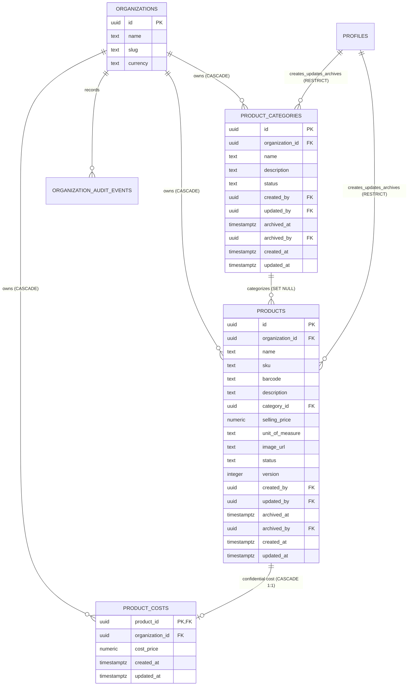

# Data Model: Feature 003 — Products & Categories

**Feature Branch**: `003-products-categories`  
**Date**: 2026-11-06 (Reconciled with Approved Specification)  
**Status**: Authoritative Data Model  
**Governing Documents**:
- [BizFlow AI Constitution v1.1.0](file:///c:/Users/Heyru/Desktop/projects/BizFlow-AI/.specify/memory/constitution.md)
- [Feature 003 Specification](file:///c:/Users/Heyru/Desktop/projects/BizFlow-AI/specs/003-products-categories/spec.md)
- [Feature 003 Requirements Checklist](file:///c:/Users/Heyru/Desktop/projects/BizFlow-AI/specs/003-products-categories/checklists/requirements.md)

---

## 1. Entity-Relationship Overview



---

## 2. Table Schemas, Constraints & Indexes

### 2.1 Table: `public.product_categories`

Flat categorization for retail products. Scoped strictly to `organization_id`. Lifecycle status has exactly two states: `'active'` and `'archived'`. Archiving preserves category records and maintains category name uniqueness across the organization.

```sql
CREATE TABLE public.product_categories (
    id UUID PRIMARY KEY DEFAULT gen_random_uuid(),
    organization_id UUID NOT NULL REFERENCES public.organizations(id) ON DELETE CASCADE,
    name TEXT NOT NULL,
    description TEXT NULL,
    status TEXT NOT NULL DEFAULT 'active' CHECK (status IN ('active', 'archived')),
    created_by UUID NOT NULL REFERENCES public.profiles(id) ON DELETE RESTRICT,
    updated_by UUID NOT NULL REFERENCES public.profiles(id) ON DELETE RESTRICT,
    archived_at TIMESTAMPTZ NULL,
    archived_by UUID NULL REFERENCES public.profiles(id) ON DELETE RESTRICT,
    created_at TIMESTAMPTZ NOT NULL DEFAULT clock_timestamp(),
    updated_at TIMESTAMPTZ NOT NULL DEFAULT clock_timestamp(),

    -- Constraints
    CONSTRAINT chk_category_name_length CHECK (
        char_length(trim(name)) BETWEEN 1 AND 100
    ),
    CONSTRAINT chk_category_description_length CHECK (
        description IS NULL OR char_length(trim(description)) <= 500
    ),
    CONSTRAINT chk_category_archival_status CHECK (
        (status = 'active' AND archived_at IS NULL AND archived_by IS NULL) OR
        (status = 'archived' AND archived_at IS NOT NULL AND archived_by IS NOT NULL)
    ),
    -- Composite unique key to support composite FK target from public.products
    CONSTRAINT uq_categories_org_id UNIQUE (organization_id, id)
);

-- Case-insensitive category name uniqueness per organization (enforced across active and archived)
CREATE UNIQUE INDEX uq_categories_org_name 
ON public.product_categories (organization_id, lower(trim(name)));

-- Query performance index for filtering categories by status
CREATE INDEX idx_categories_org_status 
ON public.product_categories (organization_id, status);
```

---

### 2.2 Table: `public.products`

Core catalog entities representing sellable items. Scoped strictly to `organization_id`. Lifecycle status has exactly three states: `'active'`, `'inactive'`, and `'archived'`. Includes 13 validated units of measure, normalized uppercase SKU, optional barcode, OCC version, and stable image URL reference.

```sql
CREATE TABLE public.products (
    id UUID PRIMARY KEY DEFAULT gen_random_uuid(),
    organization_id UUID NOT NULL REFERENCES public.organizations(id) ON DELETE CASCADE,
    name TEXT NOT NULL,
    sku TEXT NOT NULL,
    barcode TEXT NULL,
    description TEXT NULL,
    category_id UUID NULL,
    selling_price NUMERIC(14, 4) NOT NULL DEFAULT 0.0000,
    unit_of_measure TEXT NOT NULL DEFAULT 'piece',
    image_url TEXT NULL,
    status TEXT NOT NULL DEFAULT 'active',
    version INTEGER NOT NULL DEFAULT 1,
    created_by UUID NOT NULL REFERENCES public.profiles(id) ON DELETE RESTRICT,
    updated_by UUID NOT NULL REFERENCES public.profiles(id) ON DELETE RESTRICT,
    archived_at TIMESTAMPTZ NULL,
    archived_by UUID NULL REFERENCES public.profiles(id) ON DELETE RESTRICT,
    created_at TIMESTAMPTZ NOT NULL DEFAULT clock_timestamp(),
    updated_at TIMESTAMPTZ NOT NULL DEFAULT clock_timestamp(),

    -- Text length & format constraints
    CONSTRAINT chk_products_name_length CHECK (
        char_length(trim(name)) BETWEEN 1 AND 150
    ),
    CONSTRAINT chk_products_sku_format CHECK (
        sku = upper(trim(sku)) AND sku ~ '^[A-Z0-9_.-]{1,50}$'
    ),
    CONSTRAINT chk_products_barcode_format CHECK (
        barcode IS NULL OR (barcode = trim(barcode) AND barcode ~ '^[A-Za-z0-9-]{3,50}$')
    ),
    CONSTRAINT chk_products_description_length CHECK (
        description IS NULL OR char_length(trim(description)) <= 2000
    ),
    CONSTRAINT chk_products_selling_price_non_negative CHECK (
        selling_price >= 0.0000
    ),
    CONSTRAINT chk_products_unit_of_measure CHECK (
        unit_of_measure IN (
            'piece', 'unit', 'kg', 'g', 'mg', 'liter', 'ml', 'meter', 'cm', 'box', 'pack', 'pair', 'set'
        )
    ),
    CONSTRAINT chk_products_image_url_format CHECK (
        image_url IS NULL 
        OR image_url ~ '^https://.+' 
        OR image_url ~ '^[0-9a-f-]{36}/[0-9a-f-]{36}/[A-Za-z0-9._-]+$'
    ),
    CONSTRAINT chk_products_status CHECK (
        status IN ('active', 'inactive', 'archived')
    ),
    CONSTRAINT chk_products_version CHECK (
        version >= 1
    ),
    CONSTRAINT chk_products_archival_status CHECK (
        (status IN ('active', 'inactive') AND archived_at IS NULL AND archived_by IS NULL) OR
        (status = 'archived' AND archived_at IS NOT NULL AND archived_by IS NOT NULL)
    ),

    -- Composite unique key to support composite FK target from product_costs
    CONSTRAINT uq_products_org_id UNIQUE (organization_id, id),

    -- Permanent SKU uniqueness across organization (including archived products)
    CONSTRAINT uq_products_org_sku UNIQUE (organization_id, sku),

    -- Composite Foreign Key: Cross-tenant category prevention with column-specific NULLing (PostgreSQL 15+)
    CONSTRAINT fk_products_org_category FOREIGN KEY (organization_id, category_id)
        REFERENCES public.product_categories (organization_id, id)
        ON DELETE SET NULL (category_id)
);

-- Permanent Barcode uniqueness across organization for non-null barcodes (including archived products)
CREATE UNIQUE INDEX uq_products_org_barcode 
ON public.products (organization_id, barcode) 
WHERE barcode IS NOT NULL;

-- B-Tree Indexes for catalog browsing, filtering, and prefix searching
CREATE INDEX idx_products_org_status_cat 
ON public.products (organization_id, status, category_id);

CREATE INDEX idx_products_name_prefix 
ON public.products (organization_id, name text_pattern_ops);

-- Trigram GIN Index for fast fuzzy and partial substring search (requires pg_trgm)
CREATE INDEX idx_products_name_trgm 
ON public.products USING gin (name gin_trgm_ops);
```

---

### 2.3 Table: `public.product_costs`

Confidential acquisition cost isolated into a dedicated 1:1 physical table. Scoped strictly to `organization_id`. Uses composite foreign keys for cross-tenant cascade and strict tenant integrity.

```sql
CREATE TABLE public.product_costs (
    product_id UUID PRIMARY KEY,
    organization_id UUID NOT NULL,
    cost_price NUMERIC(14, 4) NOT NULL CHECK (cost_price >= 0.0000),
    created_at TIMESTAMPTZ NOT NULL DEFAULT clock_timestamp(),
    updated_at TIMESTAMPTZ NOT NULL DEFAULT clock_timestamp(),

    -- Composite Foreign Key: Ensures cost record matches product tenant and cascades on product delete
    CONSTRAINT fk_product_costs_org_product FOREIGN KEY (organization_id, product_id)
        REFERENCES public.products (organization_id, id)
        ON DELETE CASCADE,

    -- Direct Organization Foreign Key: Ensures org-level cascade handles cleanup
    CONSTRAINT fk_product_costs_org FOREIGN KEY (organization_id)
        REFERENCES public.organizations (id)
        ON DELETE CASCADE
);

CREATE INDEX idx_product_costs_org 
ON public.product_costs (organization_id);
```

---

## 3. Database Functions & Triggers

### 3.1 Immutable Currency Exponent Registry

```sql
CREATE OR REPLACE FUNCTION public.get_currency_exponent(p_currency TEXT)
RETURNS INTEGER
LANGUAGE plpgsql
IMMUTABLE
STRICT
AS $$
BEGIN
    CASE upper(trim(p_currency))
        -- 0 decimal places
        WHEN 'JPY', 'KRW', 'VND', 'CLP', 'PYG', 'UGX', 'RWF' THEN
            RETURN 0;
            
        -- 2 decimal places
        WHEN 'USD', 'EUR', 'GBP', 'CAD', 'AUD', 'NZD', 'CHF', 'SGD', 'HKD',
             'SEK', 'NOK', 'DKK', 'MXN', 'BRL', 'INR', 'ZAR', 'KES', 'NGN',
             'GHS', 'AED', 'SAR', 'QAR', 'EGP', 'COP', 'PEN', 'PHP', 'THB',
             'IDR', 'MYR' THEN
            RETURN 2;
            
        -- 3 decimal places
        WHEN 'BHD', 'KWD', 'OMR', 'JOD', 'TND', 'LYD', 'IQD' THEN
            RETURN 3;
            
        -- 4 decimal places
        WHEN 'CLF', 'UYW' THEN
            RETURN 4;
            
        ELSE
            RAISE EXCEPTION 'Unsupported or invalid ISO 4217 currency code: %', p_currency
                USING ERRCODE = 'P0009';
    END CASE;
END;
$$;
```

---

### 3.2 Organization Currency Invariance Trigger

Prevents mutating an organization's currency once catalog products exist.

```sql
CREATE OR REPLACE FUNCTION public.prevent_currency_change_when_products_exist()
RETURNS TRIGGER
LANGUAGE plpgsql
SECURITY DEFINER
SET search_path = pg_catalog, public, pg_temp
AS $$
BEGIN
    IF NEW.currency IS DISTINCT FROM OLD.currency THEN
        IF EXISTS (SELECT 1 FROM public.products WHERE organization_id = OLD.id LIMIT 1) THEN
            RAISE EXCEPTION 'Cannot change organization currency after products have been created'
                USING ERRCODE = 'P0015';
        END IF;
    END IF;
    RETURN NEW;
END;
$$;

CREATE TRIGGER trg_prevent_currency_change_when_products_exist
    BEFORE UPDATE OF currency ON public.organizations
    FOR EACH ROW
    EXECUTE FUNCTION public.prevent_currency_change_when_products_exist();
```

---

### 3.3 Automatic Timestamp Updating Triggers

```sql
CREATE TRIGGER trg_product_categories_updated_at
    BEFORE UPDATE ON public.product_categories
    FOR EACH ROW
    EXECUTE FUNCTION public.update_updated_at_column();

CREATE TRIGGER trg_products_updated_at
    BEFORE UPDATE ON public.products
    FOR EACH ROW
    EXECUTE FUNCTION public.update_updated_at_column();

CREATE TRIGGER trg_product_costs_updated_at
    BEFORE UPDATE ON public.product_costs
    FOR EACH ROW
    EXECUTE FUNCTION public.update_updated_at_column();
```

---

## 4. RBAC Seed Data & Role Permissions

```sql
-- 1. Insert 9 new catalog permissions
INSERT INTO public.permissions (key, resource, action, description) VALUES
    ('products:read', 'products', 'read', 'View product catalog items and selling prices'),
    ('products:read_cost', 'products', 'read_cost', 'View product acquisition costs and gross margins'),
    ('products:create', 'products', 'create', 'Create new product catalog entries and upload images'),
    ('products:update', 'products', 'update', 'Modify product details, selling prices, categories, and images'),
    ('products:archive', 'products', 'archive', 'Archive or restore product catalog entries'),
    ('categories:read', 'categories', 'read', 'View product categories'),
    ('categories:create', 'categories', 'create', 'Create new product categories'),
    ('categories:update', 'categories', 'update', 'Modify category names and descriptions'),
    ('categories:archive', 'categories', 'archive', 'Archive or restore product categories')
ON CONFLICT (key) DO UPDATE SET
    resource = EXCLUDED.resource,
    action = EXCLUDED.action,
    description = EXCLUDED.description;

-- 2. Map permissions to roles in public.role_permissions
-- Owner receives all registered permissions automatically via hasPermission / check_user_permission.
-- Seed mappings for Admin, Manager, and Cashier:
INSERT INTO public.role_permissions (role, permission_id)
SELECT r.role, p.id
FROM (
    -- Admin role mappings
    SELECT 'admin'::public.app_role AS role, unnest(ARRAY[
        'products:read', 'products:read_cost', 'products:create', 'products:update', 'products:archive',
        'categories:read', 'categories:create', 'categories:update', 'categories:archive'
    ]) AS perm_key
    UNION ALL
    -- Manager role mappings
    SELECT 'manager'::public.app_role AS role, unnest(ARRAY[
        'products:read', 'products:create', 'products:update',
        'categories:read', 'categories:create', 'categories:update'
    ]) AS perm_key
    UNION ALL
    -- Cashier role mappings
    SELECT 'cashier'::public.app_role AS role, unnest(ARRAY[
        'products:read',
        'categories:read'
    ]) AS perm_key
) r
JOIN public.permissions p ON p.key = r.perm_key
ON CONFLICT (role, permission_id) DO NOTHING;
```

---

## 5. Row-Level Security (RLS) & Direct DML Protection

All three tables enforce strict RLS and deny direct client modifications (`INSERT`, `UPDATE`, `DELETE`), funneling all mutations exclusively through `SECURITY DEFINER` RPCs.

```sql
-- 5.1 Product Categories RLS
ALTER TABLE public.product_categories ENABLE ROW LEVEL SECURITY;
ALTER TABLE public.product_categories FORCE ROW LEVEL SECURITY;

CREATE POLICY "Users can read product categories of their organizations"
ON public.product_categories FOR SELECT
TO authenticated
USING (
    public.is_org_member(organization_id)
    AND public.check_user_permission(organization_id, auth.uid(), 'categories:read')
);

CREATE POLICY "Deny direct client insert on product_categories"
ON public.product_categories FOR INSERT TO authenticated WITH CHECK (false);

CREATE POLICY "Deny direct client update on product_categories"
ON public.product_categories FOR UPDATE TO authenticated USING (false);

CREATE POLICY "Deny direct client delete on product_categories"
ON public.product_categories FOR DELETE TO authenticated USING (false);


-- 5.2 Products RLS
ALTER TABLE public.products ENABLE ROW LEVEL SECURITY;
ALTER TABLE public.products FORCE ROW LEVEL SECURITY;

CREATE POLICY "Users can read products of their organizations"
ON public.products FOR SELECT
TO authenticated
USING (
    public.is_org_member(organization_id)
    AND public.check_user_permission(organization_id, auth.uid(), 'products:read')
);

CREATE POLICY "Deny direct client insert on products"
ON public.products FOR INSERT TO authenticated WITH CHECK (false);

CREATE POLICY "Deny direct client update on products"
ON public.products FOR UPDATE TO authenticated USING (false);

CREATE POLICY "Deny direct client delete on products"
ON public.products FOR DELETE TO authenticated USING (false);


-- 5.3 Product Costs RLS (Confidential Data Isolation)
ALTER TABLE public.product_costs ENABLE ROW LEVEL SECURITY;
ALTER TABLE public.product_costs FORCE ROW LEVEL SECURITY;

CREATE POLICY "Users with products:read_cost can read product costs"
ON public.product_costs FOR SELECT
TO authenticated
USING (
    public.is_org_member(organization_id)
    AND public.check_user_permission(organization_id, auth.uid(), 'products:read_cost')
);

CREATE POLICY "Deny direct client insert on product_costs"
ON public.product_costs FOR INSERT TO authenticated WITH CHECK (false);

CREATE POLICY "Deny direct client update on product_costs"
ON public.product_costs FOR UPDATE TO authenticated USING (false);

CREATE POLICY "Deny direct client delete on product_costs"
ON public.product_costs FOR DELETE TO authenticated USING (false);
```

---

## 6. Supabase Storage Configuration & Policies

### 6.1 Private Bucket Provisioning

```sql
INSERT INTO storage.buckets (id, name, public, file_size_limit, allowed_mime_types)
VALUES (
    'product-images',
    'product-images',
    false,
    5242880, -- 5 MB
    ARRAY['image/jpeg', 'image/png', 'image/webp', 'image/gif']::text[]
)
ON CONFLICT (id) DO UPDATE SET
    public = false,
    file_size_limit = 5242880,
    allowed_mime_types = ARRAY['image/jpeg', 'image/png', 'image/webp', 'image/gif']::text[];
```

### 6.2 Storage RLS Policies (`storage.objects`)

Canonical object name relative to bucket: `{organization_id}/{product_id}/{filename}`  
Folder index `[1]` = `{organization_id}`, Folder index `[2]` = `{product_id}`.

```sql
-- 1. SELECT: Active org member with products:read AND target product exists in same org
CREATE POLICY "product_images_select" ON storage.objects
FOR SELECT TO authenticated
USING (
    bucket_id = 'product-images'
    AND public.is_org_member((storage.foldername(name))[1]::uuid)
    AND public.check_user_permission((storage.foldername(name))[1]::uuid, auth.uid(), 'products:read')
    AND EXISTS (
        SELECT 1 FROM public.products p
        WHERE p.id = (storage.foldername(name))[2]::uuid
          AND p.organization_id = (storage.foldername(name))[1]::uuid
    )
);

-- 2. INSERT: Active org member with products:create/update, product ownership, MIME, and size
CREATE POLICY "product_images_insert" ON storage.objects
FOR INSERT TO authenticated
WITH CHECK (
    bucket_id = 'product-images'
    AND public.is_org_member((storage.foldername(name))[1]::uuid)
    AND (
        public.check_user_permission((storage.foldername(name))[1]::uuid, auth.uid(), 'products:create')
        OR public.check_user_permission((storage.foldername(name))[1]::uuid, auth.uid(), 'products:update')
    )
    AND EXISTS (
        SELECT 1 FROM public.products p
        WHERE p.id = (storage.foldername(name))[2]::uuid
          AND p.organization_id = (storage.foldername(name))[1]::uuid
    )
    AND (metadata->>'size')::bigint <= 5242880
    AND metadata->>'mimetype' IN ('image/jpeg', 'image/png', 'image/webp', 'image/gif')
);

-- 3. UPDATE: Complete independent verification on BOTH USING and WITH CHECK
CREATE POLICY "product_images_update" ON storage.objects
FOR UPDATE TO authenticated
USING (
    bucket_id = 'product-images'
    AND public.is_org_member((storage.foldername(name))[1]::uuid)
    AND public.check_user_permission((storage.foldername(name))[1]::uuid, auth.uid(), 'products:update')
    AND EXISTS (
        SELECT 1 FROM public.products p
        WHERE p.id = (storage.foldername(name))[2]::uuid
          AND p.organization_id = (storage.foldername(name))[1]::uuid
    )
)
WITH CHECK (
    bucket_id = 'product-images'
    AND public.is_org_member((storage.foldername(name))[1]::uuid)
    AND public.check_user_permission((storage.foldername(name))[1]::uuid, auth.uid(), 'products:update')
    AND EXISTS (
        SELECT 1 FROM public.products p
        WHERE p.id = (storage.foldername(name))[2]::uuid
          AND p.organization_id = (storage.foldername(name))[1]::uuid
    )
    AND (metadata->>'size')::bigint <= 5242880
    AND metadata->>'mimetype' IN ('image/jpeg', 'image/png', 'image/webp', 'image/gif')
);

-- 4. DELETE: Active org member with products:update AND product ownership
CREATE POLICY "product_images_delete" ON storage.objects
FOR DELETE TO authenticated
USING (
    bucket_id = 'product-images'
    AND public.is_org_member((storage.foldername(name))[1]::uuid)
    AND public.check_user_permission((storage.foldername(name))[1]::uuid, auth.uid(), 'products:update')
    AND EXISTS (
        SELECT 1 FROM public.products p
        WHERE p.id = (storage.foldername(name))[2]::uuid
          AND p.organization_id = (storage.foldername(name))[1]::uuid
    )
);
```

---

## 7. Storage Cleanup & Deletion Limitations

When an organization is deleted, PostgreSQL cascades down to delete rows in `public.organizations`, `public.product_categories`, `public.products`, and `public.product_costs` via declarative foreign keys (`ON DELETE CASCADE`).

**Storage Limitation**: PostgreSQL database cascades **cannot automatically delete binary objects from Supabase Storage buckets or S3/GCS backends**. Deleting rows in `public.products` leaves corresponding binary objects in `storage.objects` as unreferenced orphans.

**Mitigation & Maintenance Strategy**:
1. When a product image is replaced or cleared via `update_productAction`, the server action invokes `supabase.storage.from('product-images').remove([oldImagePath])` upon successful RPC commit.
2. An automated cleanup cron job queries `storage.objects` where `bucket_id = 'product-images'` and `NOT EXISTS (SELECT 1 FROM public.products p WHERE p.image_url = storage.objects.name)` and `storage.objects.created_at < now() - INTERVAL '24 hours'`, safely purging orphaned files.

---

## 8. Audit Event Catalog Mappings

| Event Name | Actor | Metadata Structure | Triggering Operation |
|---|---|---|---|
| `category_created` | `auth.uid()` | `{ category_id: UUID, name: string }` | `create_product_category` |
| `category_updated` | `auth.uid()` | `{ category_id: UUID, old_name: string, new_name: string }` | `update_product_category` |
| `category_archived` | `auth.uid()` | `{ category_id: UUID, name: string }` | `archive_product_category` |
| `category_restored` | `auth.uid()` | `{ category_id: UUID, name: string }` | `restore_product_category` |
| `product_created` | `auth.uid()` | `{ product_id: UUID, sku: string, name: string, category_id: UUID \| null, selling_price: number, unit_of_measure: string, cost_set: boolean }` | `create_product` |
| `product_updated` | `auth.uid()` | `{ product_id: UUID, sku: string, version: number, cost_operation: string, updated_fields: string[] }` | `update_product` |
| `product_status_changed` | `auth.uid()` | `{ product_id: UUID, old_status: string, new_status: string, version: number }` | `toggle_product_status` |
| `product_archived` | `auth.uid()` | `{ product_id: UUID, sku: string, version: number }` | `archive_product` |
| `product_restored` | `auth.uid()` | `{ product_id: UUID, sku: string, version: number }` | `restore_product` |

All events commit atomically within the same database transaction in `public.organization_audit_events`.
Plaintext numeric cost prices are strictly EXCLUDED from all audit log payloads.
