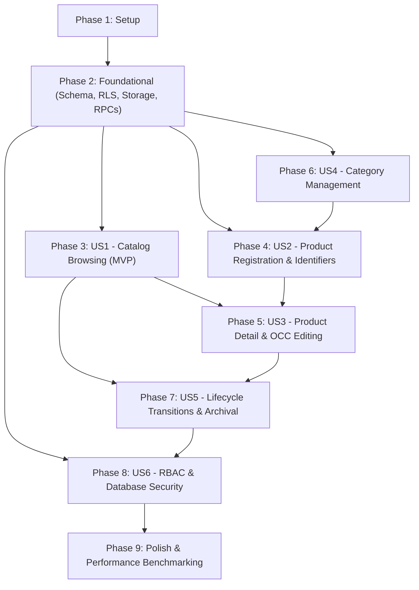

# Tasks: Feature 003 — Products & Categories

**Input**: Design documents from `specs/003-products-categories/`  
**Prerequisites**: [plan.md](plan.md), [spec.md](spec.md), [research.md](research.md), [data-model.md](data-model.md), [contracts/database-rpcs.md](contracts/database-rpcs.md), [contracts/server-actions.md](contracts/server-actions.md), [quickstart.md](quickstart.md), [requirements.md](checklists/requirements.md)  
**Governing Principle**: [BizFlow AI Constitution v1.1.0](../../.specify/memory/constitution.md)

---

## Format: `- [ ] [TaskID] [P?] [Story?] Description with file path (Requirements)`

- **[P]**: Can run in parallel (different files, no dependencies on incomplete tasks)
- **[Story]**: Maps task to user story from `spec.md` (`[US1]` through `[US6]`)
- Every task includes the exact file path and relevant functional requirements (`FR-xxx`) or success criteria (`SC-xxx`)

---

## Phase 1: Setup & Prerequisites

**Purpose**: Project initialization and shared baseline configuration without altering Features 001/002.

- [X] T001 Verify local Supabase environment and preceding migration baseline (01 through 09) in `supabase/migrations/`
- [X] T002 [P] Extend TypeScript authentication type definitions with the 9 Feature 003 permissions (`products:read`, `products:read_cost`, `products:create`, `products:update`, `products:archive`, `categories:read`, `categories:create`, `categories:update`, `categories:archive`) in `src/types/auth.ts` (FR-032, FR-033)
- [X] T003 [P] Define `UnitOfMeasure` union type (`ALLOWED_UOM` array of 13 approved retail values) and product domain models in `src/types/product.ts` (FR-001, BR-017)

---

## Phase 2: Foundational (Blocking Prerequisites)

**Purpose**: Core database tables, extensions, immutable functions, triggers, RLS policies, Storage bucket configuration, permissions seeding, and privileged stored procedures.  
**⚠️ CRITICAL**: Foundational prerequisite for all application and user story logic. All database tasks build the single consolidated migration file `supabase/migrations/20261106000010_products_categories_schema.sql`.

- [X] T004 Enable `pg_trgm` extension for trigram search in `supabase/migrations/20261106000010_products_categories_schema.sql` (FR-027, Decision 16)
- [X] T005 Create `public.product_categories` table with 2-state status (`active`, `archived`), length constraints (name 1-100 chars, description $\le 500$ chars), `organization_id NOT NULL REFERENCES public.organizations(id) ON DELETE CASCADE`, composite unique constraint `uq_categories_org_id (organization_id, id)`, and case-insensitive unique expression index `uq_categories_org_name (organization_id, lower(trim(name)))` in `supabase/migrations/20261106000010_products_categories_schema.sql` (FR-030 to FR-034, BR-015)
- [X] T006 Create `public.products` table in `supabase/migrations/20261106000010_products_categories_schema.sql` with: 3-state status (`active`, `inactive`, `archived`); 13 approved retail UOM check constraint; uppercase normalized SKU check constraint (`sku = upper(trim(sku)) AND sku ~ '^[A-Z0-9_.-]{1,50}$'`); optional barcode check constraint (`^[A-Za-z0-9-]{3,50}$`); selling price explicit `NUMERIC(14, 4) NOT NULL DEFAULT 0.0000` with non-negative check constraint (`selling_price >= 0.0000`); dual image URL check (`^https://.+` OR `^[0-9a-f-]{36}/[0-9a-f-]{36}/[A-Za-z0-9._-]+$`); OCC `version INT NOT NULL DEFAULT 1 CHECK (version >= 1)`; `organization_id NOT NULL REFERENCES public.organizations(id) ON DELETE CASCADE`; composite unique constraint `uq_products_org_id (organization_id, id)`; unconditional permanent SKU unique constraint `uq_products_org_sku (organization_id, sku)`; unconditional permanent barcode unique index `uq_products_org_barcode (organization_id, barcode) WHERE barcode IS NOT NULL`; and composite FK `fk_products_org_category (organization_id, category_id) REFERENCES public.product_categories (organization_id, id) ON DELETE SET NULL (category_id)` (FR-001 to FR-011, FR-017, FR-021, FR-023, BR-003, BR-015, BR-017)
- [X] T007 Create `public.product_costs` table with primary key `product_id`, `organization_id NOT NULL`, `cost_price NUMERIC(14, 4) NOT NULL CHECK (cost_price >= 0.0000)`, composite FK `fk_product_costs_org_product (organization_id, product_id) REFERENCES public.products (organization_id, id) ON DELETE CASCADE`, and org FK `fk_product_costs_org (organization_id) REFERENCES public.organizations (id) ON DELETE CASCADE` in `supabase/migrations/20261106000010_products_categories_schema.sql` (FR-038, BR-015)
- [X] T008 Implement immutable helper function `public.get_currency_exponent(p_currency TEXT) RETURNS INTEGER` covering all ISO 4217 whitelist currencies (0, 2, 3, or 4 minor units) and strictly raising `P0009` (`VALIDATION_ERROR`) on unknown or unsupported currency codes in `supabase/migrations/20261106000010_products_categories_schema.sql` (FR-013, BR-004)
- [X] T009 Implement trigger function `public.prevent_currency_change_when_products_exist()` and attach `BEFORE UPDATE OF currency ON public.organizations` trigger raising `P0015` (`STATE_CONFLICT`) if products exist for the organization in `supabase/migrations/20261106000010_products_categories_schema.sql` (FR-014, BR-005)
- [X] T010 Attach `update_updated_at_column()` triggers to `public.product_categories`, `public.products`, and `public.product_costs` in `supabase/migrations/20261106000010_products_categories_schema.sql`
- [X] T011 Implement idempotent seed script for the 9 catalog permissions in `public.permissions` and role mappings across `admin`, `manager`, and `cashier` in `public.role_permissions` in `supabase/migrations/20261106000010_products_categories_schema.sql` (FR-032, FR-033, Role Matrix)
- [X] T012 Configure Row-Level Security (RLS) on `product_categories`, `products`, and `product_costs`: enable and force RLS (`FORCE ROW LEVEL SECURITY`), configure SELECT policies using `public.is_org_member(organization_id)` and permission gates (`categories:read`, `products:read`, and `products:read_cost` on `product_costs`), and deny direct client mutations (`WITH CHECK (false)` / `USING (false)`) in `supabase/migrations/20261106000010_products_categories_schema.sql` (FR-038, FR-039, FR-040)
- [X] T013 Configure private Supabase Storage bucket `product-images` (`public = false`, `file_size_limit = 5242880`, `allowed_mime_types = ARRAY['image/jpeg', 'image/png', 'image/webp', 'image/gif']::text[]`) in `storage.buckets`, and implement the 4 explicit Storage RLS policies on `storage.objects` enforcing canonical path `{organization_id}/{product_id}/{filename}` in `supabase/migrations/20261106000010_products_categories_schema.sql`: (1) `SELECT`: verifies bucket ID, folder org membership, caller `products:read`, and target product existence in same tenant; (2) `INSERT`: enforces product-first authorization requiring target product to already exist in caller's organization (`EXISTS (SELECT 1 FROM public.products p WHERE p.id = (storage.foldername(name))[2]::uuid AND p.organization_id = (storage.foldername(name))[1]::uuid)`), caller `products:create` or `products:update`, size $\le 5$ MB, and allowed MIME types (pre-creation uploads to non-existent products are strictly denied by RLS); (3) `UPDATE`: independently evaluates identical complete authorization in both `USING` and `WITH CHECK` clauses to prevent cross-tenant/cross-product destination path tampering; (4) `DELETE`: verifies bucket ID, folder org membership, caller `products:update`, and target product existence in same organization (FR-042, BR-018)
- [X] T014 Implement category mutation stored procedures (`public.create_product_category`, `public.update_product_category`, `public.archive_product_category`, `public.restore_product_category`) in `supabase/migrations/20261106000010_products_categories_schema.sql`. Every procedure independently enforces database-level authorization: derives caller from `auth.uid()` (`P0003`), verifies email (`P0001`), verifies active membership in target organization (`P0004`), verifies active organization status (`P0004`), never trusts client-supplied auth claims, and enforces distinct operation-specific permissions via `public.check_user_permission` (`categories:create` for create, `categories:update` for update, `categories:archive` for archive and restore; raising `P0005` on failure). Validates case-insensitive trimmed name uniqueness across tenant (`P0006`), category existence in target organization (`P0002`), state transitions (`P0015` on updating archived category, archiving already archived category, or restoring active category), and executes atomic transactional audit logging (`category_created`, `category_updated`, `category_archived`, `category_restored`) in `public.organization_audit_events` (FR-030 to FR-037, FR-041, BR-021)
- [X] T015 Implement `public.create_product` stored procedure in `supabase/migrations/20261106000010_products_categories_schema.sql` executing strictly in order: **Phase A (Authorization)**: derives caller from `auth.uid()` (`P0003`), verifies email (`P0001`), verifies active membership in `p_org_id` (`P0004`), verifies active organization status (`P0004`), never trusts client-supplied auth claims, enforces `products:create` permission (`P0005`), and enforces `products:read_cost` permission if `p_cost_price IS NOT NULL` (`P0005`) $\rightarrow$ **Phase B (Validation & Locking)**: enforces initial `p_status = 'active'` (`P0015`), 13 retail UOM values (`P0009`), uppercase SKU regex and permanent tenant-wide uniqueness (`P0006`), optional barcode regex and permanent uniqueness (`P0006`), explicit category validation if `p_category_id IS NOT NULL` (missing or cross-tenant category raises `P0002`; existing archived category raises `P0015`), dual image URL format (`P0009`), currency row lock `SELECT ... FOR SHARE` (`P0002` if org missing), non-negative selling and cost prices (`P0007`), and minor-unit exponent precision check via `get_currency_exponent()` on `NUMERIC(14, 4)` selling price without rounding (`P0009`) $\rightarrow$ **Phase C (Atomic Mutation)**: 1. Insert product into `public.products` (`RETURNING id INTO v_product_id`); 2. IF `p_cost_price IS NOT NULL` THEN insert into `public.product_costs (organization_id, product_id, cost_price)`; 3. Insert audit event `product_created` into `public.organization_audit_events` (cost numeric strictly omitted, `cost_set: boolean` recorded); 4. Return structured JSONB with cost masked for unauthorized callers (FR-001 to FR-016, FR-038, FR-041, BR-021)
- [X] T016 Implement `public.update_product` stored procedure in `supabase/migrations/20261106000010_products_categories_schema.sql` executing strictly in order: **Phase A (Authorization)**: derives caller from `auth.uid()` (`P0003`), verifies email (`P0001`), verifies active membership in `p_org_id` (`P0004`), verifies active organization status (`P0004`), never trusts client-supplied auth claims, enforces `products:update` permission (`P0005`), and enforces `products:read_cost` permission if `p_cost_operation IN ('set', 'clear')` (`P0005`) $\rightarrow$ **Phase B (Validation & Row Lock)**: acquires row lock `SELECT ... FOR UPDATE` on `products` where `id = p_product_id AND organization_id = p_org_id` (missing raises `P0002`), verifies product `status <> 'archived'` (`P0015`), verifies OCC version match `version = p_expected_version` (mismatch raises `P0010`), evaluates `cost_operation` (`'unchanged'`, `'set'`, `'clear'`; invalid raises `P0016`), validates category if `p_category_id IS NOT NULL` (missing or cross-tenant raises `P0002`; archived raises `P0015`), locks currency row `FOR SHARE`, validates non-negative selling price (`P0007`) and exponent precision on `NUMERIC(14, 4)` via `get_currency_exponent()` (`P0009`), validates permanent SKU and barcode collisions excluding current product (`P0006`), and dual image URL format (`P0009`) $\rightarrow$ **Phase C (Atomic Mutation)**: updates product with `version = version + 1`, mutates cost record (upserts `product_costs` on `'set'`, deletes on `'clear'`, no-op on `'unchanged'`), inserts audit event `product_updated` (numeric costs strictly omitted), and returns updated product JSONB with cost masked for unauthorized callers (FR-008 to FR-015, FR-023, FR-041, BR-016, BR-021; note: Storage object deletion on image replacement is executed post-commit by the calling Server Action, not by a database trigger)
- [X] T017 Implement product lifecycle stored procedures (`public.toggle_product_status`, `public.archive_product`, `public.restore_product`) in `supabase/migrations/20261106000010_products_categories_schema.sql`. Across all three procedures: derive caller from `auth.uid()` (`P0003`), verify email (`P0001`), verify active membership in `p_org_id` (`P0004`), verify active org status (`P0004`), never trust client-supplied auth claims, acquire product row lock `FOR UPDATE` on `id = p_product_id AND organization_id = p_org_id` (missing raises `P0002`), and verify OCC version match `version = p_expected_version` (mismatch raises `P0010`). Enforce distinct database permissions and permitted lifecycle transitions: (1) `toggle_product_status`: requires `products:update` (`P0005`), validates `p_new_status IN ('active', 'inactive')` (`P0009`), rejects any transition involving `archived` (`P0015`), toggles status, increments version, and emits `product_status_changed` audit event; (2) `archive_product`: strictly requires `products:archive` (`P0005`) (restricted to Admin/Owner), verifies current `status <> 'archived'` (`P0015`), sets `status = 'archived'`, increments version, permanently preserves SKU and barcode uniqueness reservations, and emits `product_archived` audit event; (3) `restore_product`: strictly requires `products:archive` (`P0005`) (restricted to Admin/Owner), verifies current `status = 'archived'` (`P0015`), sets `status = 'active'`, increments version, and emits `product_restored` audit event (FR-017 to FR-022, FR-041, BR-021)
- [X] T018 Configure security hardening and execution privilege revocation across all 10 Feature 003 database functions in `supabase/migrations/20261106000010_products_categories_schema.sql`: (1) Lock immutable `search_path = pg_catalog, public, pg_temp` on helper `get_currency_exponent` and all 9 `SECURITY DEFINER` mutation functions (`create_product_category`, `update_product_category`, `archive_product_category`, `restore_product_category`, `create_product`, `update_product`, `toggle_product_status`, `archive_product`, `restore_product`); (2) Assign ownership of all functions to `postgres` (`ALTER FUNCTION ... OWNER TO postgres;`); (3) Revoke default `PUBLIC` and `anon` execution rights on all functions (`REVOKE ALL ON FUNCTION ... FROM PUBLIC, anon;`); (4) Grant explicit `EXECUTE` rights strictly to `authenticated` (`GRANT EXECUTE ON FUNCTION ... TO authenticated;`); (5) Include verification assertions in migration verifying that `anon` has 0 execution privileges on any Feature 003 functions (FR-040, Constitution Principle IV)
- [X] T019 [P] Update Supabase database TypeScript definitions with `product_categories`, `products`, `product_costs` tables and the 9 new RPC signatures in `src/types/database.ts`
- [X] T020 [P] Extend permission constants (`SYSTEM_PERMISSIONS`) with the 9 Feature 003 permissions in `src/lib/auth/permissions.ts` (FR-032, FR-033)

**Checkpoint**: Foundation complete — database migrations, schema constraints, security gates, RLS, Storage bucket, and RPC contracts are verified and ready for user story implementation.

---

## Phase 3: User Story 1 — Product Catalog Browsing, Search & Filtering (Priority: P1) 🎯 MVP

**Goal**: Store employees (Owner, Admin, Manager, Cashier) can browse paginated catalog products with fast search (prefix & trigram), category filtering, status filtering, sorting, and role-based cost price confidentiality.  
**Independent Test**: Execute `npm run test:integration -- tests/integration/catalog-browsing.test.ts` and `npm run test:unit -- tests/unit/lib/product-margin.test.ts`. Verify that Cashiers see selling prices but never cost prices or gross margins, 2-character queries use prefix search, and 3+ character queries use trigram search.

### Tests for User Story 1
- [X] T021 [P] [US1] Unit test gross profit and gross margin calculation utility (covering division by zero on \$0 selling price, negative margin badge, and unrecorded cost handling) in `tests/unit/lib/product-margin.test.ts` (FR-024, FR-025)
- [X] T022 [P] [US1] Integration test catalog search, prefix/trigram matching, category filtering, and Cashier cost confidentiality under RLS in `tests/integration/catalog-browsing.test.ts` (FR-026 to FR-029, FR-039, SC-002, SC-004)

### Implementation for User Story 1
- [X] T023 [P] [US1] Implement gross profit and margin calculation utility `calculateGrossMargin(sellingPrice, costPrice)` in `src/lib/products/margin.ts` (FR-024, FR-025)
- [X] T024 [P] [US1] Implement catalog search and filter component with 300ms debounce, minimum 2-character query validation, category filter select, and status filter tabs (Active, Inactive, Archived, All) in `src/components/products/ProductFilters.tsx` (FR-027, FR-028)
- [X] T025 [P] [US1] Implement responsive product table component displaying SKU, Name, Category, UOM badge, Selling Price, Status badge, and conditional Cost/Margin columns (gated by `products:read_cost`) in `src/components/products/ProductTable.tsx` (FR-026, FR-029, FR-039)
- [X] T026 [US1] Implement paginated catalog list Server Component fetching products and categories via authenticated Supabase SSR client in `src/app/[slug]/products/page.tsx` and loading skeleton in `src/app/[slug]/products/loading.tsx` (FR-026)
- [X] T027 [US1] Update tenant navigation sidebar with "Products" menu item (`Package` Lucide icon) gated by `products:read` permission in `src/components/layout/tenant-nav.tsx` (FR-026)

**Checkpoint**: User Story 1 (MVP) functional and testable independently. Catalog can be browsed and searched with complete cost confidentiality for Cashiers.

---

## Phase 4: User Story 2 — Product Registration & Identifier Integrity (Priority: P1)

**Goal**: Store managers and administrators can register new products with SKU, UOM, selling price, optional barcode, description, category, optional cost price, and image URL, enforcing permanent identifier uniqueness and atomic cost insertion.  
**Independent Test**: Execute `npm run test:unit -- tests/unit/validations/product-create.test.ts` and `npm run test:integration -- tests/integration/product-creation-rpc.test.ts`. Verify that a supplied cost price is atomically recorded, null cost creates zero cost rows, non-active initial status is rejected (`P0015`), and duplicate SKUs are permanently blocked (`P0006`).

### Tests for User Story 2
- [X] T028 [P] [US2] Unit test product creation validation schema (13 allowed UOM values, uppercase SKU normalization, barcode regex, non-negative selling price with `NUMERIC(14, 4)` precision, external HTTPS URL, and Storage path format or null/omitted for staged file uploads) in `tests/unit/validations/product-create.test.ts` (FR-001 to FR-007, FR-011, BR-017)
- [X] T029 [P] [US2] Integration test `create_product` RPC execution sequence in `tests/integration/product-creation-rpc.test.ts`: verify Phase A authorization (`P0003` unauthenticated, `P0001` unverified, `P0004` non-member, `P0005` missing `products:create` or `products:read_cost`); assert and test the RBAC invariant that all roles granted `products:create` (`Owner`, `Admin`, `Manager`) also possess `products:update` for subsequent image association; verify Phase B validation and currency `FOR SHARE` lock (`P0015` non-active status, `P0009` invalid UOM/regex/exponent precision on `NUMERIC(14, 4)`, `P0007` negative price, `P0006` duplicate SKU/barcode, and explicit category error mapping: `P0002` for missing/cross-tenant category, `P0015` for archived category); verify Phase C atomic mutation (product inserted returning ID, conditional cost inserted, rollback on failure, permanent SKU uniqueness) (FR-001 to FR-016, FR-038, SC-001, SC-006, SC-010)

### Implementation for User Story 2
- [X] T030 [P] [US2] Implement `CreateProductSchema` Zod validation schema (without `cost_operation`, enforcing 13 retail UOM values, uppercase SKU transform, non-negative price bounds with `NUMERIC(14, 4)` precision, and dual image URL format accepting optional external HTTPS URL, Storage path, or null/omitted for staged file uploads) in `src/lib/validations/product.ts` (FR-001 to FR-011)
- [ ] T031 [P] [US2] Implement private image upload widget in `src/components/products/ProductImageUploader.tsx`: supports file selection (max 5 MB, `image/jpeg`, `image/png`, `image/webp`, `image/gif`), client preview, and external HTTPS URL input. Supports two operational modes: (1) Registration mode: stages selected file in client memory/state without immediate upload (upload occurs post-creation once product ID is generated); (2) Edit mode: coordinates safe image replacement lifecycle by uploading new file to its unique canonical path `{organization_id}/{product_id}/{filename}` via Supabase Storage client before invoking `updateProductAction`, ensuring the existing image is never removed prior to database commit, and attempting rollback removal of the newly uploaded object if the update RPC fails (FR-011, FR-042, BR-018)
- [X] T032 [US2] Implement `createProductAction` Server Action in `src/actions/product-actions.ts`: validates input via `CreateProductSchema` (accepting optional external HTTPS URL or null for staged file upload), verifies caller has `products:create` (and `products:read_cost` if `cost_price` supplied), invokes `create_product` RPC with explicit `p_status: 'active'`, strips confidential cost projection for unauthorized roles, and returns `{ success: true, data: { id, version, ... } }`. Documents and enforces the RBAC invariant that every role granted `products:create` (`Owner`, `Admin`, `Manager`) also holds `products:update`, ensuring post-creation image association via `updateProductAction` is fully authorized without privilege mismatch, and revalidates `/[slug]/products` (FR-001 to FR-016, FR-038, FR-040)
- [ ] T033 [US2] Implement product creation form component in `src/components/products/ProductForm.tsx` using React Hook Form, Zod resolver, UOM select (13 values), category select (filtering active categories), conditional cost section (rendered only if caller possesses `products:read_cost`), and `ProductImageUploader`. Coordinates the canonical product-first image upload lifecycle leveraging the RBAC invariant that all authorized creators (`Owner`, `Admin`, `Manager`) possess `products:update`: (1) If external HTTPS URL: submits directly to `createProductAction` with `image_url`; (2) If local file selected: stages file in client state, invokes `createProductAction` with `image_url: null`, receives generated `product.id`, uploads staged file to `product-images` bucket at `{organization_id}/{product.id}/{filename}` via Supabase Storage client (permitted by Storage RLS), and invokes `updateProductAction` (with `expected_version: 1`, `image_url: '{organization_id}/{product.id}/{filename}'`, `cost_operation: 'unchanged'`) to attach the image; (3) Failure handling: if upload or association fails, cleans up partial storage object via `supabase.storage.from('product-images').remove(...)`, displays clear status message informing user the product was created but image attachment failed, and allows safe retry on edit page without leaving orphaned storage objects or corrupting product state (FR-001, FR-002, FR-011, FR-039, FR-042)
- [ ] T034 [US2] Implement product registration page Server Component in `src/app/[slug]/products/new/page.tsx` (FR-001, FR-040)

**Checkpoint**: User Story 2 complete. Products can be created with permanent SKU/barcode reservations, UOM enforcement, and atomic confidential cost persistence.

---

## Phase 5: User Story 3 — Product Detail View & Optimistic Concurrency Editing (Priority: P1)

**Goal**: Store managers can view full product details with dynamic signed images, audit timeline, and edit product attributes with OCC version checking to prevent silent lost updates.  
**Independent Test**: Execute `npm run test:unit -- tests/unit/validations/product-update.test.ts` and `npm run test:integration -- tests/integration/product-occ-update.test.ts`. Verify that concurrent edits with stale version are rejected with `P0010` (`CONCURRENCY_CONFLICT` / HTTP 409), cost operations (`unchanged`, `set`, `clear`) execute correctly, and private Storage object names generate 1-hour signed URLs.

### Tests for User Story 3
- [X] T035 [P] [US3] Unit test product update validation schema (requiring `expected_version` and `cost_operation` `'unchanged' | 'set' | 'clear'`) in `tests/unit/validations/product-update.test.ts` (FR-008, FR-023)
- [X] T036 [P] [US3] Integration test `update_product` RPC and OCC version incrementing in `tests/integration/product-occ-update.test.ts`: verify `P0010` on stale version mismatch, cost upsert on `'set'`, cost deletion on `'clear'`, no-op on `'unchanged'`, `P0005` on unauthorized cost modification, `P0015` on archived product, `P0002` on missing/cross-tenant category, `P0015` on archived category; and verify edit-mode image replacement lifecycle (on successful commit previous Storage object is removed post-commit, on OCC conflict or RPC validation/authorization failure newly uploaded image is rolled back and removed without touching the existing image, and existing image is never deleted prior to database commit) (FR-008 to FR-015, FR-023, SC-007, SC-008)

### Implementation for User Story 3
- [X] T037 [P] [US3] Implement `UpdateProductSchema` Zod validation schema (including `expected_version` and `cost_operation` enum) in `src/lib/validations/product.ts` (FR-008, FR-023)
- [X] T038 [P] [US3] Implement `ConcurrencyConflictModal` component alerting the user of stale update conflict (`P0010`), displaying current version information, and prompting a page refresh in `src/components/products/ConcurrencyConflictModal.tsx` (FR-023, BR-016)
- [X] T039 [US3] Implement `getSignedProductImageUrlAction` Server Action in `src/actions/product-actions.ts` enforcing dual URL protocol and tenant isolation: returns external HTTPS URLs as-is without Storage API call; for internal Storage relative object names (`{organization_id}/{product_id}/{filename}`), validates tenant folder prefix matching active organization, checks `products:read` permission, and generates 3600-second dynamic signed URL via `supabase.storage.from('product-images').createSignedUrl(imagePath, 3600)`; returns `null` with warning on missing or inaccessible storage objects (FR-042, BR-018)
- [X] T040 [US3] Implement `updateProductAction` Server Action in `src/actions/product-actions.ts`: validates input via `UpdateProductSchema`, enforces `products:update` (and `products:read_cost` if cost modified/cleared), and calls `update_product` RPC. Executes safe edit-mode image replacement lifecycle: (1) When replacing an internal Storage image, new image is uploaded first to its unique canonical Storage path; (2) Executes the OCC-protected `update_product` RPC; (3) If the RPC succeeds, removes the previous internal Storage object post-commit via `supabase.storage.from('product-images').remove([oldImagePath])`; (4) If validation, authorization, or OCC fails (`P0010`), catches the error, attempts immediate rollback removal of the newly uploaded Storage object, and preserves the existing image intact; (5) Never removes the existing image before the database update commits; (6) If cleanup of newly uploaded or previous object fails, logs the unreferenced path for maintenance orphan cleanup while returning appropriate status to caller (FR-008 to FR-015, FR-023, FR-042, BR-018)
- [X] T041 [US3] Implement product detail view component with image rendering, metadata, UOM badge, selling price, financial metrics panel (gated by `products:read_cost`), and audit timeline in `src/components/products/ProductDetailView.tsx` (FR-024, FR-025, FR-039, FR-041)
- [X] T042 [US3] Implement product detail page Server Component in `src/app/[slug]/products/[productId]/page.tsx`, loading skeleton in `src/app/[slug]/products/[productId]/loading.tsx`, and edit page in `src/app/[slug]/products/[productId]/edit/page.tsx` (FR-008, FR-023, FR-026)

**Checkpoint**: User Story 3 complete. Product detail view and OCC editing function with dynamic image signing, audit history, and lost-update prevention.

---

## Phase 6: User Story 4 — Category Management & Composite Referential Integrity (Priority: P1)

**Goal**: Store managers can create, browse, and edit flat categories with case-insensitive name uniqueness, composite foreign key cross-tenant isolation, and category archival without product loss.  
**Independent Test**: Execute `npm run test:unit -- tests/unit/validations/category.test.ts` and `npm run test:integration -- tests/integration/category-rpcs.test.ts`. Verify that duplicate category names in the same organization are rejected (`P0006`), cross-tenant category assignments fail database FK checks, and archived categories cannot be assigned to products (`P0015`).

### Tests for User Story 4
- [ ] T043 [P] [US4] Unit test category creation and update validation schemas (name trimming, length 1-100, description $\le 500$) in `tests/unit/validations/category.test.ts` (FR-030, FR-031)
- [ ] T044 [P] [US4] Integration test category RPCs and composite referential integrity (verifying `P0006` on duplicate name, `P0015` on updating archived category, `P0015` on assigning archived category to product, and composite FK preventing cross-tenant category assignment) in `tests/integration/category-rpcs.test.ts` (FR-030 to FR-037, SC-005)

### Implementation for User Story 4
- [ ] T045 [P] [US4] Implement `CreateCategorySchema` and `UpdateCategorySchema` Zod validation schemas in `src/lib/validations/category.ts` (FR-030, FR-031)
- [ ] T046 [US4] Implement category Server Actions (`createCategoryAction`, `updateCategoryAction`, `archiveCategoryAction`, `restoreCategoryAction`) in `src/actions/category-actions.ts`: independently verifies authentication, email verification, active membership, and operation permissions (`categories:create` for create, `categories:update` for update, `categories:archive` for archive/restore; noting the RBAC invariant that all roles with `categories:create` also possess `categories:update`), invokes corresponding `SECURITY DEFINER` RPCs, and revalidates cache (FR-030 to FR-037)
- [ ] T047 [US4] Implement category manager modal/drawer component displaying category list, product count badges, inline create/edit form, and archive/restore actions in `src/components/products/CategoryManagerModal.tsx` (FR-030 to FR-037)
- [ ] T048 [US4] Implement dedicated category management page Server Component with active and archived tabs in `src/app/[slug]/products/categories/page.tsx` (FR-030 to FR-037)

**Checkpoint**: User Story 4 complete. Flat category architecture operational with cross-tenant composite integrity, unique naming, and archival protections.

---

## Phase 7: User Story 5 — Product Lifecycle Transitions & Archival Integrity (Priority: P2)

**Goal**: Store managers can toggle operational product status (`active` $\leftrightarrow$ `inactive`), and administrators can archive or restore products while permanently preserving SKU and barcode reservations.  
**Independent Test**: Execute `npm run test:integration -- tests/integration/product-lifecycle.test.ts`. Verify that direct transitions involving `archived` in toggle are rejected (`P0015`), archiving retains SKU/barcode so other products cannot claim them (`P0006`), and restoring returns product to `active`.

### Tests for User Story 5
- [ ] T049 [P] [US5] Integration test product lifecycle transitions (`toggle_product_status` rejecting `archived` with `P0015`, `archive_product` capturing audit fields, `restore_product` returning to `active`, and verifying SKU/barcode cannot be claimed by another product while archived) in `tests/integration/product-lifecycle.test.ts` (FR-017 to FR-022, SC-007)

### Implementation for User Story 5
- [ ] T050 [US5] Implement `toggleProductStatusAction`, `archiveProductAction`, and `restoreProductAction` Server Actions gated by `products:update` and `products:archive` in `src/actions/product-actions.ts` (FR-018, FR-019, FR-020)
- [ ] T051 [P] [US5] Implement product lifecycle action controls (toggle status switch, archive confirmation dialog, restore confirmation dialog) in `src/components/products/ProductLifecycleActions.tsx` (FR-018, FR-019, FR-020)
- [ ] T052 [US5] Integrate lifecycle action controls into `ProductTable.tsx` and `ProductDetailView.tsx` with instant optimistic feedback and OCC conflict recovery in `src/components/products/ProductTable.tsx` and `src/components/products/ProductDetailView.tsx` (FR-017 to FR-023)

**Checkpoint**: User Story 5 complete. Products can be deactivated, archived, and restored with permanent identifier protection.

---

## Phase 8: User Story 6 — Role-Based Access Control & Direct Database Attack Protection (Priority: P2)

**Goal**: Full verification of multi-tenant database security, direct DML denial, private Storage RLS enforcement, and complete Cashier cost-price confidentiality across all channels.  
**Independent Test**: Execute `npm run test:integration -- tests/integration/direct-dml-security.test.ts tests/integration/storage-rls.test.ts tests/integration/cost-confidentiality.test.ts` and `npm run test:e2e -- tests/e2e/rbac-cashier-experience.spec.ts`. Verify 100% rejection of direct client DML, 100% rejection of cross-tenant Storage path manipulation, and 0% cost-price leakage for Cashiers.

### Tests for User Story 6
- [ ] T053 [P] [US6] Integration test direct table mutation denial: assert that authenticated client direct `INSERT`, `UPDATE`, and `DELETE` queries on `products`, `product_categories`, and `product_costs` fail with PostgreSQL error `42501` in `tests/integration/direct-dml-security.test.ts` (FR-040, SC-003)
- [ ] T054 [P] [US6] Integration test Supabase Storage RLS policies in `tests/integration/storage-rls.test.ts`: assert that `INSERT` fails when target product does not exist, fails on cross-tenant product folder, fails on file size $> 5$ MB or invalid MIME types, and succeeds only when target product exists in caller's organization with `products:create` or `products:update`; assert that `SELECT` rejects unauthorized products or non-members; assert that `UPDATE` independently evaluates `USING` and `WITH CHECK` clauses to block cross-tenant/cross-product destination path tampering; assert that `DELETE` requires `products:update` on target product (FR-042, SC-011, BR-018)
- [ ] T055 [P] [US6] Integration test cost confidentiality: assert that direct `SELECT` on `product_costs` by Cashiers returns 0 rows, Server Actions omit `cost_price` and `gross_margin`, and audit event metadata omits plaintext numeric costs in `tests/integration/cost-confidentiality.test.ts` (FR-038, FR-039, FR-041, SC-004)
- [ ] T056 [P] [US6] End-to-End Playwright test for Cashier role: verify that Cashier can view catalog and selling prices, but cannot see cost prices, margins, creation forms, or archive buttons, and network payloads contain zero cost data in `tests/e2e/rbac-cashier-experience.spec.ts` (FR-039, SC-004)
- [ ] T057 [P] [US6] End-to-End Playwright test for full retail catalog journey: verify product creation, category assignment, OCC concurrent editing conflict modal, search/filtering, and archival in `tests/e2e/products-catalog.spec.ts` (FR-001 to FR-042, SC-001 to SC-011)

**Checkpoint**: User Story 6 complete. Database-level security, Storage isolation, and RBAC confidentiality are verified and battle-tested.

---

## Phase 9: Polish & Cross-Cutting Concerns

**Purpose**: Performance benchmarking against 10,000 products, storage orphan purge specification, documentation updates, and quickstart validation.

- [ ] T058 [P] Benchmark catalog search, barcode scan lookup, and paginated listing on a seeded tenant dataset of 10,000 synthetic products across 50 categories, asserting database execution time $< 100$ms (p95) and end-to-end response time $< 400$ms (p95) in `tests/integration/catalog-performance.test.ts` (FR-026, FR-027, SC-002, Decision 16)
- [ ] T059 [P] Implement Storage orphan cleanup maintenance script in `scripts/purge-orphaned-images.ts` (or scheduled worker): queries `storage.objects` in bucket `product-images` older than 24 hours whose path does not match `image_url` on any existing product in the organization (preserving images across all product lifecycle states: `active`, `inactive`, and `archived`), and purges unreferenced objects using the supported Supabase Storage client API `supabase.storage.from('product-images').remove(...)`, maintaining strict tenant folder isolation, logging purged object keys, and providing retryable cleanup without unsupported direct database table deletions (FR-042, BR-018)
- [ ] T060 [P] Update developer documentation and API reference for Feature 003 in `docs/features/003-products-categories.md`
- [ ] T061 Execute manual testing walkthrough defined in `specs/003-products-categories/quickstart.md` across Owner, Admin, Manager, and Cashier accounts, confirming all acceptance scenarios
- [ ] T062 Execute full test suite (`npm run test:unit`, `npm run test:integration`, `npm run test:e2e`) and TypeScript verification (`npm run typecheck`) to confirm 100% clean test passes
- [ ] T063 Run `git diff --check` and verify workspace cleanliness before final implementation handoff

---

## Dependencies & Execution Order

### Phase Dependencies

### User Story Completion Order

1. **Foundational (Phase 2)**: Mandatory prerequisite for ALL user stories.
2. **User Story 4 (Category Management)** & **User Story 1 (Catalog Browsing)**: Can be developed in parallel once Foundational is complete.
3. **User Story 2 (Product Registration)**: Depends on Category Management (for category selection) and Foundational RPCs.
4. **User Story 3 (Product Detail & OCC Editing)**: Depends on US1 (catalog listing) and US2 (product creation).
5. **User Story 5 (Product Lifecycle Transitions)**: Depends on US1 (table controls) and US3 (detail view actions).
6. **User Story 6 (RBAC & Database Attack Protection)**: Verifies all components under security attacks and Cashier restrictions.
7. **Polish (Phase 9)**: Cross-cutting performance benchmarks on 10,000 products, Storage orphan maintenance, and final documentation.

---

## Parallel Execution Opportunities

### Within Phase 2 (Foundational)
- `T019` (database.ts types) and `T020` (permissions.ts) can run in parallel while migration `T004`-`T018` is being authored.

### Across User Stories (Multi-Developer Strategy)
- Once Phase 2 is complete:
  - **Developer A**: User Story 1 (Catalog browsing UI and table: `T021` to `T027`)
  - **Developer B**: User Story 4 (Category management schemas, actions, and modal: `T043` to `T048`)
  - **Developer C**: User Story 2 (Product registration validation, image uploader, and action: `T028` to `T034`)

### Within Each Story
- All unit and integration tests marked `[P]` can be authored and confirmed failing before implementation tasks begin.
- Validation schemas (`validations/*.ts`) and UI components (`components/products/*.tsx`) marked `[P]` can be implemented in parallel.

---

## Implementation Strategy

### MVP First (Phases 1, 2, and 3)
1. Complete Phase 1 (Setup) and Phase 2 (Foundational Migration & RPCs).
2. Complete Phase 3 (User Story 1 — Catalog Browsing).
3. **STOP & VALIDATE**: Run `tests/integration/catalog-browsing.test.ts`. Verify that catalog browsing, search, and Cashier cost confidentiality are fully operational.

### Incremental Delivery
1. **Increment 1**: Deliver Category Management (US4) $\rightarrow$ enables category creation.
2. **Increment 2**: Deliver Product Registration (US2) $\rightarrow$ enables adding products with permanent SKUs and confidential costs.
3. **Increment 3**: Deliver Product Detail & OCC Editing (US3) $\rightarrow$ enables dynamic signed image viewing and collision-safe editing.
4. **Increment 4**: Deliver Lifecycle Transitions (US5) $\rightarrow$ enables soft-archival without breaking historical sales.
5. **Increment 5**: Deliver RBAC Hardening & E2E Validation (US6 & Polish) $\rightarrow$ executes 10,000-product performance benchmarks and Playwright tests.

