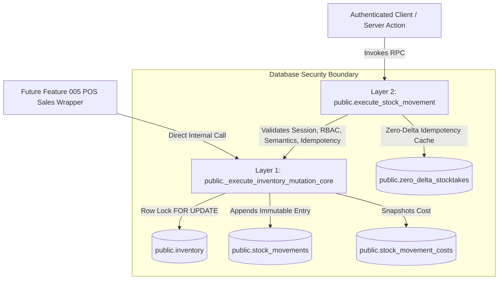

# Database RPC Contracts: Feature 004 — Inventory & Stock Management

**Feature Branch**: `004-inventory-stock-management`  
**Date**: 2026-11-10  
**Status**: Authoritative Database Contract  
**Governing Documents**:
- [BizFlow AI Constitution v1.1.0](.specify/memory/constitution.md)
- [Feature 004 Specification](specs/004-inventory-stock-management/spec.md)
- [Feature 004 Data Model](specs/004-inventory-stock-management/data-model.md)

---

## 1. RPC Architecture & Security Boundary

BizFlow AI enforces a strict dual-layer mutation architecture to ensure atomic operations, tamper-proof audit trails, and zero-trust security:



---

## 2. Layer 1: Internal Inventory Core Function

### Specification: `public._execute_inventory_mutation_core`

Low-level transactional engine executing inventory mutations and ledger appending.

```sql
CREATE OR REPLACE FUNCTION public._execute_inventory_mutation_core(
    p_org_id UUID,
    p_product_id UUID,
    p_movement_type TEXT,
    p_quantity_delta NUMERIC,
    p_reason TEXT,
    p_reference_id TEXT,
    p_idempotency_key UUID,
    p_idempotency_payload_hash TEXT,
    p_created_by UUID,
    p_expected_version INTEGER DEFAULT NULL
) RETURNS JSONB
LANGUAGE plpgsql
SECURITY DEFINER
SET search_path = pg_catalog, public, pg_temp
AS $$
...
$$;
```

### Parameters
| Name | Type | Constraint | Description |
|---|---|---|---|
| `p_org_id` | UUID | NOT NULL | Tenant organization anchor |
| `p_product_id` | UUID | NOT NULL | Target product ID |
| `p_movement_type` | TEXT | IN ('initial', 'restock', 'adjustment', 'damage', 'loss', 'internal_use', 'sale', 'return') | Movement classification |
| `p_quantity_delta` | NUMERIC(14,4) | Validated by movement sign rules | Signed inventory adjustment delta |
| `p_reason` | TEXT | 3–250 chars | Audited business explanation |
| `p_reference_id` | TEXT | Max 100 chars or NULL | Source document or PO identifier |
| `p_idempotency_key` | UUID | Optional | Client submission replay key |
| `p_idempotency_payload_hash` | TEXT | 64-char hex or NULL | SHA-256 digest of canonical payload |
| `p_created_by` | UUID | NOT NULL | Verified profile ID of actor |
| `p_expected_version` | INTEGER | Optional | Optimistic concurrency control counter |

### Execution Guarantees
1. **Row Lock & Inventory ID Resolution**: Executes `SELECT id, quantity, version INTO v_inventory_id, v_current_qty, v_current_version FROM public.inventory WHERE organization_id = p_org_id AND product_id = p_product_id FOR UPDATE;`.
2. **OCC Check**: If `p_expected_version IS NOT NULL AND v_current_version <> p_expected_version`, aborts with `STALE_VERSION_CONFLICT` (SQLSTATE `P0027`, HTTP 409).
3. **Negative Stock Guard**: If `v_current_qty + p_quantity_delta < 0.0000`, aborts with `INSUFFICIENT_STOCK` (SQLSTATE `P0011`, HTTP 422).
4. **Zero-Initial Singularity Guard**: If `p_movement_type = 'initial'` and movement history exists, aborts with `INITIAL_STOCK_NOT_PERMITTED_HISTORY_EXISTS` (SQLSTATE `P0026`, HTTP 422).
5. **Atomic Mutation**: Updates `public.inventory` (`quantity = quantity + p_quantity_delta`, `version = version + 1`, `updated_at = clock_timestamp()`).
6. **Ledger Insert**: Appends row to `public.stock_movements` with `inventory_id := v_inventory_id`, satisfying composite foreign key `fk_movements_inventory_composite (organization_id, inventory_id, product_id)`.
7. **Cost Snapshot**: If active cost exists in `public.product_costs`, inserts snapshot into `public.stock_movement_costs`.
8. **Return**: Returns JSONB payload:
   ```json
   {
     "success": true,
     "movement_id": "...",
     "product_id": "...",
     "quantity_before": "20.0000",
     "quantity_delta": "-3.0000",
     "quantity_after": "17.0000",
     "version": 2
   }
   ```

### Overload & Security Directives
```sql
-- Explicit overload cleanup
DROP FUNCTION IF EXISTS public._execute_inventory_mutation_core(UUID, UUID, TEXT, NUMERIC, TEXT, TEXT, UUID, TEXT, UUID, INTEGER);

-- Absolute denial of direct client execution
REVOKE ALL ON FUNCTION public._execute_inventory_mutation_core(
    UUID, UUID, TEXT, NUMERIC, TEXT, TEXT, UUID, TEXT, UUID, INTEGER
) FROM PUBLIC, authenticated, anon;
```

---

## 3. Layer 2: Public Mutation RPC Wrapper

### Specification: `public.execute_stock_movement`

The user-facing entry point for authenticated stock mutations.

```sql
CREATE OR REPLACE FUNCTION public.execute_stock_movement(
    p_org_id UUID,
    p_product_id UUID,
    p_movement_type TEXT,
    p_quantity NUMERIC,
    p_reason TEXT,
    p_reference_id TEXT DEFAULT NULL,
    p_idempotency_key UUID DEFAULT NULL,
    p_expected_version INTEGER DEFAULT NULL,
    p_quantity_semantics TEXT DEFAULT 'quantity_delta'
) RETURNS JSONB
LANGUAGE plpgsql
SECURITY DEFINER
SET search_path = pg_catalog, public, pg_temp
AS $$
...
$$;
```

### Mandatory Invariants & Validation Flow

#### Invariant 1: Caller Authentication
```sql
IF auth.uid() IS NULL THEN
    RAISE EXCEPTION USING ERRCODE = '08001', MESSAGE = 'UNAUTHENTICATED';
END IF;
```

#### Invariant 2: Active Organization Status
```sql
IF NOT EXISTS (SELECT 1 FROM public.organizations WHERE id = p_org_id AND is_active = TRUE) THEN
    RAISE EXCEPTION USING ERRCODE = 'P0001', MESSAGE = 'ORGANIZATION_INACTIVE';
END IF;
```

#### Invariant 3: Active Membership Status
```sql
IF NOT EXISTS (
    SELECT 1 FROM public.organization_memberships
    WHERE organization_id = p_org_id AND user_id = auth.uid() AND status = 'active'
) THEN
    RAISE EXCEPTION USING ERRCODE = 'P0002', MESSAGE = 'MEMBERSHIP_INACTIVE';
END IF;
```

#### Invariant 4: Feature 004 Scope Boundary
```sql
IF p_movement_type IN ('sale', 'return') THEN
    RAISE EXCEPTION USING ERRCODE = 'P0020', MESSAGE = 'INVALID_MOVEMENT_TYPE';
END IF;
```

#### Invariant 5: Granular Permission Check
```sql
DECLARE
    v_req_perm TEXT;
BEGIN
    v_req_perm := CASE
        WHEN p_movement_type IN ('initial', 'restock') THEN 'inventory:receive'
        WHEN p_movement_type IN ('adjustment', 'damage', 'loss', 'internal_use') THEN 'inventory:adjust'
        ELSE NULL
    END;

    IF v_req_perm IS NULL OR NOT public.check_user_permission(p_org_id, auth.uid(), v_req_perm) THEN
        RAISE EXCEPTION USING ERRCODE = '42501', MESSAGE = 'INSUFFICIENT_PERMISSIONS';
    END IF;
END;
```

#### Invariant 6: Explicit Quantity-Semantics Server-Side Validation (MANDATORY)
```sql
IF p_quantity_semantics IS NULL
   OR p_quantity_semantics NOT IN (
       'quantity_delta',
       'target_physical_count'
   )
   OR (
       p_quantity_semantics = 'target_physical_count'
       AND p_movement_type <> 'adjustment'
   )
THEN
    RAISE EXCEPTION USING
        ERRCODE = 'P0033',
        MESSAGE = 'INVALID_QUANTITY_SEMANTICS';
END IF;
```

#### Invariant 7: Advisory Lock & Canonical Idempotency Replay Evaluation
```sql
-- Compute canonical payload hash with JSON-safe RFC 8259 string escaping
v_canonical_hash := encode(
    sha256(
        convert_to(
            format(
                '{"canonical_quantity":"%s","movement_type":"%s","organization_id":"%s","product_id":"%s","quantity_semantics":"%s","reason":%s,"reference_id":%s}',
                to_char(p_quantity, 'FM9999999990.0000'),
                p_movement_type,
                p_org_id,
                p_product_id,
                p_quantity_semantics,
                to_json(trim(p_reason))::text,
                CASE WHEN p_reference_id IS NULL OR trim(p_reference_id) = '' THEN 'null' ELSE to_json(trim(p_reference_id))::text END
            ),
            'UTF8'
        )
    ),
    'hex'
);

-- Serialized Idempotency Check with Transaction-Scoped Advisory Lock
-- Executed BEFORE product lifecycle validation so that:
-- 1. Successful operations previously recorded can be replayed cleanly even if the product was subsequently archived/deactivated.
-- 2. Replayed requests using the same key with conflicting payloads return IDEMPOTENCY_CONFLICT (P0024) instead of lifecycle errors.
-- 3. Authorization (authentication, active org, active membership, granular permission) has already been validated above.
IF p_idempotency_key IS NOT NULL THEN
    -- 1. Acquire transaction-scoped advisory lock derived from (p_org_id, p_idempotency_key)
    -- Concurrency & Visibility Guarantees:
    --   - Derived from (organization_id, idempotency_key) using two 32-bit integer hashes.
    --   - Under PostgreSQL's default READ COMMITTED isolation level, when Transaction 2 unblocks after
    --     waiting for Transaction 1 to commit, each subsequent SQL statement takes a fresh statement snapshot.
    --     Therefore, Transaction 2 immediately observes the newly committed rows in public.stock_movements
    --     or public.zero_delta_stocktakes.
    --   - Advisory 32-bit hashtext collisions between distinct keys or tenants result strictly in harmless
    --     transient serialization contention (waiting), NEVER in correctness failures or cross-tenant data
    --     leakage, because all SELECT and INSERT queries filter strictly by WHERE organization_id = p_org_id
    --     AND idempotency_key = p_idempotency_key.
    --   - Table unique constraints (uq_movements_org_idempotency and uq_zero_delta_stocktake_idempotency)
    --     remain the ultimate engine-level safeguard against duplicate concurrent insertions.
    PERFORM pg_advisory_xact_lock(hashtext(p_org_id::text), hashtext(p_idempotency_key::text));

    -- 2. Check movement ledger
    SELECT * INTO v_existing_movement FROM public.stock_movements
    WHERE organization_id = p_org_id AND idempotency_key = p_idempotency_key;

    IF FOUND THEN
        IF v_existing_movement.idempotency_payload_hash = v_canonical_hash THEN
            SELECT quantity INTO v_live_qty FROM public.inventory WHERE organization_id = p_org_id AND product_id = p_product_id;
            RETURN jsonb_build_object(
                'is_replay', true,
                'status', 'replayed',
                'movement_id', v_existing_movement.id,
                'quantity_before', v_existing_movement.quantity_before,
                'quantity_delta', v_existing_movement.quantity_delta,
                'quantity_after', v_existing_movement.quantity_after,
                'current_stock', v_live_qty
            );
        ELSE
            RAISE EXCEPTION USING ERRCODE = 'P0024', MESSAGE = 'IDEMPOTENCY_CONFLICT';
        END IF;
    END IF;

    -- 3. Check zero-delta stocktakes
    SELECT * INTO v_existing_zd FROM public.zero_delta_stocktakes
    WHERE organization_id = p_org_id AND idempotency_key = p_idempotency_key;

    IF FOUND THEN
        IF v_existing_zd.idempotency_payload_hash = v_canonical_hash THEN
            SELECT quantity INTO v_live_qty FROM public.inventory WHERE organization_id = p_org_id AND product_id = p_product_id;
            RETURN jsonb_build_object(
                'status', 'matched',
                'is_replay', true,
                'matched_quantity', to_char(v_existing_zd.target_physical_count, 'FM9999999990.0000'),
                'current_stock', to_char(v_live_qty, 'FM9999999990.0000'),
                'quantity_delta', '0.0000',
                'message', 'Physical count matches recorded stock. No adjustment needed.'
            );
        ELSE
            RAISE EXCEPTION USING ERRCODE = 'P0024', MESSAGE = 'IDEMPOTENCY_CONFLICT';
        END IF;
    END IF;
END IF;
```

#### Invariant 8: New Mutation Product Retrieval, Row Lock & Lifecycle Restrictions
```sql
-- Executed ONLY when no previous operation exists (new mutation)
-- Retrieve and lock target product row in SHARE mode
-- Locking Order: Always acquire public.products (FOR SHARE) before public.inventory (FOR UPDATE)
-- to prevent concurrent lifecycle status updates (e.g., archiving) while avoiding ABBA deadlocks.
SELECT status INTO v_prod_status
FROM public.products
WHERE id = p_product_id AND organization_id = p_org_id
FOR SHARE;

IF NOT FOUND THEN
    RAISE EXCEPTION USING ERRCODE = 'P0003', MESSAGE = 'PRODUCT_NOT_FOUND';
END IF;

-- Immediate lifecycle restrictions prior to delta calculation
IF v_prod_status = 'archived' THEN
    IF p_movement_type IN ('initial', 'restock', 'internal_use') THEN
        RAISE EXCEPTION USING ERRCODE = 'P0021', MESSAGE = 'PRODUCT_ARCHIVED_STOCK_FORBIDDEN';
    END IF;
END IF;

IF v_prod_status = 'inactive' THEN
    IF p_movement_type = 'restock' THEN
        RAISE EXCEPTION USING ERRCODE = 'P0022', MESSAGE = 'PRODUCT_INACTIVE_RESTOCK_BLOCKED';
    ELSIF p_movement_type = 'internal_use' THEN
        RAISE EXCEPTION USING ERRCODE = 'P0023', MESSAGE = 'PRODUCT_INACTIVE_INTERNAL_USE_BLOCKED';
    END IF;
END IF;
```

#### Invariant 9: Delta Calculation & Zero-Delta Stocktake Persistence
```sql
IF p_quantity_semantics = 'target_physical_count' THEN
    -- Read current stock under row lock (locking inventory row second, preserving products -> inventory order)
    SELECT id, quantity INTO v_inventory_id, v_current_stock FROM public.inventory
    WHERE organization_id = p_org_id AND product_id = p_product_id FOR UPDATE;

    IF NOT FOUND THEN
        RAISE EXCEPTION USING ERRCODE = 'P0004', MESSAGE = 'INVENTORY_NOT_FOUND';
    END IF;

    v_calc_delta := p_quantity - v_current_stock;

    IF v_calc_delta = 0.0000 THEN
        IF p_idempotency_key IS NOT NULL THEN
            INSERT INTO public.zero_delta_stocktakes (
                organization_id, product_id, idempotency_key,
                idempotency_payload_hash, target_physical_count, created_by
            ) VALUES (
                p_org_id, p_product_id, p_idempotency_key,
                v_canonical_hash, p_quantity, auth.uid()
            );
        END IF;

        RETURN jsonb_build_object(
            'status', 'matched',
            'is_replay', false,
            'matched_quantity', to_char(p_quantity, 'FM9999999990.0000'),
            'current_stock', to_char(v_current_stock, 'FM9999999990.0000'),
            'quantity_delta', '0.0000',
            'message', 'Physical count matches recorded stock. No adjustment needed.'
        );
    ELSE
        v_final_delta := v_calc_delta;
    END IF;
ELSE
    v_final_delta := p_quantity;
END IF;
```

#### Invariant 10: Evaluated Delta Lifecycle Check on Archived Products
```sql
-- Evaluates the calculated signed delta for archived goods
IF v_prod_status = 'archived' THEN
    -- Positive adjustments add stock to archived products: strictly blocked
    IF p_movement_type = 'adjustment' AND v_final_delta > 0.0000 THEN
        RAISE EXCEPTION USING ERRCODE = 'P0021', MESSAGE = 'PRODUCT_ARCHIVED_STOCK_FORBIDDEN';
    END IF;
    -- Note: Negative adjustments (v_final_delta < 0), damage (< 0), and loss (< 0) are permitted write-offs
END IF;
```

#### Invariant 11: Delegation to Layer 1 Core
```sql
RETURN public._execute_inventory_mutation_core(
    p_org_id := p_org_id,
    p_product_id := p_product_id,
    p_movement_type := p_movement_type,
    p_quantity_delta := v_final_delta,
    p_reason := trim(p_reason),
    p_reference_id := NULLIF(trim(p_reference_id), ''),
    p_idempotency_key := p_idempotency_key,
    p_idempotency_payload_hash := v_canonical_hash,
    p_created_by := auth.uid(),
    p_expected_version := p_expected_version
);
```

### Overload & Grant Directives
```sql
-- Explicit overload cleanup
DROP FUNCTION IF EXISTS public.execute_stock_movement(UUID, UUID, TEXT, NUMERIC, TEXT, TEXT, UUID, INTEGER);
DROP FUNCTION IF EXISTS public.execute_stock_movement(UUID, UUID, TEXT, NUMERIC, TEXT, TEXT, UUID, INTEGER, TEXT);

-- Parameter-qualified grants
GRANT EXECUTE ON FUNCTION public.execute_stock_movement(
    UUID, UUID, TEXT, NUMERIC, TEXT, TEXT, UUID, INTEGER, TEXT
) TO authenticated;

REVOKE EXECUTE ON FUNCTION public.execute_stock_movement(
    UUID, UUID, TEXT, NUMERIC, TEXT, TEXT, UUID, INTEGER, TEXT
) FROM anon, PUBLIC;
```

---

## 4. Reorder Threshold RPC: `public.update_inventory_thresholds`

### Specification
```sql
CREATE OR REPLACE FUNCTION public.update_inventory_thresholds(
    p_org_id UUID,
    p_product_id UUID,
    p_reorder_point NUMERIC,
    p_reorder_quantity NUMERIC,
    p_expected_version INTEGER DEFAULT NULL
) RETURNS JSONB
LANGUAGE plpgsql
SECURITY DEFINER
SET search_path = pg_catalog, public, pg_temp
AS $$
DECLARE
    v_current_version INTEGER;
BEGIN
    IF auth.uid() IS NULL THEN
        RAISE EXCEPTION USING ERRCODE = '08001', MESSAGE = 'UNAUTHENTICATED';
    END IF;

    IF NOT public.check_user_permission(p_org_id, auth.uid(), 'inventory:adjust') THEN
        RAISE EXCEPTION USING ERRCODE = '42501', MESSAGE = 'INSUFFICIENT_PERMISSIONS';
    END IF;

    IF p_reorder_point IS NOT NULL AND p_reorder_point < 0.0000 THEN
        RAISE EXCEPTION USING ERRCODE = '22003', MESSAGE = 'REORDER_POINT_CANNOT_BE_NEGATIVE';
    END IF;

    IF p_reorder_quantity IS NOT NULL AND p_reorder_quantity <= 0.0000 THEN
        RAISE EXCEPTION USING ERRCODE = '22003', MESSAGE = 'REORDER_QUANTITY_MUST_BE_POSITIVE';
    END IF;

    SELECT version INTO v_current_version FROM public.inventory
    WHERE organization_id = p_org_id AND product_id = p_product_id FOR UPDATE;

    IF NOT FOUND THEN
        RAISE EXCEPTION USING ERRCODE = 'P0004', MESSAGE = 'INVENTORY_NOT_FOUND';
    END IF;

    IF p_expected_version IS NOT NULL AND v_current_version <> p_expected_version THEN
        RAISE EXCEPTION USING ERRCODE = 'P0027', MESSAGE = 'STALE_VERSION_CONFLICT';
    END IF;

    UPDATE public.inventory SET
        reorder_point = p_reorder_point,
        reorder_quantity = p_reorder_quantity,
        version = version + 1,
        updated_at = clock_timestamp()
    WHERE organization_id = p_org_id AND product_id = p_product_id;

    RETURN jsonb_build_object(
        'success', true,
        'product_id', p_product_id,
        'reorder_point', p_reorder_point,
        'reorder_quantity', p_reorder_quantity,
        'version', v_current_version + 1
    );
END;
$$;

-- Overload cleanup & grants
DROP FUNCTION IF EXISTS public.update_inventory_thresholds(UUID, UUID, NUMERIC, NUMERIC, INTEGER);

GRANT EXECUTE ON FUNCTION public.update_inventory_thresholds(
    UUID, UUID, NUMERIC, NUMERIC, INTEGER
) TO authenticated;

REVOKE EXECUTE ON FUNCTION public.update_inventory_thresholds(
    UUID, UUID, NUMERIC, NUMERIC, INTEGER
) FROM anon, PUBLIC;
```

---

## 5. Verified Canonical Idempotency Regression Fixtures

These fixtures are mathematically guaranteed and MUST pass regression verification:

### Regression Fixture 1: Stocktake Reconciliation (Target Physical Count)
```json
{"canonical_quantity":"45.0000","movement_type":"adjustment","organization_id":"a0000000-0000-0000-0000-000000000001","product_id":"b0000000-0000-0000-0000-000000000002","quantity_semantics":"target_physical_count","reason":"Quarterly stocktake","reference_id":null}
```
- **UTF-8 Byte Length**: 277 bytes
- **SHA-256 Digest**: `822dbc7818bb44882daff5f29396366a9d5f9eb571938eb36fd60270a5f108a6`

### Regression Fixture 2: Ordinary Quantity-Delta Adjustment
```json
{"canonical_quantity":"45.0000","movement_type":"adjustment","organization_id":"a0000000-0000-0000-0000-000000000001","product_id":"b0000000-0000-0000-0000-000000000002","quantity_semantics":"quantity_delta","reason":"Quarterly stocktake","reference_id":null}
```
- **UTF-8 Byte Length**: 269 bytes
- **SHA-256 Digest**: `7e2b11299620db0e9531afe7b999c1d1096b39b7f860d67be5efc531eed9f707`

### Regression Fixture 3: String Escaping with Quotation Marks & Backslashes
```json
{"canonical_quantity":"12.5000","movement_type":"damage","organization_id":"a0000000-0000-0000-0000-000000000001","product_id":"b0000000-0000-0000-0000-000000000002","quantity_semantics":"quantity_delta","reason":"Broken \"glass\" & \\backslashes\\","reference_id":"REF \"A-12\\34\""}
```
- **UTF-8 Byte Length**: 284 bytes
- **SHA-256 Digest**: `596a760972b11657cebb84a84a5b4541252b3f5c1d1d781a00c4686aeb7c0a3f`
- **Verification Purpose**: Asserts that PostgreSQL `to_json()` and TypeScript `JSON.stringify()` produce identical RFC 8259 string encodings for quotation marks and backslashes.

---

## 6. Error Code Catalog & SQLSTATE Mapping

| Error Code | SQLSTATE | HTTP Status | Trigger Condition |
|---|:---:|:---:|---|
| `UNAUTHENTICATED` | `08001` | 401 | `auth.uid()` is NULL or missing session |
| `INSUFFICIENT_PERMISSIONS` | `42501` | 403 | Caller lacks required granular permission |
| `ORGANIZATION_INACTIVE` | `P0001` | 403 | Tenant has `is_active = FALSE` |
| `MEMBERSHIP_INACTIVE` | `P0002` | 403 | Caller membership is not `active` |
| `PRODUCT_NOT_FOUND` | `P0003` | 404 | Product ID does not exist in organization |
| `INVENTORY_NOT_FOUND` | `P0004` | 404 | Inventory record missing for product |
| `TENANT_MISMATCH` | `P0005` | 400 | Organization IDs do not match across tables |
| `INSUFFICIENT_STOCK` | `P0011` | 422 | Stock deduction causes `quantity_after < 0.0000` |
| `NON_POSITIVE_QUANTITY` | `P0012` | 422 | Restock quantity submitted is $\le 0.0000$ |
| `NEGATIVE_QUANTITY_NOT_PERMITTED` | `P0013` | 422 | Initial stock submitted is $< 0.0000$ |
| `ZERO_QUANTITY_NOT_PERMITTED` | `P0014` | 422 | Delta submitted is zero (excluding initial baseline) |
| `INTEGER_QUANTITY_REQUIRED` | `P0015` | 422 | Fractional quantity submitted for discrete UOM |
| `DECIMAL_PRECISION_EXCEEDED` | `P0016` | 422 | Quantity exceeds 4 decimal places of scale |
| `ADJUSTMENT_REASON_REQUIRED` | `P0017` | 422 | Reason empty or less than 3 characters |
| `ADJUSTMENT_REASON_TOO_LONG` | `P0018` | 422 | Reason exceeds 250 characters |
| `REFERENCE_ID_TOO_LONG` | `P0019` | 422 | Reference ID exceeds 100 characters |
| `INVALID_MOVEMENT_TYPE` | `P0020` | 422 | Unknown type or direct submission of `sale`/`return` |
| `PRODUCT_ARCHIVED_STOCK_FORBIDDEN` | `P0021` | 422 | Inbound replenishment, positive adjustment, or internal use on archived product |
| `PRODUCT_INACTIVE_RESTOCK_BLOCKED` | `P0022` | 422 | Restock attempted on inactive product |
| `PRODUCT_INACTIVE_INTERNAL_USE_BLOCKED` | `P0023` | 422 | Internal use attempted on inactive product |
| `IDEMPOTENCY_CONFLICT` | `P0024` | 409 | Reuse of idempotency key with conflicting payload |
| `INITIAL_STOCK_ALREADY_ESTABLISHED` | `P0025` | 409 | Duplicate initial stock movement for product |
| `INITIAL_STOCK_NOT_PERMITTED_HISTORY_EXISTS` | `P0026` | 422 | Initial stock attempted when movement history exists |
| `STALE_VERSION_CONFLICT` | `P0027` | 409 | OCC mismatch: `expected_version` differs from DB |
| `QUANTITY_EXCEEDS_MAXIMUM` | `P0028` | 422 | Quantity exceeds `999,999,999.9999` limit |
| `UOM_CLASS_MUTATION_RESTRICTED` | `P0029` | 422 | Modifying UOM class when stock > 0 or history exists |
| `ORGANIZATION_DELETION_FAILED` | `P0030` | 500 | Organization cascade deletion failed |
| `PRODUCT_INACTIVE_SALE_BLOCKED` | `P0031` | 422 | Direct sale attempted on inactive product |
| `PRODUCT_INACTIVE_RETURN_BLOCKED` | `P0032` | 422 | Return attempted on inactive product |
| `INVALID_QUANTITY_SEMANTICS` | `P0033` | 422 | Null, unknown semantics, or target count with non-adjustment |

