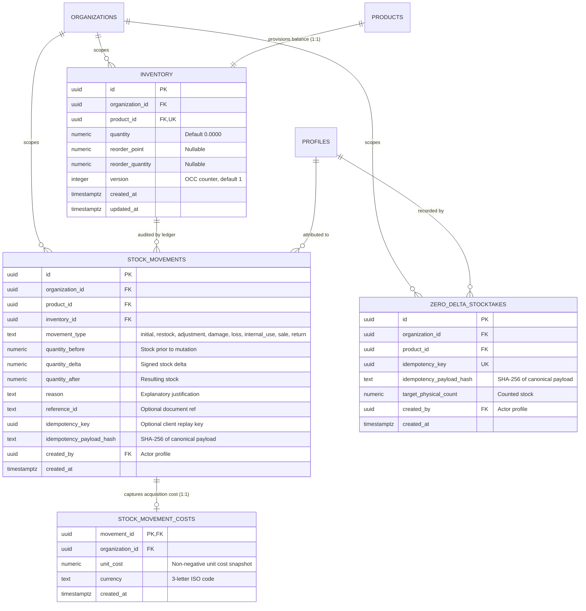

# Data Model: Feature 004 — Inventory & Stock Management

**Feature Branch**: `004-inventory-stock-management`  
**Date**: 2026-11-10  
**Status**: Authoritative Data Model  
**Governing Documents**:
- [BizFlow AI Constitution v1.1.0](.specify/memory/constitution.md)
- [Feature 004 Specification](specs/004-inventory-stock-management/spec.md)
- [Feature 004 Technical Research](specs/004-inventory-stock-management/research.md)

---

## 1. Entity-Relationship Overview



---

## 2. Table Specifications & DDL

### 2.1 Table: `public.inventory` (Materialized Balance Table)

Maintains the authoritative on-hand stock balance, optimistic concurrency counter, and replenishment threshold parameters per product.

```sql
CREATE TABLE public.inventory (
    id UUID PRIMARY KEY DEFAULT gen_random_uuid(),
    organization_id UUID NOT NULL REFERENCES public.organizations(id) ON DELETE CASCADE,
    product_id UUID NOT NULL REFERENCES public.products(id) ON DELETE CASCADE,
    quantity NUMERIC(14, 4) NOT NULL DEFAULT 0.0000,
    reorder_point NUMERIC(14, 4) DEFAULT NULL,
    reorder_quantity NUMERIC(14, 4) DEFAULT NULL,
    version INTEGER NOT NULL DEFAULT 1,
    created_at TIMESTAMPTZ NOT NULL DEFAULT clock_timestamp(),
    updated_at TIMESTAMPTZ NOT NULL DEFAULT clock_timestamp(),

    -- Constraints
    CONSTRAINT uq_inventory_org_product UNIQUE (organization_id, product_id),
    CONSTRAINT uq_inventory_org_id_product UNIQUE (organization_id, id, product_id),
    CONSTRAINT chk_inventory_quantity_non_negative CHECK (quantity >= 0.0000),
    CONSTRAINT chk_inventory_reorder_point_non_negative CHECK (reorder_point IS NULL OR reorder_point >= 0.0000),
    CONSTRAINT chk_inventory_reorder_quantity_positive CHECK (reorder_quantity IS NULL OR reorder_quantity > 0.0000),
    CONSTRAINT chk_inventory_version_positive CHECK (version > 0)
);

-- Performance Indexes
CREATE INDEX idx_inventory_org_product ON public.inventory (organization_id, product_id);
CREATE INDEX idx_inventory_reorder_alert ON public.inventory (organization_id, quantity, reorder_point)
    WHERE reorder_point IS NOT NULL;
```

---

### 2.2 Table: `public.stock_movements` (Immutable Movement Ledger)

The append-only historical audit ledger. Every stock balance change produces an unalterable row in this table.

```sql
CREATE TABLE public.stock_movements (
    id UUID PRIMARY KEY DEFAULT gen_random_uuid(),
    organization_id UUID NOT NULL REFERENCES public.organizations(id) ON DELETE CASCADE,
    product_id UUID NOT NULL,
    inventory_id UUID NOT NULL,
    movement_type TEXT NOT NULL,
    quantity_before NUMERIC(14, 4) NOT NULL,
    quantity_delta NUMERIC(14, 4) NOT NULL,
    quantity_after NUMERIC(14, 4) NOT NULL,
    reason TEXT NOT NULL,
    reference_id TEXT DEFAULT NULL,
    idempotency_key UUID DEFAULT NULL,
    idempotency_payload_hash TEXT DEFAULT NULL,
    created_by UUID NOT NULL REFERENCES public.profiles(id) ON DELETE RESTRICT,
    created_at TIMESTAMPTZ NOT NULL DEFAULT clock_timestamp(),

    -- Composite Foreign Keys with Deferrable Commit Checking
    CONSTRAINT fk_movements_inventory_composite FOREIGN KEY (organization_id, inventory_id, product_id)
        REFERENCES public.inventory (organization_id, id, product_id)
        ON DELETE NO ACTION DEFERRABLE INITIALLY DEFERRED,

    CONSTRAINT fk_movements_org_product FOREIGN KEY (organization_id, product_id)
        REFERENCES public.products (organization_id, id)
        ON DELETE NO ACTION DEFERRABLE INITIALLY DEFERRED,

    -- Enum Validation
    CONSTRAINT chk_movement_type_valid CHECK (
        movement_type IN (
            'initial', 'restock', 'adjustment', 'damage',
            'loss', 'internal_use', 'sale', 'return'
        )
    ),

    -- Mathematical Ledger Consistency
    CONSTRAINT chk_movement_math_integrity CHECK (quantity_after = quantity_before + quantity_delta),
    CONSTRAINT chk_movement_after_non_negative CHECK (quantity_after >= 0.0000),

    -- Movement Sign Direction Integrity
    CONSTRAINT chk_movement_type_sign CHECK (
        (movement_type = 'initial' AND quantity_delta >= 0.0000) OR
        (movement_type = 'restock' AND quantity_delta > 0.0000) OR
        (movement_type = 'adjustment' AND quantity_delta <> 0.0000) OR
        (movement_type IN ('damage', 'loss', 'internal_use', 'sale') AND quantity_delta < 0.0000) OR
        (movement_type = 'return' AND quantity_delta > 0.0000)
    ),

    -- Exact Zero-Initial Exception Rule
    CONSTRAINT chk_movement_initial_before_zero CHECK (
        movement_type <> 'initial' OR quantity_before = 0.0000
    ),
    CONSTRAINT chk_movement_delta_zero_rule CHECK (
        (movement_type = 'initial' AND quantity_before = 0.0000 AND quantity_delta = 0.0000) OR
        (quantity_delta <> 0.0000)
    ),

    -- String Bounds
    CONSTRAINT chk_movement_reason_length CHECK (char_length(trim(reason)) BETWEEN 3 AND 250),
    CONSTRAINT chk_movement_reference_length CHECK (reference_id IS NULL OR char_length(trim(reference_id)) <= 100),

    -- Idempotency Pair Integrity
    CONSTRAINT chk_movement_idempotency_pair CHECK (
        (idempotency_key IS NULL AND idempotency_payload_hash IS NULL) OR
        (idempotency_key IS NOT NULL AND idempotency_payload_hash IS NOT NULL)
    )
);

-- Partial Unique Index: Exactly One Initial Movement per Product
CREATE UNIQUE INDEX uq_stock_movements_initial_per_product
    ON public.stock_movements (organization_id, product_id)
    WHERE movement_type = 'initial';

-- Partial Unique Index: Scoped Idempotency Replay Protection
CREATE UNIQUE INDEX uq_movements_org_idempotency
    ON public.stock_movements (organization_id, idempotency_key)
    WHERE idempotency_key IS NOT NULL;

-- Query Performance Indexes
CREATE INDEX idx_stock_movements_org_created ON public.stock_movements (organization_id, created_at DESC, id DESC);
CREATE INDEX idx_stock_movements_org_product ON public.stock_movements (organization_id, product_id, created_at DESC);
CREATE INDEX idx_stock_movements_inventory ON public.stock_movements (organization_id, inventory_id);
CREATE INDEX idx_stock_movements_org_type ON public.stock_movements (organization_id, movement_type, created_at DESC);
```

---

### 2.3 Table: `public.stock_movement_costs` (Protected Acquisition Costs)

Captures historical unit cost snapshots at movement creation time. Isolated in a dedicated table to enforce strict database-level confidentiality.

```sql
CREATE TABLE public.stock_movement_costs (
    movement_id UUID PRIMARY KEY REFERENCES public.stock_movements(id) ON DELETE CASCADE,
    organization_id UUID NOT NULL REFERENCES public.organizations(id) ON DELETE CASCADE,
    unit_cost NUMERIC(14, 4) NOT NULL CHECK (unit_cost >= 0.0000),
    currency TEXT NOT NULL CHECK (currency ~ '^[A-Z]{3}$'),
    created_at TIMESTAMPTZ NOT NULL DEFAULT clock_timestamp()
);

CREATE INDEX idx_stock_movement_costs_org ON public.stock_movement_costs (organization_id);
```

---

### 2.4 Table: `public.zero_delta_stocktakes` (Stocktake Idempotency Persistence)

Persists successful zero-delta cycle count confirmations where physical count equaled recorded inventory, ensuring complete idempotent replay protection without polluting the movement ledger.

```sql
CREATE TABLE public.zero_delta_stocktakes (
    id UUID PRIMARY KEY DEFAULT gen_random_uuid(),
    organization_id UUID NOT NULL REFERENCES public.organizations(id) ON DELETE CASCADE,
    product_id UUID NOT NULL REFERENCES public.products(id) ON DELETE CASCADE,
    idempotency_key UUID NOT NULL,
    idempotency_payload_hash TEXT NOT NULL,
    target_physical_count NUMERIC(14, 4) NOT NULL CHECK (target_physical_count >= 0.0000),
    created_by UUID NOT NULL REFERENCES public.profiles(id) ON DELETE RESTRICT,
    created_at TIMESTAMPTZ NOT NULL DEFAULT clock_timestamp(),

    CONSTRAINT uq_zero_delta_stocktake_idempotency UNIQUE (organization_id, idempotency_key)
);

CREATE INDEX idx_zero_delta_stocktakes_org ON public.zero_delta_stocktakes (organization_id, created_at DESC);
```

#### Zero-Delta Idempotency Replay Semantics
- **Original Matched Quantity Retention**: The table explicitly stores `target_physical_count` (the original matched count recorded at stocktake execution).
- **Separation of Original Count vs Live Balance**: When an idempotent retry occurs, the system retrieves `target_physical_count` from `public.zero_delta_stocktakes` and the live balance `quantity` from `public.inventory`.
- **Replay Response Contract**:
  ```json
  {
    "status": "matched",
    "is_replay": true,
    "matched_quantity": "20.0000",
    "current_stock": "15.0000",
    "quantity_delta": "0.0000"
  }
  ```
  *Example*: If an initial stocktake confirms 20 units and subsequent POS sales reduce live stock to 15, retrying the original stocktake request returns `matched_quantity: "20.0000"` (the historical verified count) and `current_stock: "15.0000"` (live inventory), preventing incorrect delta recalculation while preserving total audit transparency.

---

## 3. Row-Level Security (RLS) & Access Policies

All four tables enforce forced Row-Level Security (`ALTER TABLE ... FORCE ROW LEVEL SECURITY`).

```sql
-- Enable and Force RLS
ALTER TABLE public.inventory ENABLE ROW LEVEL SECURITY;
ALTER TABLE public.inventory FORCE ROW LEVEL SECURITY;

ALTER TABLE public.stock_movements ENABLE ROW LEVEL SECURITY;
ALTER TABLE public.stock_movements FORCE ROW LEVEL SECURITY;

ALTER TABLE public.stock_movement_costs ENABLE ROW LEVEL SECURITY;
ALTER TABLE public.stock_movement_costs FORCE ROW LEVEL SECURITY;

ALTER TABLE public.zero_delta_stocktakes ENABLE ROW LEVEL SECURITY;
ALTER TABLE public.zero_delta_stocktakes FORCE ROW LEVEL SECURITY;

-- 1. Inventory Read Policy (inventory:read)
CREATE POLICY "inventory_select_policy" ON public.inventory
    FOR SELECT TO authenticated
    USING (public.check_user_permission(organization_id, auth.uid(), 'inventory:read'));

-- 2. Movement History Read Policy (inventory:history)
CREATE POLICY "stock_movements_select_policy" ON public.stock_movements
    FOR SELECT TO authenticated
    USING (public.check_user_permission(organization_id, auth.uid(), 'inventory:history'));

-- 3. Movement Cost Read Policy (Dual-Auth: inventory:read_valuation AND products:read_cost)
CREATE POLICY "stock_movement_costs_select_policy" ON public.stock_movement_costs
    FOR SELECT TO authenticated
    USING (
        public.check_user_permission(organization_id, auth.uid(), 'inventory:read_valuation')
        AND
        public.check_user_permission(organization_id, auth.uid(), 'products:read_cost')
    );

-- 4. Zero-Delta Stocktakes Read Policy (inventory:history)
CREATE POLICY "zero_delta_stocktakes_select_policy" ON public.zero_delta_stocktakes
    FOR SELECT TO authenticated
    USING (public.check_user_permission(organization_id, auth.uid(), 'inventory:history'));

-- Absolute Denial of Client DML (Insert, Update, Delete)
CREATE POLICY "inventory_deny_mutation" ON public.inventory
    FOR ALL TO authenticated USING (false) WITH CHECK (false);

CREATE POLICY "stock_movements_deny_mutation" ON public.stock_movements
    FOR ALL TO authenticated USING (false) WITH CHECK (false);

CREATE POLICY "stock_movement_costs_deny_mutation" ON public.stock_movement_costs
    FOR ALL TO authenticated USING (false) WITH CHECK (false);

CREATE POLICY "zero_delta_stocktakes_deny_mutation" ON public.zero_delta_stocktakes
    FOR ALL TO authenticated USING (false) WITH CHECK (false);
```

---

## 4. Automatic Anchor Provisioning Trigger

When a new product is registered in `public.products` (Feature 003), a trigger automatically provisions an anchor zero-balance record in `public.inventory` without inserting a movement ledger entry:

```sql
CREATE OR REPLACE FUNCTION public._provision_product_inventory_anchor()
RETURNS TRIGGER
LANGUAGE plpgsql
SECURITY DEFINER
SET search_path = pg_catalog, public, pg_temp
AS $$
BEGIN
    INSERT INTO public.inventory (
        organization_id,
        product_id,
        quantity,
        version,
        created_at,
        updated_at
    ) VALUES (
        NEW.organization_id,
        NEW.id,
        0.0000,
        1,
        clock_timestamp(),
        clock_timestamp()
    )
    ON CONFLICT (organization_id, product_id) DO NOTHING;

    RETURN NEW;
END;
$$;

DROP TRIGGER IF EXISTS trg_provision_inventory_anchor ON public.products;
CREATE TRIGGER trg_provision_inventory_anchor
    AFTER INSERT ON public.products
    FOR EACH ROW
    EXECUTE FUNCTION public._provision_product_inventory_anchor();
```

---

## 5. Granular RBAC Permissions Schema

Feature 004 introduces 5 granular permissions in `public.permissions` and maps them deterministically to the 4 system roles:

```sql
INSERT INTO public.permissions (id, category, description) VALUES
    ('inventory:read', 'inventory', 'View inventory balances, stock status, and overview metrics'),
    ('inventory:read_valuation', 'inventory', 'View inventory valuation totals, unit costs, and financial value'),
    ('inventory:receive', 'inventory', 'Record initial opening stock and inbound restock deliveries'),
    ('inventory:adjust', 'inventory', 'Record stock adjustments, write-offs, internal use, and reorder thresholds'),
    ('inventory:history', 'inventory', 'View full audit ledger history of inventory movements')
ON CONFLICT (id) DO UPDATE SET
    category = EXCLUDED.category,
    description = EXCLUDED.description;

-- Role Mappings:
-- Owner: Dynamically resolves all permissions via check_user_permission()
-- Admin: Receives all 5 inventory permissions
-- Manager: Receives all 5 inventory permissions
-- Cashier: Receives only inventory:read (zero cost visibility, zero mutation access)
INSERT INTO public.role_permissions (role, permission_id) VALUES
    ('admin', 'inventory:read'),
    ('admin', 'inventory:read_valuation'),
    ('admin', 'inventory:receive'),
    ('admin', 'inventory:adjust'),
    ('admin', 'inventory:history'),
    ('manager', 'inventory:read'),
    ('manager', 'inventory:read_valuation'),
    ('manager', 'inventory:receive'),
    ('manager', 'inventory:adjust'),
    ('manager', 'inventory:history'),
    ('cashier', 'inventory:read')
ON CONFLICT (role, permission_id) DO NOTHING;
```

