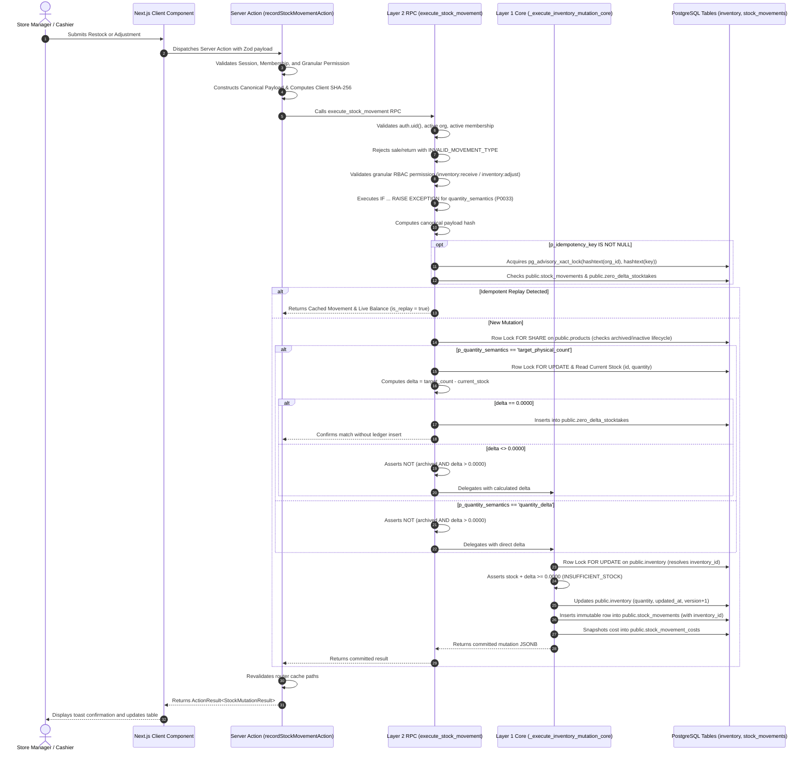
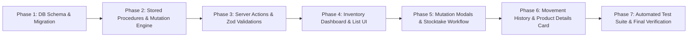

# Implementation Plan: Feature 004 — Inventory & Stock Management

**Branch**: `004-inventory-stock-management` | **Date**: 2026-11-10 | **Spec**: [specs/004-inventory-stock-management/spec.md](specs/004-inventory-stock-management/spec.md)

**Input**: Feature specification from `specs/004-inventory-stock-management/spec.md`, hardened and approved with all Product Owner clarifications resolved.

---

## Summary

Feature 004 establishes the authoritative, tamper-proof Inventory & Stock Management subsystem for BizFlow AI. It delivers real-time on-hand stock visibility, immutable historical movement audit logging, authorized stock adjustments, inbound deliveries, store usage write-offs, cycle-count stocktaking, and low-stock alerting for retail stores.

The technical design implements a dual-tier database mutation architecture:
1. **Layer 1: Internal Inventory Core (`public._execute_inventory_mutation_core`)**: A `SECURITY DEFINER` stored function ungranted to all client roles. It atomically locks rows (`FOR UPDATE`), evaluates numeric and lifecycle guards, updates `public.inventory`, appends immutable records to `public.stock_movements`, snapshots costs into `public.stock_movement_costs`, and increments optimistic concurrency counter `version`.
2. **Layer 2: Authenticated Public Wrapper (`public.execute_stock_movement`)**: The secure public API endpoint. It verifies caller authentication, active organization membership, granular RBAC permissions (`inventory:receive`, `inventory:adjust`), executes mandatory PL/pgSQL conditional validation for `p_quantity_semantics` (rejecting invalid combinations with `INVALID_QUANTITY_SEMANTICS`, SQLSTATE `P0033`, HTTP 422), evaluates canonical idempotency, handles zero-delta stocktake persistence in `public.zero_delta_stocktakes`, and delegates to Layer 1.

---

## Technical Context

**Language/Version**: TypeScript 5.6+ (Strict mode: `noImplicitAny: true`, `strictNullChecks: true`), PostgreSQL 15+ (PL/pgSQL stored procedures)

**Primary Dependencies**:
- Next.js 15+ (App Router, React Server Components by default, Server Actions)
- `@supabase/ssr` / `@supabase/supabase-js` (PostgreSQL data access & cookie session auth)
- `zod` (Runtime boundary validation on all server actions and forms)
- `react-hook-form` with `@hookform/resolvers/zod` (Client-side form state and validation)
- `lucide-react` (Standard iconography)
- `tailwind-merge` / `clsx` (Styling utilities)
- `recharts` (Metric visual indicators)

**Storage**:
- PostgreSQL hosted on Supabase (4 tables: `inventory`, `stock_movements`, `stock_movement_costs`, `zero_delta_stocktakes`)
- No object storage required for Feature 004 (product image storage managed by Feature 003)

**Testing**:
- Unit Tests: Vitest (`npm run test:unit`) for Zod schemas, canonical hash generation, math precision, and action boundaries.
- Integration Tests: Vitest against local Supabase test database (`npm run test:integration`) validating RLS policies, stored procedures, OCC versioning, and idempotency replays.
- End-to-End Tests: Playwright (`npm run test:e2e`) verifying end-to-end retail workflows (restock, stocktake, write-off, movement history, threshold configuration).

**Target Platform**: Modern desktop, tablet, and mobile web browsers (Chrome, Edge, Safari, Firefox). Responsive POS layouts.

**Project Type**: Web application within modular Next.js monorepo (`src/app/[slug]/inventory`).

**Performance Goals**:
- Database Mutation RPC: p95 latency < 100 ms
- Server Actions & REST API: p95 latency < 350 ms
- UI Interaction to Visual Confirmation: p95 latency < 500 ms

**Constraints**:
- Strict multi-tenant isolation via non-nullable `organization_id` on all tables and forced RLS.
- Zero client-side DML on inventory tables (`REVOKE INSERT, UPDATE, DELETE FROM authenticated, anon, public`).
- Deferrable composite foreign keys:
  - `fk_movements_inventory_composite`: `FOREIGN KEY (organization_id, inventory_id, product_id) REFERENCES public.inventory (organization_id, id, product_id) ON DELETE NO ACTION DEFERRABLE INITIALLY DEFERRED`.
  - `fk_movements_org_product`: `FOREIGN KEY (organization_id, product_id) REFERENCES public.products (organization_id, id) ON DELETE NO ACTION DEFERRABLE INITIALLY DEFERRED`.
- Zero-delta cycle count stocktakes must not insert movement ledger rows but must preserve 100% idempotent replay protection.

**Scale/Scope**:
- Single-store retail MVP.
- Multi-location warehouses, lot/batch tracking, serial number tracking, and automated barcoded inventory transfers are explicitly deferred to future milestones.

---

## Constitution Check

*GATE: Must pass before Phase 0 research. Re-evaluated post-design.*

- [x] **I. Multi-Tenancy**: All 4 entities (`inventory`, `stock_movements`, `stock_movement_costs`, `zero_delta_stocktakes`) contain non-nullable `organization_id` foreign keys referencing `organizations(id)` with forced PostgreSQL RLS. Tenant context is resolved strictly on the server from authenticated session and active membership. Client-supplied organization IDs are never trusted.
- [x] **II. Financial & Inventory Invariance**: Atomic database transactions guaranteed via `SECURITY DEFINER` stored procedures. Every inventory balance modification commits an immutable audit record in `public.stock_movements`. Negative stock is strictly prevented at the database engine tier (`quantity >= 0.0000`). Cost snapshots are captured at movement time into `public.stock_movement_costs`. Completed movements are immutable. Fixed-point `NUMERIC(14, 4)` is used for all quantities.
- [x] **III. Type Safety & Validation**: Strict TypeScript with zero `any`. Comprehensive Zod runtime validation schemas on all server action boundaries (`stockMovementInputSchema`, `inventoryThresholdInputSchema`, `inventoryQuerySchema`, `movementHistoryQuerySchema`).
- [x] **IV. Security & RBAC**: Granular permissions (`inventory:read`, `inventory:read_valuation`, `inventory:receive`, `inventory:adjust`, `inventory:history`) enforced on the server before mutation or query execution. Acquisition costs isolated in a dedicated 1:1 table requiring dual permissions (`inventory:read_valuation` AND `products:read_cost`).
- [x] **V. AI Guardrails**: AI assistance is auxiliary. Zero autonomous writes to inventory or stock movements. Operational actions require explicit human submission and server validation.

---

## Project Structure

### Documentation (this feature)

```text
specs/004-inventory-stock-management/
├── plan.md              # This authoritative implementation plan
├── research.md          # Technical research and design decisions
├── data-model.md        # Complete database schema, constraints, indexes, and RLS
├── quickstart.md        # Developer setup and test verification guide
├── contracts/
│   ├── database-rpcs.md # Detailed stored procedure signatures, invariants, and catalog
│   └── server-actions.md# Next.js Server Actions, Zod schemas, and TypeScript interfaces
├── checklists/
│   └── requirements.md  # Quality verification and traceability checklist
└── spec.md              # Approved Feature 004 specification
```

### Source Code (repository root)

```text
src/
├── actions/
│   └── inventory-actions.ts           # Server Actions: Overview, List, Restock, Adjust, History, Thresholds
├── app/
│   └── [slug]/
│       ├── inventory/
│       │   ├── page.tsx               # Inventory Overview dashboard & product list
│       │   ├── loading.tsx            # Skeleton loading states
│       │   ├── history/
│       │   │   └── page.tsx           # Full audit ledger history page
│       │   └── stocktake/
│       │       └── page.tsx           # Cycle count stocktake reconciliation workflow
│       └── products/
│           └── [productId]/
│               └── components/
│                   └── inventory-summary-card.tsx # Embedded inventory card on product details
├── components/
│   └── inventory/
│       ├── inventory-metrics-tiles.tsx # Aggregated metric tiles (Total, In-Stock, Low-Stock, Valuation)
│       ├── inventory-table.tsx        # Filterable, paginated inventory table
│       ├── inventory-filters.tsx      # Search, Category, Stock Status, Lifecycle Status dropdowns
│       ├── restock-modal.tsx          # Inbound delivery submission modal
│       ├── adjust-stock-modal.tsx     # Adjustment, damage, loss, internal use modal
│       ├── stocktake-modal.tsx        # Target physical count reconciliation modal
│       ├── reorder-threshold-modal.tsx# Reorder point & replenishment quantity modal
│       └── movement-history-table.tsx # Audit ledger history table with protected cost columns
├── lib/
│   ├── inventory/
│   │   ├── canonical-hash.ts          # Deterministic lexicographical JSON serialization & SHA-256
│   │   └── formatters.ts              # UOM display and quantity precision formatters
│   └── validations/
│       └── inventory.ts               # Zod validation schemas
└── types/
    └── inventory.ts                   # Domain TypeScript interfaces and error types

supabase/
└── migrations/
    └── 20261111000017_inventory_stock_management.sql # Consolidated migration
```

---

## Architecture & System Design

### 1. Two-Layer Stored Procedure Mutation Architecture



---

### 2. Mandatory Server-Side Quantity-Semantics Validation

Layer 2 executes explicit conditional PL/pgSQL validation (do not use `ASSERT`):

```sql
IF p_quantity_semantics IS NULL
   OR p_quantity_semantics NOT IN (
       'quantity_delta',
       'target_physical_count'
   )
   OR (
       p_quantity_semantics = 'target_physical_count'
       AND p_movement_type <> 'adjustment'
   )
THEN
    RAISE EXCEPTION USING
        ERRCODE = 'P0033',
        MESSAGE = 'INVALID_QUANTITY_SEMANTICS';
END IF;
```

---

### 3. Concurrency Serialization & Zero-Delta Stocktake Persistence Design

- **Advisory Lock Concurrency & Visibility Guarantees**:
  When `p_idempotency_key` is present, `execute_stock_movement` immediately acquires a transaction-scoped PostgreSQL advisory lock before querying either persistence table:
  ```sql
  PERFORM pg_advisory_xact_lock(hashtext(p_org_id::text), hashtext(p_idempotency_key::text));
  ```
  - **Lock Identity**: The lock identity is derived from `(organization_id, idempotency_key)` using two 32-bit integer hashes, partitioning concurrency by tenant and idempotency key.
  - **Statement-Level `READ COMMITTED` Snapshot Visibility**: Under PostgreSQL's default `READ COMMITTED` transaction isolation, when Transaction 2 unblocks after waiting on Transaction 1 (which was actively processing the same key), each subsequent SQL statement in Transaction 2 evaluates against a fresh statement snapshot taken at query execution time. Therefore, Transaction 2 immediately observes the row just committed by Transaction 1 in either `public.stock_movements` or `public.zero_delta_stocktakes`, guaranteeing reliable replay detection without race conditions.
  - **Benign Hash Collision Safety**: In the rare event of a 32-bit hash collision in `hashtext()` between two distinct idempotency keys or tenants, the collision causes harmless transient serialization contention (a brief wait), NEVER a correctness failure or cross-tenant data leakage. This is guaranteed because all subsequent SELECT queries and uniqueness checks filter explicitly by `WHERE organization_id = p_org_id AND idempotency_key = p_idempotency_key`.
  - **Ultimate Integrity Safeguard**: Database-level unique constraints (`uq_movements_org_idempotency` and `uq_zero_delta_stocktake_idempotency`) remain the ultimate engine-level defense ensuring duplicate records cannot be inserted even under extreme concurrency.
  - The lock is automatically released upon transaction `COMMIT` or `ROLLBACK`.

- **Zero-Delta Stocktake Persistence Design**:
  When cycle count stocktake target count matches current stock (`quantity_delta = 0.0000`), inserting into `public.stock_movements` is prohibited by `chk_movement_delta_zero_rule`.
  - **Exact Table Fields**: Persisted in `public.zero_delta_stocktakes`:
    - `id UUID PRIMARY KEY DEFAULT gen_random_uuid()`
    - `organization_id UUID NOT NULL REFERENCES public.organizations(id) ON DELETE CASCADE`
    - `product_id UUID NOT NULL REFERENCES public.products(id) ON DELETE CASCADE`
    - `idempotency_key UUID NOT NULL`
    - `idempotency_payload_hash TEXT NOT NULL`
    - `target_physical_count NUMERIC(14, 4) NOT NULL CHECK (target_physical_count >= 0.0000)`
    - `created_by UUID NOT NULL REFERENCES public.profiles(id) ON DELETE RESTRICT`
    - `created_at TIMESTAMPTZ NOT NULL DEFAULT clock_timestamp()`
    - `CONSTRAINT uq_zero_delta_stocktake_idempotency UNIQUE (organization_id, idempotency_key)`
  - **Complete Replay Response Contract**:
    When retrying an idempotent zero-delta stocktake, the response explicitly separates the original verified count (`matched_quantity` from `zero_delta_stocktakes.target_physical_count`) from the live inventory balance (`current_stock` from `public.inventory.quantity`):
    ```json
    {
      "status": "matched",
      "is_replay": true,
      "matched_quantity": "20.0000",
      "current_stock": "15.0000",
      "quantity_delta": "0.0000"
    }
    ```
    *Example*: An original stocktake confirms 20 units. Subsequent sales reduce live stock to 15. Retrying the original stocktake returns `matched_quantity: "20.0000"` (retaining the original persisted stocktake result) and `current_stock: "15.0000"` (current live inventory balance), preventing erroneous delta recalculation.

---

### 4. Database Function Grants & Overload Management

Parameter-qualified signatures and explicit overload cleanup are mandated:

```sql
-- Clean up any pre-existing or legacy signatures
DROP FUNCTION IF EXISTS public.execute_stock_movement(UUID, UUID, TEXT, NUMERIC, TEXT, TEXT, UUID, INTEGER);
DROP FUNCTION IF EXISTS public.execute_stock_movement(UUID, UUID, TEXT, NUMERIC, TEXT, TEXT, UUID, INTEGER, TEXT);
DROP FUNCTION IF EXISTS public._execute_inventory_mutation_core(UUID, UUID, TEXT, NUMERIC, TEXT, TEXT, UUID, TEXT, UUID, INTEGER);
DROP FUNCTION IF EXISTS public.update_inventory_thresholds(UUID, UUID, NUMERIC, NUMERIC, INTEGER);

-- Exact signature permissions
GRANT EXECUTE ON FUNCTION public.execute_stock_movement(
    UUID, UUID, TEXT, NUMERIC, TEXT, TEXT, UUID, INTEGER, TEXT
) TO authenticated;
REVOKE EXECUTE ON FUNCTION public.execute_stock_movement(
    UUID, UUID, TEXT, NUMERIC, TEXT, TEXT, UUID, INTEGER, TEXT
) FROM anon, PUBLIC;

REVOKE ALL ON FUNCTION public._execute_inventory_mutation_core(
    UUID, UUID, TEXT, NUMERIC, TEXT, TEXT, UUID, TEXT, UUID, INTEGER
) FROM PUBLIC, authenticated, anon;

GRANT EXECUTE ON FUNCTION public.update_inventory_thresholds(
    UUID, UUID, NUMERIC, NUMERIC, INTEGER
) TO authenticated;
REVOKE EXECUTE ON FUNCTION public.update_inventory_thresholds(
    UUID, UUID, NUMERIC, NUMERIC, INTEGER
) FROM anon, PUBLIC;
```

---

### 5. Product Lifecycle Rules & Archived Adjustment Evaluation

- **Archived Products**:
  - Stock balance remains frozen in `public.inventory`.
  - Inbound replenishment (`initial`, `restock`) and `internal_use` are blocked immediately (`PRODUCT_ARCHIVED_STOCK_FORBIDDEN`).
  - **Calculated Signed Delta Evaluation**: The restriction on archived adjustments evaluates the actual calculated signed delta, NOT the raw input quantity:
    - If `p_quantity_semantics = 'target_physical_count'`, target count lower than current stock produces a negative delta and is PERMITTED (e.g. stock 20, target 15 -> delta -5.0000 write-off).
    - Target count higher than current stock produces a positive delta and is REJECTED with `PRODUCT_ARCHIVED_STOCK_FORBIDDEN` (e.g. stock 20, target 25 -> delta +5.0000 replenishment).
    - Zero-delta target count (target equals stock) produces delta 0.0000 and is PERMITTED without creating a movement.
    - Outbound write-offs (`damage`, `loss`, negative `adjustment`) are permitted for authorized managers.
  - Excluded by default from overview totals and inventory tables; revealed only when **"Include Archived"** filter is active.
- **Inactive Products**:
  - Inbound restock is blocked (`PRODUCT_INACTIVE_RESTOCK_BLOCKED`).
  - `internal_use` allocations are strictly blocked (`PRODUCT_INACTIVE_INTERNAL_USE_BLOCKED`, SQLSTATE `P0023`, HTTP 422). Product must be reactivated to `active` via `products:update` before internal store usage can be recorded.
  - Cycle count reconciliations (`adjustment`) and physical write-offs (`damage`, `loss`) are permitted to reflect physical reality.
  - Included by default in overview totals (as active physical store assets).

---

### 6. Safe Canonical JSON Serialization

To eliminate JSON injection risks and ensure identical hashes across PostgreSQL and TypeScript:
- Key order is strictly lexicographical: `canonical_quantity, movement_type, organization_id, product_id, quantity_semantics, reason, reference_id`.
- Both TypeScript (`JSON.stringify`) and PostgreSQL (`to_json(trim(...))::text`) enforce RFC 8259 escaping for quotation marks (`"`), backslashes (`\`), and control characters.
- Fixed Regression Fixtures:
  - **Fixture 1 (Stocktake Target Count)**: `822dbc7818bb44882daff5f29396366a9d5f9eb571938eb36fd60270a5f108a6`
  - **Fixture 2 (Adjustment Delta)**: `7e2b11299620db0e9531afe7b999c1d1096b39b7f860d67be5efc531eed9f707`
  - **Fixture 3 (Quotes & Backslashes)**: `596a760972b11657cebb84a84a5b4541252b3f5c1d1d781a00c4686aeb7c0a3f`

---

### 7. Feature 005 Compatibility & Integration Contract

- Feature 005 (Customers & Sales) will implement POS checkout and return wrappers (e.g. `public.record_pos_sale`).
- Within a single PostgreSQL transaction, Feature 005 will:
  1. Validate sale parameters and caller authorization (`sales:create`).
  2. Sort sale line items in ascending alphabetical order of `product_id` to eliminate ABBA deadlock risks.
  3. Loop through items and call `public._execute_inventory_mutation_core` directly with `p_movement_type = 'sale'` and `p_quantity_delta = -line_item_qty`.
  4. If any line item triggers `INSUFFICIENT_STOCK`, the entire transaction aborts; no stock is deducted, and no sale record is committed.
  5. Stock deductions and sales line records commit together atomically.

---

## Implementation Phases & Dependencies



### Phase 1: Database Schema & Migration Foundation
- **Deliverables**:
  - `supabase/migrations/20261111000017_inventory_stock_management.sql`.
  - Tables: `inventory`, `stock_movements`, `stock_movement_costs`, `zero_delta_stocktakes`.
  - Tripartite composite foreign key: `CONSTRAINT fk_movements_inventory_composite FOREIGN KEY (organization_id, inventory_id, product_id) REFERENCES public.inventory (organization_id, id, product_id) ON DELETE NO ACTION DEFERRABLE INITIALLY DEFERRED`.
  - Product composite foreign key: `CONSTRAINT fk_movements_org_product FOREIGN KEY (organization_id, product_id) REFERENCES public.products (organization_id, id) ON DELETE NO ACTION DEFERRABLE INITIALLY DEFERRED`.
  - Constraints: `uq_inventory_org_id_product`, `chk_movement_type_sign`, `chk_movement_delta_zero_rule`, `chk_movement_initial_before_zero`.
  - Partial unique indexes: `uq_stock_movements_initial_per_product`, `uq_movements_org_idempotency`, `uq_zero_delta_stocktake_idempotency`.
  - Permissions: Seed 5 inventory permissions and role mappings.
  - Trigger: `trg_provision_inventory_anchor` on `public.products`.
  - RLS Policies: Forced RLS on all 4 tables with strict SELECT policies and `WITH CHECK (false)` mutation denial.
- **Phase Verification**:
  - Apply migration via `npx supabase migration up`.
  - Verify negative stock prevention: assert direct insert or update violating `chk_inventory_quantity_non_negative` is blocked.
  - Verify tripartite FK: assert constraint evaluation is deferred to commit, and that invalid `(organization_id, inventory_id, product_id)` tuples are rejected at commit.
  - Verify anchor provisioning: insert a new product and verify that an anchor zero-balance `inventory` row is provisioned.
  - Verify RLS: assert unauthenticated and unauthorized queries to `stock_movements` and `stock_movement_costs` return 0 rows.

### Phase 2: Stored Procedures & Mutation Engine
- **Deliverables**:
  - Layer 1 core function: `public._execute_inventory_mutation_core` (row locking, `inventory_id` resolution, balance update, ledger append, cost snapshot, OCC increment).
  - Layer 2 public wrapper: `public.execute_stock_movement` (auth guard, membership guard, granular RBAC check, scope boundary, pre-delta lifecycle validation, transaction-scoped advisory locking `pg_advisory_xact_lock`, canonical hash calculation with safe `to_json()` escaping, explicit PL/pgSQL quantity-semantics validation, post-delta archived adjustment evaluation, zero-delta stocktake persistence).
  - Reorder threshold procedure: `public.update_inventory_thresholds`.
  - Parameter-qualified grants, revokes, and overload drop directives.
- **Phase Verification**:
  - Verify quantity-semantics validation: test NULL, unknown strings, and `target_physical_count` on restock, asserting error `P0033` (`INVALID_QUANTITY_SEMANTICS`).
  - Verify advisory lock concurrency: simulate concurrent submissions sharing `(org_id, idempotency_key)` and verify strict serial execution across products and persistence tables.
  - Verify zero-delta stocktake: submit target count equal to current stock; assert confirmation in `zero_delta_stocktakes` with zero movement rows, and verify retry returns cached match.
  - Verify archived adjustments: assert target count producing negative delta succeeds; assert target count producing positive delta fails with `PRODUCT_ARCHIVED_STOCK_FORBIDDEN`.
  - Verify OCC: assert mismatched `expected_version` aborts with `P0027` (`STALE_VERSION_CONFLICT`).

### Phase 3: Server Actions & Zod Validation
- **Deliverables**:
  - `src/lib/validations/inventory.ts`: Zod validation schemas (`stockMovementInputSchema`, `inventoryThresholdInputSchema`, `inventoryQuerySchema`, `movementHistoryQuerySchema`).
  - `src/lib/inventory/canonical-hash.ts`: Deterministic lexicographical serialization & SHA-256 calculation.
  - `src/lib/inventory/formatters.ts`: Precision formatting and UOM helper utilities.
  - `src/types/inventory.ts`: TypeScript domain definitions.
  - `src/actions/inventory-actions.ts`:
    - `getInventoryOverviewAction`
    - `getInventoryListAction`
    - `getInventoryProductAction`
    - `recordStockMovementAction`
    - `updateInventoryThresholdsAction`
    - `getMovementHistoryAction`
- **Phase Verification**:
  - Run Vitest unit tests on Zod schemas (`tests/unit/validations/inventory.test.ts`): assert bounds, discrete integer checks, reason lengths.
  - Run Vitest unit tests on canonical hashing (`tests/unit/inventory/canonical-hash.test.ts`): verify exact SHA-256 digest matches for Fixture 1 (`822dbc78...`), Fixture 2 (`7e2b1129...`), and Fixture 3 (`596a7609...` with quotes/backslashes).
  - Verify server action authorization checks and tenant revalidation.

### Phase 4: Inventory Dashboard & List UI
- **Deliverables**:
  - `src/app/[slug]/inventory/page.tsx`: Inventory main dashboard layout.
  - `src/app/[slug]/inventory/loading.tsx`: Skeleton loading states.
  - `src/components/inventory/inventory-metrics-tiles.tsx`: 4 metric cards (Total Products, In-Stock, Low-Stock, Out-of-Stock, Total Valuation).
  - `src/components/inventory/inventory-filters.tsx`: Search input, category filter, stock status dropdown, lifecycle dropdown, "Include Archived" toggle.
  - `src/components/inventory/inventory-table.tsx`: Paginated, sortable inventory table with status badges (`In Stock`, `Low Stock`, `Out of Stock`, `[Archived]`).
- **Phase Verification**:
  - Verify metric tiles aggregation and currency formatting.
  - Verify deterministic stock status priority sorting (`out_of_stock` = 1, `low_stock` = 2, `in_stock` = 3).
  - Verify "Include Archived" toggle correctly hides or reveals archived products.
  - Verify Cashier session gracefully omits financial valuation tile.

### Phase 5: Mutation Modals & Stocktake Workflow
- **Deliverables**:
  - `src/components/inventory/restock-modal.tsx`: Inbound shipment receiving form (`inventory:receive`).
  - `src/components/inventory/adjust-stock-modal.tsx`: Adjustment, damage, loss, internal use write-off form (`inventory:adjust`).
  - `src/components/inventory/stocktake-modal.tsx` / `src/app/[slug]/inventory/stocktake/page.tsx`: Physical stocktake reconciliation workflow.
  - `src/components/inventory/reorder-threshold-modal.tsx`: Reorder point configuration dialog.
- **Phase Verification**:
  - Component interaction tests for form validation and error handling.
  - Verify restock modal blocks negative/zero inputs and discrete fractions.
  - Verify stocktake modal displays current vs target count and calculates live difference preview.
  - Verify reorder threshold dialog enforces non-negative bounds and OCC versioning.

### Phase 6: Movement History Ledger & Product Details Card
- **Deliverables**:
  - `src/app/[slug]/inventory/history/page.tsx`: Dedicated audit ledger history route.
  - `src/components/inventory/movement-history-table.tsx`: Filterable historical ledger table with protected cost columns.
  - `src/app/[slug]/products/[productId]/components/inventory-summary-card.tsx`: Embedded inventory summary card on product details page.
- **Phase Verification**:
  - Verify movement history pagination and filters (by product, movement type, date range).
  - Verify unit cost column visibility: Cashier sees masked/omitted cost; Manager sees acquisition cost snapshot.
  - Verify `InventorySummaryCard` renders on `/products/[productId]` when user holds `inventory:read` and gracefully omits when lacking permission.

### Phase 7: Automated Test Suite & Final Verification
- **Deliverables**:
  - Unit Tests: `tests/unit/validations/inventory.test.ts`, `tests/unit/inventory/canonical-hash.test.ts`.
  - Integration Tests: `tests/integration/inventory/execute-stock-movement.test.ts`, `tests/integration/inventory/idempotency.test.ts`, `tests/integration/inventory/cost-isolation.test.ts`.
  - End-to-End Tests: `tests/e2e/inventory-workflow.spec.ts`.
  - Verification of regression fixtures (`822dbc78...`, `7e2b1129...`, `596a7609...`).
- **Phase Verification**:
  - Run complete Vitest suite (`npm run test:unit && npm run test:integration`).
  - Run Playwright E2E walkthroughs (`npm run test:e2e`).
  - Verify all 30 functional requirements and performance benchmarks (p95 DB < 100ms, API < 350ms, UI < 500ms).

---

## Requirement Traceability Matrix

| Requirement ID | Summary | Plan Section & Component | Verification Method |
|---|---|---|---|
| `FR-INV-001` | Real-time on-hand stock visibility | Data Model 2.1; Action 3.2; UI Phase 4 | Unit & Integration Test |
| `FR-INV-002` | Overview dashboard metrics | Action 3.1; `inventory-metrics-tiles.tsx` | UI verification & API test |
| `FR-INV-003` | Stock status determination | Data Model Section 2.1; Research Section 7 | SQL query test |
| `FR-INV-004` | Search & multi-filter inventory | Action 3.2; `inventory-filters.tsx` | Filter integration test |
| `FR-INV-005` | Inbound restock recording | RPC Contract 3; Action 3.4; `restock-modal.tsx` | Restock integration test |
| `FR-INV-006` | UOM integer quantity enforcement | RPC Contract 2 & 3; `stockMovementInputSchema` | Boundary unit test |
| `FR-INV-007` | Fractional quantity handling | Data Model 2.1; RPC Contract 2 & 3 | Precision test (`NUMERIC(14,4)`) |
| `FR-INV-008` | Initial opening stock recording | RPC Contract 2 & 3; `chk_movement_initial_before_zero` | Zero-initial test |
| `FR-INV-009` | Initial stock singularity | Data Model 2.2 (`uq_stock_movements_initial_per_product`) | Unique violation test |
| `FR-INV-010` | Non-negative stock baseline | Data Model 2.1 (`chk_inventory_quantity_non_negative`) | Boundary test |
| `FR-INV-011` | Authorized stock adjustments | RPC Contract 3; Action 3.4; `adjust-stock-modal.tsx` | Adjustment test |
| `FR-INV-012` | Cycle count target physical count | RPC Contract 3 (Invariant 9); `stocktake-modal.tsx` | Reconciliation test |
| `FR-INV-013` | Zero-delta stocktake persistence | Data Model 2.4; RPC Contract 3 (Invariant 9) | Zero-delta idempotency test |
| `FR-INV-014` | Zero-delta delta rejection | Data Model 2.2 (`chk_movement_delta_zero_rule`) | Constraint test |
| `FR-INV-015` | Negative stock prevention | Data Model 2.1; RPC Contract 2 (Guard 3) | Negative stock rejection test |
| `FR-INV-016` | Chronological movement history | Data Model 2.2; Action 3.6; History UI | Audit ledger test |
| `FR-INV-017` | Filterable movement history | Action 3.6; `movement-history-table.tsx` | History query test |
| `FR-INV-018` | Movement ledger immutability | Data Model 3 (`stock_movements_deny_mutation`) | DML denial test |
| `FR-INV-019` | Reorder threshold configuration | RPC Contract 4; Action 3.5; Reorder modal | Threshold update test |
| `FR-INV-020` | Low-stock visual alert badges | Data Model 2.1; `inventory-table.tsx` | Visual badge test |
| `FR-INV-021` | Product Details inventory card | UI Phase 6 (`inventory-summary-card.tsx`) | Component test |
| `FR-INV-022` | Granular RBAC enforcement | Data Model 5; RPC Contract 3 (Invariant 5) | Role permission test |
| `FR-INV-023` | Movement valuation protection | Data Model 2.3 & 3 (`stock_movement_costs`) | RLS Cashier leakage test |
| `FR-INV-024` | Product lifecycle rules | RPC Contract 3 (Invariant 7) | Archived/Inactive test |
| `FR-INV-025` | Two-layer stored procedure | RPC Contracts 2 & 3 | Security definer test |
| `FR-INV-026` | Database movement sign integrity | Data Model 2.2 (`chk_movement_type_sign`) | Sign constraint test |
| `FR-INV-027` | Optimistic concurrency control | Data Model 2.1; RPC Contracts 2, 3, 4 (`version`) | Stale version conflict test |
| `FR-INV-028` | Canonical idempotency contract | RPC Contract 3 (Invariant 8); Research 3 | Replay & conflict tests |
| `FR-INV-029` | Maximum quantity boundary | RPC Contract 2 & 3; Zod schema (`999,999,999.9999`) | Boundary test |
| `FR-INV-030` | UOM class mutation restriction | Data Model Section 2.1; RPC Contract 3 | Update product test |

---

## Risk Analysis & Mitigation

| Risk | Severity | Impact | Mitigation Strategy |
|---|:---:|---|---|
| **Zero-Delta Stocktake Idempotency Loss** | High | Retrying a zero-delta count after stock changes applies erroneous deltas. | Persist confirmations in `public.zero_delta_stocktakes`; verify idempotency keys against both tables before executing deltas. |
| **Concurrent Mutation Deadlocks (ABBA)** | High | Concurrent multi-product sales or bulk receives deadlock and roll back. | Enforce global ascending `product_id` sorting before acquiring `FOR UPDATE` row locks in multi-item procedures. |
| **Sensitive Cost Leakage to Cashiers** | High | Unauthorized staff view supplier acquisition costs via client queries. | Isolate unit costs in `public.stock_movement_costs` with forced RLS requiring `inventory:read_valuation` AND `products:read_cost`. |
| **Optimistic Concurrency Lost Updates** | Medium | User A and User B adjust stock simultaneously; one update silently overwrites the other. | Include `version` in mutation payload; abort with `STALE_VERSION_CONFLICT` (HTTP 409) if database version has advanced. |
| **Tenant Offboarding Foreign-Key Deadlock** | Medium | Cascading organization deletion fails due to composite foreign keys on movements. | Declare both composite foreign keys as `ON DELETE NO ACTION DEFERRABLE INITIALLY DEFERRED`. |
| **Invalid Semantics or Rogue Client Strings** | Medium | Client sends arbitrary string for `quantity_semantics` or passes target count on restock. | Enforce explicit PL/pgSQL conditional check in Layer 2 entry point (`IF ... RAISE EXCEPTION 'INVALID_QUANTITY_SEMANTICS'`). |

---

## Assumptions & Dependencies

1. **Feature 001 Dependency**: Profiles and organizations exist with `organizations.is_active` and `organization_memberships.status = 'active'`. Local date filtering uses `organizations.timezone`.
2. **Feature 002 Dependency**: RBAC authorization uses `public.check_user_permission(org_id, auth.uid(), perm_key)`. Predefined roles are `owner`, `admin`, `manager`, `cashier`.
3. **Feature 003 Dependency**: Catalog items reside in `public.products`. When products are created, `trg_provision_inventory_anchor` creates a zero-balance `inventory` row. UOM constraints conform to `chk_products_uom`.
4. **Feature 005 Integration Hand-off**: POS sales and returns are deferred to Feature 005. Feature 004 RPC strictly blocks `sale` and `return` (`INVALID_MOVEMENT_TYPE`), while Layer 1 `_execute_inventory_mutation_core` provides the trusted engine for Feature 005.
