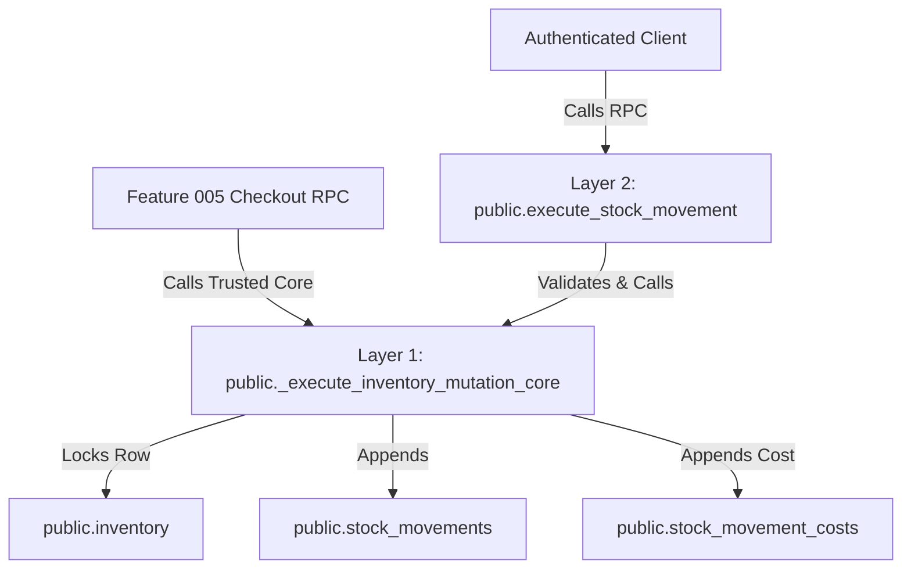

# Feature Specification: Inventory & Stock Management

**Feature ID**: 004  
**Feature Name**: Inventory & Stock Management  
**Feature Branch**: `004-inventory-stock-management`  
**Created**: 2026-11-10  
**Updated**: 2026-11-10 (Specification Hardened & Clarifications Resolved — Ready for Planning)  
**Status**: Approved (Specification Hardened & Clarifications Resolved — Ready for Planning)  
**Development Phase**: Web MVP (with Future Companion Mobile Architecture Alignment)  
**Governing Documents**:
- [BizFlow AI Constitution v1.1.0](.specify/memory/constitution.md)
- [Master Project Blueprint](docs/MASTER_PROJECT_BLUEPRINT.md)
- [Feature 001 Specification & Architecture](specs/001-auth-organization/spec.md)
- [Feature 002 Specification & Architecture](specs/002-employee-rbac/spec.md)
- [Feature 003 Specification & Architecture](specs/003-products-categories/spec.md)

**Input**: User description: "Feature 004 — Inventory & Stock Management creates a secure, reliable inventory management module that allows retail businesses to monitor stock quantities, record stock movements, perform authorized adjustments, and maintain a trustworthy history of inventory changes. The central architectural principle is the Immutable Inventory Movement Ledger: every committed inventory-changing operation must have a corresponding permanent inventory movement record. The system must never silently overwrite or erase historical stock movements to make current quantities appear correct."

---

## Resolved Product-Owner Decisions

### Archived Products Stock Policy (Resolved 2026-11-10)

Archiving a catalog product holding positive on-hand stock (`quantity > 0.0000`) is permitted.

**Confirmed Operational Policy**:
1. **Balance Preservation**: When an active product is archived via `products:archive`, its current on-hand stock balance is frozen and preserved in `public.inventory`.
2. **No Automated Movement**: Archiving or unarchiving a product does NOT automatically create, delete, or modify any inventory movement ledger record or stock quantity.
3. **Visibility Behind Explicit Filter**: Archived products remain accessible in inventory list and history queries through an **"Include Archived"** filter toggle (off by default; accessible only to users with `inventory:read`). When displayed, archived products show a prominent `[Archived]` badge.
4. **Inbound Replenishment Prohibited**: Archived products CANNOT receive inbound stock (`restock` and `initial` are strictly blocked with error `PRODUCT_ARCHIVED_STOCK_FORBIDDEN`). Restoring the product to `active` is required before any replenishment can occur.
5. **Permitted Outbound Write-Offs**: Authorized managers holding `inventory:adjust` are permitted to execute outbound write-offs (`damage`, `loss`, or negative `adjustment`) on archived products to clear damaged, spoiled, or lost goods from the physical store. Positive adjustments and `internal_use` allocations on archived goods are blocked (`PRODUCT_ARCHIVED_STOCK_FORBIDDEN`).
6. **Sales & Return Reservations**: Direct sales and returns for archived goods are reserved for Feature 005 checkout and returns workflows.
7. **History Preservation**: Complete movement history and historical movement costs for archived products remain permanently accessible to authorized roles holding `inventory:history` and `inventory:read_valuation`.

### Inactive Products Internal Use Policy (Resolved 2026-11-10)

`internal_use` movements are strictly prohibited when a product is in `inactive` status.
- Any attempt to record an internal-use allocation for an inactive product is rejected with `PRODUCT_INACTIVE_INTERNAL_USE_BLOCKED` (SQLSTATE `P0023`, HTTP 422).
- The product must be explicitly reactivated to `active` via `products:update` before internal store usage, promotional samples, or supply allocations can be recorded.

---

## Binding Implementation Constraints (inputs to /plan)

> [!IMPORTANT]
> The `/speckit.plan` phase must carry these binding constraints into `data-model.md`, API contracts, and other relevant implementation artifacts under `contracts/`. Planning may elaborate implementation details but must not redefine or weaken these approved invariants.

### 1. The Immutable Inventory Movement Ledger Architecture (Constitution Principle II)
- **Problem**: In traditional CRUD inventory systems, updating a stock quantity directly (`UPDATE inventory SET quantity = 50`) destroys historical traceability, conceals shrinkage/theft, makes auditing impossible, and causes silent race conditions.
- **Architecture**: BizFlow AI implements a dual-tier ledger model:
  1. `public.stock_movements` (The Append-Only Ledger): The authoritative source of truth for every stock mutation. Records immutable movement facts: previous stock (`quantity_before`), change magnitude (`quantity_delta`), resulting stock (`quantity_after`), movement classification (`movement_type`), business explanation (`reason`), document reference (`reference_id`), idempotency payload signature (`idempotency_payload_hash`), creator identity (`created_by`), and creation timestamp (`created_at`).
  2. `public.inventory` (The Materialized Balance Table): Maintains current available stock balances (`quantity`), optimistic concurrency counter (`version`), and replenishment thresholds (`reorder_point`, `reorder_quantity`) per `(organization_id, product_id)`.
- **Atomic Synchronization**:
  - The balance table, the ledger table, and associated cost snapshot records MUST be mutated together within an explicit PostgreSQL database transaction using a dedicated `SECURITY DEFINER` stored function (`_execute_inventory_mutation_core`).
  - No application code or client is ever permitted to issue direct SQL `INSERT`, `UPDATE`, `DELETE`, or `TRUNCATE` on `public.inventory`, `public.stock_movements`, or `public.stock_movement_costs`.
  - All direct client DML and DDL on these tables is denied via explicit SQL privilege revocations (`REVOKE INSERT, UPDATE, DELETE, TRUNCATE FROM authenticated, anon, public`) and PostgreSQL Row-Level Security (`USING (false) WITH CHECK (false)`).
- **Mathematical Invariant**:
  $$\text{Current Balance} = \text{Opening Balance} + \sum \text{quantity\_delta}$$
  Every successful operation maintains this invariant. If an operation fails, the transaction rolls back completely; neither the balance nor the ledger changes.

### 2. Database-Enforced Cost Confidentiality (Defense-in-Depth)
- **Problem**: PostgreSQL Row-Level Security (RLS) filters rows, not columns. If `unit_cost` resides directly on `public.stock_movements` and `authenticated` users have `SELECT` privileges, any user holding `inventory:history` (or `inventory:read`) could bypass application-layer projection and query `supabase.from('stock_movements').select('unit_cost')` directly, exposing sensitive supplier acquisition costs to unauthorized roles like Cashier.
- **Architecture (Table-Separated Cost Protection)**:
  - Adhering to the established Feature 003 cost-isolation pattern, historical movement unit costs reside in a dedicated 1:1 table `public.stock_movement_costs`:
    - `movement_id UUID PRIMARY KEY REFERENCES public.stock_movements(id) ON DELETE CASCADE`
    - `organization_id UUID NOT NULL REFERENCES public.organizations(id) ON DELETE CASCADE`
    - `unit_cost NUMERIC(14, 4) NOT NULL CHECK (unit_cost >= 0.0000)`
    - `created_at TIMESTAMPTZ NOT NULL DEFAULT clock_timestamp()`
    - Composite Foreign Key: `CONSTRAINT fk_movement_costs_org_movement FOREIGN KEY (organization_id, movement_id) REFERENCES public.stock_movements (organization_id, id) ON DELETE CASCADE`
  - `public.stock_movement_costs` has RLS enabled and forced (`ENABLE ROW LEVEL SECURITY; FORCE ROW LEVEL SECURITY;`).
  - A single permissive SELECT policy restricts row visibility to authorized financial roles:
    ```sql
    CREATE POLICY "stock_movement_costs_select" ON public.stock_movement_costs
        FOR SELECT TO authenticated
        USING (
            public.is_org_member(organization_id, auth.uid()) AND
            public.check_user_permission(organization_id, auth.uid(), 'inventory:read_valuation') AND
            public.check_user_permission(organization_id, auth.uid(), 'products:read_cost')
        );
    ```
  - **Reconciliation with Feature 003**: Access to inventory cost data requires BOTH `inventory:read_valuation` and `products:read_cost`. Owner, Admin, and Manager hold both; Cashier holds neither. Callers without valuation permissions receive 0 rows from `stock_movement_costs`, physically guaranteeing that supplier cost data is inaccessible to unauthorized users across all access paths (Supabase client, REST API, GraphQL, and Server Actions).
  - Direct `INSERT`, `UPDATE`, `DELETE`, and `TRUNCATE` on `public.stock_movement_costs` are denied to all client roles. Mutations execute exclusively via the trusted internal mutation function.

### 3. Negative Stock Prevention & Concurrency Serialization
- **Problem**: Concurrent operations (e.g. simultaneous stock deductions or adjustments) could race and cause stock balances to drop below zero or corrupt ledger history.
- **Architecture**:
  - **Database Constraint**: `public.inventory` enforces `CONSTRAINT chk_inventory_non_negative_quantity CHECK (quantity >= 0.0000)`.
  - **Row-Level Locking**: Any stock mutation begins by locking the specific product's inventory row using PostgreSQL `SELECT ... FOR UPDATE` inside the transactional stored function. This serializes all concurrent stock modifications for that specific product within the organization.
  - **Deterministic Rejection**: If a requested stock deduction exceeds available quantity (`quantity_before + quantity_delta < 0.0000`), the stored procedure immediately aborts with error `INSUFFICIENT_STOCK` (SQLSTATE `P0011`).

### 4. Stock Movement Taxonomy, Permitted Signs & Scope Boundaries
- **Movement Classifications & Enforced Sign Directions**:
  Every stock movement belongs to a strictly defined classification with an enforced mathematical sign direction:

| Movement Type | Permitted Delta Sign | Quantity Delta Rule | Mathematical Invariant | Direct Feature 004 Creation |
|---|---|---|---|:---:|
| `initial` | Positive or Zero | `quantity_delta >= 0.0000` | `quantity_after = quantity_before + quantity_delta` | Yes |
| `restock` | Positive | `quantity_delta > 0.0000` | `quantity_after = quantity_before + quantity_delta` | Yes |
| `adjustment` | Positive or Negative | `quantity_delta <> 0.0000` | `quantity_after = quantity_before + quantity_delta` | Yes |
| `damage` | Negative | `quantity_delta < 0.0000` | `quantity_after = quantity_before + quantity_delta` | Yes |
| `loss` | Negative | `quantity_delta < 0.0000` | `quantity_after = quantity_before + quantity_delta` | Yes |
| `internal_use` | Negative | `quantity_delta < 0.0000` | `quantity_after = quantity_before + quantity_delta` | Yes |
| `sale` | Negative | `quantity_delta < 0.0000` | `quantity_after = quantity_before + quantity_delta` | No (Reserved Feature 005) |
| `return` | Positive | `quantity_delta > 0.0000` | `quantity_after = quantity_before + quantity_delta` | No (Reserved Feature 005) |

- **Database-Level Sign Enforcement**:
  Enforced by check constraint on `public.stock_movements`:
  ```sql
  CONSTRAINT chk_movement_type_sign CHECK (
      (movement_type = 'initial' AND quantity_delta >= 0.0000) OR
      (movement_type = 'restock' AND quantity_delta > 0.0000) OR
      (movement_type = 'adjustment' AND quantity_delta <> 0.0000) OR
      (movement_type IN ('damage', 'loss', 'internal_use', 'sale') AND quantity_delta < 0.0000) OR
      (movement_type = 'return' AND quantity_delta > 0.0000)
  )
  ```
- **Scope Boundary**: Movements 1–6 can be created directly by authorized users in Feature 004. Movements 7–8 are registered in the database check constraint for schema forward-compatibility, but direct creation via Feature 004 user interfaces is blocked. Feature 004 does NOT implement sales checkout, customer refund processing, or supplier purchase order workflows.

### 5. Exact Zero-Initial Exception & Singularity Invariants
- **Rule**:
  - An `initial` movement MUST have `quantity_before = 0.0000`. This applies to both positive and zero opening balances.
  - A zero-delta initial movement is permitted **only** when:
    - `movement_type = 'initial'`
    - `quantity_before = 0.0000`
    - `quantity_delta = 0.0000`
    - `quantity_after = 0.0000`
  - All other movement types (`restock`, `adjustment`, `damage`, `loss`, `internal_use`, `sale`, `return`) strictly require `quantity_delta <> 0.0000`.
  - **Database Check Constraints**:
    ```sql
    CONSTRAINT chk_movement_initial_before_zero CHECK (
        movement_type <> 'initial' OR quantity_before = 0.0000
    );

    CONSTRAINT chk_movement_delta_zero_rule CHECK (
        (movement_type = 'initial' AND quantity_delta = 0.0000 AND quantity_before = 0.0000 AND quantity_after = 0.0000) OR
        (movement_type = 'initial' AND quantity_delta > 0.0000) OR
        (movement_type <> 'initial' AND quantity_delta <> 0.0000)
    );
    ```
  - **Database Singularity & History Checks**:
    1. Opening stock can only be established **once** per product per organization. Enforced natively by a partial unique index:
       ```sql
       CREATE UNIQUE INDEX uq_stock_movements_initial_per_product
           ON public.stock_movements (organization_id, product_id)
           WHERE movement_type = 'initial';
       ```
    2. Furthermore, an `initial` movement is strictly rejected if ANY movement record already exists for the product (whether initial, restock, adjustment, damage, loss, or internal use). The stored procedure verifies:
       ```sql
       IF EXISTS (SELECT 1 FROM public.stock_movements WHERE organization_id = p_org_id AND product_id = p_product_id) THEN
           RAISE EXCEPTION USING ERRCODE = 'P0026', MESSAGE = 'INITIAL_STOCK_NOT_PERMITTED_HISTORY_EXISTS';
       END IF;
       ```
    3. If concurrent requests race and violate the partial unique index, the procedure catches `unique_violation` (SQLSTATE `23505`) and raises `INITIAL_STOCK_ALREADY_ESTABLISHED` (SQLSTATE `P0025`, HTTP 409).
    4. A zero-delta initial movement consumes this one-time initial slot. Subsequent stock changes must use an authorized `restock` or `adjustment`.

### 6. Product Creation & Inventory Provisioning Contract
- **Contract Boundary**: Feature 003 product creation (`create_product` RPC) and Feature 004 inventory provisioning operate under a decoupled, declarative contract:
  1. **Automatic Zero-Balance Provisioning**: When a catalog product is created in `public.products`, an associated `public.inventory` row with `quantity = 0.0000`, `reorder_point = NULL`, and `reorder_quantity = NULL` is automatically and idempotently provisioned within the same organization.
     - Handled via a dedicated PostgreSQL trigger `trg_provision_product_inventory` on `public.products` (`AFTER INSERT FOR EACH ROW EXECUTE FUNCTION public.handle_new_product_inventory()`).
     - Trigger function properties: `SECURITY DEFINER`, owned by `postgres`, fixed `SET search_path = pg_catalog, public, pg_temp`, execution granted strictly to database engine.
     - Uses `INSERT INTO public.inventory (organization_id, product_id, quantity) VALUES (NEW.organization_id, NEW.id, 0.0000) ON CONFLICT (organization_id, product_id) DO NOTHING;`.
     - **Critical Invariant**: Automatic zero-balance provisioning does **NOT** insert an `initial` stock movement into `public.stock_movements`. It merely establishes the anchor balance row.
  2. **Explicit Opening Stock Initialization**: Establishing opening stock is an intentional, authorized user action (`inventory:receive`) that inserts the single permitted `initial` movement into `public.stock_movements`.
  3. **Backward-Compatible Backfill**: Feature 004 migration executes a one-time idempotent backfill creating zero-balance `public.inventory` records for all pre-existing Feature 003 products lacking an inventory record:
     ```sql
     INSERT INTO public.inventory (organization_id, product_id, quantity)
     SELECT p.organization_id, p.id, 0.0000
     FROM public.products p
     WHERE NOT EXISTS (
         SELECT 1 FROM public.inventory i
         WHERE i.organization_id = p.organization_id AND i.product_id = p.id
     )
     ON CONFLICT (organization_id, product_id) DO NOTHING;
     ```

### 7. Tripartite Relational Integrity & Deletion Cascade Behavior
- **Declarative Tenant Boundary**:
  - `public.inventory` defines composite unique constraint `CONSTRAINT uq_inventory_org_id_product UNIQUE (organization_id, id, product_id)`.
  - `public.stock_movements` defines matching composite foreign keys:
    ```sql
    CONSTRAINT fk_movements_inventory_composite
        FOREIGN KEY (organization_id, inventory_id, product_id)
        REFERENCES public.inventory (organization_id, id, product_id)
        ON DELETE NO ACTION DEFERRABLE INITIALLY DEFERRED;

    CONSTRAINT fk_movements_org_product
        FOREIGN KEY (organization_id, product_id)
        REFERENCES public.products (organization_id, id)
        ON DELETE NO ACTION DEFERRABLE INITIALLY DEFERRED;
    ```
- **Explicit Foreign-Key Deferrability & Deletion Mechanics**:
  - In PostgreSQL, standard `ON DELETE RESTRICT` evaluates constraint checks immediately upon referenced row deletion, which prevents cascading deletes originating from organization deletion even if dependent records are slated for deletion in the same operation.
  - A standard `ON DELETE NO ACTION` constraint defaults to `NOT DEFERRABLE` (checked at statement completion). While that permits a single-statement cascade (`DELETE FROM organizations WHERE id = $1`), it fails in multi-statement procedural tenant offboarding scripts (e.g. running separate `DELETE FROM products;` followed by `DELETE FROM inventory;` within a transaction block) because the intermediate statement leaves unreferenced rows.
  - Declaring `ON DELETE NO ACTION DEFERRABLE INITIALLY DEFERRED` explicitly defers constraint validation to the end of the transaction (`COMMIT`).
  - **Multi-Statement Tenant Deletion**: Within a tenant deletion transaction—whether executed via a single cascading `DELETE FROM organizations WHERE id = $1` or orchestrated via multiple discrete `DELETE` statements across dependent tables—constraint evaluation is held until statement execution completes and the transaction attempts to commit. By commit time, all dependent rows within the deleted organization have been removed simultaneously, allowing tenant offboarding to succeed cleanly.
- **Product Deletion Restrictions [VERIFY AGAINST 003]**:
  - Under Feature 003 business rule `BR-015`, individual product hard deletion (`DELETE FROM products WHERE id = ...`) is completely prohibited in normal operations; products are soft-archived via `products:archive`.
  - If a direct SQL deletion of an individual product with existing stock movements were attempted (`DELETE FROM products WHERE id = $1`), PostgreSQL evaluates the deferred constraint at transaction commit. Because referencing rows remain in `public.stock_movements`, the check fails and rolls back the transaction with `foreign_key_violation` (SQLSTATE `23503`), strictly preserving audit ledger integrity.
- **Profile Retention & Attribution [VERIFY AGAINST 001]**:
  - `created_by` in `public.stock_movements` references `public.profiles(id) ON DELETE RESTRICT`.
  - In Feature 001, `organizations.created_by` references `public.profiles(id) ON DELETE RESTRICT`. Feature 002 `FR-029` establishes that employee offboarding transitions membership to `status = 'revoked'` while strictly prohibiting hard deletion of membership records. Feature 004 adopts this same `ON DELETE RESTRICT` constraint on `stock_movements.created_by REFERENCES public.profiles(id)`. This guarantees that if a database deletion of a user profile is attempted, PostgreSQL blocks it if historical stock movements exist. Note: An explicit user-account anonymization or GDPR erasure workflow is a Feature 004 retention assumption/policy, not an explicit requirement of Feature 001 (which specifies profile updating in `FR-007`).

### 8. Complete Idempotency Contract & Canonical Payload Semantics
- **Canonical Payload Normalization**:
  The canonical mutation payload represents the client's original submission intent:
  1. Fields: `canonical_quantity` (NUMERIC(14,4)), `movement_type` (TEXT), `organization_id` (UUID), `product_id` (UUID), `quantity_semantics` (TEXT), `reason` (trimmed TEXT, 3–250 chars), `reference_id` (trimmed TEXT, NULL if empty/whitespace-only).
  2. For standard movements (`initial`, `restock`, `damage`, `loss`, `internal_use`) and ordinary delta-based adjustments, `canonical_quantity` is the requested delta magnitude, and `quantity_semantics` is `'quantity_delta'`.
  3. For cycle-count stocktake reconciliations, `canonical_quantity` is the submitted `target_physical_count` (preserving the original client intent), and `quantity_semantics` is `'target_physical_count'`.
- **Deterministic Serialization & SHA-256 Hashing Rules**:
  1. **Key Order**: Object keys are serialized in strict lexicographical order: `canonical_quantity`, `movement_type`, `organization_id`, `product_id`, `quantity_semantics`, `reason`, `reference_id`.
  2. **Numeric Formatting**: Numeric values format with exactly 4 decimal digits (e.g. `'45.0000'`).
  3. **String Normalization**: String fields are trimmed (`trim()`). If `reference_id` is empty, whitespace-only, or NULL, it serializes as literal `null`.
  4. **Compact JSON**: Serialized without whitespace between delimiters (separators `','` and `':'`).
  5. **Encoding & Hash**: Serialized as UTF-8 bytes and hashed using SHA-256 to produce a 64-character lowercase hexadecimal string stored in `stock_movements.idempotency_payload_hash`.
  6. **Concrete Worked Examples**:
     - **Example 1: Stocktake Reconciliation (Target Physical Count)**:
       - Submitted Target Count: `45.0000`
       - Movement Type: `'adjustment'`
       - Organization ID: `'a0000000-0000-0000-0000-000000000001'`
       - Product ID: `'b0000000-0000-0000-0000-000000000002'`
       - Quantity Semantics: `'target_physical_count'`
       - Reason: `'Quarterly stocktake'`
       - Reference ID: `null`
       - Serialized string: `{"canonical_quantity":"45.0000","movement_type":"adjustment","organization_id":"a0000000-0000-0000-0000-000000000001","product_id":"b0000000-0000-0000-0000-000000000002","quantity_semantics":"target_physical_count","reason":"Quarterly stocktake","reference_id":null}`
       - Verified SHA-256 Digest: `822dbc7818bb44882daff5f29396366a9d5f9eb571938eb36fd60270a5f108a6`
     - **Example 2: Ordinary Quantity-Delta Adjustment**:
       - Submitted Delta: `+45.0000`
       - Movement Type: `'adjustment'`
       - Organization ID: `'a0000000-0000-0000-0000-000000000001'`
       - Product ID: `'b0000000-0000-0000-0000-000000000002'`
       - Quantity Semantics: `'quantity_delta'`
       - Reason: `'Quarterly stocktake'`
       - Reference ID: `null`
       - Serialized string: `{"canonical_quantity":"45.0000","movement_type":"adjustment","organization_id":"a0000000-0000-0000-0000-000000000001","product_id":"b0000000-0000-0000-0000-000000000002","quantity_semantics":"quantity_delta","reason":"Quarterly stocktake","reference_id":null}`
       - Verified SHA-256 Digest: `7e2b11299620db0e9531afe7b999c1d1096b39b7f860d67be5efc531eed9f707`
  7. **Semantic Disambiguation Invariant**:
     Because `quantity_semantics` is an immutable element of the canonical payload, a stocktake reconciliation setting stock to 45 and a delta adjustment adding 45 units produce distinct SHA-256 digests (`822dbc78...` vs `7e2b1129...`). If the same idempotency key is submitted for both operations, the procedure detects the hash mismatch and raises `IDEMPOTENCY_CONFLICT` (SQLSTATE `P0024`, HTTP 409).
- **Post-Commit Replay Invariance**:
  - When the initial request commits, `public.inventory.quantity` becomes `45.0000`, and a stock movement is appended with `quantity_delta = +5.0000`, `quantity_after = 45.0000`, and `idempotency_payload_hash = '822dbc7818bb44882daff5f29396366a9d5f9eb571938eb36fd60270a5f108a6'`.
  - When a retry carrying the same target count (`45.0000`) and idempotency key arrives AFTER commit, the procedure catches the unique violation on `uq_movements_org_idempotency`, re-evaluates caller authorization, matches the canonical payload hash (`822dbc78...`), and returns the original committed movement and live balance (`45.0000`).
  - The procedure does NOT recalculate delta against live stock (`45.0000 - 45.0000 = 0.0000`), which prevents both false `ZERO_QUANTITY_NOT_PERMITTED` errors and false `IDEMPOTENCY_CONFLICT` rejections.
- **Database Constraint on Idempotency Pair**:
  ```sql
  CONSTRAINT chk_movement_idempotency_pair CHECK (
      (idempotency_key IS NULL AND idempotency_payload_hash IS NULL) OR
      (idempotency_key IS NOT NULL AND idempotency_payload_hash IS NOT NULL)
  );
  ```
- **Cross-Product Collision Handling & Replay Authorization**:
  1. The organization enforces permanent uniqueness via partial unique index:
     ```sql
     CREATE UNIQUE INDEX uq_movements_org_idempotency
         ON public.stock_movements (organization_id, idempotency_key)
         WHERE idempotency_key IS NOT NULL;
     ```
  2. Because requests for different products cannot be serialized by a single product's row lock, concurrent submissions carrying the same `idempotency_key` race to insert into `public.stock_movements`.
  3. The database procedure catches the unique violation on `uq_movements_org_idempotency` (`ERRCODE = '23505'`).
  4. It re-reads the committed movement record:
     - Verifies caller authentication and active tenant membership.
     - Evaluates whether the caller currently possesses the permission required for that movement type. If permission has been revoked, the replay is rejected (`INSUFFICIENT_PERMISSIONS`, HTTP 403).
     - Compares the canonical `idempotency_payload_hash`.
     - **Match**: Returns the original movement record along with the current live balance (`{ original_movement: {...}, current_stock: live_inventory.quantity, is_replay: true }`).
     - **Mismatch**: Aborts with `IDEMPOTENCY_CONFLICT` (SQLSTATE `P0024`, HTTP 409).
- **Client Submission Behavior**:
  - Web UI generates a fresh UUID v4 per user submission intent.
  - Retries of the same submission intent reuse the same key.
  - A network timeout or connection reset MUST reuse the key; clients must never generate a new key merely because a response timed out.

### 9. Inventory Valuation, Rounding & Currency Exponent Contract
- **Valuation Calculation**:
  $$\text{Total Valuation} = \sum (\text{inventory.quantity} \times \text{product\_costs.cost\_price})$$
  - Calculated at query time using current replacement costs from `public.product_costs`.
  - **Full-Precision Line Calculation**: Each line item is calculated at full supported precision (`quantity * cost_price`).
  - **Single Aggregate Rounding**: The total sum is rounded once at the end using `public.get_currency_exponent(v_org_currency)`.
  - **Unknown Cost**: Products without a row in `public.product_costs` have an *Unknown Cost* (`NULL`). They are omitted from monetary valuation totals and reported in a separate `unvalued_products_count` metric (never defaulted to zero).
  - **Zero Cost**: Products with `product_costs.cost_price = 0.0000` represent genuinely free/zero-cost goods and contribute `0.00` to valuation.
- **Currency Binding**:
  - Currency is strictly inherited from `public.organizations.currency` (ISO 4217). Hardcoded currency symbols (e.g. `$`) are prohibited; display renders as `[CURRENCY_CODE] [FORMATTED_AMOUNT]`.

### 10. Organization Deletion & Ledger Retention Scope
- **Operational Ledger Immutability**: Within the operational lifecycle of an active organization, committed stock movements and cost snapshots are permanent. They CANNOT be updated, deleted, or truncated.
- **Exceptional Tenant Cascade**: When an organization is deleted (e.g. business dissolution or tenant purge), cascading deletes from `public.organizations(id)` remove all tenant-scoped data in one operation:
  `organizations` $\rightarrow$ `products` (`ON DELETE CASCADE`), `inventory` (`ON DELETE CASCADE`), `stock_movements` (`ON DELETE CASCADE`), `stock_movement_costs` (`ON DELETE CASCADE`).
  Because foreign keys between movements, inventory, and products use `ON DELETE NO ACTION DEFERRABLE INITIALLY DEFERRED`, constraint evaluation is deferred until transaction commit, allowing tenant deletion to commit cleanly whether executed via a single cascading statement or via multi-statement procedural offboarding scripts.

### 11. Two-Layer Database Architecture & Mutation Contract
All inventory mutations execute through a two-layer database architecture to ensure strict separation of concerns and forward-compatibility with future modules:



#### Layer 1: Internal Inventory Core Function
- Function: `public._execute_inventory_mutation_core(p_org_id UUID, p_product_id UUID, p_movement_type TEXT, p_quantity_delta NUMERIC, p_reason TEXT, p_reference_id TEXT, p_idempotency_key UUID, p_idempotency_payload_hash TEXT, p_created_by UUID, p_expected_version INTEGER DEFAULT NULL) RETURNS JSONB`
- Security Configuration:
  - `SECURITY DEFINER`, `OWNER TO postgres`.
  - Fixed `SET search_path = pg_catalog, public, pg_temp`.
  - **Explicit Overload Handling**: To prevent ambiguous signature collisions during migrations, pre-existing function overloads must be dropped before recreation:
    ```sql
    DROP FUNCTION IF EXISTS public._execute_inventory_mutation_core(UUID, UUID, TEXT, NUMERIC, TEXT, TEXT, UUID, TEXT, UUID, INTEGER);
    ```
  - **Privilege Revocation with Exact Signature**:
    ```sql
    REVOKE ALL ON FUNCTION public._execute_inventory_mutation_core(UUID, UUID, TEXT, NUMERIC, TEXT, TEXT, UUID, TEXT, UUID, INTEGER) FROM PUBLIC, authenticated, anon;
    ```
  - Executable ONLY by trusted database functions (Layer 2 wrapper and future Feature 005 sales wrapper). Direct client RPC execution is physically impossible.
- Core Responsibilities:
  1. Acquires row-level lock on `public.inventory` (`FOR UPDATE`).
  2. Asserts product belongs to `p_org_id` and is not archived for inbound stock.
  3. Verifies version match if `p_expected_version` is provided (optimistic concurrency control).
  4. Validates movement sign, UOM precision, and absolute quantity bounds (`<= 999,999,999.9999`).
  5. Asserts `quantity_before + p_quantity_delta >= 0.0000` (rejects negative stock with `INSUFFICIENT_STOCK`).
  6. Enforces exact zero-initial rules and singularity constraints.
  7. Updates `public.inventory`: sets `quantity = quantity_after`, `updated_at = clock_timestamp()`, increments `version = version + 1`.
  8. Inserts immutable record into `public.stock_movements`.
  9. If a cost exists in `public.product_costs`, snapshots it into `public.stock_movement_costs`.
  10. Returns JSONB containing created movement and resulting live inventory balance.

#### Layer 2: Feature 004 User-Facing Wrapper Procedure
- Function: `public.execute_stock_movement(p_org_id UUID, p_product_id UUID, p_movement_type TEXT, p_quantity NUMERIC, p_reason TEXT, p_reference_id TEXT DEFAULT NULL, p_idempotency_key UUID DEFAULT NULL, p_expected_version INTEGER DEFAULT NULL, p_quantity_semantics TEXT DEFAULT 'quantity_delta') RETURNS JSONB`
- Security Configuration & Overload Handling:
  - `SECURITY DEFINER`, `OWNER TO postgres`.
  - Fixed `SET search_path = pg_catalog, public, pg_temp`.
  - **Explicit Overload Cleanup**: To prevent ambiguous signature collisions during migrations, pre-existing or legacy function signatures must be explicitly dropped before recreation:
    ```sql
    DROP FUNCTION IF EXISTS public.execute_stock_movement(UUID, UUID, TEXT, NUMERIC, TEXT, TEXT, UUID, INTEGER);
    DROP FUNCTION IF EXISTS public.execute_stock_movement(UUID, UUID, TEXT, NUMERIC, TEXT, TEXT, UUID, INTEGER, TEXT);
    ```
  - **Parameter-Qualified Grants & Revocations**:
    ```sql
    GRANT EXECUTE ON FUNCTION public.execute_stock_movement(UUID, UUID, TEXT, NUMERIC, TEXT, TEXT, UUID, INTEGER, TEXT) TO authenticated;
    REVOKE EXECUTE ON FUNCTION public.execute_stock_movement(UUID, UUID, TEXT, NUMERIC, TEXT, TEXT, UUID, INTEGER, TEXT) FROM anon, PUBLIC;
    ```
- Authorization & Guard Invariants (11 Mandatory Invariants):
  1. **Authenticated Caller**: Asserts `auth.uid() IS NOT NULL` (rejects with `UNAUTHENTICATED`, HTTP 401).
  2. **Active Organization**: Asserts `organizations.is_active = TRUE` for target tenant (rejects with `ORGANIZATION_INACTIVE`, HTTP 403).
  3. **Active Membership**: Asserts caller holds an active membership (`status = 'active'`) in target organization (rejects with `MEMBERSHIP_INACTIVE`, HTTP 403).
  4. **Granular Permission Check**: Evaluates permission required by the requested movement type using `public.check_user_permission()`. Rejects with `INSUFFICIENT_PERMISSIONS` (HTTP 403) if missing.
  5. **Feature 004 Scope Boundary**: Strictly rejects `sale` and `return` movement types (`INVALID_MOVEMENT_TYPE`, HTTP 422). Direct client creation of sales or returns through Feature 004 is blocked.
  6. **Quantity Semantics Explicit Server-Side Validation**:
     Validates operation semantics conditionally using an explicit PL/pgSQL block (rejects with `INVALID_QUANTITY_SEMANTICS`, SQLSTATE `P0033`, HTTP 422; do not use `ASSERT`):
     ```sql
     IF p_quantity_semantics IS NULL
        OR p_quantity_semantics NOT IN (
            'quantity_delta',
            'target_physical_count'
        )
        OR (
            p_quantity_semantics = 'target_physical_count'
            AND p_movement_type <> 'adjustment'
        )
     THEN
         RAISE EXCEPTION USING
             ERRCODE = 'P0033',
             MESSAGE = 'INVALID_QUANTITY_SEMANTICS';
     END IF;
     ```
  7. **Canonical Idempotency Evaluation**: Computes canonical hash using `{ canonical_quantity, movement_type, organization_id, product_id, quantity_semantics, reason, reference_id }`. If an idempotency key is supplied, acquires transaction-scoped advisory lock and checks `public.stock_movements` and `public.zero_delta_stocktakes`. Matching requests return the original successful response immediately (even if product was subsequently archived/deactivated). Reused keys with mismatching payloads return `IDEMPOTENCY_CONFLICT` (`P0024`, HTTP 409).
  8. **Product Retrieval, Shared Row Lock & Lifecycle Validation**: When no previous operation exists (new mutation), acquires shared row lock (`FOR SHARE`) on `public.products` (preserving `products` -> `inventory` lock hierarchy). Rejects missing products (`PRODUCT_NOT_FOUND`); rejects `initial`, `restock`, `internal_use` on archived products (`PRODUCT_ARCHIVED_STOCK_FORBIDDEN`); rejects `restock` on inactive products (`PRODUCT_INACTIVE_RESTOCK_BLOCKED`); rejects `internal_use` on inactive products (`PRODUCT_INACTIVE_INTERNAL_USE_BLOCKED`).
  9. **Deterministic Identity Binding**: Derives `p_created_by := auth.uid()`. Never trusts client-supplied user IDs.
  10. **Quantity Calculation, Zero-Delta Persistence & Delegation to Layer 1**:
      - If `p_quantity_semantics = 'target_physical_count'`: reads locked `quantity_before` from `public.inventory` (`FOR UPDATE`), computes `p_quantity_delta := p_quantity - quantity_before`. If delta = 0, persists to `public.zero_delta_stocktakes` and returns confirmation without ledger entry; if non-zero, validates that delta does not add stock to archived products, then delegates to Layer 1.
      - If `p_quantity_semantics = 'quantity_delta'`: sets `p_quantity_delta := p_quantity`, validates that delta does not add stock to archived products, and delegates to Layer 1.
      - Invokes `_execute_inventory_mutation_core`.
  11. **Error Translation**: Translates underlying database exceptions into standardized error catalog codes.

#### Movement Type Permission Mapping
| Movement Type | Required Permission | Allowed in Feature 004 RPC |
|---|---|:---:|
| `initial` | `inventory:receive` | Yes |
| `restock` | `inventory:receive` | Yes |
| `adjustment` | `inventory:adjust` | Yes |
| `damage` | `inventory:adjust` | Yes |
| `loss` | `inventory:adjust` | Yes |
| `internal_use` | `inventory:adjust` | Yes |
| `sale` | Reserved for Feature 005 (requires `sales:create`) | No (`INVALID_MOVEMENT_TYPE`) |
| `return` | Reserved for Feature 005 (requires future return permission) | No (`INVALID_MOVEMENT_TYPE`) |

#### Feature 005 Integration Contract
- Feature 005 (Customers & Sales) will implement its own trusted database wrapper (e.g. `public.record_pos_sale`).
- That wrapper will validate the caller, verify `sales:create`, validate sale line items, and invoke `public._execute_inventory_mutation_core` for each line item within the **SAME** PostgreSQL transaction.
- If any line item has insufficient stock, the entire transaction aborts; no sale is recorded, and no stock is deducted. Stock deductions and sale records commit together atomically.

#### Note on `SECURITY DEFINER` and `BYPASSRLS`
In Supabase/PostgreSQL, functions owned by the `postgres` role execute with `BYPASSRLS`. Therefore, row-level security is bypassed during function execution. To guarantee zero data leakage or tenant boundary breach, the function itself explicitly enforces tenant validation, caller membership verification, and permission checks before executing any DML or queries.

### 12. Reorder-Point & Threshold Mutation Contract
- Direct SQL `UPDATE` on `public.inventory` is denied by RLS (`USING (false)`).
- Reorder points and suggested replenishment quantities MUST be updated exclusively through a dedicated trusted stored procedure:
  `public.update_inventory_thresholds(p_org_id UUID, p_product_id UUID, p_reorder_point NUMERIC, p_reorder_quantity NUMERIC, p_expected_version INTEGER DEFAULT NULL) RETURNS JSONB`
- **Security & Authorization**:
  - `SECURITY DEFINER`, owned by `postgres`, fixed `SET search_path = pg_catalog, public, pg_temp`.
  - Verifies caller authentication (`auth.uid() IS NOT NULL`), active organization membership, and requires `inventory:adjust`.
  - Validates numeric bounds: `reorder_point >= 0.0000` (or NULL), `reorder_quantity > 0.0000` (or NULL).
  - Validates UOM precision (discrete units require whole integers).
  - Updates `public.inventory`: sets `reorder_point`, `reorder_quantity`, `updated_at = clock_timestamp()`, and increments `version = version + 1`.
  - **Non-Ledger Invariant**: Threshold updates do NOT insert a record into `public.stock_movements` or modify historical movement records.

### 13. Inventory Version & Optimistic Concurrency Control (OCC) Semantics
- `public.inventory.version` is a positive `INTEGER` initialized to `1` upon product inventory provisioning.
- It increments monotonically by `+1` on every committed balance mutation and threshold mutation.
- It is NEVER decremented, reset, or reused. Failed or rolled-back transactions do not increment the persisted version.
- UI editing forms and mutation requests include `expected_version`. If the database version does not match `expected_version`, the stored procedure aborts with `STALE_VERSION_CONFLICT` (SQLSTATE `P0027`, HTTP 409), preventing lost updates.

### 14. Stocktake Reconciliation Semantics
- For cycle counts and stocktakes, client submissions provide a `target_physical_count` rather than a calculated delta.
- The mutation function locks the inventory row (`FOR UPDATE`), reads current stock (`quantity_before`), and calculates `quantity_delta := target_physical_count - quantity_before`.
- If `quantity_delta = 0.0000`, the count already matches system stock; the system returns a status confirmation without inserting a zero-delta movement.
- If `quantity_delta <> 0.0000`, it validates that `target_physical_count >= 0.0000` and commits an `adjustment` movement.
- **Idempotency Replay Safety**: The canonical idempotency payload includes the client's submitted `target_physical_count` formatted to scale 4 paired with `quantity_semantics: "target_physical_count"` (`{"canonical_quantity":"45.0000",...,"quantity_semantics":"target_physical_count",...}`). When a retry arrives after a successful commit, the system recognizes the identical target count (matching verified SHA-256 digest `822dbc7818bb44882daff5f29396366a9d5f9eb571938eb36fd60270a5f108a6`), skips re-calculating delta (which would now be 0), and returns the original committed adjustment movement.

### 15. Product Lifecycle & Movement Permission Matrix

| Movement Type | Active Product | Inactive Product | Archived Product (Approved Policy) |
|---|:---:|:---:|:---:|
| `initial` | Allowed (if no prior movements) | Allowed (if no prior movements) | Blocked (`PRODUCT_ARCHIVED_STOCK_FORBIDDEN`) |
| `restock` | Allowed | Blocked (`PRODUCT_INACTIVE_RESTOCK_BLOCKED`) | Blocked (`PRODUCT_ARCHIVED_STOCK_FORBIDDEN`) |
| `adjustment` | Allowed | Allowed (count reconciliation) | Allowed ONLY as negative write-off; positive blocked (`PRODUCT_ARCHIVED_STOCK_FORBIDDEN`) |
| `damage` | Allowed | Allowed (breakage write-off) | Allowed (write-off of damaged goods) |
| `loss` | Allowed | Allowed (shrinkage write-off) | Allowed (write-off of missing goods) |
| `internal_use` | Allowed | Blocked (`PRODUCT_INACTIVE_INTERNAL_USE_BLOCKED`) | Blocked (`PRODUCT_ARCHIVED_STOCK_FORBIDDEN`) |
| `sale` | Reserved (Feature 005) | Blocked (`PRODUCT_INACTIVE_SALE_BLOCKED`) | Blocked (`PRODUCT_ARCHIVED_STOCK_FORBIDDEN`) |
| `return` | Reserved (Feature 005) | Blocked (`PRODUCT_INACTIVE_RETURN_BLOCKED`) | Blocked (`PRODUCT_ARCHIVED_STOCK_FORBIDDEN`) |

#### Inventory Overview & Filter Rules
1. **Archived Products in Overview Totals**: Excluded by default. Included in product counts and valuation totals ONLY when the "Include Archived" toggle is explicitly enabled.
2. **Inactive Products in Overview Totals**: Included by default in product counts and valuation totals (as they represent physical store assets).
3. **Default Product Status Filter**: Non-archived products (`status IN ('active', 'inactive')`).
4. **"Include Archived" Filter Toggle**: Off by default. Available only to users with `inventory:read`. When enabled, archived products appear with an `[Archived]` badge and can be isolated using the Status dropdown (`all`, `active`, `inactive`, `archived`).
5. **Deterministic Status Sort Order**: When sorting by stock status, the priority sequence is: `out_of_stock` (1), `low_stock` (2), `in_stock` (3).

### 16. Error Code Catalog

| Error Code | SQLSTATE | HTTP Status | Trigger Condition |
|---|:---:|:---:|---|
| `UNAUTHENTICATED` | `08001` | 401 | `auth.uid()` is NULL or missing valid session token |
| `INSUFFICIENT_PERMISSIONS` | `42501` | 403 | Caller lacks the granular permission required for the operation |
| `ORGANIZATION_INACTIVE` | `P0001` | 403 | Target organization has `is_active = FALSE` |
| `MEMBERSHIP_INACTIVE` | `P0002` | 403 | Caller's membership in the target organization is not `active` |
| `PRODUCT_NOT_FOUND` | `P0003` | 404 | Product ID does not exist within the organization |
| `INVENTORY_NOT_FOUND` | `P0004` | 404 | Inventory record missing for product in organization |
| `TENANT_MISMATCH` | `P0005` | 400 | Product, inventory, or movement tenant IDs do not match |
| `INSUFFICIENT_STOCK` | `P0011` | 422 | Stock deduction exceeds available stock (`quantity_after < 0.0000`) |
| `NON_POSITIVE_QUANTITY` | `P0012` | 422 | Restock quantity submitted is zero or negative |
| `NEGATIVE_QUANTITY_NOT_PERMITTED` | `P0013` | 422 | Initial stock quantity submitted is negative |
| `ZERO_QUANTITY_NOT_PERMITTED` | `P0014` | 422 | Adjustment or movement delta submitted is zero (excluding initial exception) |
| `INTEGER_QUANTITY_REQUIRED` | `P0015` | 422 | Non-integer quantity submitted for a discrete unit of measure |
| `DECIMAL_PRECISION_EXCEEDED` | `P0016` | 422 | Quantity exceeds 4 decimal places of fractional precision |
| `ADJUSTMENT_REASON_REQUIRED` | `P0017` | 422 | Stock adjustment submitted without a non-empty reason |
| `ADJUSTMENT_REASON_TOO_LONG` | `P0018` | 422 | Adjustment reason exceeds 250 characters |
| `REFERENCE_ID_TOO_LONG` | `P0019` | 422 | Reference ID exceeds 100 characters |
| `INVALID_MOVEMENT_TYPE` | `P0020` | 422 | Unknown movement type or direct creation of reserved `sale`/`return` |
| `PRODUCT_ARCHIVED_STOCK_FORBIDDEN` | `P0021` | 422 | Inbound replenishment, positive adjustment, or internal use attempted on archived product |
| `PRODUCT_INACTIVE_RESTOCK_BLOCKED` | `P0022` | 422 | Inbound restock attempted on inactive product |
| `PRODUCT_INACTIVE_INTERNAL_USE_BLOCKED` | `P0023` | 422 | Internal use attempted on inactive product (product must be reactivated first) |
| `PRODUCT_INACTIVE_SALE_BLOCKED` | `P0031` | 422 | Direct sale attempted on inactive product |
| `PRODUCT_INACTIVE_RETURN_BLOCKED` | `P0032` | 422 | Customer return attempted on inactive product |
| `IDEMPOTENCY_CONFLICT` | `P0024` | 409 | Reuse of idempotency key with conflicting canonical payload |
| `INITIAL_STOCK_ALREADY_ESTABLISHED` | `P0025` | 409 | Duplicate initial stock movement attempted for product |
| `INITIAL_STOCK_NOT_PERMITTED_HISTORY_EXISTS` | `P0026` | 422 | Initial stock movement attempted on product that already has movement history |
| `STALE_VERSION_CONFLICT` | `P0027` | 409 | OCC mismatch: `expected_version` differs from database `version` |
| `QUANTITY_EXCEEDS_MAXIMUM` | `P0028` | 422 | Quantity exceeds maximum allowable limit (`999,999,999.9999`) |
| `UOM_CLASS_MUTATION_RESTRICTED` | `P0029` | 422 | Attempting to change product UOM class while stock > 0 or history exists |
| `ORGANIZATION_DELETION_FAILED` | `P0030` | 500 | Organization cascade deletion encountered unhandled foreign-key block |
| `INVALID_QUANTITY_SEMANTICS` | `P0033` | 422 | `p_quantity_semantics` is NULL, not in ('quantity_delta', 'target_physical_count'), or target_physical_count used with movement_type other than adjustment |

---

## User Scenarios & Testing *(mandatory)*

### User Story 1 - View Inventory Overview & Stock Balances (Priority: P1)

As a Store Owner, Manager, or Cashier,  
I want to view real-time on-hand stock quantities, units of measure, and stock statuses across all catalog products,  
So that I know exactly how much inventory is available to serve retail customers and avoid stockouts.

**Why this priority**: Real-time stock visibility is the fundamental prerequisite of retail operations. Without accurate on-hand stock data, a store cannot fulfill customer orders or make purchasing decisions.

**Real-Time Data Scope**: For Web MVP, "real-time" means immediate, authoritative reads from PostgreSQL upon page navigation and automatic server-side revalidation/cache invalidation immediately following any mutation. Live WebSocket/Supabase Realtime subscriptions are deferred.

**Independent Test**: Can be tested independently by creating catalog products, navigating to `/inventory`, searching by SKU/name, filtering by category/status, and verifying that stock quantities match database records.

**Acceptance Scenarios**:
1. **Given** an authenticated user with `inventory:read` in an active organization, **When** they navigate to `/inventory`, **Then** the system displays a paginated inventory table showing Product Name, SKU, Barcode, Category, Current Quantity, Unit of Measure, Stock Status (`In Stock`, `Low Stock`, `Out of Stock`), and Reorder Point.
2. **Given** a Cashier (who holds `inventory:read` but lacks `inventory:read_valuation`), **When** they view the inventory list, **Then** stock quantities and units of measure are displayed, but unit costs, total values, and valuation summary widgets are completely hidden and omitted from network responses.
3. **Given** an Owner or Manager (who holds both `inventory:read_valuation` and `products:read_cost`), **When** they view the inventory list, **Then** the inventory overview displays Total Tracked Products, In-Stock Products, Low-Stock Count, Out-of-Stock Count, and Total Inventory Valuation in the organization's currency.
4. **Given** an inventory list of 10,000 products, **When** the user types a partial product name, SKU, or scans a barcode into the search field, **Then** the browser list updates within 500 ms to display matching items.
5. **Given** an organization with products having low stock (`quantity <= reorder_point`), **When** the user applies the "Low Stock" filter, **Then** only products with quantities at or below their configured reorder point (and greater than zero) are shown.

---

### User Story 2 - Receive Stock / Restock Inventory (Priority: P1)

As a Store Manager holding `inventory:receive`,  
I want to record incoming inventory shipments with received quantities, supplier reference IDs, and notes,  
So that stock balances are incremented accurately and the delivery is permanently recorded in the ledger.

**Why this priority**: Retail stores receive stock replenishment shipments regularly. Recording inbound deliveries accurately is essential for shelf availability and operational accounting.

**Independent Test**: Can be tested independently by selecting an active product with 10 units on hand, submitting a Restock action with quantity 25 and reference "PO-8812", and verifying that current quantity increments to 35 and an immutable `stock_movements` record is appended.

**Acceptance Scenarios**:
1. **Given** a user holding `inventory:receive`, **When** they select an active product with 10 units on hand and submit a restock of 15 units with reason "Weekly replenishment" and reference "PO-9901", **Then** the product balance becomes 25 units, and a `stock_movements` record is created with `movement_type = 'restock'`, `quantity_before = 10`, `quantity_delta = +15`, `quantity_after = 25`.
2. **Given** a product with discrete unit of measure `piece`, **When** the user attempts to restock `3.5` units, **Then** the system rejects the operation with validation error `INTEGER_QUANTITY_REQUIRED` (HTTP 422).
3. **Given** a product with continuous unit of measure `kg`, **When** the user submits a restock of `12.7500` units, **Then** the system accepts the fractional quantity and increments the balance accurately.
4. **Given** an archived product, **When** a user attempts to receive stock, **Then** the system rejects the operation with error `PRODUCT_ARCHIVED_STOCK_FORBIDDEN` (HTTP 422).
5. **Given** an inactive product, **When** a user attempts to restock, **Then** the system rejects the operation with error `PRODUCT_INACTIVE_RESTOCK_BLOCKED` (HTTP 422).
6. **Given** a Cashier lacking `inventory:receive`, **When** they attempt to trigger a restock action via the UI or direct API request, **Then** the request is rejected with `403 Forbidden` (`INSUFFICIENT_PERMISSIONS`).

---

### User Story 3 - Record Initial Stock for Catalog Products (Priority: P2)

As a Store Owner, Admin, or Manager holding `inventory:receive`,  
I want to establish the authoritative opening stock baseline for catalog products during catalog setup or store onboarding,  
So that starting inventory is recorded with an auditable baseline movement.

**Why this priority**: Initial stock setup transitions a newly registered catalog product into active, operational inventory.

**Independent Test**: Two-step independent test: (1) Create a new catalog product in Feature 003, verifying that an anchor zero-balance `public.inventory` record is provisioned without an initial movement, (2) Record an initial stock movement of 50 units via `execute_stock_movement`, verifying that balance updates to 50 and a single `initial` movement record is inserted with `quantity_before = 0` and `quantity_after = 50`.

**Acceptance Scenarios**:
1. **Given** a newly created product with no previous movement history, **When** an authorized user holding `inventory:receive` sets opening stock to 50 units with reason "Initial store count", **Then** the system sets balance to 50 and creates an `initial` movement with `quantity_before = 0.0000`, `quantity_delta = +50.0000`, `quantity_after = 50.0000`.
2. **Given** an existing product with no previous movement history, **When** an authorized user explicitly establishes opening stock to 0 with reason "Zero opening stock confirmed", **Then** the system creates an `initial` stock movement record with `quantity_before = 0.0000`, `quantity_delta = 0.0000`, `quantity_after = 0.0000`, creating an auditable baseline.
3. **Given** a product that already has an `initial` stock movement recorded, **When** a user attempts to record a second `initial` stock movement, **Then** the stored procedure catches the unique constraint violation and aborts with error `INITIAL_STOCK_ALREADY_ESTABLISHED` (SQLSTATE `P0025`, HTTP 409).
4. **Given** a product that has no initial movement but already has received a `restock` movement, **When** a user attempts to record an `initial` movement, **Then** the procedure rejects the operation with error `INITIAL_STOCK_NOT_PERMITTED_HISTORY_EXISTS` (SQLSTATE `P0026`, HTTP 422).

---

### User Story 4 - Perform Controlled Stock Adjustments & Corrections (Priority: P2)

As a Store Manager or Owner holding `inventory:adjust`,  
I want to adjust stock balances up or down after physical stocktakes or record damage, shrinkage, and loss with mandatory explanations,  
So that system balances match physical reality while maintaining an unalterable audit trail.

**Why this priority**: Breakage, spillage, shrinkage, and counting discrepancies occur in retail. Authorized managers must be able to realign system balances without erasing historical records.

**Independent Test**: Can be tested independently by adjusting a product with 20 units down to 17 units with movement type `damage` and reason "3 bottles broken during shelving", verifying that the balance updates to 17 and a `damage` movement is appended.

**Acceptance Scenarios**:
1. **Given** an authorized user with `inventory:adjust`, **When** they submit an adjustment for a product from 20 units to 17 units with movement type `damage` and reason "Shattered on retail floor", **Then** the balance is updated to 17, and a movement is created with `quantity_delta = -3.0000`, `quantity_before = 20.0000`, `quantity_after = 17.0000`.
2. **Given** a user attempting to adjust stock, **When** they submit without entering an explanatory reason, **Then** the submission is blocked with validation error `ADJUSTMENT_REASON_REQUIRED` (HTTP 422).
3. **Given** a product with 5 units on hand, **When** a user attempts to submit a reduction of 8 units, **Then** the system rejects the operation with error `INSUFFICIENT_STOCK` (HTTP 422) and prevents negative stock.
4. **Given** a user performing a cycle count who enters a target physical count of 45 units (current balance is 40 units), **When** they submit with type `adjustment` and reason "Quarterly stocktake", **Then** the server acquires the row lock, computes `quantity_delta = +5.0000`, commits the adjustment atomically, and returns the resulting balance of 45 units.
5. **Given** the completed stocktake adjustment in Scenario 4 with an `idempotency_key`, **When** the client retries the identical stocktake request carrying target physical count 45 with `quantity_semantics = 'target_physical_count'` (matching verified canonical hash `822dbc78...`), **Then** the procedure detects the committed key, verifies the canonical payload hash matches, returns the original movement (delta `+5.0000`) and balance 45, and does NOT produce an idempotency conflict or apply a second delta.
6. **Given** an inactive product, **When** an authorized user attempts to record an `internal_use` movement, **Then** the system rejects the operation with error `PRODUCT_INACTIVE_INTERNAL_USE_BLOCKED` (HTTP 422), requiring the product to be reactivated first.
7. **Given** a mutation request with invalid quantity semantics (e.g. NULL, unrecognized string, or `target_physical_count` paired with a non-adjustment movement), **When** submitted to `execute_stock_movement`, **Then** the procedure rejects the operation with error `INVALID_QUANTITY_SEMANTICS` (SQLSTATE `P0033`, HTTP 422) without modifying stock or appending a ledger record.

---

### User Story 5 - Audit Stock Movement History (Priority: P3)

As a Store Owner, Admin, or Manager holding `inventory:history`,  
I want to view the complete chronological movement ledger for any product or across the entire organization,  
So that I can trace every addition, deduction, adjustment, actor, timestamp, and reference document.

**Why this priority**: Accountability and financial integrity require an unforgeable record of who changed stock, when, why, and by how much.

**Independent Test**: Can be tested independently by performing 3 distinct movements on a product (initial, restock, damage) and querying `/inventory/history`, verifying all 3 rows appear in reverse chronological order with exact timestamps and actor names.

**Acceptance Scenarios**:
1. **Given** a user with `inventory:history`, **When** they navigate to the Movement History tab, **Then** they see a filterable, paginated audit table showing Date/Time, Product Name, SKU, Movement Type badge, Delta (`+` green, `-` red), Quantity Before, Quantity After, Reason, Reference ID, and Performed By (employee name).
2. **Given** the movement history view, **When** the user filters by Product, Movement Type, or Date Range, **Then** only ledger entries matching the criteria are returned, ordered deterministically by `created_at DESC, id DESC`.
3. **Given** a Cashier lacking `inventory:history`, **When** they issue a direct SQL query `SELECT * FROM public.stock_movements`, **Then** PostgreSQL RLS strictly filters out all records and returns zero rows.
4. **Given** an archived product, **When** an authorized user filters history for that product's SKU, **Then** all historical stock movements remain fully intact and viewable.
5. **Given** a direct SQL query by an authenticated client attempting to `UPDATE`, `DELETE`, or `TRUNCATE` `public.stock_movements`, **Then** PostgreSQL RLS and revoked SQL privileges strictly deny the operation.

---

### User Story 6 - Configure Reorder Points & Low-Stock Alerts (Priority: P3)

As a Store Manager holding `inventory:adjust`,  
I want to configure minimum stock thresholds (reorder points) and suggested replenishment quantities for individual products,  
So that the dashboard highlights items running low before they sell out completely.

**Why this priority**: Proactive replenishment prevents lost retail sales resulting from unexpected stockouts.

**Independent Test**: Can be tested independently by updating a product's reorder point to 10 via `update_inventory_thresholds`, adjusting stock to 8, and verifying that the product receives a visual `Low Stock` badge and appears in the low-stock dashboard filter.

**Acceptance Scenarios**:
1. **Given** a user with `inventory:adjust`, **When** they submit a reorder point of 15 units and suggested reorder quantity of 50 units via `update_inventory_thresholds`, **Then** `public.inventory.reorder_point` is set to 15, `reorder_quantity` is set to 50, `updated_at` is updated, `version` is incremented, and NO stock movement record is created.
2. **Given** a product with `reorder_point = 10` and current quantity 8, **When** viewed in the inventory list or dashboard, **Then** the status badge renders as `Low Stock` (amber indicator).
3. **Given** a product with current quantity 0, **When** viewed in the inventory list, **Then** the status badge renders as `Out of Stock` (red indicator), regardless of configured reorder point.
4. **Given** a product with `reorder_point = NULL`, **When** current quantity is 3, **Then** the status badge renders as `In Stock` (normal) because no threshold is configured.

---

## Feature 003 Product Details Integration

To maintain a cohesive catalog experience without modifying Feature 003's core architecture, Feature 004 defines a clean UI and data-fetching integration on the Product Details page (`/products/[id]`):
1. **Embedded Inventory Summary Card**: Feature 004 introduces an `InventorySummaryCard` component embedded on `/products/[id]`.
2. **Authorized Server-Side Data Fetch**: The card retrieves data via a dedicated server action that checks `inventory:read`. If the authenticated user lacks `inventory:read`, the inventory card is gracefully omitted from the page.
3. **Movement History Widget**: The product details page includes an optional "Stock Movements" tab/card. This component executes a query requiring `inventory:history`. If the user has `inventory:read` but lacks `inventory:history`, current stock is displayed while the movement history table is replaced with a discreet "Detailed movement history requires manager permissions" placeholder.
4. **Valuation Protection**: Product acquisition costs on the details page continue to be governed by Feature 003's `products:read_cost` and Feature 004's `inventory:read_valuation`.

---

## Edge Cases

- **Concurrent Reductions on Same Product**: Two users simultaneously attempt to deduct stock from the same product. The database locks the product's inventory row via `SELECT ... FOR UPDATE`, processing the first deduction. The second deduction evaluates the updated balance; if remaining stock is insufficient, it aborts cleanly with `INSUFFICIENT_STOCK` without corrupting state.
- **Cross-Product Idempotency Collision**: Two separate requests for different products are submitted concurrently with the same `idempotency_key`. The procedure catches the unique index violation on `uq_movements_org_idempotency`, re-reads the committed movement, re-checks authorization, compares the canonical payload hash, and raises `IDEMPOTENCY_CONFLICT` (SQLSTATE `P0024`, HTTP 409).
- **Network Retries with Identical Key**: A client submits a Restock request, network drops before receiving the response, and client retries with the same `idempotency_key`. The database detects the unique index violation, verifies canonical payload equality, skips duplicate mutation, and returns the original movement and live balance.
- **Product Creation without Stock**: A product is created in Feature 003 without stock. The trigger automatically provisions a corresponding `public.inventory` row with `quantity = 0.0000` without inserting an initial movement record, preserving the product's eligibility for explicit opening-stock initialization.
- **Product Archival with Remaining Stock**: When a product holding positive on-hand stock is archived, its balance remains recorded in the database and visible in inventory views with an `[Archived]` indicator (behind the "Include Archived" toggle). Inbound restocking (`restock`, `initial`) and internal use allocations are strictly blocked (`PRODUCT_ARCHIVED_STOCK_FORBIDDEN`). Outbound write-offs (`damage`, `loss`) by authorized managers holding `inventory:adjust` remain permitted to clear obsolete or damaged stock. Replenishment resumes only after restoring the product to `active`.
- **Zero Initial Movement Established**: A user initializes a product with explicit zero stock (`quantity_delta = 0.0000`). This consumes the one-time initial movement slot. Any subsequent attempt to record another `initial` movement is rejected with `INITIAL_STOCK_ALREADY_ESTABLISHED`. Subsequent stock additions must use `restock`.
- **Fractional Precision Overflow**: A user attempts to restock `10.12345` kg. The value exceeds 4 decimal places and is rejected with `DECIMAL_PRECISION_EXCEEDED` (HTTP 422).
- **Absolute Quantity Maximum**: A user attempts to restock a quantity that would cause current stock to exceed `999,999,999.9999`. The operation is rejected with `QUANTITY_EXCEEDS_MAXIMUM` (SQLSTATE `P0028`, HTTP 422).
- **Unit of Measure Class Mutation [VERIFY AGAINST 003]**: A user attempts to edit a product's UOM from `kg` (continuous) to `piece` (discrete) in Feature 003 while stock on hand is `5.5000` kg or movement history exists. Feature 004 requires rejecting the change with `UOM_CLASS_MUTATION_RESTRICTED` (HTTP 422) to prevent corrupting inventory arithmetic.
- **Organization Cascade Deletion**: When an entire organization is deleted, PostgreSQL evaluates cascading foreign keys from `organizations(id)` across products, inventory, movements, and movement costs. Because intermediate foreign keys use `ON DELETE NO ACTION DEFERRABLE INITIALLY DEFERRED`, constraint evaluation is deferred to transaction commit, allowing tenant deletion to commit cleanly whether executed via a single cascading statement or via multi-statement procedural offboarding scripts.
- **Profile Deactivation & Attribution Retention [VERIFY AGAINST 001]**: `created_by` in `public.stock_movements` references `public.profiles(id) ON DELETE RESTRICT`. Feature 001 enforces `ON DELETE RESTRICT` on `profiles(id)` for organizations, and Feature 002 `FR-029` transitions employee membership to `status = 'revoked'` while prohibiting hard deletion. Feature 004 adopts this same `ON DELETE RESTRICT` constraint on `created_by` to prevent hard deletion of referenced profile records while movement history exists. An explicit user profile anonymization/deletion lifecycle is an operational assumption/retention policy for Feature 004, not an explicit Feature 001 requirement.
- **Date-Range Timezone Filtering [VERIFY AGAINST 001]**: Date filters in movement history queries resolve start-of-day and end-of-day boundaries in the organization's configured IANA timezone (`organizations.timezone`, default 'UTC') before comparing against `created_at` TIMESTAMPTZ timestamps.

---

## Requirements *(mandatory)*

### Functional Requirements

#### Inventory Balances & Overview
- **FR-INV-001**: The system MUST maintain a dedicated `public.inventory` balance record for every product within an organization, tracking current available quantity, version counter, and optional replenishment thresholds.
- **FR-INV-002**: The system MUST provide an Inventory Overview dashboard displaying aggregated metrics: Total Tracked Products (count), In-Stock Product Count, Low-Stock Item Count, Out-of-Stock Item Count, and Total Inventory Valuation in the organization's currency (valuation restricted to authorized roles). Inactive products are included by default; archived products are excluded by default and included only when the "Include Archived" toggle is enabled. If physical quantity aggregates are presented, they MUST be grouped by unit of measure.
- **FR-INV-003**: The inventory list MUST support multi-criteria search by product name, SKU, and barcode.
- **FR-INV-004**: The inventory list MUST support filtering by Category, Stock Status (`all`, `in_stock`, `low_stock`, `out_of_stock`), Product Status (`all`, `active`, `inactive`, `archived`), and an "Include Archived" boolean toggle (default: false).
- **FR-INV-005**: The inventory list MUST support server-side pagination with configurable page size (default 25 items) and deterministic sorting by Product Name, SKU, Quantity, and Status.
- **FR-INV-006**: When displaying products, the system MUST show the product's configured unit of measure (`unit_of_measure`) alongside numerical quantities.

#### Stock Inbound & Replenishment
- **FR-INV-007**: Authorized users holding `inventory:receive` MUST be able to record inbound stock receipts (`restock`), specifying product, quantity received, optional supplier reference ID, and optional delivery notes.
- **FR-INV-008**: Authorized users holding `inventory:receive` MUST be able to establish opening stock (`initial`) for catalog products that have no previous movement history, accepting either a positive quantity (`quantity_delta > 0.0000`) or an explicit zero quantity (`quantity_delta = 0.0000` with before and after equal to zero).
- **FR-INV-009**: The system MUST reject any attempt to record an `initial` stock movement for a product that already has an initial stock movement recorded (`INITIAL_STOCK_ALREADY_ESTABLISHED`) or any other prior stock movement (`INITIAL_STOCK_NOT_PERMITTED_HISTORY_EXISTS`).
- **FR-INV-010**: Inbound stock receipts (`restock`) MUST reject non-positive quantities (`quantity <= 0.0000`). Initial stock movements (`initial`) MUST reject negative quantities (`quantity < 0.0000`), permitting zero ONLY for explicit opening-stock initialization.

#### Stock Outbound & Adjustments
- **FR-INV-011**: Authorized users holding `inventory:adjust` MUST be able to execute stock adjustments with required classification: `adjustment` (count reconciliation), `damage` (damaged goods), `loss` (shrinkage/theft), or `internal_use` (store use/samples).
- **FR-INV-012**: Every stock adjustment MUST include a non-empty explanatory reason (`reason`) between 3 and 250 characters.
- **FR-INV-013**: The system MUST reject any stock reduction that would cause current stock to drop below zero (`quantity < 0.0000`), returning error `INSUFFICIENT_STOCK`.
- **FR-INV-014**: The system MUST reject stock adjustments (`adjustment`, `damage`, `loss`, `internal_use`) where the resulting quantity is identical to current quantity (`quantity_delta = 0.0000`). Zero-delta movements are strictly prohibited for all movement types other than a one-time explicit `initial` opening-stock initialization.

#### Immutable Movement Ledger & Cost Isolation
- **FR-INV-015**: Every successful stock mutation MUST insert an immutable record into `public.stock_movements`.
- **FR-INV-016**: Each stock movement record MUST capture: movement ID, organization ID, product ID, inventory ID, movement type, quantity delta, quantity before, quantity after, canonical payload hash, reason, optional reference ID, optional idempotency key, creator ID, and timestamp. If a supplier cost exists in `public.product_costs`, a snapshot record MUST be inserted into `public.stock_movement_costs`.
- **FR-INV-017**: The system MUST provide an Inventory Movement History view displaying chronological ledger entries with filters for product, movement type, actor, and date range, ordered deterministically by `created_at DESC, id DESC`.
- **FR-INV-018**: Historical stock movements and movement costs MUST NOT be editable, deletable, or truncatable through application interfaces or direct client SQL under any circumstances.

#### Thresholds & Monitoring
- **FR-INV-019**: Authorized users holding `inventory:adjust` MUST be able to configure a product's reorder point (`reorder_point`) and suggested reorder quantity (`reorder_quantity`) via a dedicated trusted procedure (`update_inventory_thresholds`) that updates `updated_at` and increments `version` without generating an inventory movement.
- **FR-INV-020**: The system MUST mark a product as `Low Stock` when `quantity <= reorder_point AND quantity > 0`.
- **FR-INV-021**: The system MUST mark a product as `Out of Stock` when `quantity = 0`.
- **FR-INV-022**: Low-stock and out-of-stock indicators MUST be visually highlighted on both the inventory list and the embedded inventory summary card on the product details screen.

#### Inventory Valuation
- **FR-INV-023**: The system MUST calculate current inventory valuation using the current replacement cost from `public.product_costs` formatted in the organization's currency, computing line totals at full precision and rounding the final aggregate once using `get_currency_exponent`.
- **FR-INV-024**: Products with no recorded cost in `public.product_costs` MUST be categorized as having *Unknown Cost*, reported in an unvalued item counter, and omitted from monetary valuation totals.
- **FR-INV-025**: Access to inventory valuation metrics, total inventory value, and unit costs MUST be restricted to users possessing both `inventory:read_valuation` and `products:read_cost` permissions.

#### Core Contracts, Provisioning & Constraints
- **FR-INV-026 (Database-Enforced Movement Sign)**: The system MUST enforce permitted sign rules at the database boundary: `initial` ($\ge 0$), `restock` ($> 0$), `adjustment` ($\ne 0$), `damage` ($< 0$), `loss` ($< 0$), `internal_use` ($< 0$), `sale` ($< 0$), `return` ($> 0$).
- **FR-INV-027 (Automatic Zero-Balance Inventory Provisioning)**: Product creation in Feature 003 MUST trigger automatic provisioning of a zero-balance `public.inventory` row via database trigger without inserting any movement record into `public.stock_movements`.
- **FR-INV-028 (Deterministic Canonical Idempotency Contract)**: When a mutation is received with a previously committed `(organization_id, idempotency_key)`, the system MUST evaluate the canonical payload hash (`{ canonical_quantity, movement_type, organization_id, product_id, quantity_semantics, reason, reference_id }`). If hashes match and the caller holds required permissions, it returns the original movement and live balance; if hashes differ (including mismatches between target count reconciliations and delta adjustments), it rejects with `IDEMPOTENCY_CONFLICT`.
- **FR-INV-029 (Maximum Permitted Quantity Limit)**: The system MUST reject any stock mutation that would cause current stock to exceed `999,999,999.9999` (under `NUMERIC(14,4)`), aborting with error `QUANTITY_EXCEEDS_MAXIMUM`.
- **FR-INV-030 (Unit of Measure Class Mutation Restriction) [VERIFY AGAINST 003]**: The system MUST reject changes to a product's `unit_of_measure` between discrete and continuous measurement classes whenever the product's on-hand stock is greater than zero or any movement ledger history exists, returning error `UOM_CLASS_MUTATION_RESTRICTED`.

---

### Non-Functional Requirements

- **NFR-INV-001 (Performance Tiers)**:
  - Database Query Latency: p95 latency under 100 ms for paginated catalog queries of up to 10,000 products with category and status filtering.
  - Server Action / REST API Latency: p95 response time under 350 ms.
  - Browser Interaction Latency: UI table search and filter updates under 500 ms.
- **NFR-INV-002 (Transactional Atomicity)**: Stock balance updates, movement ledger insertions, and cost snapshots MUST execute within a single atomic database transaction; partial updates are strictly prevented.
- **NFR-INV-003 (Concurrency Serialization & Multi-Product Lock Ordering)**:
  - Single-product stock mutation transactions MUST acquire a row-level lock (`SELECT ... FOR UPDATE`) on the target inventory record.
  - When an operation locks multiple inventory records (e.g. multi-line operations in Feature 005), it MUST acquire row locks in strictly ascending `product_id` order to eliminate ABBA deadlock risks.
- **NFR-INV-004 (Permanent Idempotency)**: Mutation operations supporting client-provided `idempotency_key` (UUID v4) MUST guarantee permanent idempotency for the lifetime of the tenant ledger record via a unique index on `(organization_id, idempotency_key)`.
- **NFR-INV-005 (Audit Integrity & Deterministic Ordering)**: All stock movements MUST record timestamps using PostgreSQL `clock_timestamp()`. Paginated history queries MUST order by `created_at DESC, id DESC` to guarantee deterministic pagination without skipped or duplicate rows.
- **NFR-INV-006 (Type Safety & Validation)**: All input payloads to Server Actions and REST API routes MUST be validated using Zod schemas at runtime boundaries with TypeScript strict mode enforced.
- **NFR-INV-007 (Accessibility & Responsiveness)**: All inventory screens and modals MUST adhere to WCAG 2.1 AA standards and render responsively on mobile, tablet, and desktop viewports.

---

### Business Rules

- **BR-INV-001 (Non-Negative Balance Invariant)**: An organization's stock quantity for any product MUST never be negative (`quantity >= 0.0000`). Any transaction that would result in negative stock is aborted.
- **BR-INV-002 (Ledger Immutability Invariant)**: Committed stock movement records in `public.stock_movements` and `public.stock_movement_costs` are strictly permanent. They MUST NOT be updated, deleted, or truncated. Corrections require an opposite compensating adjustment.
- **BR-INV-003 (UOM Quantity Formatting)**:
  - Products with discrete units of measure (`piece`, `box`, `pack`, `pair`, `dozen`, `bundle`, `set`) MUST only accept whole integer quantities.
  - Products with continuous units of measure (`kg`, `g`, `liter`, `ml`, `meter`, `yard`, `foot`) accept fractional quantities up to 4 decimal places.
- **BR-INV-004 (Mandatory Adjustment Justification)**: Every manual stock adjustment (`adjustment`, `damage`, `loss`, `internal_use`) MUST include an explanatory reason text between 3 and 250 characters.
- **BR-INV-005 (Archived Product Stock Invariant & Inbound Guard)**: When a product with positive on-hand stock is archived, its balance is frozen in `public.inventory`. Archived products CANNOT receive inbound stock (`restock`, `initial`) or internal use allocations. Inbound replenishment requires restoring the product to `active`. Outbound write-offs (`damage`, `loss`, negative `adjustment`) by authorized users holding `inventory:adjust` remain permitted. Archival itself does not generate an automated stock movement.
- **BR-INV-006 (Opening Stock Singularity & Zero-Delta Exception)**: An `initial` stock movement can only be recorded once per product per organization (enforced by partial unique index and history pre-check). An `initial` movement is permitted to have `quantity_delta = 0.0000` solely for explicit opening-balance verification where `quantity_before = 0.0000` and `quantity_after = 0.0000`. All other stock movement types strictly require `quantity_delta <> 0.0000`.
- **BR-INV-007 (Tenant Boundary Invariance)**: An inventory balance record and its stock movements MUST strictly belong to the same `organization_id` as the referenced product. Cross-tenant movement creation is prohibited.
- **BR-INV-008 (Valuation Exclusion of Unknown Costs)**: Unknown product acquisition costs MUST NEVER be defaulted to zero in valuation calculations.
- **BR-INV-009 (Movement Sign Direction Integrity)**: Movement deltas must strictly conform to their sign rules: `restock` and `return` are always positive; `damage`, `loss`, `internal_use`, and `sale` are always negative; `adjustment` is non-zero positive or negative; `initial` is non-negative.
- **BR-INV-010 (Tripartite Relational Integrity & Deferrability)**: Every movement's `(organization_id, inventory_id, product_id)` MUST match an existing inventory row via a composite foreign key with `ON DELETE NO ACTION DEFERRABLE INITIALLY DEFERRED`. This defers constraint checking to transaction commit, enabling multi-statement tenant purge transactions while blocking individual product deletion when movement history exists.
- **BR-INV-011 (Provisioning Decoupled from Movement Ledger)**: Automatic zero-balance inventory provisioning upon product creation does not generate a movement record.
- **BR-INV-012 (Threshold Updates Non-Ledger Invariant)**: Reorder points and suggested replenishment quantities are non-ledger configuration attributes. Updating them updates `updated_at` and increments `version`, but does NOT insert a stock movement record.
- **BR-INV-013 (Inventory OCC Counter Invariance)**: `public.inventory.version` increments by `+1` on every successful balance or threshold mutation. Collisions with a client-supplied `expected_version` abort with `STALE_VERSION_CONFLICT`.

---

### Security Requirements & Granular RBAC

- **SEC-INV-001 (Tenant Isolation)**: All inventory and stock movement tables MUST have non-nullable `organization_id` foreign keys with Row-Level Security enabled and forced (`FORCE ROW LEVEL SECURITY`).
- **SEC-INV-002 (Zero-Trust Context)**: Organization identity and user permissions MUST be resolved server-side from verified session credentials and active memberships; client-supplied tenant headers or IDs are never trusted.
- **SEC-INV-003 (DML Denial on Balance & Ledger via RLS & SQL Grants)**:
  - Direct SQL `INSERT`, `UPDATE`, `DELETE`, and `TRUNCATE` privileges on `public.inventory`, `public.stock_movements`, and `public.stock_movement_costs` are explicitly revoked from `authenticated`, `anon`, and `public`. Only `SELECT` is granted to `authenticated`.
  - In addition, RLS policies enforce denial:
    - `public.inventory`: `INSERT` denied via `WITH CHECK (false)`; `UPDATE` denied via `USING (false) WITH CHECK (false)`; `DELETE` denied via `USING (false)`.
    - `public.stock_movements`: `INSERT` denied via `WITH CHECK (false)`; `UPDATE` denied via `USING (false) WITH CHECK (false)`; `DELETE` denied via `USING (false)`.
    - `public.stock_movement_costs`: `INSERT` denied via `WITH CHECK (false)`; `UPDATE` denied via `USING (false) WITH CHECK (false)`; `DELETE` denied via `USING (false)`.
  - All inventory mutations MUST execute exclusively via authorized PostgreSQL `SECURITY DEFINER` stored procedures.
- **SEC-INV-004 (Valuation Data Masking & Cost Isolation)**: Cost data is physically isolated in `public.stock_movement_costs` and `public.product_costs`. SELECT on cost tables requires both `inventory:read_valuation` and `products:read_cost`. If caller lacks these permissions, queries return 0 rows at the database engine tier.
- **SEC-INV-005 (Granular Permission Catalog)**: Five new permissions are established in `public.permissions`:
  1. `inventory:read`: View inventory overview, stock levels, and product quantities.
  2. `inventory:receive`: Record stock replenishment and initial stock.
  3. `inventory:adjust`: Record stock adjustments, write-offs, and reorder points.
  4. `inventory:history`: View detailed movement audit ledger and actor logs.
  5. `inventory:read_valuation`: View inventory valuation totals, unit costs, and financial inventory reports.
- **SEC-INV-006 (Role-to-Permission Mapping Matrix)**:

| Permission | Owner | Admin | Manager | Cashier |
|---|:---:|:---:|:---:|:---:|
| `inventory:read` | Yes | Yes | Yes | Yes |
| `inventory:receive` | Yes | Yes | Yes | No |
| `inventory:adjust` | Yes | Yes | Yes | No |
| `inventory:history` | Yes | Yes | Yes | No |
| `inventory:read_valuation` | Yes | Yes | Yes | No |

*Note*: Active Owners dynamically receive all permissions registered in `public.permissions` via rule 3 of `check_user_permission()`. Unknown permission keys evaluate to false for all roles.
- **SEC-INV-007 (Tenant-Scoped Composite Foreign Keys & Deferrability)**: Cross-tenant association is prevented declaratively via composite foreign keys `(organization_id, product_id)` referencing `products`, `(organization_id, inventory_id, product_id)` referencing `inventory`, and `(organization_id, movement_id)` referencing `stock_movements`. The composite foreign keys to `inventory` and `products` are configured as `ON DELETE NO ACTION DEFERRABLE INITIALLY DEFERRED` to support transactional multi-statement tenant purge while preserving individual product history protection.
- **SEC-INV-008 (Explicit SELECT RLS Policies)**:
  - `public.inventory`:
    ```sql
    CREATE POLICY "inventory_select_policy" ON public.inventory
        FOR SELECT TO authenticated
        USING (
            public.is_org_member(organization_id, auth.uid()) AND
            public.check_user_permission(organization_id, auth.uid(), 'inventory:read')
        );
    ```
  - `public.stock_movements`:
    ```sql
    CREATE POLICY "stock_movements_select_policy" ON public.stock_movements
        FOR SELECT TO authenticated
        USING (
            public.is_org_member(organization_id, auth.uid()) AND
            public.check_user_permission(organization_id, auth.uid(), 'inventory:history')
        );
    ```
  - `public.stock_movement_costs`:
    ```sql
    CREATE POLICY "stock_movement_costs_select_policy" ON public.stock_movement_costs
        FOR SELECT TO authenticated
        USING (
            public.is_org_member(organization_id, auth.uid()) AND
            public.check_user_permission(organization_id, auth.uid(), 'inventory:read_valuation') AND
            public.check_user_permission(organization_id, auth.uid(), 'products:read_cost')
        );
    ```
- **SEC-INV-009 (Function Security & Two-Layer Core Isolation)**:
  - The internal mutation core function `public._execute_inventory_mutation_core` is strictly ungranted to `authenticated`, `anon`, and `public`.
  - Functions owned by roles with `BYPASSRLS` (e.g. `postgres`) bypass PostgreSQL RLS. Therefore, the functions themselves MUST explicitly enforce tenant boundary checks, active membership status, caller identity assertion, and permission validation before any data operation.

---

### Key Entities

#### Entity 1: Inventory Balances (`public.inventory`)
Represents the current stock position and replenishment settings for a product in an organization.
- **id**: UUID, Primary Key, default `gen_random_uuid()`.
- **organization_id**: UUID, Not Null, references `public.organizations(id)` on delete cascade.
- **product_id**: UUID, Not Null.
- **quantity**: NUMERIC(14, 4), Not Null, default `0.0000`, constrained by `CHECK (quantity >= 0.0000 AND quantity <= 999999999.9999)`.
- **reorder_point**: NUMERIC(14, 4), Nullable, constrained by `CHECK (reorder_point IS NULL OR (reorder_point >= 0.0000 AND reorder_point <= 999999999.9999))`.
- **reorder_quantity**: NUMERIC(14, 4), Nullable, constrained by `CHECK (reorder_quantity IS NULL OR (reorder_quantity > 0.0000 AND reorder_quantity <= 999999999.9999))`.
- **version**: INTEGER, Not Null, default `1` (Optimistic Concurrency Control counter).
- **created_at**: TIMESTAMPTZ, Not Null, default `clock_timestamp()`.
- **updated_at**: TIMESTAMPTZ, Not Null, default `clock_timestamp()`.
- **Constraints**:
  - `CONSTRAINT uq_inventory_org_product UNIQUE (organization_id, product_id)`
  - `CONSTRAINT uq_inventory_org_id_product UNIQUE (organization_id, id, product_id)`
  - `CONSTRAINT fk_inventory_org_product FOREIGN KEY (organization_id, product_id) REFERENCES public.products(organization_id, id) ON DELETE CASCADE`

#### Entity 2: Stock Movements (`public.stock_movements`)
Represents an immutable, append-only ledger entry recording an individual inventory change.
- **id**: UUID, Primary Key, default `gen_random_uuid()`.
- **organization_id**: UUID, Not Null, references `public.organizations(id)` on delete cascade.
- **product_id**: UUID, Not Null.
- **inventory_id**: UUID, Not Null.
- **movement_type**: TEXT, Not Null, constrained by `CHECK (movement_type IN ('initial', 'restock', 'adjustment', 'damage', 'loss', 'internal_use', 'sale', 'return'))`.
- **quantity_delta**: NUMERIC(14, 4), Not Null, constrained by `CHECK (abs(quantity_delta) <= 999999999.9999)`.
- **quantity_before**: NUMERIC(14, 4), Not Null, constrained by `CHECK (quantity_before >= 0.0000 AND quantity_before <= 999999999.9999)`.
- **quantity_after**: NUMERIC(14, 4), Not Null, constrained by `CHECK (quantity_after >= 0.0000 AND quantity_after <= 999999999.9999)`.
- **reason**: TEXT, Not Null, constrained by `CHECK (char_length(trim(reason)) BETWEEN 3 AND 250)`.
- **reference_id**: TEXT, Nullable, constrained by `CHECK (reference_id IS NULL OR char_length(trim(reference_id)) <= 100)`.
- **idempotency_key**: UUID, Nullable.
- **idempotency_payload_hash**: TEXT, Nullable (SHA-256 of canonical payload `{ canonical_quantity, movement_type, organization_id, product_id, quantity_semantics, reason, reference_id }`).
- **created_by**: UUID, Not Null, references `public.profiles(id)` on delete restrict.
- **created_at**: TIMESTAMPTZ, Not Null, default `clock_timestamp()`.
- **Constraints**:
  - `CONSTRAINT chk_movement_delta_math CHECK (quantity_before + quantity_delta = quantity_after)`
  - `CONSTRAINT chk_movement_initial_before_zero CHECK (movement_type <> 'initial' OR quantity_before = 0.0000)`
  - `CONSTRAINT chk_movement_delta_zero_rule CHECK ((movement_type = 'initial' AND quantity_delta = 0.0000 AND quantity_before = 0.0000 AND quantity_after = 0.0000) OR (movement_type = 'initial' AND quantity_delta > 0.0000) OR (movement_type <> 'initial' AND quantity_delta <> 0.0000))`
  - `CONSTRAINT chk_movement_type_sign CHECK ((movement_type = 'initial' AND quantity_delta >= 0.0000) OR (movement_type = 'restock' AND quantity_delta > 0.0000) OR (movement_type = 'adjustment' AND quantity_delta <> 0.0000) OR (movement_type IN ('damage', 'loss', 'internal_use', 'sale') AND quantity_delta < 0.0000) OR (movement_type = 'return' AND quantity_delta > 0.0000))`
  - `CONSTRAINT chk_movement_idempotency_pair CHECK ((idempotency_key IS NULL AND idempotency_payload_hash IS NULL) OR (idempotency_key IS NOT NULL AND idempotency_payload_hash IS NOT NULL))`
  - `CONSTRAINT uq_movements_org_id UNIQUE (organization_id, id)`
  - `CONSTRAINT fk_movements_inventory_composite FOREIGN KEY (organization_id, inventory_id, product_id) REFERENCES public.inventory(organization_id, id, product_id) ON DELETE NO ACTION DEFERRABLE INITIALLY DEFERRED`
  - `CONSTRAINT fk_movements_org_product FOREIGN KEY (organization_id, product_id) REFERENCES public.products(organization_id, id) ON DELETE NO ACTION DEFERRABLE INITIALLY DEFERRED`
  - Partial Unique Index: `CREATE UNIQUE INDEX uq_movements_org_idempotency ON public.stock_movements (organization_id, idempotency_key) WHERE idempotency_key IS NOT NULL;`
  - Partial Unique Index: `CREATE UNIQUE INDEX uq_stock_movements_initial_per_product ON public.stock_movements (organization_id, product_id) WHERE movement_type = 'initial';`

#### Entity 3: Stock Movement Costs (`public.stock_movement_costs`)
Represents an isolated, permission-gated acquisition cost snapshot for an individual stock movement.
- **movement_id**: UUID, Primary Key, references `public.stock_movements(id)` on delete cascade.
- **organization_id**: UUID, Not Null, references `public.organizations(id)` on delete cascade.
- **unit_cost**: NUMERIC(14, 4), Not Null, constrained by `CHECK (unit_cost >= 0.0000)`.
- **created_at**: TIMESTAMPTZ, Not Null, default `clock_timestamp()`.
- **Constraints**:
  - `CONSTRAINT fk_movement_costs_org_movement FOREIGN KEY (organization_id, movement_id) REFERENCES public.stock_movements(organization_id, id) ON DELETE CASCADE`

---

## Success Criteria *(mandatory)*

### Measurable Outcomes

- **SC-INV-001**: Store managers can search and view on-hand stock for any catalog product within 500 ms in the browser.
- **SC-INV-002**: 100% of confirmed stock operations update the visible stock balance and produce an immutable, auditable movement entry; zero inventory changes occur without an audit record.
- **SC-INV-003**: 0% negative stock balances under concurrent stock deduction requests.
- **SC-INV-004**: The inventory mutation engine handles 100 operations/sec distributed across products while preserving ledger arithmetic and zero overselling; simultaneous same-product requests are cleanly serialized without deadlocks or double-mutations.
- **SC-INV-005**: 100% of unauthenticated requests receive HTTP 401; 100% of authenticated requests lacking necessary permissions (e.g. Cashiers attempting restocking, adjustments, or valuation queries) receive HTTP 403 and return zero valuation data.
- **SC-INV-006**: Inventory balance listing and movement history render within 350 ms server response time for catalogs of up to 10,000 products.
- **SC-INV-007**: 100% of network retries presenting identical idempotency keys return the original operation outcome without creating duplicate movements or mutating stock balances a second time.

---

## Assumptions

- **A-INV-001 (Single Store Location MVP)**: Organizations operate a single retail inventory location for the MVP phase. Multi-warehouse tracking is deferred.
- **A-INV-002 (In-App Visual Alerts)**: Low-stock monitoring consists of in-app visual indicators, badges, and dashboard widgets. External email, SMS, and push notification delivery belong to a future notifications feature.
- **A-INV-003 (Catalog Pre-requisite)**: Products and categories are managed via Feature 003. Feature 004 manages inventory quantities, movements, and thresholds for existing catalog products.
- **A-INV-004 (Feature 005 Sales Integration Contract)**: Inbound purchase orders and outbound POS sales will integrate with the inventory ledger in Feature 005 (Customers & Sales) via the internal core function `_execute_inventory_mutation_core`, utilizing the reserved `sale` and `return` movement types atomically within the sales transaction.
- **A-INV-005 (Companion Mobile Client API)**: Next.js Server Actions orchestrate web interactions, while versioned REST API Route Handlers under `/api/v1/inventory` provide equivalent capabilities for the planned Flutter companion client, adhering to identical business rules and authorization guards.
- **A-INV-006 (Zero-Draft Product Model)**: Catalog products exist only in `active`, `inactive`, or `archived` states (established by Feature 003). There is no "draft" catalog state.
- **A-INV-007 (Authoritative Server-Rendered State)**: Web MVP inventory views render fresh authoritative database state on page load and mutate via transactional server actions that trigger revalidation. Client-side polling and real-time WebSockets are not required for MVP.

---

## Out of Scope

The following capabilities are deliberately deferred from Feature 004:
1. Multi-location / multi-warehouse inventory tracking and bin allocations.
2. Inter-location inventory transfers.
3. Batch, lot-number, and serial-number tracking.
4. Expiry-date and perishable stock management.
5. Stock reservations (e.g. e-commerce cart holds).
6. Backorders and pre-orders.
7. Bulk stock import / export via CSV or Excel spreadsheets.
8. Formal physical stocktake sessions (multi-person count auditing workflows).
9. Supplier purchase orders and supplier catalog management.
10. Point-of-Sale (POS) cash register checkout and barcode scanner hardware drivers.
11. External notifications (SMS, Email, Push) for low-stock thresholds.
12. Customer returns and refund workflows.
13. Flutter companion mobile application UI implementation.

---

## Blueprint Deviations

1. **Omission of `inventory_adjustments` Table**: The Master Project Blueprint proposed a separate `inventory_adjustments` table. Feature 004 unifies all inventory-affecting events—including adjustments, cycle-count reconciliations, damage, and loss write-offs—directly into `public.stock_movements`. This provides a single, unbroken chronological ledger and eliminates redundant tables.
2. **Colon-Delimited Permission Convention**: Blueprint examples occasionally illustrated permissions with dot-delimiters (e.g. `inventory.view`). Feature 004 strictly follows the colon-delimited convention established and implemented in Feature 002 (`inventory:read`, `inventory:receive`, `inventory:adjust`, `inventory:history`, `inventory:read_valuation`).
3. **Single-Location Retail MVP**: Blueprint references to multi-warehouse or branch routing are scoped down to a single store inventory location per organization for the MVP.
4. **Table-Separated Movement Cost Snapshot**: The blueprint suggested storing `unit_cost` directly on movement records. Feature 004 isolates unit costs in `public.stock_movement_costs` to guarantee database-level confidentiality against unauthorized direct queries by non-financial roles (Cashier).
