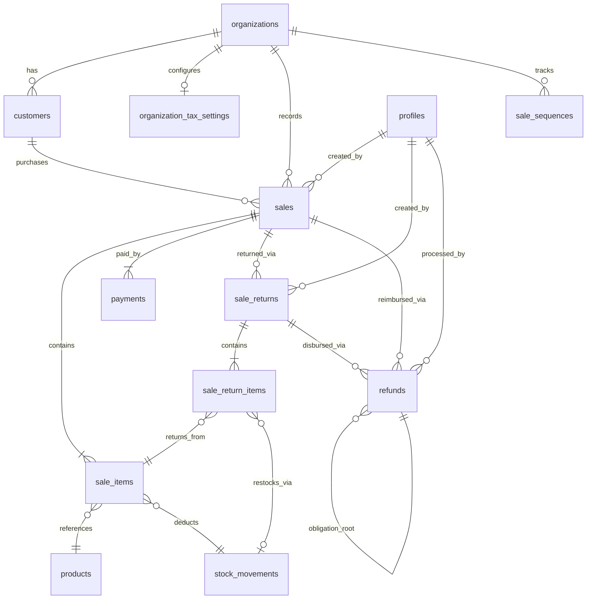

# Data Model: Feature 005 — Customers & Sales

**Branch**: `005-customers-sales` | **Date**: 2026-11-17 | **Spec**: [spec.md](./spec.md)

---

## Entity Relationship Diagram



---

## Migration File

**File**: `supabase/migrations/20261117000021_customers_sales_schema.sql`

---

## Table 1: `public.organization_tax_settings`

Organization-scoped tax configuration. One row per organization (singleton via PK).

```sql
CREATE TABLE public.organization_tax_settings (
    organization_id  UUID PRIMARY KEY REFERENCES public.organizations(id) ON DELETE CASCADE,
    tax_name         TEXT NOT NULL DEFAULT 'VAT'
                     CHECK (length(trim(tax_name)) >= 1 AND length(trim(tax_name)) <= 100),
    default_tax_rate NUMERIC(6, 4) NOT NULL DEFAULT 0.0000
                     CHECK (default_tax_rate >= 0.0000 AND default_tax_rate <= 100.0000),
    is_tax_inclusive BOOLEAN NOT NULL DEFAULT false,
    updated_at       TIMESTAMPTZ NOT NULL DEFAULT now(),
    updated_by       UUID NOT NULL REFERENCES public.profiles(id) ON DELETE RESTRICT
);
```

**Indexes**: PK index on `organization_id` (implicit).

**RLS Policies**:
- SELECT: `check_user_permission(organization_id, auth.uid(), 'sales:read')` or `is_org_member(organization_id, auth.uid())`
- INSERT/UPDATE/DELETE: Deny-all (`USING (false) WITH CHECK (false)`). Mutated only via `update_tax_settings`.

---

## Table 2: `public.customers`

Tenant-scoped customer profiles with partial uniqueness on phone/email among active records.

```sql
CREATE TABLE public.customers (
    id              UUID PRIMARY KEY DEFAULT gen_random_uuid(),
    organization_id UUID NOT NULL REFERENCES public.organizations(id) ON DELETE CASCADE,
    name            TEXT NOT NULL CHECK (length(trim(name)) BETWEEN 1 AND 255),
    phone           TEXT NULL CHECK (phone IS NULL OR phone ~ '^\+[1-9]\d{6,14}$'),
    email           TEXT NULL CHECK (email IS NULL OR email ~ '^.+@.+$'),
    notes           TEXT NULL CHECK (notes IS NULL OR length(notes) <= 1000),
    status          TEXT NOT NULL DEFAULT 'active'
                    CHECK (status IN ('active', 'archived')),
    created_at      TIMESTAMPTZ NOT NULL DEFAULT now(),
    updated_at      TIMESTAMPTZ NOT NULL DEFAULT now()
);
```

**Constraints**:
- `CONSTRAINT uq_customers_org_id UNIQUE (organization_id, id)` — Composite unique for FK targets
- `CREATE UNIQUE INDEX uq_customers_org_phone_active ON public.customers (organization_id, phone) WHERE status <> 'archived' AND phone IS NOT NULL` — Tenant-scoped phone uniqueness among non-archived
- `CREATE UNIQUE INDEX uq_customers_org_email_active ON public.customers (organization_id, email) WHERE status <> 'archived' AND email IS NOT NULL` — Tenant-scoped email uniqueness among non-archived

**Indexes**:
- `idx_customers_org_status ON public.customers (organization_id, status)` — Filter by active/archived
- `idx_customers_org_name ON public.customers (organization_id, lower(name) text_pattern_ops)` — Name search

**RLS Policies**:
- SELECT: `check_user_permission(organization_id, auth.uid(), 'customers:read')`
- INSERT/UPDATE/DELETE: Deny-all. Mutated only via `create_customer`, `update_customer`, `archive_customer`.

---

## Table 3: `public.sales`

Immutable committed sale transactions with lifecycle status tracking.

```sql
CREATE TABLE public.sales (
    id                    UUID PRIMARY KEY DEFAULT gen_random_uuid(),
    organization_id       UUID NOT NULL REFERENCES public.organizations(id) ON DELETE CASCADE,
    sale_number           TEXT NOT NULL,
    customer_id           UUID NULL,
    created_by            UUID NOT NULL REFERENCES public.profiles(id) ON DELETE RESTRICT,
    subtotal              NUMERIC(14, 4) NOT NULL CHECK (subtotal >= 0),
    order_discount_amount NUMERIC(14, 4) NOT NULL DEFAULT 0.0000 CHECK (order_discount_amount >= 0),
    is_tax_inclusive      BOOLEAN NOT NULL DEFAULT false,
    tax_rate              NUMERIC(6, 4) NOT NULL DEFAULT 0.0000 CHECK (tax_rate >= 0),
    tax_name              TEXT NOT NULL DEFAULT 'None',
    tax_amount            NUMERIC(14, 4) NOT NULL DEFAULT 0.0000 CHECK (tax_amount >= 0),
    total_amount          NUMERIC(14, 4) NOT NULL CHECK (total_amount >= 0),
    currency              TEXT NOT NULL CHECK (currency ~ '^[A-Z]{3}$'),
    status                TEXT NOT NULL DEFAULT 'completed'
                          CHECK (status IN ('completed', 'voided', 'partially_returned', 'returned')),
    payment_status        TEXT NOT NULL DEFAULT 'paid'
                          CHECK (payment_status IN ('paid', 'partially_refunded', 'refunded')),
    idempotency_key       UUID NOT NULL,
    idempotency_hash      TEXT NOT NULL,
    void_idempotency_key  UUID NULL,
    void_idempotency_hash TEXT NULL,
    voided_at             TIMESTAMPTZ NULL,
    voided_by             UUID NULL REFERENCES public.profiles(id) ON DELETE RESTRICT,
    void_reason           TEXT NULL,
    notes                 TEXT NULL,
    created_at            TIMESTAMPTZ NOT NULL DEFAULT now(),
    updated_at            TIMESTAMPTZ NOT NULL DEFAULT now()
);
```

**Constraints**:
- `CONSTRAINT uq_sales_org_id UNIQUE (organization_id, id)` — Composite unique for FK targets
- `CONSTRAINT fk_sales_org_customer FOREIGN KEY (organization_id, customer_id) REFERENCES public.customers (organization_id, id) ON DELETE RESTRICT` — Composite FK prevents cross-tenant customer linking
- `CONSTRAINT uq_sales_org_sale_number UNIQUE (organization_id, sale_number)` — Unique sale numbers per org
- `CONSTRAINT uq_sales_org_idempotency UNIQUE (organization_id, idempotency_key)` — Idempotency enforcement
- `CREATE UNIQUE INDEX uq_sales_org_void_idempotency ON public.sales (organization_id, void_idempotency_key) WHERE void_idempotency_key IS NOT NULL` — Void idempotency

**Indexes**:
- `idx_sales_org_status ON public.sales (organization_id, status)` — Status filtering
- `idx_sales_org_created ON public.sales (organization_id, created_at DESC)` — Date range queries
- `idx_sales_org_customer ON public.sales (organization_id, customer_id) WHERE customer_id IS NOT NULL` — Customer history lookup
- `idx_sales_org_created_by ON public.sales (organization_id, created_by)` — Cashier filtering

**RLS Policies**:
- SELECT: `check_user_permission(organization_id, auth.uid(), 'sales:read')`
- INSERT/UPDATE/DELETE: Deny-all. Mutated only via RPCs.

---

## Table 4: `public.sale_items`

Immutable line items with snapshotted prices, costs, discounts, and tax allocations.

```sql
CREATE TABLE public.sale_items (
    id                   UUID PRIMARY KEY DEFAULT gen_random_uuid(),
    organization_id      UUID NOT NULL,
    sale_id              UUID NOT NULL,
    product_id           UUID NOT NULL,
    quantity             NUMERIC(14, 4) NOT NULL CHECK (quantity > 0),
    unit_price           NUMERIC(14, 4) NOT NULL CHECK (unit_price >= 0),
    unit_cost            NUMERIC(14, 4) NULL,
    line_discount_amount NUMERIC(14, 4) NOT NULL DEFAULT 0.0000 CHECK (line_discount_amount >= 0),
    allocated_order_disc NUMERIC(14, 4) NOT NULL DEFAULT 0.0000 CHECK (allocated_order_disc >= 0),
    taxable_amount       NUMERIC(14, 4) NOT NULL CHECK (taxable_amount >= 0),
    allocated_tax_amount NUMERIC(14, 4) NOT NULL CHECK (allocated_tax_amount >= 0),
    total_price          NUMERIC(14, 4) NOT NULL CHECK (total_price >= 0),
    movement_id          UUID NOT NULL REFERENCES public.stock_movements(id) ON DELETE RESTRICT,
    created_at           TIMESTAMPTZ NOT NULL DEFAULT now()
);
```

**Constraints**:
- `CONSTRAINT uq_sale_items_org_id UNIQUE (organization_id, id)` — Composite unique for FK targets
- `CONSTRAINT uq_sale_items_org_sale_item_prod UNIQUE (organization_id, sale_id, id, product_id)` — 4-column composite for `sale_return_items` FK
- `CONSTRAINT fk_sale_items_org_sale FOREIGN KEY (organization_id, sale_id) REFERENCES public.sales (organization_id, id) ON DELETE CASCADE`
- `CONSTRAINT fk_sale_items_org_product FOREIGN KEY (organization_id, product_id) REFERENCES public.products (organization_id, id) ON DELETE RESTRICT`
- `CONSTRAINT uq_sale_items_sale_product UNIQUE (sale_id, product_id)` — One line per product per sale

**Indexes**:
- `idx_sale_items_sale_id ON public.sale_items (sale_id)` — Sale detail lookups
- `idx_sale_items_product_id ON public.sale_items (organization_id, product_id)` — Product sales history

**Column Privileges & Cost Protection**:
- Table-level SELECT is revoked from `authenticated`, `anon`, and `PUBLIC`:
  `REVOKE SELECT ON TABLE public.sale_items FROM authenticated, anon, PUBLIC;`
- Direct column-level SELECT is granted to `authenticated` ONLY on safe columns (excluding `unit_cost`):
  `GRANT SELECT (id, organization_id, sale_id, product_id, quantity, unit_price, line_discount_amount, allocated_order_disc, taxable_amount, allocated_tax_amount, total_price, movement_id, created_at) ON TABLE public.sale_items TO authenticated;`
- Column `unit_cost` has NO direct SELECT grant to `authenticated` or `anon`. Direct PostgREST queries requesting `unit_cost` (e.g., `GET /sale_items?select=unit_cost` or `GET /sale_items?select=*`) are denied at the database parser/planner boundary with `42501 permission_denied for column unit_cost`.
- Protected cost reads: `unit_cost` is accessible exclusively via the `SECURITY DEFINER` RPC `public.get_sale_detail`, which verifies caller has BOTH `inventory:read_valuation` AND `products:read_cost` before returning costs (returning `NULL` otherwise).

**RLS Policies**:
- SELECT: `check_user_permission(organization_id, auth.uid(), 'sales:read')` (evaluates on accessible safe columns)
- INSERT/UPDATE/DELETE: Deny-all. Mutated only via `execute_sale`.

---

## Table 5: `public.payments`

Immutable payment tender records linked to sales. Insert-only.

```sql
CREATE TABLE public.payments (
    id              UUID PRIMARY KEY DEFAULT gen_random_uuid(),
    organization_id UUID NOT NULL,
    sale_id         UUID NOT NULL,
    payment_method  TEXT NOT NULL CHECK (payment_method IN ('cash', 'card', 'bank_transfer', 'other')),
    amount          NUMERIC(14, 4) NOT NULL CHECK (amount > 0),
    amount_tendered NUMERIC(14, 4) NULL CHECK (amount_tendered IS NULL OR amount_tendered >= 0),
    change_due      NUMERIC(14, 4) NULL CHECK (change_due IS NULL OR change_due >= 0),
    reference_no    TEXT NULL,
    created_at      TIMESTAMPTZ NOT NULL DEFAULT now()
);
```

**Constraints**:
- `CONSTRAINT fk_payments_org_sale FOREIGN KEY (organization_id, sale_id) REFERENCES public.sales (organization_id, id) ON DELETE CASCADE`
- `CREATE UNIQUE INDEX uq_payments_org_method_ref ON public.payments (organization_id, payment_method, reference_no) WHERE reference_no IS NOT NULL` — Duplicate external reference prevention

**Indexes**:
- `idx_payments_sale_id ON public.payments (sale_id)` — Sale payment lookups

**RLS Policies**:
- SELECT: `check_user_permission(organization_id, auth.uid(), 'payments:read')`
- INSERT/UPDATE/DELETE: Deny-all. Mutated only via `execute_sale`.

---

## Table 6: `public.sale_returns`

Return transaction headers with idempotency protection.

```sql
CREATE TABLE public.sale_returns (
    id               UUID PRIMARY KEY DEFAULT gen_random_uuid(),
    organization_id  UUID NOT NULL REFERENCES public.organizations(id) ON DELETE CASCADE,
    sale_id          UUID NOT NULL,
    return_number    TEXT NOT NULL,
    reason           TEXT NOT NULL CHECK (length(trim(reason)) >= 3 AND length(trim(reason)) <= 255),
    total_refund_amount NUMERIC(14, 4) NOT NULL CHECK (total_refund_amount >= 0),
    idempotency_key  UUID NOT NULL,
    idempotency_hash TEXT NOT NULL,
    created_by       UUID NOT NULL REFERENCES public.profiles(id) ON DELETE RESTRICT,
    created_at       TIMESTAMPTZ NOT NULL DEFAULT now()
);
```

**Constraints**:
- `CONSTRAINT uq_sale_returns_org_id UNIQUE (organization_id, id)` — Composite unique for FK targets
- `CONSTRAINT uq_sale_returns_org_sale_id UNIQUE (organization_id, sale_id, id)` — 3-column composite for refunds FK
- `CONSTRAINT fk_sale_returns_org_sale FOREIGN KEY (organization_id, sale_id) REFERENCES public.sales (organization_id, id) ON DELETE RESTRICT`
- `CONSTRAINT uq_sale_returns_org_return_number UNIQUE (organization_id, return_number)` — Unique return numbers
- `CONSTRAINT uq_sale_returns_org_idempotency UNIQUE (organization_id, idempotency_key)` — Idempotency enforcement

**Indexes**:
- `idx_sale_returns_sale_id ON public.sale_returns (organization_id, sale_id)` — Returns by sale

**RLS Policies**:
- SELECT: `check_user_permission(organization_id, auth.uid(), 'returns:read')`
- INSERT/UPDATE/DELETE: Deny-all. Mutated only via `execute_sale_return`.

---

## Table 7: `public.sale_return_items`

Line-item return records with composite FK enforcement (F005-041).

```sql
CREATE TABLE public.sale_return_items (
    id                   UUID PRIMARY KEY DEFAULT gen_random_uuid(),
    organization_id      UUID NOT NULL,
    return_id            UUID NOT NULL,
    sale_id              UUID NOT NULL,
    sale_item_id         UUID NOT NULL,
    product_id           UUID NOT NULL,
    quantity             NUMERIC(14, 4) NOT NULL CHECK (quantity > 0),
    refund_amount        NUMERIC(14, 4) NOT NULL CHECK (refund_amount >= 0),
    restock_to_inventory BOOLEAN NOT NULL,
    movement_id          UUID NULL REFERENCES public.stock_movements(id) ON DELETE RESTRICT,
    created_at           TIMESTAMPTZ NOT NULL DEFAULT now()
);
```

**Constraints**:
- `CONSTRAINT fk_return_items_org_return_sale FOREIGN KEY (organization_id, sale_id, return_id) REFERENCES public.sale_returns (organization_id, sale_id, id) ON DELETE CASCADE` — Guarantees return item belongs to same sale as return header
- `CONSTRAINT fk_return_items_org_sale_item_prod FOREIGN KEY (organization_id, sale_id, sale_item_id, product_id) REFERENCES public.sale_items (organization_id, sale_id, id, product_id) ON DELETE RESTRICT` — Guarantees return item references a sale item from the same sale with matching product (F005-041)
- `CONSTRAINT uq_return_items_return_sale_item UNIQUE (return_id, sale_item_id)` — One return entry per sale item per return transaction

**Indexes**:
- `idx_return_items_sale_item ON public.sale_return_items (sale_item_id)` — Prior return quantity lookups

**RLS Policies**:
- SELECT: `check_user_permission(organization_id, auth.uid(), 'returns:read')`
- INSERT/UPDATE/DELETE: Deny-all. Mutated only via `execute_sale_return`.

---

## Table 8: `public.refunds`

Dedicated reimbursement ledger with obligation tracking, replacement lineage, and confirmation idempotency.

```sql
CREATE TABLE public.refunds (
    id                           UUID PRIMARY KEY DEFAULT gen_random_uuid(),
    organization_id              UUID NOT NULL,
    sale_id                      UUID NOT NULL,
    return_id                    UUID NULL,
    parent_refund_id             UUID NULL,
    obligation_refund_id         UUID NOT NULL,
    refund_method                TEXT NOT NULL CHECK (refund_method IN ('cash', 'card', 'bank_transfer', 'other')),
    amount                       NUMERIC(14, 4) NOT NULL CHECK (amount > 0),
    reference_no                 TEXT NULL,
    status                       TEXT NOT NULL CHECK (status IN ('completed', 'pending', 'failed')),
    reason                       TEXT NOT NULL,
    processed_by                 UUID NOT NULL REFERENCES public.profiles(id) ON DELETE RESTRICT,
    idempotency_key              UUID NULL,
    idempotency_hash             TEXT NULL,
    confirmation_idempotency_key UUID NULL,
    confirmation_idempotency_hash TEXT NULL,
    created_at                   TIMESTAMPTZ NOT NULL DEFAULT now(),
    updated_at                   TIMESTAMPTZ NOT NULL DEFAULT now()
);
```

**Constraints**:
- `CONSTRAINT uq_refunds_org_id UNIQUE (organization_id, id)` — Composite unique for self-referential FKs
- `CONSTRAINT uq_refunds_org_sale_id UNIQUE (organization_id, sale_id, id)` — 3-column composite for parent FK
- `CONSTRAINT fk_refunds_org_sale FOREIGN KEY (organization_id, sale_id) REFERENCES public.sales (organization_id, id) ON DELETE RESTRICT`
- `CONSTRAINT fk_refunds_org_sale_return FOREIGN KEY (organization_id, sale_id, return_id) REFERENCES public.sale_returns (organization_id, sale_id, id)` — NULL `return_id` skips FK check (void refunds)
- `CONSTRAINT fk_refunds_org_sale_parent FOREIGN KEY (organization_id, sale_id, parent_refund_id) REFERENCES public.refunds (organization_id, sale_id, id) ON DELETE RESTRICT` — NULL `parent_refund_id` skips FK check (original refunds)
- `CONSTRAINT fk_refunds_org_obligation FOREIGN KEY (organization_id, obligation_refund_id) REFERENCES public.refunds (organization_id, id) DEFERRABLE INITIALLY DEFERRED` — Obligation root reference (self-referencing insert where `obligation_refund_id = id` validates at transaction commit)
- `CREATE UNIQUE INDEX uq_refunds_org_obligation_active ON public.refunds (organization_id, obligation_refund_id) WHERE status IN ('pending', 'completed')` — At most one active attempt per obligation (F005-044)
- `CREATE UNIQUE INDEX uq_refunds_org_confirmation_key ON public.refunds (organization_id, confirmation_idempotency_key) WHERE confirmation_idempotency_key IS NOT NULL` — Confirmation idempotency (F005-046)
- `CREATE UNIQUE INDEX uq_refunds_org_idempotency_key ON public.refunds (organization_id, idempotency_key) WHERE idempotency_key IS NOT NULL` — Replacement idempotency

**Indexes**:
- `idx_refunds_sale_id ON public.refunds (organization_id, sale_id)` — Sale refund history
- `idx_refunds_obligation ON public.refunds (organization_id, obligation_refund_id)` — Obligation chain lookups
- `idx_refunds_status ON public.refunds (organization_id, status)` — Pending refund queries

**RLS Policies**:
- SELECT: `check_user_permission(organization_id, auth.uid(), 'refunds:read')`
- INSERT/UPDATE/DELETE: Deny-all. Mutated only via RPCs.

---

## Table 9: `public.sale_sequences`

Organization-scoped daily sequence counters for sale and return numbers.

```sql
CREATE TABLE public.sale_sequences (
    organization_id UUID NOT NULL REFERENCES public.organizations(id) ON DELETE CASCADE,
    sequence_type   TEXT NOT NULL CHECK (sequence_type IN ('sale', 'return')),
    date_key        DATE NOT NULL,
    last_number     INTEGER NOT NULL DEFAULT 0 CHECK (last_number >= 0),
    created_at      TIMESTAMPTZ NOT NULL DEFAULT now(),
    updated_at      TIMESTAMPTZ NOT NULL DEFAULT now(),
    PRIMARY KEY (organization_id, sequence_type, date_key)
);
```

**RLS Policies**:
- SELECT/INSERT/UPDATE/DELETE: Deny-all (`USING (false) WITH CHECK (false)`). Manipulated exclusively by `SECURITY DEFINER` RPCs running as `postgres`.

---

## Permission Seed Data

```sql
-- Insert new F005 permissions into permissions catalog
INSERT INTO public.permissions (key, description) VALUES
    ('customers:read', 'View customer profiles and search customers'),
    ('customers:create', 'Create customer profiles'),
    ('customers:update', 'Update customer contact information'),
    ('customers:archive', 'Archive customer profiles'),
    ('sales:read', 'View sales history and receipts'),
    ('sales:create', 'Create sales checkouts'),
    ('sales:void', 'Void completed sales'),
    ('returns:read', 'View return records'),
    ('returns:create', 'Process returns and refunds'),
    ('payments:read', 'View payment records'),
    ('refunds:read', 'View refund records'),
    ('tax_settings:update', 'Update organization tax settings')
ON CONFLICT (key) DO NOTHING;

-- Assign permissions to roles
INSERT INTO public.role_permissions (role, permission_key) VALUES
    -- Owner: all 12
    ('owner', 'customers:read'), ('owner', 'customers:create'),
    ('owner', 'customers:update'), ('owner', 'customers:archive'),
    ('owner', 'sales:read'), ('owner', 'sales:create'), ('owner', 'sales:void'),
    ('owner', 'returns:read'), ('owner', 'returns:create'),
    ('owner', 'payments:read'), ('owner', 'refunds:read'),
    ('owner', 'tax_settings:update'),
    -- Admin: all 12
    ('admin', 'customers:read'), ('admin', 'customers:create'),
    ('admin', 'customers:update'), ('admin', 'customers:archive'),
    ('admin', 'sales:read'), ('admin', 'sales:create'), ('admin', 'sales:void'),
    ('admin', 'returns:read'), ('admin', 'returns:create'),
    ('admin', 'payments:read'), ('admin', 'refunds:read'),
    ('admin', 'tax_settings:update'),
    -- Manager: 10 (no tax_settings:update)
    ('manager', 'customers:read'), ('manager', 'customers:create'),
    ('manager', 'customers:update'), ('manager', 'customers:archive'),
    ('manager', 'sales:read'), ('manager', 'sales:create'), ('manager', 'sales:void'),
    ('manager', 'returns:read'), ('manager', 'returns:create'),
    ('manager', 'payments:read'), ('manager', 'refunds:read'),
    -- Cashier: 7 (read/create only, no void/archive/returns:create/refunds:read/tax)
    ('cashier', 'customers:read'), ('cashier', 'customers:create'),
    ('cashier', 'customers:update'),
    ('cashier', 'sales:read'), ('cashier', 'sales:create'),
    ('cashier', 'returns:read'), ('cashier', 'payments:read')
ON CONFLICT (role, permission_key) DO NOTHING;
```

---

## Updated Trigger

```sql
-- Auto-update updated_at timestamp trigger (reuse existing function if available)
CREATE TRIGGER trg_customers_updated_at
    BEFORE UPDATE ON public.customers
    FOR EACH ROW EXECUTE FUNCTION public.handle_updated_at();

CREATE TRIGGER trg_tax_settings_updated_at
    BEFORE UPDATE ON public.organization_tax_settings
    FOR EACH ROW EXECUTE FUNCTION public.handle_updated_at();

CREATE TRIGGER trg_sales_updated_at
    BEFORE UPDATE ON public.sales
    FOR EACH ROW EXECUTE FUNCTION public.handle_updated_at();

CREATE TRIGGER trg_refunds_updated_at
    BEFORE UPDATE ON public.refunds
    FOR EACH ROW EXECUTE FUNCTION public.handle_updated_at();

CREATE TRIGGER trg_sale_sequences_updated_at
    BEFORE UPDATE ON public.sale_sequences
    FOR EACH ROW EXECUTE FUNCTION public.handle_updated_at();
```

---

## Security Grants & Column Privileges Summary

```sql
-- Revoke direct table-level SELECT on sale_items
REVOKE SELECT ON TABLE public.sale_items FROM authenticated, anon, PUBLIC;

-- Grant column-level SELECT only on safe columns (unit_cost explicitly omitted)
GRANT SELECT (
    id,
    organization_id,
    sale_id,
    product_id,
    quantity,
    unit_price,
    line_discount_amount,
    allocated_order_disc,
    taxable_amount,
    allocated_tax_amount,
    total_price,
    movement_id,
    created_at
) ON TABLE public.sale_items TO authenticated;
```
