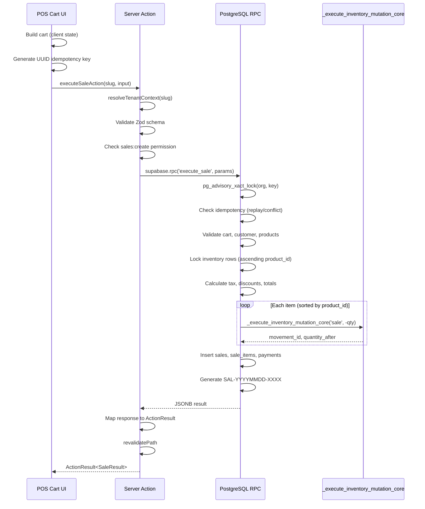
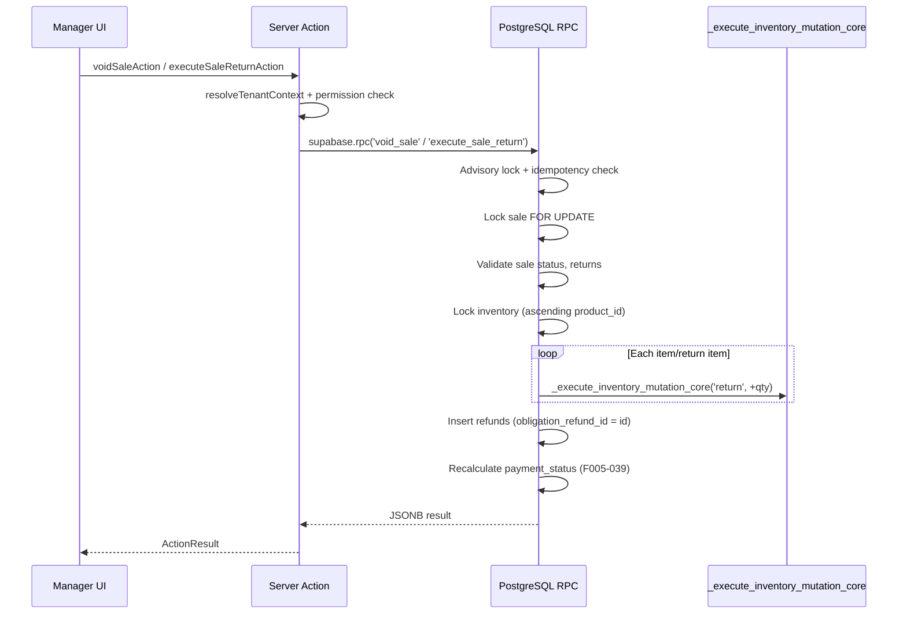
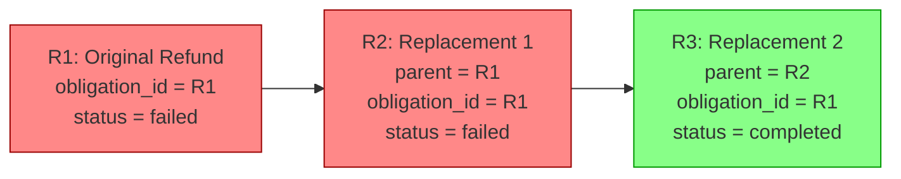

# Implementation Plan: Feature 005 — Customers & Sales

**Branch**: `005-customers-sales` | **Date**: 2026-11-17 | **Spec**: [spec.md](./spec.md)

**Input**: Feature specification from `specs/005-customers-sales/spec.md` (Revision 2.6 — Obligation Lock & Canonical Normalization Hardening)

---

## Summary

Feature 005 introduces comprehensive **Customer Management** and **Point-of-Sale (POS) Sales Management** to BizFlow AI. The implementation delivers an atomic multi-item checkout engine, multi-tender split payment processing, line-item returns with optional inventory restock, sale void/cancellation, an external reimbursement confirmation lifecycle with obligation-based replacement tracking, customer profile management with tenant-scoped uniqueness, and organization tax settings.

The technical approach builds on the established two-layer database mutation architecture from Feature 004, adding 9 new tables, 11 SECURITY DEFINER RPCs, 12 new RBAC permissions, comprehensive RLS policies with column-level security on sensitive cost data, and a full application stack of server actions, Zod validation schemas, TypeScript types, and UI components for POS checkout, customer management, sales history, receipts, and refund lifecycle management.

---

## Technical Context

**Language/Version**: TypeScript 5.7+ (Strict mode), PostgreSQL 15+ (PL/pgSQL)

**Primary Dependencies**: Next.js 15+ (App Router), @supabase/ssr 0.5+, @supabase/supabase-js 2.48+, zod 3.24+, react-hook-form 7.54+, @hookform/resolvers, lucide-react 0.474+, server-only

**Storage**: PostgreSQL on Supabase — 9 new tables, 11 RPCs, 12 permissions

**Testing**: Vitest 3.0+ (unit + integration), Playwright 1.50+ (E2E)

**Target Platform**: Desktop/tablet/mobile web browsers (responsive)

**Project Type**: Modular Next.js App Router monorepo web application

**Performance Goals**: p95 DB RPC < 120ms (20-item cart), checkout < 1.5s end-to-end, search < 500ms, sustained 50 checkouts/sec/org

**Constraints**: Financial precision via NUMERIC(14,4), zero floating-point arithmetic in financial paths, offline-incapable (server-authoritative)

**Scale/Scope**: Single-store retail MVP

---

## Constitution Check

*GATE: Must pass before Phase 0 research. Re-check after Phase 1 design.*

- [x] **I. Multi-Tenancy**: All 9 tables include `organization_id` with composite FKs. RLS enabled and forced on every table. Tenant context resolved server-side via `resolveTenantContext(slug)`. Client-supplied org IDs never trusted.
- [x] **II. Financial & Inventory Invariance**: All checkout, void, and return operations execute in single atomic PostgreSQL transactions via SECURITY DEFINER RPCs. Every stock change produces immutable `stock_movements` records. Historical prices, costs, and tax parameters are snapshotted. Completed sales are immutable; corrections via void/return audit trails.
- [x] **III. Type Safety & Validation**: Strict TypeScript throughout. Zod schemas validate all server action inputs. No `any` in production code. Domain types in `src/types/`.
- [x] **IV. Security & RBAC**: 12 new permissions with role mappings. Server-side permission verification in every action. Deny-all RLS policies on all DML. No service-role key exposure. `SECURITY DEFINER` RPCs with restrictive grants.
- [x] **V. AI Guardrails**: No AI-autonomous financial operations. All checkout, void, return, and refund operations require explicit human action via authenticated server actions.

---

## Project Structure

### Documentation (this feature)

```text
specs/005-customers-sales/
├── plan.md                        # This file
├── spec.md                        # Approved specification (Revision 2.6)
├── research.md                    # Phase 0 research output
├── data-model.md                  # Phase 1 database schema design
├── quickstart.md                  # Developer setup guide
├── contracts/
│   ├── database-rpcs.md           # 11 RPC contracts
│   └── server-actions.md          # Server action contracts & Zod schemas
├── checklists/
│   └── requirements.md            # Requirements checklist (65/65 checklist items passed)
└── tasks.md                       # Phase 2 output (created by /speckit.tasks)
```

### Source Code (repository root)

```text
supabase/migrations/
└── 20261117000021_customers_sales_schema.sql  # Single migration: 9 tables, 11 RPCs, permissions, column security, RLS

src/
├── actions/
│   ├── customer-actions.ts        # Customer CRUD server actions
│   ├── sales-actions.ts           # Sale checkout, void, return, refund server actions
│   └── tax-settings-actions.ts    # Tax settings server action
├── types/
│   ├── customers.ts               # Customer domain types
│   └── sales.ts                   # Sale, payment, return, refund domain types
├── lib/
│   ├── auth/
│   │   └── permissions.ts         # +12 permissions added to SYSTEM_PERMISSIONS & ROLE_PERMISSIONS
│   ├── validations/
│   │   ├── customers.ts           # Customer Zod schemas
│   │   └── sales.ts               # Sale, payment, return, refund Zod schemas
│   └── sales/
│       ├── error-codes.ts         # SQLSTATE → domain error mapping
│       ├── canonical-hash.ts      # Client-side canonical hash utility
│       └── formatters.ts          # Receipt formatting, currency display
├── components/
│   ├── pos/
│   │   ├── pos-cart.tsx           # POS cart with product search
│   │   ├── cart-item-row.tsx      # Individual cart line
│   │   ├── payment-modal.tsx      # Multi-tender payment entry
│   │   ├── checkout-summary.tsx   # Tax, discount, total display
│   │   └── receipt-view.tsx       # Thermal receipt layout
│   ├── customers/
│   │   ├── customer-list.tsx      # Customer list with search
│   │   ├── customer-form.tsx      # Create/edit customer modal
│   │   ├── customer-detail.tsx    # Profile with purchase history
│   │   └── customer-search.tsx    # Inline POS customer picker
│   ├── sales/
│   │   ├── sales-list.tsx         # Filterable sales history table
│   │   ├── sale-detail.tsx        # Full sale breakdown view
│   │   ├── void-dialog.tsx        # Void confirmation dialog
│   │   ├── return-dialog.tsx      # Line-item return form
│   │   └── refund-actions.tsx     # Refund lifecycle management
│   └── settings/
│       └── tax-settings-form.tsx  # Tax configuration form
└── app/
    └── [slug]/
        ├── pos/
        │   └── page.tsx           # POS checkout page
        ├── sales/
        │   ├── page.tsx           # Sales history page
        │   └── [saleId]/
        │       └── page.tsx       # Sale detail page
        ├── customers/
        │   ├── page.tsx           # Customer list page
        │   └── [customerId]/
        │       └── page.tsx       # Customer detail page
        └── settings/
            └── tax/
                └── page.tsx       # Tax settings page

tests/
├── unit/
│   ├── validations/
│   │   ├── customers.test.ts
│   │   └── sales.test.ts
│   └── sales/
│       ├── tax-calculation.test.ts
│       ├── discount-allocation.test.ts
│       ├── canonical-hash.test.ts
│       ├── refund-calculation.test.ts
│       └── error-codes.test.ts
├── integration/
│   └── sales/
│       ├── execute-sale.test.ts
│       ├── void-sale.test.ts
│       ├── execute-return.test.ts
│       ├── refund-lifecycle.test.ts
│       ├── customer-crud.test.ts
│       ├── idempotency.test.ts
│       ├── concurrency.test.ts
│       ├── rls-policies.test.ts
│       └── tax-settings.test.ts
└── e2e/
    ├── pos-checkout.spec.ts
    ├── customer-management.spec.ts
    └── void-return.spec.ts
```

**Structure Decision**: Feature 005 follows the established modular monolith pattern from Features 003–004: domain-scoped actions, types, validations, and components under `src/`. Single comprehensive migration file. Test organization mirrors source structure.

---

## Architecture & System Design

### Checkout Transaction Flow



### Void & Return Flow



### Refund Replacement Chain



---

## Implementation Phases

### Phase 1: Database Schema Migration

**Files**: `supabase/migrations/20261117000021_customers_sales_schema.sql`

**Scope**:
1. Create 9 tables with all constraints, indexes, and composite FKs (data-model.md). Constraint `fk_refunds_org_obligation` uses `DEFERRABLE INITIALLY DEFERRED` for self-referencing original refund inserts.
2. Enable and force RLS on all 9 tables
3. Create RLS policies per spec Section 4 (deny-all DML, permission-based SELECT) and column-level privileges: revoke table SELECT on `sale_items` from `authenticated, anon, PUBLIC`, grant direct SELECT only on safe columns (excluding `unit_cost`), enforce RLS
4. Create `updated_at` triggers
5. Insert 12 permissions into `permissions` catalog
6. Insert role-permission mappings into `role_permissions`
7. Implement all 11 RPCs (including `get_sale_detail` with dual-permission cost protection) with full PL/pgSQL bodies
8. Set ownership, revoke/grant execution privileges

**Dependencies**: F001–F004 migrations must exist. Specifically depends on:
- `organizations`, `profiles`, `memberships` (F001)
- `permissions`, `role_permissions`, `check_user_permission`, `is_org_member` (F002)
- `products`, `product_costs`, `product_categories`, `get_currency_exponent` (F003)
- `inventory`, `stock_movements`, `_execute_inventory_mutation_core` (F004)

**Requirement Traceability**: CUS-001–010, SAL-001–015, PAY-001–010, RET-001–014, INV-001–008, SEC-001–008, FIN-001–007, NFR-001–005

**Verification**: `npx supabase db reset` succeeds. All 905+ existing tests pass. Schema verification queries from quickstart.md return expected counts.

---

### Phase 2: Application Permissions Registration

**Files**: `src/lib/auth/permissions.ts`, `src/types/auth.ts`

**Scope**:
1. Add 12 new permission keys to `SYSTEM_PERMISSIONS` array
2. Add F005 permission mappings to `ROLE_PERMISSIONS` map
3. Extend `PermissionKey` union type with 12 new keys

**Dependencies**: Phase 1 (permissions must exist in DB first)

**Requirement Traceability**: SEC-006, SEC-007

**Verification**: TypeScript compilation passes. Permission type checking works for new keys.

---

### Phase 3: Domain Types & Validation Schemas

**Files**: `src/types/customers.ts`, `src/types/sales.ts`, `src/lib/validations/customers.ts`, `src/lib/validations/sales.ts`, `src/lib/sales/error-codes.ts`

**Scope**:
1. Define customer domain types (CustomerRecord, CustomerDetail, PaginatedCustomerResult)
2. Define sales domain types (SaleResult, SaleDetail, SaleItemRecord, PaymentRecord, ReturnRecord, RefundRecord, etc.)
3. Create customer Zod schemas (create, update, search)
4. Create sales Zod schemas (executeSale, voidSale, executeSaleReturn, confirmRefund, recordRefundFailure, issueReplacementRefund, salesListQuery, updateTaxSettings)
5. Create SQLSTATE → domain error code mapper

**Dependencies**: Phase 2 (permission types)

**Requirement Traceability**: CUS-002–004, SAL-002–003, PAY-002, PAY-006, RET-002–005, FIN-001–004

**Verification**: Unit tests for all Zod schemas (boundary values, E.164 phone, email normalization, discount limits, quantity precision).

---

### Phase 4: Customer Management Server Actions & UI

**Files**: `src/actions/customer-actions.ts`, `src/components/customers/*`, `src/app/[slug]/customers/*`

**Scope**:
1. Implement `createCustomerAction`, `updateCustomerAction`, `archiveCustomerAction`, `searchCustomersAction`, `getCustomerDetailAction`
2. Build customer list page with search, pagination, status filtering
3. Build create/edit customer modal with phone E.164 validation
4. Build customer detail page with purchase history tab
5. Build inline POS customer picker component (for Phase 7)

**Dependencies**: Phase 3 (types, schemas, error codes)

**Requirement Traceability**: CUS-001–010

**Verification**: Integration tests for customer CRUD via RPCs. Unit tests for phone/email normalization. E2E test for customer management flow.

---

### Phase 5: Tax Settings Server Action & UI

**Files**: `src/actions/tax-settings-actions.ts`, `src/components/settings/tax-settings-form.tsx`, `src/app/[slug]/settings/tax/page.tsx`

**Scope**:
1. Implement `updateTaxSettingsAction` and `getTaxSettingsAction`
2. Build tax settings form (name, rate, inclusive/exclusive toggle)
3. Add settings page route

**Dependencies**: Phase 3 (types, schemas)

**Requirement Traceability**: FIN-005, FIN-006

**Verification**: Integration test for upsert behavior. Unit test for rate validation (0–100 range, 4 decimal places).

---

### Phase 6: Sale Checkout Server Action (Core Engine)

**Files**: `src/actions/sales-actions.ts` (executeSaleAction), `src/lib/sales/canonical-hash.ts`

**Scope**:
1. Implement `executeSaleAction` server action
2. Implement client-side canonical hash utility for idempotency key generation
3. SQLSTATE error mapping for checkout errors
4. Response parsing and ActionResult construction

**Dependencies**: Phase 3 (types, schemas), Phase 1 (execute_sale RPC)

**Requirement Traceability**: SAL-001–011, SAL-014–015, PAY-001–010, INV-001–004, INV-007–008, FIN-001–007, NFR-001–003

**Verification**: Integration tests for:
- Walk-in guest checkout (tax-exclusive)
- Registered customer checkout (tax-inclusive)
- Split payment across methods
- Cash change calculation
- Zero-value promotional sale
- Idempotency replay (same key + same payload)
- Idempotency conflict (same key + different payload)
- Insufficient stock rejection
- Archived/inactive product rejection
- Duplicate product rejection
- Empty cart rejection
- Payment underpayment/overpayment rejection
- Payment reference validation
- Concurrent checkout on last unit

---

### Phase 7: POS Cart UI

**Files**: `src/components/pos/*`, `src/app/[slug]/pos/page.tsx`

**Scope**:
1. Build POS cart page with product search (name, SKU, barcode)
2. Cart item rows with quantity editing and line discount
3. Order discount input
4. Customer picker (inline creation via Phase 4 component)
5. Checkout summary (subtotal, discounts, tax calculation preview, total)
6. Payment modal (multi-tender, cash change calculation, reference entry)
7. Idempotency key generation on submit
8. Receipt display after successful checkout
9. Error display with actionable messages

**Dependencies**: Phase 4 (customer picker), Phase 5 (tax settings read), Phase 6 (checkout action)

**Requirement Traceability**: SAL-001, SAL-004, SAL-006–009, CUS-009–010, PAY-001–007, NFR-005

**Verification**: E2E test for complete POS checkout flow.

---

### Phase 8: Void Sale Server Action & UI

**Files**: `src/actions/sales-actions.ts` (voidSaleAction), `src/components/sales/void-dialog.tsx`

**Scope**:
1. Implement `voidSaleAction` server action
2. Build void confirmation dialog with reason input and optional reversal references
3. Permission gating (sales:void — Manager/Admin/Owner only)

**Dependencies**: Phase 6 (sale must exist to void)

**Requirement Traceability**: SAL-013, INV-006, RET-007, RET-012

**Verification**: Integration tests for:
- Cash void (immediate completion)
- External void with/without reference (pending reimbursement)
- Void blocked if returns exist
- Void blocked if already voided
- Cashier void attempt rejected (permissions)
- Void idempotency replay/conflict

---

### Phase 9: Sale Return Server Action & UI

**Files**: `src/actions/sales-actions.ts` (executeSaleReturnAction), `src/components/sales/return-dialog.tsx`

**Scope**:
1. Implement `executeSaleReturnAction` server action
2. Build return dialog with line-item selection, quantity input, restock toggle
3. Refund method selection
4. Proportional refund calculation display

**Dependencies**: Phase 6 (sale must exist), Phase 8 (void prevents returns)

**Requirement Traceability**: RET-001–011, INV-005–006, INV-008

**Verification**: Integration tests for:
- Partial return with restock
- Partial return without restock (damaged)
- Excess quantity rejection
- Duplicate return item rejection
- Return against inactive product (restock blocked)
- Cross-sale return item FK enforcement
- Return idempotency replay/conflict
- Split-tender refund ceiling enforcement
- Cumulative refund cap enforcement

---

### Phase 10: Refund Lifecycle Server Actions & UI

**Files**: `src/actions/sales-actions.ts` (confirmRefundAction, recordRefundFailureAction, issueReplacementRefundAction), `src/components/sales/refund-actions.tsx`

**Scope**:
1. Implement `confirmRefundAction`, `recordRefundFailureAction`, `issueReplacementRefundAction`
2. Build refund lifecycle management UI (pending → confirmed/failed → replacement)
3. Confirmation dialog with external reference input
4. Failure recording dialog
5. Replacement dialog with method selection

**Dependencies**: Phase 8 (void creates refunds), Phase 9 (return creates refunds)

**Requirement Traceability**: RET-012–014, F005-038–047

**Verification**: Integration tests for:
- Confirmation with external reference (F005-046 Cases A–E)
- Cross-refund confirmation key conflict (Case C)
- Failure recording
- Replacement with obligation tracking (F005-044)
- Unconditional obligation advisory lock
- Replacement blocked when active attempt exists (P0064)
- Replacement blocked when obligation completed (P0067)
- Multi-failure chain (R1→R2→R3)
- Cross-sale parent refund FK enforcement (F005-045)
- Concurrent replacement serialization

---

### Phase 11: Sales History, Detail & Receipt UI

**Files**: `src/actions/sales-actions.ts` (getSalesListAction, getSaleDetailAction, getReturnHistoryAction), `src/components/sales/*`, `src/app/[slug]/sales/*`

**Scope**:
1. Implement list/detail/history query actions; sale detail action invokes `get_sale_detail` RPC
2. Build sales history page with filters (date, status, customer, cashier, search)
3. Build sale detail page with items, payments, returns, refunds tabs
4. Build printable thermal receipt component (80mm/58mm)
5. Database-enforced cost protection: direct SELECT on `sale_items.unit_cost` revoked (`42501`); `get_sale_detail` returns `unit_cost = null` unless caller has BOTH `inventory:read_valuation` AND `products:read_cost`

**Dependencies**: Phase 6–10 (sale data must exist)

**Requirement Traceability**: SAL-012, SEC-005, NFR-004–005

**Verification**: E2E test for sales history navigation, receipt printing, and cost visibility.

---

### Phase 12: Automated Test Suite & Final Verification

**Files**: `tests/unit/*`, `tests/integration/*`, `tests/e2e/*`

**Scope**:
1. Complete unit test suite for all Zod schemas (boundary values, precision)
2. Complete unit test suite for tax calculation (exclusive/inclusive, zero-rate, rounding)
3. Complete unit test suite for discount allocation (line, order, proportional)
4. Complete unit test suite for canonical hash construction (payment normalization F005-047)
5. Complete unit test suite for refund calculation (proportional, residual absorption)
6. Complete integration test suite for all 11 RPCs
7. Complete integration test suite for RLS policies and column privileges (direct `unit_cost` denial, cross-tenant isolation, deny-all DML)
8. Complete integration test suite for concurrency scenarios (F005-044–047)
9. Complete E2E test suite for critical happy paths
10. Run full regression: `npm run test && npx playwright test`

**Dependencies**: All prior phases

**Requirement Traceability**: All 77 requirements

**Verification**: All tests pass. Zero regression in F001–F004 test suites.

---

## Requirement Traceability Matrix

| Requirement | Phase | Primary Component | Verification |
|---|:---:|---|---|
| CUS-001 | 4 | `create_customer` RPC, customer-actions.ts | Integration test |
| CUS-002 | 3, 4 | customers.ts types, Zod schema | Unit + integration |
| CUS-003 | 1, 4 | `create_customer` RPC (lower/trim) | Integration test |
| CUS-004 | 1, 4 | `create_customer` RPC (E.164 regex) | Unit + integration |
| CUS-005 | 4 | searchCustomersAction | Integration test |
| CUS-006 | 1, 4 | `update_customer` RPC | Integration test |
| CUS-007 | 1, 4 | `archive_customer` RPC | Integration test |
| CUS-008 | 1 | Composite FK ON DELETE RESTRICT | Integration test |
| CUS-009 | 6 | `execute_sale` (customer_id NULL) | Integration test |
| CUS-010 | 7 | POS inline customer creation | E2E test |
| SAL-001 | 7 | Client-side cart state | E2E test |
| SAL-002 | 1, 3 | Zod schema + DB CHECK | Unit + integration |
| SAL-003 | 1, 3 | UOM precision validation | Unit + integration |
| SAL-004 | 1 | `execute_sale` server pricing | Integration test |
| SAL-005 | 1 | `execute_sale` cost snapshot | Integration test |
| SAL-006 | 1, 3 | Discount validation | Unit + integration |
| SAL-007 | 1 | Subtotal calculation | Integration test |
| SAL-008 | 1 | Total amount formula | Integration test |
| SAL-009 | 1 | `sale_sequences` generation | Integration test |
| SAL-010 | 1 | `execute_sale` atomic transaction | Integration test |
| SAL-011 | 1 | `created_by = auth.uid()` | Integration test |
| SAL-012 | 11 | getSalesListAction | E2E test |
| SAL-013 | 8 | `void_sale` RPC | Integration test |
| SAL-014 | 1 | RLS deny-all UPDATE/DELETE | Integration test |
| SAL-015 | 1 | `movement_id FK` | Integration test |
| PAY-001 | 1 | Composite FK on payments | Integration test |
| PAY-002 | 1, 3 | Payment method enum | Unit test |
| PAY-003 | 1, 6 | Split payment validation | Integration test |
| PAY-004 | 1 | `sum(payments) == total` | Integration test |
| PAY-005 | 1, 7 | Cash change calculation | Unit + E2E |
| PAY-006 | 1 | Non-cash overpayment block | Integration test |
| PAY-007 | 1 | Partial unique reference index | Integration test |
| PAY-008 | 1 | `payment_status = 'paid'` | Integration test |
| PAY-009 | 1 | RLS deny-all, immutable | Integration test |
| PAY-010 | 1 | Canonical hash normalization (F005-047) | Unit + integration |
| RET-001 | 9 | `execute_sale_return` RPC | Integration test |
| RET-002 | 1, 3 | Reason validation (3–255 chars) | Unit + integration |
| RET-003 | 1 | Duplicate return item check | Integration test |
| RET-004 | 1 | Quantity ≤ unreturned check | Integration test |
| RET-005 | 1, 9 | Restock toggle | Integration test |
| RET-006 | 1 | `_execute_inventory_mutation_core('return')` | Integration test |
| RET-007 | 1 | Dedicated refunds table | Integration test |
| RET-008 | 1 | Proportional refund allocation | Unit + integration |
| RET-009 | 1 | Sale status update | Integration test |
| RET-010 | 1 | `sale_sequences` return number | Integration test |
| RET-011 | 1 | Return idempotency | Integration test |
| RET-012 | 1, 10 | Obligation refund identity (F005-044) | Integration test |
| RET-013 | 1 | Composite FK integrity (F005-045) | Integration test |
| RET-014 | 1, 10 | Confirmation idempotency (F005-046) | Integration test |
| INV-001 | 1 | `_execute_inventory_mutation_core` call | Integration test |
| INV-002 | 1 | Ascending product_id locking | Concurrency test |
| INV-003 | 1 | `P0011` rollback | Integration test |
| INV-004 | 1 | `sale` movement type, negative delta | Integration test |
| INV-005 | 1 | `return` movement type, positive delta | Integration test |
| INV-006 | 1 | `void:{sale_id}` reference | Integration test |
| INV-007 | 1 | REVOKE from public/authenticated | Schema test |
| INV-008 | 1 | `P0031`/`P0021`/`P0056` checks | Integration test |
| SEC-001 | 1 | `organization_id NOT NULL` on all tables | Schema test |
| SEC-002 | 1 | RLS ENABLE/FORCE on all tables | Schema test |
| SEC-003 | 1 | RLS policies use `check_user_permission` | Schema test |
| SEC-004 | 4–11 | `resolveTenantContext(slug)` in all actions | Code review |
| SEC-005 | 1, 11 | sale_items column grants, get_sale_detail RPC, sales-actions.ts | Integration test |
| SEC-006 | 2 | Cashier role permissions | Unit test |
| SEC-007 | 2 | Manager/Admin/Owner restrictions | Unit test |
| SEC-008 | 1 | Deny-all DML RLS policies | Integration test |
| FIN-001 | 1 | NUMERIC(14,4) on all monetary columns | Schema test |
| FIN-002 | 1 | `ROUND(value, exponent)` usage | Integration test |
| FIN-003 | 3, 7 | No `number` arithmetic in financial paths | Code review |
| FIN-004 | 1, 3 | Negative amount rejection | Unit + integration |
| FIN-005 | 1 | Server-sourced tax calculation | Integration test |
| FIN-006 | 1 | Tax snapshot immutability | Integration test |
| FIN-007 | 1 | Cumulative refund cap | Integration test |
| NFR-001 | 12 | p95 < 120ms benchmark | Performance test |
| NFR-002 | 12 | 50 checkouts/sec load test | Performance test |
| NFR-003 | 1 | Advisory lock + canonical hash | Integration test |
| NFR-004 | 1 | Audit timestamps + user IDs | Schema test |
| NFR-005 | 11 | Thermal receipt layout | E2E test |

---

## Concurrency & Idempotency Test Plans

### F005-044: Obligation Advisory Lock & Replacement Serialization

| Test | Scenario | Expected |
|---|---|---|
| C44-01 | Two concurrent `issue_replacement_refund` for same obligation | One succeeds, other gets `P0064` |
| C44-02 | Replacement targeting original failed refund | Obligation lock acquired unconditionally, success |
| C44-03 | Replacement targeting descendant failed refund | Obligation lock acquired, inherits obligation root |
| C44-04 | Replacement when obligation already completed | `P0067 OBLIGATION_ALREADY_COMPLETED` |
| C44-05 | Multi-failure chain: R1→R2→R3 all share obligation | All share `obligation_refund_id = R1.id` |

### F005-045: Composite Foreign Key Integrity & Deferred Obligation Constraint

| Test | Scenario | Expected |
|---|---|---|
| C45-01 | Return item referencing sale item from different sale | `23503 foreign_key_violation` |
| C45-02 | Refund with `sale_id = S2` and `return_id` from S1 | `23503 foreign_key_violation` |
| C45-03 | Replacement refund with cross-sale `parent_refund_id` | `23503 foreign_key_violation` |
| C45-04 | `void_sale` creates original refund with `obligation_refund_id = id` (self-referencing) | Insert succeeds (deferred FK `fk_refunds_org_obligation` validated at COMMIT) |
| C45-05 | `execute_sale_return` creates original refund with `obligation_refund_id = id` (self-referencing) | Insert succeeds (deferred FK `fk_refunds_org_obligation` validated at COMMIT) |
| C45-06 | Replacement refund inherits `obligation_refund_id` from parent chain | Immediate FK succeeds (referenced row already exists) |
| C45-07 | Refund with `obligation_refund_id` referencing a different tenant | `23503 foreign_key_violation` at COMMIT |

### F005-046: Confirmation Idempotency Key Cases

| Test | Scenario | Expected |
|---|---|---|
| C46-A | Same key + same refund + same hash | Replay (`is_replay = true`) |
| C46-B | Same key + same refund + different hash | `P0024 IDEMPOTENCY_CONFLICT` |
| C46-C | Same key + different refund | `P0024 IDEMPOTENCY_CONFLICT` (not raw 23505) |
| C46-D | Different key + already completed refund | `P0062 REFUND_ALREADY_SETTLED` |
| C46-E | Two concurrent confirmations | Advisory lock serializes; second hits A–D |

### F005-047: Payment Canonical Normalization

| Test | Scenario | Expected |
|---|---|---|
| C47-01 | Same payment, different `amount_tendered` | `P0024 IDEMPOTENCY_CONFLICT` |
| C47-02 | Same payment, different `change_due` | `P0024 IDEMPOTENCY_CONFLICT` |
| C47-03 | `reference_no` null vs empty vs whitespace | Same hash (all normalize to null) |
| C47-04 | Payments in different array order | Same hash (sorted deterministically) |
| C47-05 | Identical replay | Success (`is_replay = true`) |

---

## Risk Analysis & Mitigation

| # | Risk | Severity | Likelihood | Mitigation |
|---|---|:---:|:---:|---|
| R1 | Deadlock on concurrent multi-item checkout | High | Medium | Deterministic ascending `product_id` row locking |
| R2 | Double-charge on network retry | Critical | High | Advisory lock + idempotency key + canonical hash |
| R3 | Cross-tenant data leakage | Critical | Low | Composite FKs + RLS deny-all + SECURITY DEFINER |
| R4 | Financial rounding discrepancy | Medium | Medium | Last-line rounding reconciliation absorbs residuals |
| R5 | Duplicate refund payout | Critical | Medium | Obligation partial unique index + advisory lock |
| R6 | Stale inventory version conflict | Low | Medium | Optional `expected_version` passed through |
| R7 | Migration breaks F001–F004 | High | Low | Full regression test suite before merge |
| R8 | Performance degradation on complex RPCs | Medium | Medium | p95 benchmark tests, index optimization |
| R9 | Orphaned pending refunds | Low | Low | Manager dashboard for pending refund visibility |
| R10 | Sequence number gap on rollback | Low | Low | Accepted: gaps are non-critical, numbers remain unique |

---

## Security Test Plan

| # | Test | Expected |
|---|---|---|
| S01 | Cashier attempts `void_sale` | `42501 INSUFFICIENT_PERMISSIONS` |
| S02 | Cashier attempts `execute_sale_return` | `42501 INSUFFICIENT_PERMISSIONS` |
| S03 | Cashier attempts `archive_customer` | `42501 INSUFFICIENT_PERMISSIONS` |
| S04 | Unauthenticated RPC call | `08001 UNAUTHENTICATED` |
| S05 | Direct INSERT into `sales` table | RLS denies |
| S06 | Direct UPDATE on `payments` | RLS denies |
| S07 | Cross-tenant sale read via PostgREST | Zero rows returned |
| S08a | Cashier direct PostgREST request for `sale_items.unit_cost` | `42501 permission_denied for column unit_cost` (database-enforced denial) |
| S08b | Cashier calls protected RPC `get_sale_detail` | `unit_cost = null` on all line items |
| S08c | User with `inventory:read_valuation` ONLY calls `get_sale_detail` | `unit_cost = null` on all line items |
| S08d | User with `products:read_cost` ONLY calls `get_sale_detail` | `unit_cost = null` on all line items |
| S08e | User with BOTH `inventory:read_valuation` AND `products:read_cost` calls `get_sale_detail` | Actual `unit_cost` returned with full precision |
| S08f | Cross-tenant request to `get_sale_detail` (Org B sale_id from Org A context) | `P0048 SALE_NOT_FOUND` |
| S08g | Authorized user reads safe non-cost columns on `sale_items` via PostgREST | 200 OK with RLS tenant isolation |
| S09 | Service role key in client bundle | Build-time lint/check |
| S10 | Inactive org member attempts checkout | `P0002 MEMBERSHIP_INACTIVE` |

---

## Financial Precision Test Plan

| # | Test | Expected |
|---|---|---|
| F01 | Tax-exclusive: $100 subtotal, 10% tax | `tax_amount = $10.00`, `total = $110.00` |
| F02 | Tax-inclusive: $110 total, 10% tax | `taxable_base = $100.00`, `tax_amount = $10.00` |
| F03 | Zero tax rate | `tax_amount = 0.0000` |
| F04 | Multi-item with rounding | Last line absorbs residual, `sum(total_price) == total_amount` |
| F05 | Currency exponent 0 (JPY) | Amounts rounded to integer |
| F06 | Currency exponent 3 (KWD) | Amounts rounded to 3 decimals |
| F07 | Maximum quantity (999,999,999.9999) | Accepted at boundary |
| F08 | Quantity at 5 decimal places | `P0016 DECIMAL_PRECISION_EXCEEDED` |
| F09 | Discrete UOM with fractional quantity | `P0015 INTEGER_QUANTITY_REQUIRED` |
| F10 | Proportional return refund (2 of 3 units) | `refund = round((total_price / 3) * 2, decimals)` |
| F11 | Final remaining return absorbs rounding | `refund = total_price - prior_refunds` |

---

## Assumptions & Dependencies

### Assumptions
1. Feature 004 `_execute_inventory_mutation_core` accepts `movement_type = 'sale'` and `'return'` without modification
2. `handle_updated_at()` trigger function exists from Feature 001 migration
3. Supabase Auth session provides `auth.uid()` in RPC context
4. `get_currency_exponent()` exists from Feature 003 migration
5. No new npm dependencies required

### Dependencies
| Dependency | Feature | Status |
|---|---|---|
| `organizations` table | F001 | ✅ Implemented |
| `profiles` table | F001 | ✅ Implemented |
| `memberships` table | F001 | ✅ Implemented |
| `check_user_permission` function | F002 | ✅ Implemented |
| `is_org_member` function | F002 | ✅ Implemented |
| `products` table (composite unique) | F003 | ✅ Implemented |
| `product_costs` table | F003 | ✅ Implemented |
| `get_currency_exponent` function | F003 | ✅ Implemented |
| `inventory` table (composite unique) | F004 | ✅ Implemented |
| `stock_movements` table | F004 | ✅ Implemented |
| `_execute_inventory_mutation_core` function | F004 | ✅ Implemented |
| `handle_updated_at` trigger function | F001 | ✅ Implemented |

---

## Complexity Tracking

> No constitution violations identified. No complexity justifications required.

---

## Validation Reviews

### Review A: Specification Coverage ✅

All 77 requirements (CUS-001–010, SAL-001–015, PAY-001–010, RET-001–014, INV-001–008, SEC-001–008, FIN-001–007, NFR-001–005) appear in the traceability matrix with assigned phases, components, and verification methods.

### Review B: Architecture Compatibility ✅

Feature 005 reuses established patterns:
- Server action pattern from `inventory-actions.ts`
- SECURITY DEFINER RPC pattern from `execute_stock_movement`
- RLS deny-all + permission-based SELECT from `inventory`, `stock_movements`
- Composite FK pattern from `stock_movements` → `inventory`
- Zod validation pattern from `src/lib/validations/inventory.ts`
- ActionResult<T> pattern from `src/types/auth.ts`
- Advisory lock + canonical hash idempotency from F004

### Review C: Database Correctness ✅

- 9 tables with correct data types, constraints, and indexes
- All composite FKs verified against existing unique constraints
- Partial unique indexes for conditional uniqueness (phone/email, obligation)
- RLS enabled and forced on all tables
- 11 RPCs with correct signatures, grants, and ownership (including `get_sale_detail` with database-enforced cost column protection)
- Table-level SELECT on `sale_items` revoked from `authenticated`, granting SELECT only on safe non-cost columns to enforce database-level cost protection
- `fk_refunds_org_obligation` uses `DEFERRABLE INITIALLY DEFERRED` for self-referencing original refund inserts

### Review D: Financial & Inventory Integrity ✅

- All monetary columns NUMERIC(14,4)
- Rounding via `ROUND(value, get_currency_exponent(currency))`
- Last-line rounding reconciliation for exact totals
- `_execute_inventory_mutation_core` called within same transaction
- Ascending product_id locking eliminates deadlocks
- Stock movements with correct types and signs

### Review E: Concurrency & Idempotency ✅

- Advisory locks on all mutating RPCs
- Canonical hash construction with deterministic sorting
- Payment canonicalization includes all 5 material fields (F005-047)
- Obligation lock unconditional (F005-044)
- Cross-refund key collision detected before 23505 (F005-046)
- Partial unique index as final database safeguard

### Review F: Execution Readiness ✅

- Plan provides exact file paths, function signatures, and table schemas
- Each phase has clear dependencies, scope, and verification criteria
- All RPCs have complete precondition tables and return shapes
- Test plans cover unit, integration, concurrency, security, financial precision, and E2E
- No open questions or unresolved ambiguities

---

## Final Verdict

**READY FOR `/speckit.tasks`**

All 77 requirements are traced to implementation phases with concrete verification methods. The database schema, RPC contracts, server action contracts, Zod schemas, and test plans are fully specified. Direct database protection of `sale_items.unit_cost` is enforced via column privileges and the `get_sale_detail` RPC. Architecture compatibility with Features 001–004 is verified. All 47 specification defects (F005-001 through F005-047) are addressed in the design. No blocking issues remain.
