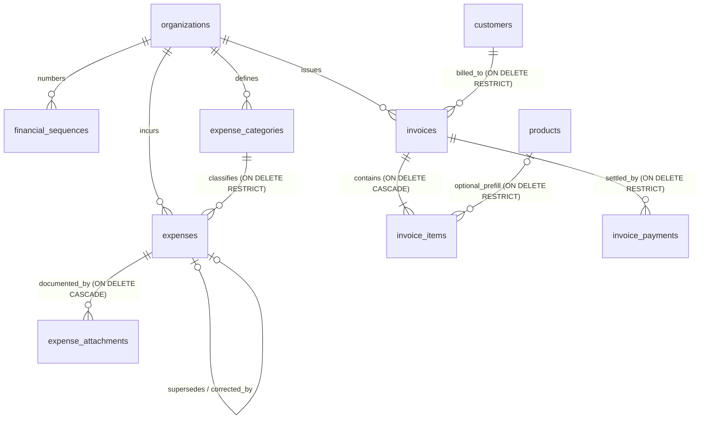

# Conceptual & Physical Data Model: Feature 006 — Invoices & Expenses

**Branch**: `006-invoices-expenses` | **Date**: 2026-11-28 | **Spec**: [spec.md](./spec.md)  
**Target Migration**: `supabase/migrations/20261128000026_invoices_expenses_schema.sql` *(to be created during implementation)*

---

## 1. Entity Relationship Diagram

---

## 2. Database Tables, Constraints & Indexes

All 7 tables require:
- `organization_id UUID NOT NULL REFERENCES public.organizations(id) ON DELETE CASCADE`
- `ALTER TABLE ... ENABLE ROW LEVEL SECURITY; ALTER TABLE ... FORCE ROW LEVEL SECURITY;`
- Deny-all DML policy for `authenticated` (`FOR ALL TO authenticated USING (false) WITH CHECK (false)`)
- Permissive `SELECT` policies ONLY where direct tenant read is authorized via `public.check_user_permission(...)`.

### 2.1 `public.financial_sequences`
Organization-scoped daily numbering counters (`D5 Option A`).
- **Columns**:
  - `organization_id UUID NOT NULL REFERENCES public.organizations(id) ON DELETE CASCADE`
  - `sequence_type TEXT NOT NULL CHECK (sequence_type IN ('invoice', 'invoice_payment', 'expense'))`
  - `date_key DATE NOT NULL` *(evaluated in `organizations.timezone`)*
  - `last_number INTEGER NOT NULL DEFAULT 0 CHECK (last_number >= 0)`
  - `created_at TIMESTAMPTZ NOT NULL DEFAULT now()`
  - `updated_at TIMESTAMPTZ NOT NULL DEFAULT now()`
- **Primary Key**: `(organization_id, sequence_type, date_key)`
- **Triggers**: `BEFORE UPDATE` → `public.handle_updated_at()`
- **RLS**: Deny-all (`SELECT` and DML blocked for `authenticated`; mutated strictly by `SECURITY DEFINER` RPCs).
- **Formatting**: `{PREFIX}-{YYYYMMDD}-{lpad(last_number::text, 4, '0')}` (grows seamlessly beyond 4 digits if `>= 10000`).

### 2.2 `public.invoices`
Standalone customer billing headers (`D1`, `D2`, `D4`, `D5`, `F-03`, `F-07`).
- **Columns**:
  - `id UUID PRIMARY KEY DEFAULT gen_random_uuid()`
  - `organization_id UUID NOT NULL REFERENCES public.organizations(id) ON DELETE CASCADE`
  - `invoice_number TEXT NULL` *(NULL while `'draft'`; assigned once upon issuance as `INV-{YYYYMMDD}-{XXXX}`)*
  - `customer_id UUID NOT NULL`
  - `customer_name_snapshot TEXT NOT NULL CHECK (length(trim(customer_name_snapshot)) BETWEEN 1 AND 255)`
  - `customer_email_snapshot TEXT NULL`
  - `customer_phone_snapshot TEXT NULL`
  - `issue_date DATE NOT NULL`
  - `due_date DATE NOT NULL`
  - `status TEXT NOT NULL DEFAULT 'draft' CHECK (status IN ('draft', 'issued', 'partially_paid', 'paid', 'cancelled'))`
  - `currency TEXT NOT NULL CHECK (currency ~ '^[A-Z]{3}$')`
  - `tax_name TEXT NOT NULL DEFAULT 'VAT' CHECK (length(trim(tax_name)) BETWEEN 1 AND 100)`
  - `tax_rate NUMERIC(6, 4) NOT NULL DEFAULT 0.0000 CHECK (tax_rate >= 0.0000 AND tax_rate <= 100.0000)`
  - `is_tax_inclusive BOOLEAN NOT NULL DEFAULT false`
  - `is_tax_exempt BOOLEAN NOT NULL DEFAULT false`
  - `subtotal NUMERIC(14, 4) NOT NULL DEFAULT 0.0000 CHECK (subtotal >= 0)`
  - `invoice_discount_amount NUMERIC(14, 4) NOT NULL DEFAULT 0.0000 CHECK (invoice_discount_amount >= 0)`
  - `taxable_amount NUMERIC(14, 4) NOT NULL DEFAULT 0.0000 CHECK (taxable_amount >= 0)`
  - `tax_amount NUMERIC(14, 4) NOT NULL DEFAULT 0.0000 CHECK (tax_amount >= 0)`
  - `total_amount NUMERIC(14, 4) NOT NULL DEFAULT 0.0000 CHECK (total_amount >= 0)`
  - `paid_amount NUMERIC(14, 4) NOT NULL DEFAULT 0.0000 CHECK (paid_amount >= 0)`
  - `outstanding_balance NUMERIC(14, 4) NOT NULL DEFAULT 0.0000 CHECK (outstanding_balance >= 0)`
  - `notes TEXT NULL CHECK (notes IS NULL OR length(notes) <= 1000)`
  - `payment_instructions TEXT NULL CHECK (payment_instructions IS NULL OR length(payment_instructions) <= 1000)`
  - `issued_at TIMESTAMPTZ NULL`
  - `issued_by UUID NULL REFERENCES public.profiles(id) ON DELETE RESTRICT`
  - `paid_at TIMESTAMPTZ NULL`
  - `cancelled_at TIMESTAMPTZ NULL`
  - `cancelled_by UUID NULL REFERENCES public.profiles(id) ON DELETE RESTRICT`
  - `cancellation_reason TEXT NULL CHECK (cancellation_reason IS NULL OR length(trim(cancellation_reason)) BETWEEN 3 AND 255)`
  - `draft_idempotency_key UUID NOT NULL`
  - `draft_idempotency_hash TEXT NOT NULL`
  - `issue_idempotency_key UUID NULL`
  - `issue_idempotency_hash TEXT NULL`
  - `cancel_idempotency_key UUID NULL`
  - `cancel_idempotency_hash TEXT NULL`
  - `created_by UUID NOT NULL REFERENCES public.profiles(id) ON DELETE RESTRICT`
  - `updated_by UUID NULL REFERENCES public.profiles(id) ON DELETE RESTRICT`
  - `created_at TIMESTAMPTZ NOT NULL DEFAULT now()`
  - `updated_at TIMESTAMPTZ NOT NULL DEFAULT now()`
- **Derived Computed Field (SQL Views / RPCs)**:
  - `is_overdue`: `(status IN ('issued', 'partially_paid') AND due_date < (now() AT TIME ZONE org.timezone)::DATE)`
- **Constraints**:
  - `uq_invoices_org_id UNIQUE (organization_id, id)`
  - `fk_invoices_org_customer FOREIGN KEY (organization_id, customer_id) REFERENCES public.customers(organization_id, id) ON DELETE RESTRICT`
  - `chk_invoices_dates CHECK (due_date >= issue_date)`
  - `chk_invoices_balance_eq CHECK (paid_amount + outstanding_balance = total_amount)`
  - `chk_invoices_paid_bounds CHECK (paid_amount <= total_amount)`
  - `uq_invoices_org_draft_idemp UNIQUE (organization_id, draft_idempotency_key)`
- **Partial Unique & Lookup Indexes**:
  - `uq_invoices_org_number ON public.invoices (organization_id, invoice_number) WHERE invoice_number IS NOT NULL`
  - `uq_invoices_org_issue_idemp ON public.invoices (organization_id, issue_idempotency_key) WHERE issue_idempotency_key IS NOT NULL`
  - `uq_invoices_org_cancel_idemp ON public.invoices (organization_id, cancel_idempotency_key) WHERE cancel_idempotency_key IS NOT NULL`
  - `idx_invoices_org_status_due ON public.invoices (organization_id, status, due_date)`
  - `idx_invoices_org_customer ON public.invoices (organization_id, customer_id, created_at DESC)`
  - `idx_invoices_org_issue_date ON public.invoices (organization_id, issue_date DESC)`
  - `idx_invoices_org_created ON public.invoices (organization_id, created_at DESC)`
- **RLS**: `SELECT` granted to `authenticated` (`check_user_permission(organization_id, auth.uid(), 'invoices:read')`); DML denied.

### 2.3 `public.invoice_items`
Immutable line-item snapshots once parent invoice leaves `'draft'`. Never stores or reads `unit_cost` (`SEC-010`).
- **Columns**:
  - `id UUID PRIMARY KEY DEFAULT gen_random_uuid()`
  - `organization_id UUID NOT NULL REFERENCES public.organizations(id) ON DELETE CASCADE`
  - `invoice_id UUID NOT NULL`
  - `sort_order INTEGER NOT NULL CHECK (sort_order >= 0)`
  - `product_id UUID NULL` *(optional catalog prefill reference; never triggers stock movements)*
  - `sku_snapshot TEXT NULL CHECK (sku_snapshot IS NULL OR length(trim(sku_snapshot)) <= 100)`
  - `unit_of_measure_snapshot TEXT NULL CHECK (unit_of_measure_snapshot IS NULL OR length(trim(unit_of_measure_snapshot)) <= 50)`
  - `description TEXT NOT NULL CHECK (length(trim(description)) BETWEEN 1 AND 255)`
  - `quantity NUMERIC(14, 4) NOT NULL CHECK (quantity > 0)`
  - `unit_price NUMERIC(14, 4) NOT NULL CHECK (unit_price >= 0)`
  - `line_discount_amount NUMERIC(14, 4) NOT NULL DEFAULT 0.0000 CHECK (line_discount_amount >= 0)`
  - `allocated_invoice_disc NUMERIC(14, 4) NOT NULL DEFAULT 0.0000 CHECK (allocated_invoice_disc >= 0)`
  - `is_taxable BOOLEAN NOT NULL DEFAULT true`
  - `taxable_amount NUMERIC(14, 4) NOT NULL DEFAULT 0.0000 CHECK (taxable_amount >= 0)`
  - `allocated_tax_amount NUMERIC(14, 4) NOT NULL DEFAULT 0.0000 CHECK (allocated_tax_amount >= 0)`
  - `total_price NUMERIC(14, 4) NOT NULL CHECK (total_price >= 0)`
  - `created_at TIMESTAMPTZ NOT NULL DEFAULT now()`
- **Constraints & Indexes**:
  - `fk_invoice_items_org_invoice FOREIGN KEY (organization_id, invoice_id) REFERENCES public.invoices(organization_id, id) ON DELETE CASCADE`
  - `fk_invoice_items_org_product FOREIGN KEY (organization_id, product_id) REFERENCES public.products(organization_id, id) ON DELETE RESTRICT`
  - `uq_invoice_items_order UNIQUE (organization_id, invoice_id, sort_order)`
  - `idx_invoice_items_invoice ON public.invoice_items (organization_id, invoice_id, sort_order)`
- **RLS**: `SELECT` granted to `authenticated` (`check_user_permission(organization_id, auth.uid(), 'invoices:read')`); DML denied.

### 2.4 `public.invoice_payments`
Dedicated invoice collection ledger (`D1`, `D2`, `F-02`, `Audit #3`). Strictly isolated from `public.payments`.
- **Columns**:
  - `id UUID PRIMARY KEY DEFAULT gen_random_uuid()`
  - `organization_id UUID NOT NULL REFERENCES public.organizations(id) ON DELETE CASCADE`
  - `invoice_id UUID NOT NULL`
  - `payment_number TEXT NOT NULL` *(format `IPAY-{YYYYMMDD}-{XXXX}`)*
  - `payment_method TEXT NOT NULL CHECK (payment_method IN ('cash', 'card', 'bank_transfer', 'other'))`
  - `amount NUMERIC(14, 4) NOT NULL CHECK (amount > 0)`
  - `balance_after_payment NUMERIC(14, 4) NOT NULL CHECK (balance_after_payment >= 0)` *(immutable receipt snapshot `F-02`)*
  - `payment_date DATE NOT NULL`
  - `reference_no TEXT NULL CHECK (reference_no IS NULL OR length(trim(reference_no)) BETWEEN 1 AND 120)`
  - `notes TEXT NULL CHECK (notes IS NULL OR length(notes) <= 500)`
  - `status TEXT NOT NULL DEFAULT 'recorded' CHECK (status IN ('recorded', 'reversed'))`
  - `reversed_at TIMESTAMPTZ NULL`
  - `reversed_by UUID NULL REFERENCES public.profiles(id) ON DELETE RESTRICT`
  - `reversal_reason TEXT NULL CHECK (reversal_reason IS NULL OR length(trim(reversal_reason)) BETWEEN 3 AND 255)`
  - `idempotency_key UUID NOT NULL`
  - `idempotency_hash TEXT NOT NULL`
  - `reversal_idempotency_key UUID NULL`
  - `reversal_idempotency_hash TEXT NULL`
  - `created_by UUID NOT NULL REFERENCES public.profiles(id) ON DELETE RESTRICT`
  - `created_at TIMESTAMPTZ NOT NULL DEFAULT now()`
- **Constraints & Indexes**:
  - `fk_invoice_payments_org_invoice FOREIGN KEY (organization_id, invoice_id) REFERENCES public.invoices(organization_id, id) ON DELETE RESTRICT`
  - `uq_invoice_payments_org_number UNIQUE (organization_id, payment_number)`
  - `uq_invoice_payments_org_idemp UNIQUE (organization_id, idempotency_key)`
  - `chk_invoice_payments_ref_req CHECK (payment_method = 'cash' OR reference_no IS NOT NULL)`
  - `chk_invoice_payments_reversal CHECK ((status = 'recorded' AND reversed_at IS NULL AND reversed_by IS NULL AND reversal_reason IS NULL) OR (status = 'reversed' AND reversed_at IS NOT NULL AND reversed_by IS NOT NULL AND reversal_reason IS NOT NULL))`
  - `uq_invoice_payments_method_ref_active ON public.invoice_payments (organization_id, payment_method, reference_no) WHERE reference_no IS NOT NULL AND status = 'recorded'`
  - `uq_invoice_payments_rev_idemp ON public.invoice_payments (organization_id, reversal_idempotency_key) WHERE reversal_idempotency_key IS NOT NULL`
  - `idx_invoice_payments_invoice ON public.invoice_payments (organization_id, invoice_id, created_at ASC)`
  - `idx_invoice_payments_date ON public.invoice_payments (organization_id, payment_date DESC) WHERE status = 'recorded'`
- **RLS**: `SELECT` granted to `authenticated` (`check_user_permission(organization_id, auth.uid(), 'invoice_payments:read')`); DML denied.

### 2.5 `public.expense_categories`
Tenant-isolated operational expense categories with safe archival.
- **Columns**:
  - `id UUID PRIMARY KEY DEFAULT gen_random_uuid()`
  - `organization_id UUID NOT NULL REFERENCES public.organizations(id) ON DELETE CASCADE`
  - `name TEXT NOT NULL CHECK (length(trim(name)) BETWEEN 1 AND 100)`
  - `description TEXT NULL CHECK (description IS NULL OR length(description) <= 500)`
  - `status TEXT NOT NULL DEFAULT 'active' CHECK (status IN ('active', 'archived'))`
  - `is_system_default BOOLEAN NOT NULL DEFAULT false`
  - `created_by UUID NOT NULL REFERENCES public.profiles(id) ON DELETE RESTRICT`
  - `created_at TIMESTAMPTZ NOT NULL DEFAULT now()`
  - `updated_at TIMESTAMPTZ NOT NULL DEFAULT now()`
- **Constraints & Indexes**:
  - `uq_expense_categories_org_id UNIQUE (organization_id, id)`
  - `uq_expense_categories_org_name_active ON public.expense_categories (organization_id, lower(trim(name))) WHERE status = 'active'`
  - `idx_expense_categories_org_status ON public.expense_categories (organization_id, status)`
- **Triggers**: `BEFORE UPDATE` → `public.handle_updated_at()`
- **RLS**: `SELECT` granted to `authenticated` (`check_user_permission(organization_id, auth.uid(), 'expense_categories:read')`); DML denied.

### 2.6 `public.expenses`
Operational expense ledger implementing `D3`, `F-01`, `F-05`, `F-06`, and `Audit #3`/`#4`.
- **Columns**:
  - `id UUID PRIMARY KEY DEFAULT gen_random_uuid()`
  - `organization_id UUID NOT NULL REFERENCES public.organizations(id) ON DELETE CASCADE`
  - `expense_number TEXT NOT NULL` *(format `EXP-{YYYYMMDD}-{XXXX}`)*
  - `category_id UUID NOT NULL`
  - `title TEXT NOT NULL CHECK (length(trim(title)) BETWEEN 1 AND 255)`
  - `description TEXT NULL CHECK (description IS NULL OR length(description) <= 1000)`
  - `payee_name TEXT NULL CHECK (payee_name IS NULL OR length(trim(payee_name)) <= 255)`
  - `net_amount NUMERIC(14, 4) NOT NULL CHECK (net_amount > 0)`
  - `tax_amount NUMERIC(14, 4) NOT NULL DEFAULT 0.0000 CHECK (tax_amount >= 0)` *(additive input tax, decoupled from sales `organization_tax_settings`)*
  - `total_amount NUMERIC(14, 4) NOT NULL CHECK (total_amount > 0)`
  - `currency TEXT NOT NULL CHECK (currency ~ '^[A-Z]{3}$')`
  - `expense_date DATE NOT NULL`
  - `lifecycle_status TEXT NOT NULL DEFAULT 'active' CHECK (lifecycle_status IN ('active', 'voided', 'corrected'))`
  - `payment_status TEXT NOT NULL CHECK (payment_status IN ('unpaid', 'paid'))`
  - `payment_date DATE NULL`
  - `payment_method TEXT NULL CHECK (payment_method IS NULL OR payment_method IN ('cash', 'card', 'bank_transfer', 'other'))`
  - `reference_no TEXT NULL CHECK (reference_no IS NULL OR length(trim(reference_no)) BETWEEN 1 AND 120)`
  - `paid_at TIMESTAMPTZ NULL`
  - `paid_by UUID NULL REFERENCES public.profiles(id) ON DELETE RESTRICT`
  - `voided_at TIMESTAMPTZ NULL`
  - `voided_by UUID NULL REFERENCES public.profiles(id) ON DELETE RESTRICT`
  - `void_reason TEXT NULL CHECK (void_reason IS NULL OR length(trim(void_reason)) BETWEEN 3 AND 255)`
  - `supersedes_expense_id UUID NULL`
  - `corrected_by_expense_id UUID NULL`
  - `correction_reason TEXT NULL CHECK (correction_reason IS NULL OR length(trim(correction_reason)) BETWEEN 3 AND 255)`
  - `idempotency_key UUID NOT NULL`
  - `idempotency_hash TEXT NOT NULL`
  - `pay_idempotency_key UUID NULL`
  - `pay_idempotency_hash TEXT NULL`
  - `void_idempotency_key UUID NULL`
  - `void_idempotency_hash TEXT NULL`
  - `correct_idempotency_key UUID NULL`
  - `correct_idempotency_hash TEXT NULL`
  - `created_by UUID NOT NULL REFERENCES public.profiles(id) ON DELETE RESTRICT`
  - `updated_by UUID NULL REFERENCES public.profiles(id) ON DELETE RESTRICT`
  - `created_at TIMESTAMPTZ NOT NULL DEFAULT now()`
  - `updated_at TIMESTAMPTZ NOT NULL DEFAULT now()`
- **Constraints & Indexes**:
  - `uq_expenses_org_id UNIQUE (organization_id, id)`
  - `uq_expenses_org_number UNIQUE (organization_id, expense_number)`
  - `fk_expenses_org_category FOREIGN KEY (organization_id, category_id) REFERENCES public.expense_categories(organization_id, id) ON DELETE RESTRICT`
  - `fk_expenses_org_supersedes FOREIGN KEY (organization_id, supersedes_expense_id) REFERENCES public.expenses(organization_id, id) ON DELETE RESTRICT`
  - `fk_expenses_org_corrected_by FOREIGN KEY (organization_id, corrected_by_expense_id) REFERENCES public.expenses(organization_id, id) ON DELETE RESTRICT`
  - `chk_expenses_total_eq CHECK (total_amount = net_amount + tax_amount)`
  - `chk_expenses_settlement CHECK ((payment_status = 'unpaid' AND payment_date IS NULL AND payment_method IS NULL AND reference_no IS NULL AND paid_at IS NULL AND paid_by IS NULL) OR (payment_status = 'paid' AND payment_date IS NOT NULL AND payment_method IS NOT NULL AND paid_at IS NOT NULL AND paid_by IS NOT NULL AND (payment_method = 'cash' OR reference_no IS NOT NULL)))`
  - `chk_expenses_void_only_unpaid CHECK (lifecycle_status <> 'voided' OR (payment_status = 'unpaid' AND voided_at IS NOT NULL AND voided_by IS NOT NULL AND void_reason IS NOT NULL))`
  - `chk_expenses_corrected_only_paid CHECK (lifecycle_status <> 'corrected' OR (payment_status = 'paid' AND correction_reason IS NOT NULL))`
  - `uq_expenses_org_idemp UNIQUE (organization_id, idempotency_key)`
  - `uq_expenses_org_pay_idemp ON public.expenses (organization_id, pay_idempotency_key) WHERE pay_idempotency_key IS NOT NULL`
  - `uq_expenses_org_void_idemp ON public.expenses (organization_id, void_idempotency_key) WHERE void_idempotency_key IS NOT NULL`
  - `uq_expenses_org_correct_idemp ON public.expenses (organization_id, correct_idempotency_key) WHERE correct_idempotency_key IS NOT NULL`
  - `uq_expenses_org_method_ref_active ON public.expenses (organization_id, payment_method, reference_no) WHERE reference_no IS NOT NULL AND lifecycle_status = 'active'`
  - `idx_expenses_org_lifecycle_date ON public.expenses (organization_id, lifecycle_status, expense_date DESC)`
  - `idx_expenses_org_category ON public.expenses (organization_id, category_id)`
  - `idx_expenses_org_payment_status ON public.expenses (organization_id, payment_status)`
- **Triggers**: `BEFORE UPDATE` → `public.handle_updated_at()`
- **RLS**: `SELECT` granted to `authenticated` (`check_user_permission(organization_id, auth.uid(), 'expenses:read')`); DML denied.

### 2.7 `public.expense_attachments`
Receipt metadata strictly anchored to active parent expenses (`Audit #2`).
- **Columns**:
  - `id UUID PRIMARY KEY DEFAULT gen_random_uuid()`
  - `organization_id UUID NOT NULL REFERENCES public.organizations(id) ON DELETE CASCADE`
  - `expense_id UUID NOT NULL`
  - `storage_path TEXT NOT NULL UNIQUE` *(regex enforced: `{org_id}/{expense_id}/{file}`)*
  - `file_name TEXT NOT NULL CHECK (length(trim(file_name)) BETWEEN 1 AND 255)`
  - `mime_type TEXT NOT NULL CHECK (mime_type IN ('application/pdf', 'image/jpeg', 'image/png', 'image/webp'))`
  - `file_size BIGINT NOT NULL CHECK (file_size BETWEEN 1 AND 5242880)`
  - `uploaded_by UUID NOT NULL REFERENCES public.profiles(id) ON DELETE RESTRICT`
  - `created_at TIMESTAMPTZ NOT NULL DEFAULT now()`
- **Constraints & Indexes**:
  - `fk_expense_attachments_org_expense FOREIGN KEY (organization_id, expense_id) REFERENCES public.expenses(organization_id, id) ON DELETE CASCADE`
  - `idx_expense_attachments_expense ON public.expense_attachments (organization_id, expense_id, created_at ASC)`
- **RLS**: `SELECT` granted to `authenticated` (`check_user_permission(organization_id, auth.uid(), 'expenses:read')`); DML denied.

---

## 3. Private Storage Bucket & Storage RLS (`SEC-009`)

- **Bucket**: `'expense-attachments'` (`public = false`, `file_size_limit = 5242880`, `allowed_mime_types = ARRAY['application/pdf', 'image/jpeg', 'image/png', 'image/webp']::text[]`)
- **Path Contract**: `^[0-9a-f-]{36}/[0-9a-f-]{36}/[A-Za-z0-9._-]+$`
- **Policies on `storage.objects`**:
  1. `expense_attachments_select`: `bucket_id = 'expense-attachments'`, valid path regex, `is_org_member(folder[1])`, `check_user_permission(folder[1], auth.uid(), 'expenses:read')`, and parent expense exists in org.
  2. `expense_attachments_insert`: valid path regex, `is_org_member(folder[1])`, `(check_user_permission(..., 'expenses:create') OR check_user_permission(..., 'expenses:update'))`, parent expense exists in org with **`lifecycle_status = 'active'`**, MIME in allow-list, size `<= 5242880`.
  3. `expense_attachments_delete`: valid path regex, `is_org_member(folder[1])`, `check_user_permission(..., 'expenses:update')`, and parent expense exists in org with **`lifecycle_status = 'active'`**.

---

## 4. Permission Registrations (16 Keys)

Registered in `public.permissions` and seeded into `public.role_permissions` (`owner` resolves dynamically via `permissions` + `SYSTEM_PERMISSIONS`):

| Category | Permission Keys | Admin | Manager | Cashier |
|---|---|:---:|:---:|:---:|
| `invoices` | `invoices:read`, `invoices:create`, `invoices:update`, `invoices:issue`, `invoices:cancel` | All 5 | All 5 | — |
| `invoice_payments` | `invoice_payments:read`, `invoice_payments:create`, `invoice_payments:reverse` | All 3 | `read`, `create` | — |
| `expenses` | `expenses:read`, `expenses:create`, `expenses:update`, `expenses:pay`, `expenses:void` | All 5 | `read`, `create`, `update`, `pay` | — |
| `expense_categories` | `expense_categories:read`, `expense_categories:manage` | Both | `read` | — |
| `financial_summaries` | `financial_summaries:read` | `read` | — | — |
