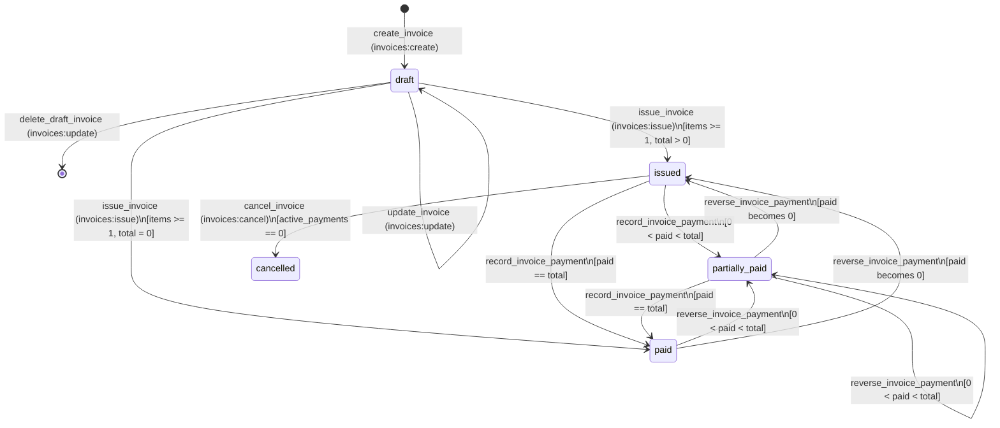
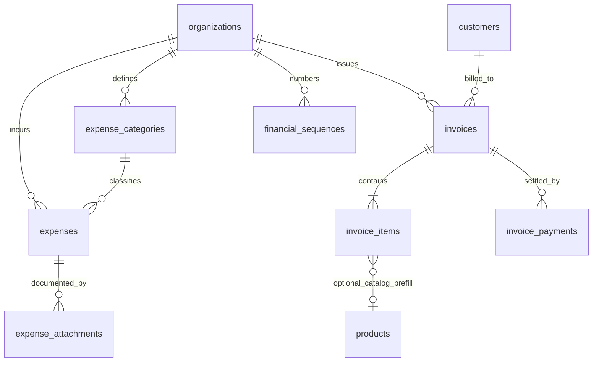

# Feature Specification: Invoices & Expenses

**Feature ID**: 006  
**Feature Branch**: `006-invoices-expenses`  
**Created**: 2026-11-28  
**Updated**: 2026-11-28 (Project Owner Decisions D1–D5 Approved & Reconciled)  
**Status**: Approved — Ready for `/plan`  
**Development Phase**: Web MVP (Aligned with Planned Flutter Companion API Architecture)  
**Governing Documents**:
- [BizFlow AI Constitution v1.1.0](../../.specify/memory/constitution.md)
- [Master Project Blueprint](../../docs/MASTER_PROJECT_BLUEPRINT.md)
- [Feature 001 Specification — Auth & Organizations](../001-auth-organization/spec.md)
- [Feature 002 Specification — Employee Management & RBAC](../002-employee-rbac/spec.md)
- [Feature 003 Specification — Products & Categories](../003-products-categories/spec.md)
- [Feature 004 Specification — Inventory & Stock Management](../004-inventory-stock-management/spec.md)
- [Feature 005 Specification — Customers & Sales (Rev 2.6)](../005-customers-sales/spec.md)

**Input**: User description: `# BIZFLOW AI — FEATURE 006: INVOICES & EXPENSES`

---

## 1. Feature Overview & Business Objectives

Feature 006 introduces centralized **Customer Invoicing (Billing & Receivables)** and **Business Expense Tracking** to BizFlow AI. While Feature 005 handles immediate counter-based Point-of-Sale (POS) retail transactions and stock deductions, small and medium-sized businesses also require formal billing documents with deferred due dates, partial or milestone payment collection, printable/PDF client invoices, and structured tracking of operational business expenses (rent, utilities, payroll, supplies, marketing, and other overheads).

### Primary Business Objectives
1. Enable authorized staff to draft, issue, track, cancel, and generate printable/PDF invoices associated with organization customers.
2. Track invoice balances accurately across multiple partial and full payments without altering completed Feature 005 POS sales or duplicating revenue/inventory effects.
3. Provide structured operational expense recording, categorization, payment tracking, and secure supporting-receipt attachment storage.
4. Expose permission-gated operational summaries for invoices, outstanding receivables, overdue balances, and categorized expenses using exact same-currency arithmetic.
5. Enforce strict multi-tenant Row-Level Security (RLS), immutable financial history, server-authoritative calculations, idempotent mutations, and comprehensive audit logging.

---

## 2. Stakeholders & User Roles

Role definitions follow Feature 002 (`app_role`: `owner`, `admin`, `manager`, `cashier`) and granular `<resource>:<action>` permissions enforced server-side.

| Role | Primary Needs in Feature 006 | Expected Authority Scope |
|---|---|---|
| **Owner** | Full oversight of invoicing, receivables, expense categories, all financial summaries, cancellations, and reversals. | Automatic access to all registered Feature 006 permissions (unknown keys still fail closed). |
| **Admin** | Configure/manage expense categories, issue and cancel invoices, record/reverse payments, manage expenses, view financial summaries. | Full Feature 006 operational & administrative permissions. |
| **Manager** | Create/issue invoices, collect invoice payments, record/pay expenses, view summaries; bounded on high-risk reversals/cancellations as configured. | Operational invoice, payment, and expense permissions. |
| **Cashier** | Strictly limited (or denied by default) from back-office financial administration; optional read/collect access only if explicitly granted via RBAC. | Least privilege: zero destructive, cancellation, reversal, or sensitive expense/profit summary access by default. |
| **Customer (External Subject)** | Receives accurate printable/PDF invoices and payment receipts showing line items, discounts, taxes, payments applied, and balance due. | No direct system login; represented via Feature 005 `customers` entity. |

---

## 3. Scope, Explicit Boundaries & Prioritization

### 3.1 Explicit Domain Boundaries (Non-Negotiable Separation)

To prevent accounting corruption, duplicated revenue, and accidental coupling with Features 003–005:

1. **Invoices vs. POS Sales (`public.sales`)**:
   - Feature 005 `sales` represent immediate counter checkouts that atomically deduct inventory (`stock_movements` type `sale`) and require full payment at commit time (`sum(payments) = total_amount`).
   - Feature 006 `invoices` represent strictly standalone billing documents with an `issue_date`, `due_date`, draft-to-issued lifecycle, and deferred/partial payment collection (`outstanding_balance >= 0`).
   - Standalone invoices MUST NOT automatically create POS sales records, link to POS sales, or deduct/modify inventory in `public.inventory` / `public.stock_movements`. Optional catalog product selection serves strictly as a non-mutating prefill for item description, SKU snapshot, and unit price.
2. **Invoice Payments vs. POS Payments & Customer Refunds**:
   - Feature 005 `public.payments` is structurally bound to `sales` (`sale_id NOT NULL`) and is strictly insert-only at POS checkout.
   - Feature 006 `invoice_payments` MUST live in a dedicated ledger linked strictly to `invoices` (and scoped by `organization_id`) so Feature 005 invariants remain untouched.
   - Collecting an invoice payment does NOT modify cash register drawer sessions.
   - **Internal Payment Reversal vs. Customer Refund**: Reversing an invoice payment (`reverse_invoice_payment`) is strictly an internal billing-ledger correction (e.g., data-entry error, bounced check, or uncollected transfer) that transitions `invoice_payments.status` to `'reversed'` and restores `invoices.outstanding_balance`. Automated customer refund workflows and external refund disbursement ledgers (analogous to Feature 005 `public.refunds`) are explicitly **deferred** from Feature 006 P0.
3. **Expenses vs. Inventory Purchasing & Accounts Payable**:
   - Feature 006 expenses track operational business expenditures (utilities, rent, salaries, logistics, general supplies, services).
   - Recording an expense MUST NOT create inventory stock movements (`restock`), update `public.inventory`, alter `public.product_costs`, or create Purchase Orders / Supplier AP ledgers.
4. **Operational Summaries vs. Formal Accounting Statements**:
   - Feature 006 dashboards display operational counts and totals (issued value, collected payments, outstanding receivables, overdue receivables, categorized expenses).
   - They are NOT a double-entry General Ledger, Trial Balance, GAAP/IFRS P&L, or Balance Sheet (formal profitability reporting belongs to Feature 007 using explicitly reconciled definitions).

### 3.2 Scope Prioritization (P0 / P1 / Deferred)

| Capability | Priority | Rationale |
|---|:---:|---|
| Draft & Issued Invoice lifecycle (`draft`, `issued`, `partially_paid`, `paid`, `cancelled`) | **P0** | Core billing workflow with immutability after issuance. |
| Sequential tenant-scoped invoice numbering (`INV-...`) | **P0** | Legal/audit requirement; prevents collisions. |
| Customer association (reusing Feature 005 `customers`) & snapshot | **P0** | Eliminates duplicate customer records; preserves historical customer info. |
| Line items (description, qty, unit price, line discount), optional invoice discount, tax snapshot | **P0** | Exact fixed-point billing calculation parity. |
| Invoice partial/full payment collection & outstanding balance tracking | **P0** | Core receivables tracking with overpayment protection & idempotency. |
| Overdue invoice identification & filtering | **P0** | Essential for receivables follow-up. |
| Printable invoice & server-consistent PDF generation + payment receipts | **P0** | Explicitly required by Blueprint and user workflows. |
| Expense recording, editing (policy-bounded), archival/voiding | **P0** | Core expense tracking capability. |
| Organization-scoped Expense Categories (default seeds + CRUD + archival) | **P0** | Essential for expense analysis and historical integrity. |
| Secure private attachment upload/view for expense receipts | **P0** | Supporting documentation with strict tenant isolation. |
| Operational Invoice & Expense Dashboard Summary cards & category breakdown | **P0** | Immediate business visibility without cross-currency distortion. |
| Invoice duplication ("Duplicate as Draft") | **P1** | High-value convenience for repeat billing without touching recurring billing engines. |
| Invoice payment-record reversal (`reverse_invoice_payment`) | **P0** | Safe, audited non-destructive billing-ledger correction for misrecorded/bounced payments (does not execute customer refunds). |
| Expense unpaid/paid settlement & optional `tax_amount` component | **P0** | Supports unpaid vs. paid expense lifecycle with full-settlement transition and optional tax capture. |
| Automated invoice customer refund workflows & refund disbursements | **Deferred** | Distinct from internal payment-record reversal; external refund obligation/payout tracking is excluded from Feature 006 P0. |
| Expense approval workflow (`pending_approval` → `approved` / `rejected`) | **Deferred** | Excluded from P0 per Owner Decision D3 Option A to avoid multi-step pre-payment approval overhead. |
| Partial expense installment payments | **Deferred** | Expenses settle cleanly as full `'unpaid'` → `'paid'` in P0 per Owner Decision D3 Option A. |
| POS-sale-derived invoice generation (`source_sale_id`) & inventory-deducting invoices | **Deferred / Excluded** | Invoices remain strictly standalone billing documents per Owner Decision D1 Option A without duplicating sales or touching stock. |
| Recurring invoices & subscription billing | **Deferred** | Requires background job schedulers, billing cycles, and automated issuance rules outside initial scope. |
| Automated overdue email/SMS reminders & email invoice delivery | **Deferred** | Requires outbound email templating, SMTP/Resend delivery tracking, and notification preferences. |
| Online payment gateway links (Stripe/PayPal webhooks) | **Deferred** | Payment gateway integration, PCI/webhook handling, and online checkout are separate scope. |
| Supplier management, Purchase Orders & Inventory receiving | **Deferred** | Distinct procurement/AP domain; explicitly excluded to avoid inventory coupling. |
| Bank reconciliation, General Ledger, Journal Entries, P&L, Balance Sheet | **Deferred** | Full double-entry accounting/ERP scope; Feature 007 covers operational analytics. |
| Multi-currency FX conversion | **Deferred** | Requires exchange rate tables, realized/unrealized FX gain/loss accounting. |
| Formal Credit Notes & E-invoicing (UBL/ZATCA/PEPPOL) | **Deferred** | Regional tax authority integrations and credit-note accounting are outside MVP. |

---

## 4. Assumptions, Dependencies & Project Owner Decisions

### 4.1 Confirmed Repository Baseline (Established by Constitution & Features 001–005)
The following rules are **confirmed** by existing codebase contracts and MUST NOT be weakened:
1. **Tenancy**: `organization_id UUID NOT NULL` on all tables, composite `(organization_id, id)` FKs, `ENABLE` + `FORCE ROW LEVEL SECURITY`, server-resolved `getTenantContext(slug)` / `resolveTenantContext(slug)`, zero trust in client `organization_id` or `bizflow_active_org` cookie.
2. **Database Execution**: Mutations execute atomically via `SECURITY DEFINER` PostgreSQL RPCs (`OWNER TO postgres`, `SET search_path = pg_catalog, public, pg_temp`, `GRANT EXECUTE TO authenticated`, `REVOKE FROM PUBLIC, anon, service_role`), with direct table DML denied via RLS.
3. **Monetary Math**: `NUMERIC(14, 4)` storage, `public.get_currency_exponent(currency)` rounding (`ROUND(val, exponent)`), server-authoritative calculation, zero negative amounts (`P0007`).
4. **Customers**: Reuses `public.customers` (`CUS-001`–`CUS-010`). Archived customers cannot be attached to new invoices (`P0041`).
5. **Tax Infrastructure**: Reuses `public.organization_tax_settings` (`tax_name`, `default_tax_rate`, `is_tax_inclusive`) as organization tax configuration baseline, snapshotted on documents upon issuance.
6. **Payment Methods**: Reuses `'cash'`, `'card'`, `'bank_transfer'`, `'other'`, requiring non-empty `reference_no` for non-cash methods.
7. **Idempotency & Locks**: Mandatory UUID `idempotency_key` + `pg_advisory_xact_lock` + canonical JSONB SHA-256 hash (`P0055`, `P0024`).
8. **Audit Trail**: Reuses `public.organization_audit_events` for immutable security/financial event logging alongside entity audit columns.

### 4.2 Approved Project Owner Decisions (Resolved 2026-11-28)

The following **5 business decisions** and clarifying rules have been formally approved by the Project Owner and govern all Feature 006 design and planning:

1. **Decision 1 (Option A — Strictly Standalone Billing Documents)**:
   - Invoices are standalone customer billing documents supporting custom line descriptions and optional catalog product prefill (copying name/SKU/unit price only).
   - Issuing, paying, reversing payments on, or cancelling an invoice NEVER creates a Feature 005 POS `sales` record, NEVER duplicates POS revenue recognition, and NEVER touches `public.inventory` or `public.stock_movements`.
2. **Decision 2 (Option A — Derived `is_overdue`, Audited Payment Reversals, Cancel Blocked While Paid)**:
   - Persisted invoice `status` is strictly `('draft', 'issued', 'partially_paid', 'paid', 'cancelled')`. Overdue status is derived dynamically via `is_overdue = (status IN ('issued', 'partially_paid') AND due_date < (now() AT TIME ZONE organization.timezone)::DATE)`, ensuring partially paid past-due invoices accurately display both states without background-job drift.
   - Mistaken/bounced invoice payments are corrected via an audited, immutable **internal payment-record reversal** (`reverse_invoice_payment`, transitioning `status` to `'reversed'` while preserving the row and audit trail). This is strictly an internal billing-ledger correction; automated customer refund workflows and refund disbursement ledgers are explicitly **deferred** from Feature 006 P0.
   - Identical idempotent retries of a successful payment reversal MUST replay the original successful reversal response (`is_replay = true`). A new reversal attempt (with a distinct `idempotency_key`) against an already-reversed payment MUST be rejected with `P0078 INVOICE_PAYMENT_ALREADY_REVERSED`.
   - Cancelling an invoice (`cancel_invoice`) while any active (`'recorded'`) payments exist is strictly blocked (`P0076 INVOICE_HAS_ACTIVE_PAYMENTS`); active payments must be reversed first.
3. **Decision 3 (Option A — No Expense Approval Workflow in P0, Full-Settlement `unpaid`/`paid`, Optional Expense Tax)**:
   - Expense approval workflows (`pending_approval` / `approved` / `rejected`) and partial expense installment payments are deferred.
   - Expenses track separate `lifecycle_status` (`'active'` | `'voided'`) and `payment_status` (`'unpaid'` | `'paid'`, full-settlement transition), plus optional `tax_amount >= 0.0000` (`total_amount = net_amount + tax_amount`).
4. **Decision 4 (Option A — Org Tax Snapshot, Invoice Exemption, Per-Line Taxability, Line & Invoice Discounts)**:
   - On issuance, invoices snapshot `public.organization_tax_settings` (`tax_name`, `tax_rate`, `is_tax_inclusive`), support an invoice-level `is_tax_exempt` toggle (overriding effective rate to `0.0000`) and per-line `is_taxable` toggle (default `true`), and support both line-level and invoice-level discounts using Feature 005's proportional allocation and final-line residual absorption rules.
5. **Decision 5 (Option A — Daily Org-Timezone Sequences & Single Organization Currency)**:
   - Sequential numbers use daily organization-timezone counters (`INV-{YYYYMMDD}-{XXXX}`, `IPAY-{YYYYMMDD}-{XXXX}`, `EXP-{YYYYMMDD}-{XXXX}`), aligned with Feature 005 `SAL-{YYYYMMDD}-{XXXX}`.
   - All Feature 006 invoices, invoice payments, and expenses MUST strictly use `public.organizations.currency`; multi-currency FX conversion is deferred.

---

## 5. User Scenarios & Testing *(mandatory)*

### User Story 1 — Draft, Edit & Issue Customer Invoice (Priority: P0)

As an authorized manager or admin, I need to create a draft invoice for an active customer with itemized products or services, quantities, prices, discounts, tax preview, issue date, and due date, refine the draft as needed, and formally issue it with a sequential invoice number so that the finalized billing record becomes legally immutable.

**Why this priority**: Creating and issuing accurate, numbered, immutable customer invoices is the foundational **P0** billing workflow of Feature 006 (while the companion `Duplicate as Draft` convenience sub-capability in `FR-014` remains explicitly classified as **P1**).

**Independent Test**: Can be fully tested by creating a draft invoice for an active customer with two line items (one catalog-prefilled, one custom service), updating a quantity while in `draft`, issuing the invoice with a valid idempotency key, and verifying: (1) sequential `invoice_number` is assigned, (2) status transitions to `issued`, (3) tax parameters and totals are snapshotted, (4) subsequent edit attempts on the issued invoice are rejected, and (5) an audit event is logged.

**Acceptance Scenarios**:

1. **Create and Edit Draft Invoice (With Draft Idempotency)**:
   - **Given** Caller holds `invoices:create` and `invoices:update` in Organization A, and active Customer C exists,
   - **When** Caller creates a draft invoice with Customer C, due date 14 days from issue date, 2 line items (10 units × \$25.00 + 1 service line × \$100.00), and UUID `draft_idempotency_key`, then edits line 1 to 12 units while still `draft`,
   - **Then** Draft persists updated subtotal \$400.0000, tax, and total, carries status `'draft'`, holds `invoice_number = NULL` until issuance, and retries of the exact `create_invoice` call with the same key return the existing draft (`is_replay = true`) without creating duplicates.
2. **Formal Invoice Issuance & Snapshot Lock**:
   - **Given** A valid `draft` invoice with at least 1 line item and `due_date >= issue_date`, and organization tax setting is 10% exclusive,
   - **When** Authorized user (`invoices:issue`) issues the invoice with UUID `issue_idempotency_key`,
   - **Then** System assigns unique sequential `INV-{YYYYMMDD}-{XXXX}`, snapshots `tax_name`, `tax_rate`, `is_tax_inclusive`, `is_tax_exempt`, and supported customer fields (`customer_name_snapshot`, `customer_email_snapshot`, `customer_phone_snapshot`), calculates authoritative `subtotal`, `tax_amount`, `total_amount`, sets `outstanding_balance = total_amount`, sets `status = 'issued'`, sets `issued_at`/`issued_by`, and records an immutable audit event.
3. **Immutability After Issuance**:
   - **Given** Invoice `INV-001` is in status `'issued'`,
   - **When** Any user attempts to update its line items, prices, customer, or discount, or directly modify table columns,
   - **Then** System rejects the edit with `INVOICE_IMMUTABLE_AFTER_ISSUANCE` (`P0072`, HTTP 422), and RLS denies direct table updates.
4. **Archived Customer & Empty Invoice Rejection**:
   - **Given** Customer Z is `archived`, or draft invoice has 0 line items,
   - **When** User attempts to create/issue an invoice for Customer Z or issue an empty invoice,
   - **Then** System rejects with `CUSTOMER_ARCHIVED` (`P0041`) or `INVOICE_EMPTY_ITEMS` (`P0073`).

---

### User Story 2 — Invoice Payment Collection, Partial Payments & Balance Reconciliation (Priority: P0)

As an authorized manager or billing operator, I need to record one or more partial or full payments against an issued invoice across supported payment methods while enforcing non-overpayment and idempotency guarantees, so that outstanding customer balances and invoice payment statuses stay accurate under concurrent activity.

**Why this priority**: Receivables management depends on accurate partial/full payment tracking without double-counting payments or allowing balances to go negative.

**Independent Test**: Can be fully tested by issuing a \$200.00 invoice, recording a \$75.00 `bank_transfer` payment with reference `"WIRE-1001"`, verifying `outstanding_balance = 125.0000` and `status = 'partially_paid'`, submitting a \$150.00 payment attempt (verifying rejection with `P0075 INVOICE_PAYMENT_EXCEEDS_BALANCE`), and recording the final \$125.00 `cash` payment (verifying `outstanding_balance = 0.0000` and `status = 'paid'`).

**Acceptance Scenarios**:

1. **Partial Payment Transition & Receipt Balance Snapshot**:
   - **Given** Issued invoice `INV-001` has `total_amount = 200.0000` and `outstanding_balance = 200.0000`,
   - **When** Authorized user (`invoice_payments:create`) records a \$75.00 `bank_transfer` payment with reference `"WIRE-1001"` and UUID `idempotency_key`,
   - **Then** System creates an `invoice_payments` row for `75.0000` persisting immutable `balance_after_payment = 125.0000`, updates `paid_amount = 75.0000`, updates `outstanding_balance = 125.0000`, transitions invoice status to `'partially_paid'`, and logs an audit event.
2. **Full Balance Settlement**:
   - **Given** `INV-001` is `'partially_paid'` with `outstanding_balance = 125.0000`,
   - **When** User records a \$125.00 `cash` payment,
   - **Then** System persists `balance_after_payment = 0.0000` on the second payment row (preserving `125.0000` on the first payment row), updates `paid_amount` to `200.0000`, `outstanding_balance` to `0.0000`, transitions `status` to `'paid'`, and records `paid_at`.
3. **Overpayment & Duplicate Reference Prevention**:
   - **Given** `INV-001` has `outstanding_balance = 125.0000`,
   - **When** User attempts to record a payment of \$130.00, OR reuses an existing non-cash `(payment_method, reference_no)` in the organization,
   - **Then** System rejects with `INVOICE_PAYMENT_EXCEEDS_BALANCE` (`P0075`) or `PAYMENT_REFERENCE_EXISTS` (`23505`).
4. **Concurrent Partial Payment Serialization**:
   - **Given** `INV-001` has `outstanding_balance = 100.0000`,
   - **When** Two operators simultaneously submit \$80.00 payments under distinct idempotency keys,
   - **Then** Row lock on the invoice (`FOR UPDATE`) serializes both transactions: the first succeeds (`outstanding_balance = 20.0000`), and the second fails cleanly with `INVOICE_PAYMENT_EXCEEDS_BALANCE` (`P0075`), leaving total paid strictly `<= total_amount`.

---

### User Story 3 — Invoice Cancellation, Overdue Identification & Payment Reversals (Priority: P0)

As an admin or manager, I need to identify overdue invoices immediately, cancel erroneous unpaid issued invoices with a mandatory audit reason, and safely reverse misrecorded invoice payments without deleting financial history, so that receivables remain trustworthy and auditable.

**Why this priority**: Invoice cancellation, derived overdue identification/filtering, and audited internal payment-record reversal (`reverse_invoice_payment`) are core **P0** error-recovery and receivables-tracking capabilities in Section 3.2 (while automated customer refund disbursement workflows remain **Deferred**).

**Independent Test**: Can be fully tested by creating an issued invoice with `due_date` in the past (verifying overdue visibility before and after a partial payment), attempting to cancel it while active payments exist (verifying rejection per policy), reversing the payment with an audit reason, and cancelling the invoice with a mandatory reason.

**Acceptance Scenarios**:

1. **Overdue Identification Across Unpaid and Partially Paid Invoices**:
   - **Given** Invoice `INV-002` (`due_date = yesterday` in org timezone) is in status `'issued'` or `'partially_paid'`,
   - **When** Invoices are queried or filtered by Overdue,
   - **Then** `INV-002` reports `is_overdue = true` alongside its true payment status (`issued` or `partially_paid`); once paid in full (`paid`) or `cancelled`, `is_overdue` becomes `false`.
2. **Cancelled Invoice Blocked When Active Payments Exist**:
   - **Given** Invoice `INV-003` has an active (non-reversed) payment of \$50.00,
   - **When** Authorized user attempts to cancel `INV-003`,
   - **Then** System rejects cancellation with `INVOICE_HAS_ACTIVE_PAYMENTS` (`P0076`), preserving financial reconciliation.
3. **Audited Internal Payment Reversal & Subsequent Cancellation**:
   - **Given** Authorized user (`invoice_payments:reverse`) reverses the \$50.00 payment on `INV-003` with reason `"Bank transfer bounced"` and UUID `idempotency_key` `K-REV-1`,
   - **When** Reversal commits (and an identical retry with `K-REV-1` replays cleanly with `is_replay = true`, whereas a distinct key `K-REV-2` against that same reversed payment is rejected with `P0078 INVOICE_PAYMENT_ALREADY_REVERSED`), and user then cancels `INV-003` (`invoices:cancel`) with reason `"Customer cancelled order"`,
   - **Then** Payment record retains its immutable amount and displays `status = 'reversed'` + reversal reason (without issuing any automated customer refund disbursement), `INV-003` outstanding balance restores to `total_amount` before transitioning to `status = 'cancelled'`, and no further payments can be recorded against `INV-003`.

---

### User Story 4 — Printable Invoices, PDF Generation & Payment Receipts (Priority: P0)

As a manager or billing operator, I need to view and download a clean PDF invoice and printable invoice/payment receipt containing exact persisted organization, customer, line item, tax, and payment figures, so that customers receive accurate billing documentation.

**Why this priority**: Document generation (printable invoices, server-consistent PDFs, and payment receipts) is a core **P0** deliverable of Feature 006 per Section 3.2 Scope Prioritization.

**Independent Test**: Can be fully tested by issuing an invoice with discounts, taxes, and a partial payment, generating the printable view and PDF download, and verifying that every numeric line matches stored database snapshots and unauthorized users or cross-tenant requests are denied.

**Acceptance Scenarios**:

1. **Persisted Financial Fidelity in Invoice PDF/Print & Customer Snapshot**:
   - **Given** Issued invoice `INV-004` has snapshotted customer details (`customer_name_snapshot = "Acme Corp"`), tax (`VAT 15%`), line discount, and partial payment \$100.00, and the customer profile is later renamed to `"Acme Holdings"`,
   - **When** Authorized user (`invoices:read`) opens Print View or downloads PDF,
   - **Then** Output displays organization details, the original snapshotted customer billing info (`"Acme Corp"`, snapshotted email/phone), invoice number, issue/due dates, itemized lines, subtotal, discounts, tax breakdown, grand total, paid amount, and outstanding balance matching persisted database columns verbatim.
2. **Historical Balance Snapshot on Payment Receipt**:
   - **Given** Payment 1 (\$75.00) was recorded leaving `balance_after_payment = 125.0000`, and Payment 2 (\$125.00) later settled the invoice to `0.0000`,
   - **When** User (`invoice_payments:read`) opens or prints the receipt for Payment 1,
   - **Then** Payment 1 receipt displays `Amount Paid: $75.00` and `Remaining Balance After Payment: $125.00` (from `balance_after_payment`, unaffected by Payment 2).
3. **Cross-Tenant PDF Access Blocked**:
   - **Given** User belongs to Organization A,
   - **When** User requests PDF or print endpoint for an invoice belonging to Organization B,
   - **Then** Server denies request with HTTP 404 / 403 (`INSUFFICIENT_PERMISSIONS` / `INVOICE_NOT_FOUND`), returning zero bytes of Organization B data.

---

### User Story 5 — Business Expense Recording, Categorization & Receipt Attachments (Priority: P0)

As a business owner or manager, I need to record operational business expenses assigned to organization expense categories, track whether each expense is unpaid or paid, attach receipt/supporting files securely, and search/filter historical expenses without impacting store inventory.

**Why this priority**: Expense visibility is the second pillar of Feature 006, giving owners centralized control over store operating costs.

**Independent Test**: Can be fully tested by creating a custom expense category `"Courier & Shipping"`, recording an expense of \$145.00 in `unpaid` status, attaching a PDF receipt stored in the private tenant bucket, marking it `paid` via `bank_transfer`, and verifying inventory stock counts are untouched and cross-tenant attachment fetches fail.

**Acceptance Scenarios**:

1. **Record Categorized Paid Expense with Receipt Attachment**:
   - **Given** User holds `expenses:create` and active category `"Utilities"` exists,
   - **When** User submits expense `"Electricity Bill — Nov"`, net amount \$210.50, date `2026-11-25`, payee `"City Power"`, `payment_status = 'paid'` with `payment_date = 2026-11-25`, `payment_method = 'bank_transfer'`, reference `"UTL-882"`, and attaches a 1.2 MB PDF receipt,
   - **Then** Expense persists with sequential `EXP-{YYYYMMDD}-{XXXX}`, `total_amount = 210.5000` in organization currency, canonical `paid_at = now()` and `paid_by = auth.uid()`, attachment metadata linked to tenant-scoped private storage path, zero inventory mutations, and an audit event.
2. **Expense Payment Settlement (Unpaid → Paid)**:
   - **Given** Active expense `EXP-001` was recorded with `payment_status = 'unpaid'` (all settlement fields `NULL`),
   - **When** Authorized user (`expenses:pay`) marks `EXP-001` as paid via `mark_expense_paid` with `payment_date`, `payment_method`, reference, and `idempotency_key`,
   - **Then** `payment_status` becomes `'paid'`, `paid_at` / `paid_by` are populated atomically, and dashboard paid/unpaid totals update immediately.
3. **Unpaid Expense Voiding vs. Paid Expense Correction**:
   - **Given** Active `unpaid` expense `EXP-002` was created in error, and active `paid` expense `EXP-003` was recorded with an erroneous amount (\$500.00 instead of \$50.00),
   - **When** Authorized user (`expenses:void`) voids `EXP-002`, attempts direct `void_expense` on `EXP-003`, and then executes `correct_paid_expense` on `EXP-003` for \$50.00 with reason `"Typo in paid receipt amount"`,
   - **Then** `EXP-002` transitions to `'voided'` and is excluded from active totals; direct `void_expense` on `EXP-003` is rejected (`P0087 PAID_EXPENSE_VOID_BLOCKED`); `correct_paid_expense` preserves `EXP-003` immutably (`lifecycle_status = 'corrected'`, preserving original settlement history), creates replacement active paid expense `EXP-004` (\$50.00, `supersedes_expense_id = EXP-003.id`), and logs an audit event without pretending an external bank refund occurred.
4. **Expense Category Archival Preserves Historical Reporting**:
   - **Given** Category `"Marketing Events"` has 5 historical expenses,
   - **When** Admin archives `"Marketing Events"` via `expense_categories:manage`,
   - **Then** `"Marketing Events"` is hidden from new expense category selectors (`P0080 EXPENSE_CATEGORY_ARCHIVED`), while all 5 historical expenses retain their category link and appear accurately in historical expense reports.
5. **Oversized or Invalid Attachment Rejection & Active-Only Removal**:
   - **Given** User attempts to upload an executable file (`.exe` / `.html`) or a 15 MB PDF, OR attempts to add/remove an attachment on a `'voided'` or `'corrected'` expense,
   - **When** Validation runs,
   - **Then** Invalid uploads fail with `INVALID_ATTACHMENT` (`P0085`), and attachment mutations on non-active expenses fail with `P0083 EXPENSE_VOIDED` / `P0088 EXPENSE_NOT_ACTIVE`.

---

### User Story 6 — Operational Invoice & Expense Summary Dashboard (Priority: P0)

As an owner or admin, I need a dedicated summary view showing total issued invoices, collected invoice payments, outstanding receivables, overdue totals, and expense breakdowns by category over selectable date ranges, so that I can monitor store cash obligations and expenses accurately.

**Why this priority**: Operational summaries synthesize invoice and expense records into actionable insights for store owners without conflating them with POS sales or formal GAAP statements.

**Independent Test**: Can be fully tested by seeding issued, partially paid, paid, overdue, and cancelled invoices alongside paid and unpaid expenses across two categories, loading the summary view for the date range, and verifying exact reconciliation of every metric (excluding cancelled/voided items from active totals).

**Acceptance Scenarios**:

1. **Exact Date-Range Activity vs. As-Of-Today Receivables & Expense Totals**:
   - **Given** Current month `[2026-11-01, 2026-11-30]` is selected, and Organization has: Invoice A (`issue_date = 2026-10-20`, `due_date = 2026-11-10`, \$200 total, with \$50 paid on `2026-11-05` leaving \$150 open & overdue today), Invoice B (`issue_date = 2026-11-03`, \$100 total, \$100 paid on `2026-11-03`), Cancelled Invoice C (`issue_date = 2026-11-04`, \$300), Paid Expense E1 (`expense_date = 2026-11-10`, \$80 Rent), Unpaid Expense E2 (`expense_date = 2026-11-12`, \$40 Utilities), Voided Unpaid Expense E3 (`expense_date = 2026-11-12`, \$99),
   - **When** Owner (`financial_summaries:read`) views the Invoices & Expenses Summary for `[2026-11-01, 2026-11-30]`,
   - **Then**:
     - **Period Issued Invoice Value** (`issue_date` in range, excluding `draft` and `cancelled`) = \$100.00 (Invoice B only).
     - **Period Collected Invoice Payments** (`payment_date` in range, `status = 'recorded'`) = \$150.00 (\$50 from Invoice A + \$100 from Invoice B).
     - **Current Open Receivables (As of Today)** = \$150.00 (Invoice A's open balance across all open invoices).
     - **Current Overdue Receivables (As of Today)** = \$150.00 (Invoice A).
     - **Period Active Expenses** (`expense_date` in range, `lifecycle_status = 'active'`) = \$120.00 (Paid: \$80.00, Unpaid: \$40.00; excludes Voided E3), with Category Breakdown showing Rent (\$80.00) and Utilities (\$40.00).
2. **Unauthorized Role Denied Summary Access**:
   - **Given** Cashier lacks `financial_summaries:read`,
   - **When** Cashier queries summary endpoints or navigates to summary view,
   - **Then** Server denies access (`42501 INSUFFICIENT_PERMISSIONS` / HTTP 403 or 404).

---

### Edge Cases

1. **Due Date Prior to Issue Date**: Creating or issuing an invoice where `due_date < issue_date` MUST be rejected (`INVALID_DATE_RANGE`, `P0071`).
2. **Zero-Value Invoice & Boundary Calculations**: Invoices with `subtotal = 0.0000`, zero-gross free lines (`unit_price = 0.0000`), all lines non-taxable, `is_tax_exempt = true`, or 100% discount (`total_amount = 0.0000`) MUST execute without division by zero. Upon issuance of a zero-value invoice (`total_amount = 0.0000`), status immediately transitions `draft → paid` (`outstanding_balance = 0.0000`, `paid_at = issued_at = now()`) with zero payment records required.
3. **Deleted/Archived Catalog Product Referenced on Draft Invoice**: If a catalog `product_id` linked to a `draft` invoice line item is archived or deactivated before issuance, `issue_invoice` MUST reject issuance with `PRODUCT_UNAVAILABLE_FOR_INVOICE` (`P0086`) until the operator removes or updates the draft line; once `issued`, subsequent archival or price changes on the catalog product never affect the historical invoice snapshot.
4. **Concurrent Draft Creation & Edit/Issue Races**: `create_invoice` enforces mandatory UUID `p_idempotency_key` + advisory lock (`is_replay = true` on identical retry; `P0024` on conflict/reuse). `update_invoice`, `issue_invoice`, and `cancel_invoice` acquire row lock `FOR UPDATE` on the invoice header to serialize concurrent edits and state transitions cleanly.
5. **Idempotent Retries Across All Mutations**: Network drops during `create_invoice`, `issue_invoice`, `record_invoice_payment`, `reverse_invoice_payment`, `cancel_invoice`, `create_expense`, `mark_expense_paid`, `void_expense`, or `correct_paid_expense` return the original persisted result (`is_replay = true`) when retried with the same `idempotency_key` and canonical payload hash (checked before state-transition errors), and raise `P0024 IDEMPOTENCY_CONFLICT` on parameter drift or cross-record key reuse.
6. **Organization Timezone Midnight Boundary for Overdue Calculation**: Overdue evaluation compares `due_date < (now() AT TIME ZONE organization.timezone)::DATE`, never server UTC date, preventing off-by-one-day overdue discrepancies.
7. **Concurrent First-Time Category Seeding & Category Archival**: `seed_default_expense_categories` uses advisory lock + `ON CONFLICT DO NOTHING` so simultaneous first loads never collide with `23505`. Composite FK + row lock ensures an expense cannot be created or updated referencing an archived category concurrently (`P0080 EXPENSE_CATEGORY_ARCHIVED`).
8. **Payment Reference Reuse After Reversal / Void**: Active uniqueness on non-cash `reference_no` is scoped to `WHERE reference_no IS NOT NULL AND status = 'recorded'` (for `invoice_payments`) and `WHERE reference_no IS NOT NULL AND lifecycle_status = 'active'` (for `expenses`), allowing a corrected replacement payment or expense to reuse the external reference after the erroneous entry was reversed or voided/corrected.
9. **Attachment Orphan Prevention & Audit Preservation**: Adding or removing an attachment is permitted ONLY while `lifecycle_status = 'active'` (deletes both metadata row and storage object). Voided and corrected expenses retain existing attachments read-only for `expenses:read` audit inspection.

---

## 6. Invoice Lifecycle & State Machine

### 6.1 Persisted Status vs. Derived Overdue Flag

To avoid contradictory persisted states (such as losing whether an overdue invoice has received partial payments):
- **Persisted `status` enum**: `'draft'` | `'issued'` | `'partially_paid'` | `'paid'` | `'cancelled'`
- **Derived `is_overdue` boolean**: `status IN ('issued', 'partially_paid') AND due_date < (now() AT TIME ZONE org.timezone)::DATE`

### 6.2 Transition Rules & Preconditions

| Transition | Trigger / RPC | Required Permission | Preconditions | Side Effects & Audit |
|---|---|---|---|---|
| `[*] → draft` | `create_invoice` | `invoices:create` | Active customer (`customer_id NOT NULL`), `due_date >= issue_date`, valid line items. | Assigns draft UUID (`invoice_number = NULL`); logs `invoice.created`. |
| `draft → draft` | `update_invoice` | `invoices:update` | `status = 'draft'`; row locked `FOR UPDATE`. | Recomputes draft totals; logs `invoice.updated`. |
| `draft → deleted` | `delete_draft_invoice` | `invoices:update` | `status = 'draft'`; zero payments exist. | Hard-deletes unissued draft (never issued financial records); logs `invoice.draft_deleted`. |
| `draft → issued` (or `paid` if total=0) | `issue_invoice` | `invoices:issue` | `status = 'draft'`, `items >= 1`, active customer & active catalog links, valid `idempotency_key`. | Allocates sequential `INV-{YYYYMMDD}-{XXXX}`, snapshots org tax settings & customer info, freezes document; logs `invoice.issued`. |
| `issued / partially_paid → partially_paid / paid` | `record_invoice_payment` | `invoice_payments:create` | `status IN ('issued', 'partially_paid')`, `0 < amount <= outstanding_balance`, ref required if non-cash, `idempotency_key`. | Inserts `invoice_payments` row (`IPAY-{YYYYMMDD}-{XXXX}`) with immutable `balance_after_payment`, updates `paid_amount`, `outstanding_balance`, `status`, sets `paid_at` if paid; logs `invoice_payment.recorded`. |
| `partially_paid / paid → issued / partially_paid` | `reverse_invoice_payment` | `invoice_payments:reverse` | Idempotency replay checked first; for new keys, payment `status = 'recorded'`, reason ≥ 3 chars, invoice `status <> 'cancelled'`. | Internal ledger correction only (no automated customer refund); marks payment `'reversed'`, recalculates `paid_amount`, `outstanding_balance`, reverts invoice status cleanly; logs `invoice_payment.reversed`. |
| `issued → cancelled` | `cancel_invoice` | `invoices:cancel` | `status = 'issued'`, active non-reversed payment count = `0`, reason ≥ 3 chars, `idempotency_key`. | Sets `status = 'cancelled'`, `cancelled_at`, `cancelled_by`, `cancellation_reason`; logs `invoice.cancelled`. |
| **Forbidden** | Any edit on non-draft | — | `status <> 'draft'` | Rejected with `INVOICE_IMMUTABLE_AFTER_ISSUANCE` (`P0072`). |
| **Forbidden** | Pay `draft`/`paid`/`cancelled` | — | `status NOT IN ('issued', 'partially_paid')` | Rejected with `INVOICE_NOT_PAYABLE` (`P0074`). |
| **Forbidden** | Cancel with active payments | — | `paid_amount > 0` | Rejected with `INVOICE_HAS_ACTIVE_PAYMENTS` (`P0076`). |

---

## 7. Expense & Expense Category State Machines

Expenses separate **record lifecycle** from **payment settlement** (approval workflows and partial expense installment payments are deferred per Decision 3 Option A):
- **`lifecycle_status`**: `'active'` | `'voided'` | `'corrected'`
- **`payment_status`**: `'unpaid'` | `'paid'`

> **Lifecycle & Correction Rules (F-01)**:
> - **Active (`'active'`)**: Valid operational expense included in active operational expense totals (split into Paid vs. Unpaid).
> - **Voided (`'voided'`) — Unpaid Only**: An erroneous `'unpaid'` expense marked void via `void_expense` (`expenses:void`) with a mandatory reason (`3–255` chars). Permanently preserved in the database (with attachments kept read-only for auditability), locked against edits/payments/attachments (`P0083 EXPENSE_VOIDED`), and excluded from active financial expense totals. Hard-deletion of persisted expense records is prohibited.
> - **Paid Expense Protection & Bounded Correction (`'corrected'`)**: An already-`'paid'` expense CANNOT be voided via `void_expense` (`P0087 PAID_EXPENSE_VOID_BLOCKED`), CANNOT revert to `'unpaid'`, and CANNOT have financial amounts (`net_amount`, `tax_amount`) or settlement fields altered in place (`P0084 PAID_EXPENSE_AMOUNT_LOCKED`). Non-financial metadata (`title`, `description`, `payee_name`, `category_id`, and attachments) may be updated while `'active'`. Financial errors on a `'paid'` expense are corrected exclusively via privileged RPC `correct_paid_expense` (`expenses:void`, mandatory reason + `idempotency_key`), which preserves the original row and all its settlement fields immutably as `lifecycle_status = 'corrected'` (`corrected_by_expense_id` linking to the replacement), inserts a new `'active'` `'paid'` replacement expense (`supersedes_expense_id` linking to the original), and logs an immutable audit event—never pretending an external bank refund occurred.

```mermaid
stateDiagram-v2
    state "Expense Lifecycle" as LC {
        [*] --> active : create_expense (expenses:create)
        active --> active : update_expense (expenses:update)\n[while active]
        active --> voided : void_expense (expenses:void)\n[payment_status = unpaid]
        active --> corrected : correct_paid_expense (expenses:void)\n[payment_status = paid; spawns new active paid replacement]
    }

    state "Expense Payment Status" as PS {
        [*] --> unpaid : recorded as unpaid
        [*] --> paid : recorded as paid immediately
        unpaid --> paid : mark_expense_paid (expenses:pay)\n[while lifecycle_status = active]
    }
```

### Expense Category Lifecycle
- **`status`**: `'active'` | `'archived'`
- Active categories appear in expense creation/editing dropdowns and filter selectors.
- Archiving a category (`expense_categories:manage`) sets `status = 'archived'`, blocks attaching it to new or updated expenses (`P0080 EXPENSE_CATEGORY_ARCHIVED`), enforces uniqueness among active categories (`UNIQUE (organization_id, lower(trim(name))) WHERE status = 'active'`), and preserves 100% of historical expenses and category-breakdown reports.

---

## 8. Financial Calculation Rules, Precision, Tax & Payment Behavior

### 8.1 Monetary Precision & Arithmetic Invariance (Matches Feature 005)
1. **Database Precision**: Every monetary quantity (`unit_price`, `line_discount_amount`, `invoice_discount_amount`, `subtotal`, `taxable_amount`, `tax_amount`, `total_amount`, `paid_amount`, `outstanding_balance`, `expense.net_amount`, `expense.tax_amount`, `expense.total_amount`) MUST be stored as `NUMERIC(14, 4)`. Quantities MUST use `NUMERIC(14, 4)` (`> 0`). Tax rates MUST use `NUMERIC(6, 4)` (`0.0000` to `100.0000`).
2. **Currency & Rounding**: Every invoice, payment, and expense MUST inherit `public.organizations.currency` (3-letter ISO 4217). Rounding MUST use PostgreSQL `ROUND(value, v_decimals)` where `v_decimals = public.get_currency_exponent(currency)` (0 for JPY/KRW, 3 for KWD/BHD, 2 default, 4 for CLF/UYW).
3. **Server Authority**: All authoritative financial totals MUST be calculated inside PostgreSQL RPCs. Client TypeScript preview math MUST replicate the exact rounding algorithm (symmetric decimal rounding, zero raw IEEE-754 persistence).
4. **Non-Negative Enforcement**: Negative quantities, unit prices, discounts, tax amounts, invoice totals, payment amounts, or expense amounts MUST be rejected (`P0007 INVALID_FINANCIAL_AMOUNT` / `P0012 NON_POSITIVE_QUANTITY`).

### 8.2 Authoritative Invoice Calculation Equations & Boundary Rules (F-08)

Following Feature 005's two-pass deterministic algorithm (lines sorted by `sort_order ASC, id ASC`):
1. **Line Gross & Line Net**:
   $$\text{line\_gross}_i = \text{ROUND}(\text{quantity}_i \times \text{unit\_price}_i,\; \text{decimals})$$
   - **Zero-Gross Line (`unit_price = 0.0000`)**: Valid (`line_gross_i = 0.0000`). Constraint $0 \le \text{line\_discount}_i \le \text{line\_gross}_i$ strictly enforces `line_discount_i = 0.0000` (else `P0047 DISCOUNT_EXCEEDS_MAXIMUM`).
   $$\text{line\_net}_i = \text{line\_gross}_i - \text{line\_discount}_i$$
2. **Subtotal, Zero-Subtotal Guard & Invoice-Level Discount Residual**:
   $$\text{subtotal} = \sum_i \text{line\_net}_i$$
   - Constraint: $0 \le \text{invoice\_discount} \le \text{subtotal}$ (else `P0047 DISCOUNT_EXCEEDS_MAXIMUM`). When `subtotal = 0.0000`, `invoice_discount` MUST be `0.0000`.
   - **Zero-Subtotal Division Guard**: If `subtotal = 0.0000`, every line MUST set $\text{alloc\_disc}_i = 0.0000$ without performing division by `subtotal`.
   - **Proportional Allocation with Safe Residual Absorption**: When `subtotal > 0.0000`, let $k$ be the index of the final line item where $\text{line\_net}_k > 0.0000$ (never absorbing a rounding residual onto a zero-net line so $\text{line\_discounted}_i \ge 0.0000$ always holds):
     - For $i < k$: $\text{alloc\_disc}_i = \text{ROUND}\left(\frac{\text{line\_net}_i}{\text{subtotal}} \times \text{invoice\_discount},\; \text{decimals}\right)$, accumulating $\text{running\_disc} = \text{running\_disc} + \text{alloc\_disc}_i$.
     - For $i = k$: $\text{alloc\_disc}_k = \text{invoice\_discount} - \text{running\_disc}$ (guarantees $\sum_i \text{alloc\_disc}_i = \text{invoice\_discount}$).
     - For $i > k$ (trailing zero-net lines): $\text{alloc\_disc}_i = 0.0000$.
   - Discounted line amount: $\text{line\_discounted}_i = \text{line\_net}_i - \text{alloc\_disc}_i \ge 0.0000$.
3. **Tax Calculation & Zero-Tax Boundaries**:
   - Let effective line rate $r_i = 0.0000$ if `invoice.is_tax_exempt = true` OR `line.is_taxable = false` OR `invoice.tax_rate = 0.0000`, else `invoice.tax_rate`.
   - **Zero Effective Rate ($r_i = 0.0000$) or Zero Discounted Line ($\text{line\_discounted}_i = 0.0000$)**: Both inclusive and exclusive tax modes produce $\text{taxable\_amount}_i = \text{line\_discounted}_i$, $\text{allocated\_tax}_i = 0.0000$, $\text{line\_total}_i = \text{line\_discounted}_i$.
   - **Tax-Exclusive (`is_tax_inclusive = false`, $r_i > 0$)**:
     $$\text{taxable\_amount}_i = \text{line\_discounted}_i, \quad \text{allocated\_tax}_i = \text{ROUND}(\text{taxable\_amount}_i \times (r_i / 100),\; \text{decimals}), \quad \text{line\_total}_i = \text{taxable\_amount}_i + \text{allocated\_tax}_i$$
   - **Tax-Inclusive (`is_tax_inclusive = true`, $r_i > 0$)**:
     $$\text{line\_total}_i = \text{line\_discounted}_i, \quad \text{taxable\_amount}_i = \text{ROUND}\left(\frac{\text{line\_total}_i}{1 + r_i / 100},\; \text{decimals}\right), \quad \text{allocated\_tax}_i = \text{line\_total}_i - \text{taxable\_amount}_i$$
   - **Invoice Header Totals & Line Reconciliation**:
     $$\text{taxable\_amount} = \sum_i \text{taxable\_amount}_i, \quad \text{tax\_amount} = \sum_i \text{allocated\_tax}_i, \quad \text{total\_amount} = \sum_i \text{line\_total}_i$$
     Because each line rounds independently using `ROUND(..., decimals)` and header totals are exact sums of persisted line columns, line items and header totals always reconcile identically with zero rounding discrepancy across multiple lines (matching Feature 005 POS arithmetic).
4. **Invoice Balance & Payment Snapshot Equations**:
   $$\text{paid\_amount} = \sum_{\text{status} = \text{'recorded'}} \text{payment.amount}$$
   $$\text{outstanding\_balance} = \text{total\_amount} - \text{paid\_amount}$$
   $$\text{payment.balance\_after\_payment} = \text{outstanding\_balance}_{\text{after this payment}}$$
   - Invariant: $0 \le \text{paid\_amount} \le \text{total\_amount}$ and $0 \le \text{outstanding\_balance} \le \text{total\_amount}$.

### 8.3 Expense Financial & Tax Equations (Audit #4 & F-05)
- **Additive Explicit Tax Model**: Unlike POS sales and customer invoices (which apply `organization_tax_settings` inclusive/exclusive rates automatically), operational vendor expenses record explicit additive values supplied from the vendor bill/receipt:
  - `net_amount = ROUND(input_net_amount, decimals) > 0.0000`
  - `tax_amount = ROUND(coalesce(input_tax_amount, 0.0000), decimals) >= 0.0000`
  - `total_amount = net_amount + tax_amount`
  *(If a vendor receipt has no itemized tax or is tax-exempt, `tax_amount = 0.0000` and `total_amount = net_amount`.)*
- **Canonical Settlement Invariant**: When `payment_status = 'unpaid'`, `payment_date`, `payment_method`, `reference_no`, `paid_at`, and `paid_by` MUST all be `NULL`. When `payment_status = 'paid'`, `payment_date`, `payment_method`, `paid_at`, and `paid_by` MUST all be `NOT NULL` (and `reference_no` MUST be `NOT NULL` if `payment_method <> 'cash'`), settling the full `total_amount`.

---

## 9. Requirements *(mandatory)*

### 9.1 Functional Requirements

#### A. Invoice Management (`FR-001`–`FR-015`)
- **FR-001**: System MUST allow users holding `invoices:create` to create a `draft` invoice via `public.create_invoice` scoped to the active organization with a mandatory UUID `idempotency_key` (`draft_idempotency_key`), preventing duplicate draft creation on retries.
- **FR-002**: Invoices MUST associate with an active customer from `public.customers` (`customer_id NOT NULL` — invoices require an identifiable billing customer, unlike anonymous walk-in POS receipts) and capture `customer_name_snapshot`, `customer_email_snapshot`, and `customer_phone_snapshot` matching `public.customers`, frozen permanently upon issuance (`customer_address` and customer `tax_id` are excluded/deferred until added to `public.customers`).
- **FR-003**: Invoices MUST capture `issue_date` (DATE) and `due_date` (DATE) satisfying `due_date >= issue_date` (`P0071 INVALID_DATE_RANGE`).
- **FR-004**: Invoice lines MUST support free-text descriptions (1–255 chars), optional `product_id` reference (prefilling SKU/name/price without reserving/deducting stock), `quantity > 0`, `unit_price >= 0`, `line_discount_amount >= 0`, and optional `is_taxable` flag.
- **FR-005**: System MUST allow editing (`update_invoice`) and discarding (`delete_draft_invoice`) invoices ONLY while `status = 'draft'`.
- **FR-006**: System MUST allow users holding `invoices:issue` to issue a non-empty `draft` invoice via `public.issue_invoice` with a mandatory UUID `idempotency_key`.
- **FR-007**: Upon issuance, system MUST atomically assign a unique sequential `invoice_number` per organization (`INV-{YYYYMMDD}-{XXXX}` via dedicated sequence table using organization timezone) and snapshot tax configuration (`tax_name`, `tax_rate`, `is_tax_inclusive`, `is_tax_exempt`).
- **FR-008**: Once issued (`status <> 'draft'`), invoice header amounts, dates, customer, and line items MUST be strictly immutable (`P0072 INVOICE_IMMUTABLE_AFTER_ISSUANCE`).
- **FR-009**: System MUST support optional `notes` (max 1000 chars) and `payment_instructions` (max 1000 chars) captured on the invoice.
- **FR-010**: System MUST allow users holding `invoices:read` to search invoices by `invoice_number`, customer name, or notes, filter by `status`, `overdue` only, `customer_id`, and `issue_date` / `due_date` ranges, sort, and paginate results.
- **FR-011**: System MUST expose a dedicated invoice detail view showing complete line items, tax breakdown, discounts, payment history, overdue badge, and audit trail.
- **FR-012**: Customer detail pages (extending Feature 005 UI read integration) MUST display a Customer Invoices section/tab for users holding both `customers:read` and `invoices:read`, showing `issued`, `partially_paid`, `paid`, and `cancelled` invoices (plus a visibly badged Draft section/filter when viewing drafts, while excluding `draft` and `cancelled` records from billed/receivable totals).
- **FR-013**: System MUST allow users holding `invoices:cancel` to cancel an `issued` invoice that has zero active recorded payments via `public.cancel_invoice` with mandatory `cancellation_reason` (3–255 chars) and `idempotency_key`. Cancelled invoices retain their `invoice_number` and remain permanently auditable.
- **FR-014**: *(P1)* System MUST allow users holding `invoices:create` to duplicate any existing invoice into a fresh `draft` invoice (copying customer if active, line descriptions/prices/discounts, notes, and instructions with current date defaults).
- **FR-015**: System MUST compute `is_overdue = (status IN ('issued', 'partially_paid') AND due_date < (now() AT TIME ZONE organization.timezone)::DATE)` consistently across queries and detail views.

#### B. Invoice Payment Management (`FR-016`–`FR-023`)
- **FR-016**: System MUST store invoice payments in `public.invoice_payments` strictly isolated from Feature 005 POS `public.payments` and without altering POS register drawers.
- **FR-017**: System MUST allow users holding `invoice_payments:create` to record partial or full payments against invoices in `status IN ('issued', 'partially_paid')` via `public.record_invoice_payment` with mandatory `idempotency_key`.
- **FR-018**: System MUST support payment methods `'cash'`, `'card'`, `'bank_transfer'`, and `'other'`, payment `amount > 0`, `payment_date`, and optional `notes`. Non-cash payments MUST require a non-empty `reference_no` (`P0057`) unique per organization and method among active `'recorded'` payments (reversed payment references may be reused).
- **FR-019**: System MUST lock the parent invoice row `FOR UPDATE` and reject any payment exceeding `outstanding_balance` (`P0075 INVOICE_PAYMENT_EXCEEDS_BALANCE`).
- **FR-020**: After recording a payment, system MUST atomically recalculate `paid_amount`, `outstanding_balance`, persist the immutable `balance_after_payment = new_outstanding_balance` snapshot on the `invoice_payments` row, and transition invoice `status` to `'partially_paid'` or `'paid'`.
- **FR-021**: System MUST allow multiple payments against a single invoice until `outstanding_balance = 0.0000`.
- **FR-022**: System MUST allow users holding `invoice_payments:reverse` to reverse a `'recorded'` invoice payment via `public.reverse_invoice_payment` with mandatory `reversal_reason` (3–255 chars) and UUID `idempotency_key`. Reversal is strictly an internal billing-ledger correction (automated customer refund processing and disbursement are deferred from Feature 006 P0). The RPC MUST check idempotency replay before state rejection: identical retries of a successful reversal MUST return the original successful reversal result (`is_replay = true`), conflicting payloads under the same key MUST raise `P0024 IDEMPOTENCY_CONFLICT`, and a new reversal attempt (distinct key) against an already-reversed payment MUST raise `P0078 INVOICE_PAYMENT_ALREADY_REVERSED`. Reversal preserves the original payment row immutably (`status = 'reversed'`), recalculates `outstanding_balance`, and reverts invoice status cleanly (`'paid'` → `'partially_paid'` or `'issued'`).
- **FR-023**: System MUST generate an immutable payment receipt view/print record for each recorded invoice payment showing payment number (`IPAY-{YYYYMMDD}-{XXXX}`), date, method, reference, amount paid, invoice number, and the persisted `balance_after_payment` snapshot as of that specific payment (not the invoice's later live balance).

#### C. Expense Management & Categories (`FR-024`–`FR-033`)
- **FR-024**: System MUST allow users holding `expense_categories:read` to view active categories, and users holding `expense_categories:manage` to create, rename, and archive organization-specific expense categories.
- **FR-025**: System MUST seed standard default expense categories idempotently and race-safely (`INSERT ... ON CONFLICT DO NOTHING` against the active normalized name index) when an organization accesses/initializes expense categories (e.g., `Rent & Utilities`, `Salaries & Wages`, `Supplies & Packaging`, `Marketing & Advertising`, `Transport & Delivery`, `Software & Subscriptions`, `Maintenance & Repairs`, `Other Operating Expenses`).
- **FR-026**: Category names MUST be unique (case-insensitive trimmed) among active categories within an organization (`23505`). Archiving a category (`status = 'archived'`) blocks new assignments (`P0080 EXPENSE_CATEGORY_ARCHIVED`) while preserving historical expenses and reports.
- **FR-027**: System MUST allow users holding `expenses:create` to record an expense via `public.create_expense` with mandatory UUID `idempotency_key`, sequential `expense_number` (`EXP-{YYYYMMDD}-{XXXX}`), `title` (1–255 chars), `category_id` (active category in org), `net_amount > 0`, optional additive `tax_amount >= 0` (explicitly decoupled from `organization_tax_settings`), `expense_date`, optional `payee_name`, optional `description`, and `payment_status` (`'unpaid'` or `'paid'`).
- **FR-028**: When an expense is created or settled as `'paid'`, system MUST atomically set canonical settlement metadata (`payment_date`, `payment_method`, optional/conditional `reference_no`, `paid_at = now()`, `paid_by = auth.uid()`), require `reference_no` for non-cash methods (`P0057`), and enforce `(organization_id, payment_method, reference_no)` uniqueness among active expenses (`voided` and `corrected` expense references may be reused). Unpaid expenses MUST keep all five settlement fields `NULL`.
- **FR-029**: System MUST allow users holding `expenses:update` to edit `'active'` expenses (`title`, `description`, `category_id`, `payee_name`, `expense_date`, and `net_amount`/`tax_amount` while `payment_status = 'unpaid'`). Financial amounts (`net_amount`, `tax_amount`) and settlement fields of a `'paid'` expense are strictly locked against modification (`P0084 PAID_EXPENSE_AMOUNT_LOCKED`); non-financial metadata (`title`, `description`, `payee_name`, `category_id`, and attachments) on an `'active'` paid expense may still be updated with audit logging. Editing `'voided'` (`P0083`) or `'corrected'` (`P0088`) expenses is strictly blocked.
- **FR-030**: System MUST allow users holding `expenses:pay` to settle an `'unpaid'` `'active'` expense to `'paid'` via `public.mark_expense_paid` with mandatory `idempotency_key`, `payment_date`, `payment_method`, and optional/conditional `reference_no`, setting `paid_at = now()` and `paid_by = auth.uid()` atomically.
- **FR-031**: System MUST forbid hard-deletion of expense records and enforce distinct voiding vs. paid-correction workflows using canonical permission `expenses:void`:
  - **FR-031a (Void Unpaid Expense)**: Users holding `expenses:void` may void an erroneous `'unpaid'` `'active'` expense via `public.void_expense` with mandatory `idempotency_key` and `void_reason` (3–255 chars), setting `lifecycle_status = 'voided'` and excluding it from financial totals while retaining full audit history. Attempting `void_expense` on a `'paid'` expense MUST fail with `P0087 PAID_EXPENSE_VOID_BLOCKED`.
  - **FR-031b (Correct Paid Expense)**: Users holding `expenses:void` may replace an erroneous `'paid'` `'active'` expense via `public.correct_paid_expense` with mandatory `idempotency_key`, `correction_reason` (3–255 chars), and corrected replacement expense fields. Atomically preserves the original row and its settlement history immutably with `lifecycle_status = 'corrected'` (`corrected_by_expense_id`), inserts a new `'active'` `'paid'` replacement row (`supersedes_expense_id`), excludes `'corrected'` rows from active totals to prevent double counting, and writes immutable audit events.
- **FR-032**: System MUST allow uploading/removing supporting receipt files (PDF, JPEG, PNG, WebP; max 5 MB per file) stored in a private organization-scoped storage bucket (`expense-attachments`) with metadata in `public.expense_attachments` ONLY while parent `lifecycle_status = 'active'` (`expenses:create` or `expenses:update` for add; `expenses:update` for remove). `'voided'` and `'corrected'` expenses retain existing attachments strictly read-only.
- **FR-033**: System MUST allow users holding `expenses:read` to search expenses by `expense_number`, title, or payee, filter by `category_id`, `payment_status`, `lifecycle_status`, and `expense_date` range, sort, and paginate.

#### D. Operational Dashboards & Document Generation (`FR-034`–`FR-039`)
- **FR-034**: System MUST provide an Invoices & Expenses Summary view gated by `financial_summaries:read` with explicit boundary semantics:
  - **Period Activity Metrics (`[from_date, to_date]` inclusive, organization timezone)**: issued invoice counts/amounts (filtered by `issue_date` for `status IN ('issued', 'partially_paid', 'paid')`, excluding `draft` and `cancelled`), collected invoice payments (filtered by `payment_date` for `status = 'recorded'`), and active expense totals + category breakdown (filtered by `expense_date` for `lifecycle_status = 'active'`, excluding `'voided'` and `'corrected'`, and retaining archived categories with active historical expenses in range).
  - **Point-in-Time Receivables (`As of Today` in organization timezone)**: Current Total Open Balance (`SUM(outstanding_balance)`) and Current Overdue Count & Balance (`is_overdue = true`) across all `status IN ('issued', 'partially_paid')` invoices regardless of period filter dates.
- **FR-035**: All summary metrics MUST operate strictly within the organization's single currency (`organizations.currency`) using organization timezone date boundaries and MUST NEVER mix incomparable currencies.
- **FR-036**: System MUST generate both a browser-printable invoice view and a downloadable PDF invoice matching stored `invoices`, `invoice_items`, and `invoice_payments` values exactly, with clean multi-page pagination for large item lists.
- **FR-037**: Generated invoice documents MUST include: organization name, address, phone, email, and `tax_id`, captured customer snapshot fields (`customer_name_snapshot`, `customer_email_snapshot`, `customer_phone_snapshot`), `invoice_number`, `issue_date`, `due_date`, status/overdue label, itemized quantities/prices/discounts/tax, subtotal, discount, tax breakdown, total, paid to date, balance due, notes, and payment instructions.
- **FR-038**: System MUST provide a printable payment receipt for each recorded invoice payment displaying its persisted `balance_after_payment`.
- **FR-039**: Every significant lifecycle action (invoice create/update/issue/cancel, payment record/reverse, expense create/update/pay/void/correct, attachment add/remove, category manage) MUST append an immutable audit event to `public.organization_audit_events`.

### 9.2 Non-Functional Requirements (`NFR-001`–`NFR-008`)
- **NFR-001 (RPC Latency)**: p95 database execution time for `issue_invoice`, `record_invoice_payment`, and `create_expense` MUST be `< 150 ms` for typical payloads (up to 50 invoice lines).
- **NFR-002 (Query Scalability)**: List endpoints for invoices and expenses MUST use keyset or indexed offset pagination (default page size 20, max 100) backed by `(organization_id, created_at DESC)` and `(organization_id, status)` indexes.
- **NFR-003 (PDF Fidelity & Performance)**: Server-side or deterministic PDF generation for an invoice with up to 100 line items MUST complete within `< 2 s` and render persisted values verbatim without client-side floating-point drift.
- **NFR-004 (Idempotency)**: All financial mutation RPCs MUST serialize duplicate retries via `pg_advisory_xact_lock(hashtext(p_org_id::text), hashtext(p_idempotency_key::text))` and SHA-256 canonical payload hashing (`P0024`).
- **NFR-005 (Accessibility & UI States)**: All pages MUST implement Loading, Empty, Error, and Success states, keyboard navigation, and WCAG 2.1 AA contrast across light and dark modes.
- **NFR-006 (Attachment Safety)**: Attachment uploads MUST validate MIME type and file size (`<= 5 MB`), enforce safe path conventions (`{org_id}/{expense_id}/{file}`), and serve private downloads exclusively via short-lived signed URLs after server authorization.
- **NFR-007 (API Parity)**: Core domain validation (Zod schemas) and service orchestration MUST be structured for reuse by both Next.js Server Actions and future `/api/v1/invoices` & `/api/v1/expenses` REST endpoints for the planned Flutter mobile client.
- **NFR-008 (Type Safety)**: Strict TypeScript (`noImplicitAny`, `strictNullChecks`) with zero `any` in production code.

### 9.3 Security, Multi-Tenancy & RBAC Requirements (`SEC-001`–`SEC-012`)
- **SEC-001**: Every Feature 006 table (`expense_categories`, `expenses`, `expense_attachments`, `invoices`, `invoice_items`, `invoice_payments`, `financial_sequences`) MUST have `organization_id UUID NOT NULL REFERENCES public.organizations(id) ON DELETE CASCADE`.
- **SEC-002**: Every Feature 006 table MUST enable and force PostgreSQL RLS (`ENABLE ROW LEVEL SECURITY; FORCE ROW LEVEL SECURITY;`).
- **SEC-003**: Direct client `INSERT`, `UPDATE`, and `DELETE` MUST be denied via RLS on all Feature 006 financial tables; all mutations MUST run through `SECURITY DEFINER` RPCs owned by `postgres` with `SET search_path = pg_catalog, public, pg_temp`.
- **SEC-004**: Cross-table references within the tenant (`invoices → customers`, `invoice_items → invoices`, `invoice_payments → invoices`, `expenses → expense_categories`, `expense_attachments → expenses`) MUST enforce composite foreign keys including `organization_id` to physically prohibit cross-tenant linking.
- **SEC-005**: Every Server Action, Route Handler (including PDF/attachment routes), and RPC MUST independently resolve tenant membership via `resolveTenantContext(slug)` / `is_org_member` and check granular permissions via `hasPermission` / `check_user_permission`.
- **SEC-006**: Client-supplied `organization_id` and `bizflow_active_org` cookie MUST NEVER be used for authorization.
- **SEC-007**: Unknown or unregistered permissions MUST always evaluate to `false`, including for Owner.
- **SEC-008**: Service-role keys MUST NEVER be exposed to clients or used to bypass RLS in application request paths.
- **SEC-009**: Private storage bucket `expense-attachments` MUST enforce RLS verifying `is_org_member`, `expenses:read` (for SELECT) or `expenses:create`/`expenses:update` (for INSERT) or `expenses:update` (for DELETE), path ownership matching `(storage.foldername(name))[1] = org_id`, and an active parent expense (`lifecycle_status = 'active'`) in `public.expenses` so attachments on `'voided'` or `'corrected'` expenses are strictly immutable.
- **SEC-010**: Generated invoice PDFs and receipts MUST NOT expose `public.product_costs` or `sale_items.unit_cost` under any circumstance.
- **SEC-011**: Text inputs (notes, instructions, descriptions, payee names) MUST be trimmed, length-bounded via Zod & SQL `CHECK` constraints, and safely encoded (React JSX / escaped PDF text) to prevent XSS or PDF injection.
- **SEC-012**: Every invoice payment and expense mutation MUST derive `created_by`, `issued_by`, `cancelled_by`, `reversed_by`, `paid_by`, and `voided_by` strictly from `auth.uid()`, never from client parameters.

#### Proposed RBAC Permission Catalog (`^[a-z_]+:[a-z_]+$`)

| Permission Key | Description | Owner | Admin | Manager | Cashier |
|---|---|:---:|:---:|:---:|:---:|
| `invoices:read` | View invoices, details, and print/PDF views | ✓ | ✓ | ✓ | — |
| `invoices:create` | Create draft invoices and duplicate invoices | ✓ | ✓ | ✓ | — |
| `invoices:update` | Edit or delete unissued draft invoices | ✓ | ✓ | ✓ | — |
| `invoices:issue` | Issue draft invoices into immutable billing records | ✓ | ✓ | ✓ | — |
| `invoices:cancel` | Cancel unpaid issued invoices | ✓ | ✓ | ✓ | — |
| `invoice_payments:read` | View invoice payments and payment receipts | ✓ | ✓ | ✓ | — |
| `invoice_payments:create` | Record partial/full payments on issued invoices | ✓ | ✓ | ✓ | — |
| `invoice_payments:reverse` | Reverse recorded invoice payments with reason | ✓ | ✓ | — | — |
| `expenses:read` | View expense lists, details, and attachments | ✓ | ✓ | ✓ | — |
| `expenses:create` | Record new expenses and attach receipts | ✓ | ✓ | ✓ | — |
| `expenses:update` | Update active expenses and manage attachments | ✓ | ✓ | ✓ | — |
| `expenses:pay` | Mark unpaid expenses as paid | ✓ | ✓ | ✓ | — |
| `expenses:void` | Void unpaid erroneous expenses or correct paid expenses with reason | ✓ | ✓ | — | — |
| `expense_categories:read` | View expense categories | ✓ | ✓ | ✓ | — |
| `expense_categories:manage` | Create, edit, and archive expense categories | ✓ | ✓ | — | — |
| `financial_summaries:read` | View Invoice & Expense financial summary dashboard | ✓ | ✓ | — | — |

#### Complete Operation-to-Permission Authorization Matrix (`SEC-005`)

| Operation / Route / RPC | Required Server Permission(s) |
|---|---|
| `create_invoice` / `duplicate_invoice` | `invoices:create` |
| `update_invoice` / `delete_draft_invoice` | `invoices:update` |
| `issue_invoice` | `invoices:issue` |
| `cancel_invoice` | `invoices:cancel` |
| Invoice list, detail, print view, PDF route download | `invoices:read` (payment history panel & receipt links additionally check `invoice_payments:read`) |
| Customer Detail Invoices tab | `customers:read` AND `invoices:read` |
| `record_invoice_payment` | `invoice_payments:create` |
| `reverse_invoice_payment` | `invoice_payments:reverse` |
| Invoice payment history list & printable receipt | `invoice_payments:read` |
| `seed_default_expense_categories` / list categories | `expense_categories:read` (or `expense_categories:manage`) |
| Create / rename / archive expense category | `expense_categories:manage` |
| `create_expense` / upload attachment during creation | `expenses:create` (and `expenses:update` allowed on existing active expense upload) |
| `update_expense` / delete attachment on active expense | `expenses:update` |
| `mark_expense_paid` | `expenses:pay` |
| `void_expense` / `correct_paid_expense` | `expenses:void` |
| Expense list, detail, signed attachment download | `expenses:read` |
| Invoices & Expenses Summary view & metrics | `financial_summaries:read` |

### 9.4 Integration Contracts with Features 001–005 (`INT-001`–`INT-006`)
- **INT-001 (Feature 001 — Auth & Orgs)**: Reuses `organizations` (currency, timezone, name, address, phone, email, tax_id, `is_active`), `profiles`, `organization_memberships`, and `organization_audit_events`.
- **INT-002 (Feature 002 — RBAC)**: Registers Feature 006 permissions in `public.permissions` and `public.role_permissions`, plus `SYSTEM_PERMISSIONS` and `ROLE_PERMISSIONS` in TypeScript.
- **INT-003 (Feature 003 — Products)**: Invoice line creation MAY optionally read active `products` (`id`, `name`, `sku`, `selling_price`, `unit_of_measure`) for prefill convenience; Feature 006 MUST NEVER read or expose `product_costs` or mutate `products`.
- **INT-004 (Feature 004 — Inventory)**: Feature 006 MUST NOT invoke `_execute_inventory_mutation_core`, read/lock `inventory`, or insert into `stock_movements`. Invoices and expenses are strictly decoupled from physical warehouse stock.
- **INT-005 (Feature 005 — Customers & Tax)**: Invoices MUST reference `public.customers` via composite FK `(organization_id, customer_id)` with `ON DELETE RESTRICT` defined on `public.invoices` (so customer hard-deletion is blocked at the database FK boundary if historical invoices exist, mapping `23503` cleanly without modifying completed Feature 005 tables or historical migrations). Invoices enforce `CUSTOMER_ARCHIVED` (`P0041`) on draft creation/issuance and reuse `public.organization_tax_settings` for tax defaults at issuance.
- **INT-006 (Feature 005 — Sales Isolation)**: Feature 006 invoices and `invoice_payments` MUST NOT create or mutate `public.sales`, `public.payments`, `public.sale_returns`, or `public.refunds`, and MUST NOT trigger duplicate revenue recognition in POS sales.

---

## 10. Conceptual Data Model & Relationships

### Entity Summaries

1. **`public.financial_sequences`**: Organization-scoped sequential numbering counters (`sequence_type`: `'invoice'`, `'invoice_payment'`, `'expense'`; `date_key DATE`; `last_number INTEGER`; PK `(organization_id, sequence_type, date_key)`). Direct client access: deny-all.
2. **`public.invoices`**:
   - Identity & Ownership: `id UUID PK`, `organization_id UUID NOT NULL`, `UNIQUE (organization_id, id)`.
   - References: `customer_id UUID NOT NULL`, `FK (organization_id, customer_id) REFERENCES customers (organization_id, id) ON DELETE RESTRICT`; `created_by`, `issued_by`, `cancelled_by` referencing `profiles(id)`.
   - Numbering & Dates: `invoice_number TEXT NULL` (assigned uniquely on issuance as `INV-{YYYYMMDD}-{XXXX}` via partial `UNIQUE (organization_id, invoice_number) WHERE invoice_number IS NOT NULL`), `issue_date DATE NOT NULL`, `due_date DATE NOT NULL CHECK (due_date >= issue_date)`.
   - Snapshots: `customer_name_snapshot`, `customer_email_snapshot`, `customer_phone_snapshot` (explicitly matching existing `public.customers` columns; billing address & customer `tax_id` deferred), `tax_name`, `tax_rate NUMERIC(6,4)`, `is_tax_inclusive BOOLEAN`, `is_tax_exempt BOOLEAN`, `currency TEXT`.
   - Amounts (`NUMERIC(14,4)`): `subtotal`, `invoice_discount_amount`, `taxable_amount`, `tax_amount`, `total_amount`, `paid_amount`, `outstanding_balance` (`paid_amount + outstanding_balance = total_amount`).
   - Lifecycle: `status IN ('draft', 'issued', 'partially_paid', 'paid', 'cancelled')`, `issued_at`, `paid_at`, `cancelled_at`, `cancellation_reason`, `notes`, `payment_instructions`.
   - Idempotency: `draft_idempotency_key UUID NOT NULL`, `draft_idempotency_hash TEXT NOT NULL` (`UNIQUE (organization_id, draft_idempotency_key)`), `issue_idempotency_key`, `issue_idempotency_hash`, `cancel_idempotency_key`, `cancel_idempotency_hash` (partial unique indexes per org).
   - Indexes: `(organization_id, status, due_date)`, `(organization_id, customer_id)`, `(organization_id, issue_date DESC)`.
3. **`public.invoice_items`**:
   - Identity & Composite FKs: `id`, `organization_id`, `invoice_id` (`FK (organization_id, invoice_id) REFERENCES invoices(organization_id, id) ON DELETE CASCADE`), optional `product_id` (`FK (organization_id, product_id) REFERENCES products(organization_id, id) ON DELETE RESTRICT`).
   - Attributes: `sort_order INTEGER`, `description TEXT (1..255)`, `sku_snapshot TEXT NULL`, `unit_of_measure_snapshot TEXT NULL`, `quantity NUMERIC(14,4) > 0`, `unit_price NUMERIC(14,4) >= 0`, `line_discount_amount NUMERIC(14,4) >= 0`, `allocated_invoice_disc NUMERIC(14,4)`, `is_taxable BOOLEAN`, `taxable_amount NUMERIC(14,4)`, `allocated_tax_amount NUMERIC(14,4)`, `total_price NUMERIC(14,4)`.
4. **`public.invoice_payments`**:
   - Identity & Composite FK: `id`, `organization_id`, `invoice_id` (`FK (organization_id, invoice_id) REFERENCES invoices(organization_id, id) ON DELETE RESTRICT`), `payment_number TEXT` (`UNIQUE (organization_id, payment_number)`).
   - Attributes: `payment_method IN ('cash', 'card', 'bank_transfer', 'other')`, `amount NUMERIC(14,4) > 0`, `balance_after_payment NUMERIC(14,4) NOT NULL CHECK (balance_after_payment >= 0)`, `payment_date DATE`, `reference_no TEXT NULL`, `notes TEXT NULL`, `status IN ('recorded', 'reversed')`, `reversed_at`, `reversed_by`, `reversal_reason`, `idempotency_key UUID NOT NULL`, `idempotency_hash TEXT NOT NULL`, `reversal_idempotency_key UUID NULL`, `reversal_idempotency_hash TEXT NULL`, `created_by`.
   - Constraints: Partial unique `UNIQUE (organization_id, payment_method, reference_no) WHERE reference_no IS NOT NULL AND status = 'recorded'` (allowing reuse after reversal), `UNIQUE (organization_id, idempotency_key)`.
   - Immutability: Original `amount`, `balance_after_payment`, `payment_method`, and `payment_date` are never edited; reversals transition `status` to `'reversed'` via audited RPC only.
5. **`public.expense_categories`**:
   - `id`, `organization_id`, `UNIQUE (organization_id, id)`, `name TEXT (1..100)`, `description TEXT NULL`, `status IN ('active', 'archived')`, `is_system_default BOOLEAN`, `created_by`, timestamps.
   - Unique Index: `UNIQUE (organization_id, lower(trim(name))) WHERE status = 'active'`.
6. **`public.expenses`**:
   - Identity & Composite FKs: `id`, `organization_id`, `UNIQUE (organization_id, id)`, `expense_number TEXT` (`UNIQUE (organization_id, expense_number)`), `category_id UUID NOT NULL` (`FK (organization_id, category_id) REFERENCES expense_categories(organization_id, id) ON DELETE RESTRICT`), optional `supersedes_expense_id UUID NULL` (`FK (organization_id, supersedes_expense_id) REFERENCES expenses(organization_id, id) ON DELETE RESTRICT`), optional `corrected_by_expense_id UUID NULL` (`FK (organization_id, corrected_by_expense_id) REFERENCES expenses(organization_id, id) ON DELETE RESTRICT`).
   - Attributes: `title TEXT (1..255)`, `description TEXT NULL (<= 1000)`, `payee_name TEXT NULL (<= 255)`, `net_amount NUMERIC(14,4) > 0`, `tax_amount NUMERIC(14,4) >= 0`, `total_amount NUMERIC(14,4) > 0` (`total_amount = net_amount + tax_amount`), `currency TEXT`, `expense_date DATE NOT NULL`, `lifecycle_status IN ('active', 'voided', 'corrected')`, `payment_status IN ('unpaid', 'paid')`, `payment_date DATE NULL`, `payment_method TEXT NULL CHECK (payment_method IS NULL OR payment_method IN ('cash', 'card', 'bank_transfer', 'other'))`, `reference_no TEXT NULL`, `paid_at TIMESTAMPTZ NULL`, `paid_by UUID NULL REFERENCES profiles(id)`, `voided_at`, `voided_by`, `void_reason`, `correction_reason`, `idempotency_key UUID NOT NULL`, `idempotency_hash TEXT NOT NULL`, `pay_idempotency_key UUID NULL`, `pay_idempotency_hash TEXT NULL`, `void_idempotency_key UUID NULL`, `void_idempotency_hash TEXT NULL`, `correct_idempotency_key UUID NULL`, `correct_idempotency_hash TEXT NULL`, `created_by`, `updated_by`.
   - Constraints: Settlement `CHECK` invariant (`(payment_status = 'unpaid' AND payment_date IS NULL AND payment_method IS NULL AND reference_no IS NULL AND paid_at IS NULL AND paid_by IS NULL) OR (payment_status = 'paid' AND payment_date IS NOT NULL AND payment_method IS NOT NULL AND paid_at IS NOT NULL AND paid_by IS NOT NULL AND (payment_method = 'cash' OR length(trim(reference_no)) > 0))`); partial unique `UNIQUE (organization_id, payment_method, reference_no) WHERE reference_no IS NOT NULL AND lifecycle_status = 'active'` (allowing reuse after void/correction); unique idempotency indexes on `(organization_id, idempotency_key)`, `(organization_id, pay_idempotency_key)`, `(organization_id, void_idempotency_key)`, and `(organization_id, correct_idempotency_key)` (partial `WHERE ... IS NOT NULL`).
   - Indexes: `(organization_id, lifecycle_status, expense_date DESC)`, `(organization_id, category_id)`, `(organization_id, payment_status)`.
7. **`public.expense_attachments`**:
   - `id`, `organization_id`, `expense_id` (`FK (organization_id, expense_id) REFERENCES expenses(organization_id, id) ON DELETE CASCADE`), `storage_path TEXT NOT NULL` (`UNIQUE (storage_path)`), `file_name TEXT`, `mime_type`, `file_size BIGINT (1..5242880)`, `uploaded_by`, `created_at`.

---

## 11. Concurrency, Idempotency & Error Behavior

### 11.1 Locking & Concurrency Strategy
- **Sequence Collisions**: Atomic `INSERT ... ON CONFLICT (organization_id, sequence_type, date_key) DO UPDATE SET last_number = last_number + 1 RETURNING last_number` inside the transaction guarantees zero duplicate `INV-`, `IPAY-`, or `EXP-` numbers under concurrent inserts.
- **Idempotency Advisory Locks**: All transactional creation and state-transition RPCs (`create_invoice`, `issue_invoice`, `cancel_invoice`, `record_invoice_payment`, `reverse_invoice_payment`, `create_expense`, `mark_expense_paid`, `void_expense`, `correct_paid_expense`) acquire `pg_advisory_xact_lock(hashtext(p_org_id::text), hashtext(p_idempotency_key::text))` and verify SHA-256 canonical JSONB hash (`P0024 IDEMPOTENCY_CONFLICT` on parameter drift).
- **Idempotency Evaluation Order (Precedence Over State Rejection)**: For every idempotent creation and state-transition RPC (`create_invoice`, `issue_invoice`, `cancel_invoice`, `record_invoice_payment`, `reverse_invoice_payment`, `create_expense`, `mark_expense_paid`, `void_expense`, `correct_paid_expense`), after acquiring the transaction-scoped advisory lock on `(p_org_id, p_idempotency_key)` and computing the canonical JSONB SHA-256 hash:
  1. **Cross-Record Key Conflict (`Case C`)**: Check whether `p_idempotency_key` has already been used on a *different* record in the same organization → raise `P0024 IDEMPOTENCY_CONFLICT` before row-level checks so raw `23505` never leaks.
  2. **Same-Record Replay (`Case A`)**: If the target record already stores `p_idempotency_key` with a matching canonical hash → return the stored successful response (`is_replay = true`), even if the record is already in its post-transition state (e.g., an already-reversed payment returns its original reversal result on identical retry; an already-corrected paid expense returns the original correction result on identical retry).
  3. **Same-Record Payload Drift (`Case B`)**: If the target record stores `p_idempotency_key` with a differing canonical hash → raise `P0024 IDEMPOTENCY_CONFLICT`.
  4. **New Key State Check (`Case D`)**: Only when `p_idempotency_key` is new/unused, reject invalid states (e.g., `P0078 INVOICE_PAYMENT_ALREADY_REVERSED`, `P0082 EXPENSE_ALREADY_PAID`, `P0083 EXPENSE_VOIDED`, `P0087 PAID_EXPENSE_VOID_BLOCKED`, `P0088 EXPENSE_NOT_ACTIVE`, `P0089 EXPENSE_NOT_PAID`, `P0074 INVOICE_NOT_PAYABLE`).
- **Row Locks**:
  - `update_invoice`, `delete_draft_invoice`, `issue_invoice`, `cancel_invoice`, `record_invoice_payment`, and `reverse_invoice_payment` acquire `SELECT ... FROM public.invoices WHERE organization_id = p_org_id AND id = p_invoice_id FOR UPDATE`, serializing competing partial payments, edits, and cancellations cleanly.
  - `update_expense`, `mark_expense_paid`, `void_expense`, and `correct_paid_expense` acquire `SELECT ... FROM public.expenses WHERE organization_id = p_org_id AND id = p_expense_id FOR UPDATE`, serializing concurrent settlement, void, edit, and paid-correction attempts cleanly.

### 11.2 Feature 006 Error Catalog (Starting at `P0070`)

| Error Code | SQLSTATE | HTTP | Condition |
|---|:---:|:---:|---|
| `INVOICE_NOT_FOUND` | `P0070` | 404 | Invoice ID does not exist in active organization |
| `INVALID_DATE_RANGE` | `P0071` | 422 | `due_date < issue_date` or invalid filter date range |
| `INVOICE_IMMUTABLE_AFTER_ISSUANCE` | `P0072` | 422 | Attempted to edit or delete a non-draft invoice |
| `INVOICE_EMPTY_ITEMS` | `P0073` | 422 | Attempted to issue an invoice with zero line items |
| `INVOICE_NOT_PAYABLE` | `P0074` | 422 | Attempted payment against `draft`, `paid`, or `cancelled` invoice |
| `INVOICE_PAYMENT_EXCEEDS_BALANCE` | `P0075` | 422 | Payment amount exceeds `outstanding_balance` |
| `INVOICE_HAS_ACTIVE_PAYMENTS` | `P0076` | 422 | Attempted to cancel an invoice that has active recorded payments |
| `INVOICE_PAYMENT_NOT_FOUND` | `P0077` | 404 | Invoice payment ID not found in organization |
| `INVOICE_PAYMENT_ALREADY_REVERSED` | `P0078` | 422 | Attempted to reverse an already reversed payment |
| `EXPENSE_CATEGORY_NOT_FOUND` | `P0079` | 404 | Expense category not found in organization |
| `EXPENSE_CATEGORY_ARCHIVED` | `P0080` | 422 | Attempted to assign an archived category to a new/updated expense |
| `EXPENSE_NOT_FOUND` | `P0081` | 404 | Expense record not found in organization |
| `EXPENSE_ALREADY_PAID` | `P0082` | 422 | Attempted to pay an already paid expense |
| `EXPENSE_VOIDED` | `P0083` | 422 | Attempted to modify, attach/remove files, or pay a voided expense |
| `PAID_EXPENSE_AMOUNT_LOCKED` | `P0084` | 422 | Attempted to alter financial amount of an already paid expense |
| `INVALID_ATTACHMENT` | `P0085` | 422 | Unsupported MIME type, oversize file (`> 5 MB`), or cross-tenant path |
| `PRODUCT_UNAVAILABLE_FOR_INVOICE` | `P0086` | 422 | Catalog product linked on draft invoice is inactive or archived at issuance |
| `PAID_EXPENSE_VOID_BLOCKED` | `P0087` | 422 | Attempted to void a paid expense directly via `void_expense` instead of `correct_paid_expense` |
| `EXPENSE_NOT_ACTIVE` | `P0088` | 422 | Attempted to mutate, pay, attach/remove files, or re-correct an already `'corrected'` historical expense |
| `EXPENSE_NOT_PAID` | `P0089` | 422 | Attempted `correct_paid_expense` against an `'unpaid'` expense (use `update_expense` or `void_expense`) |

*(Shared Feature 001–005 codes reused: `08001`, `42501`, `P0001`, `P0002`, `P0003`, `P0007`, `P0012`, `P0016`, `P0024`, `P0040`, `P0041`, `P0047`, `P0055`, `P0057`, `23503`, `23505`, `23514`.)*

---

## 12. UI/UX, Navigation & Document Generation Requirements

1. **Application Navigation**: Add permission-gated links in `TenantNav` for **Invoices** (`/[slug]/invoices`, gated by `invoices:read`) and **Expenses** (`/[slug]/expenses`, gated by `expenses:read`), matching Blueprint §9 navigation order and existing Tailwind/shadcn design tokens (with full light and dark mode contrast).
2. **Invoices Workspace (`/[slug]/invoices`)**:
   - Summary KPI strip (if `financial_summaries:read` held) clearly labeling **Period Activity (`from_date`–`to_date`)** (`Total Issued`, `Collected Payments`) separately from **Current Open (As of Today)** (`Total Outstanding`, `Total Overdue`).
   - Search & Filters: search by invoice # / customer, status tabs (`All`, `Draft`, `Issued`, `Partially Paid`, `Paid`, `Overdue`, `Cancelled`), customer filter, issue/due date range, sorting, pagination.
   - Responsive table on desktop / cards on mobile with unambiguous status + overdue badges.
3. **Invoice Builder / Editor (`/[slug]/invoices/new`, `/[slug]/invoices/[invoiceId]/edit`)**:
   - Reuses `CustomerPicker` (Feature 005) and optional catalog product lookup prefill.
   - Dynamic line-item editor (description, qty, price, line discount, taxable toggle), invoice-level discount, tax-exempt toggle, live preview totals matching PostgreSQL math, notes, payment instructions, Save as Draft (with idempotency key) vs Save & Issue actions.
4. **Invoice Detail & Payment Experience (`/[slug]/invoices/[invoiceId]`)**:
   - Header actions gated by status and permission: Edit/Delete (draft), Issue (draft), Record Payment (issued/partially paid), Print / Download PDF (all non-draft, preview for draft), Duplicate as Draft, Cancel Invoice (issued with 0 active payments).
   - Payment modal (`Record Payment`) showing `Total`, `Paid`, `Remaining Balance`, method selector, reference input (mandatory non-cash), payment date, and idempotent submit guard.
   - Payment history table with individual **Print Receipt** (displaying persisted `balance_after_payment`) and **Reverse Payment** (gated by `invoice_payments:reverse`) actions.
5. **Customer Detail Invoices Section (`/[slug]/customers/[customerId]`)**:
   - Displays customer invoice history (`issued`, `partially_paid`, `paid`, `cancelled`, plus clearly badged `draft` records) gated by `customers:read` + `invoices:read`, while excluding `draft` and `cancelled` invoices from billed/receivable customer metrics.
6. **Expenses Workspace (`/[slug]/expenses`)**:
   - Summary strip & category breakdown (if `financial_summaries:read` held), clearly scoped to active expenses in `[from_date, to_date]` and excluding `'voided'` and `'corrected'` rows.
   - Filters: search by expense # / title / payee, category filter, payment status (`All`, `Unpaid`, `Paid`), lifecycle (`Active`, `Voided`, `Corrected`), date range.
   - Category Management modal/drawer (`/[slug]/expenses/categories` or modal on `/expenses` gated by `expense_categories:manage`) for creating, editing, and archiving categories.
   - Expense create/edit modal or page with attachment drag-and-drop/upload preview (PDF/image, enabled only while `lifecycle_status = 'active'`), **Mark as Paid** modal, **Void Expense** action (unpaid only, `expenses:void`), and **Correct Paid Expense** modal (paid active only, `expenses:void`) linking cleanly to `supersedes_expense_id` / `corrected_by_expense_id`.
7. **Printable & PDF Documents**:
   - Clean A4/Letter responsive print stylesheet (`print:bg-white print:text-black print:hidden` controls) and server-side/route-handler PDF download (`/api/...` or `[slug]/invoices/[invoiceId]/pdf`) enforcing `invoices:read` and tenant verification before rendering persisted invoice data.

---

## 13. Acceptance Criteria Matrix

| Scenario ID | Category | Criterion Summary (Given / When / Then) |
|---|---|---|
| **AC-01** | Positive | Create draft invoice with 2 lines, edit line quantity, issue invoice → sequential `INV-...`, immutable customer (`name/email/phone`) & tax snapshots, audit log. |
| **AC-02** | Negative | Attempt to edit line price or discount on an `issued` invoice → rejected with `P0072 INVOICE_IMMUTABLE_AFTER_ISSUANCE`. |
| **AC-03** | Boundary | Issue invoice with 100% discount (`total_amount = 0.0000`) or zero-price line → transitions cleanly to `'paid'` with `outstanding_balance = 0.0000`; negative line total prevented via `line_net_k > 0` residual absorption guard. |
| **AC-04** | Positive | Record two partial payments (\$60 card + \$40 cash) on \$100 invoice → transitions `issued → partially_paid → paid`, `outstanding_balance = 0.0000`, and payment receipts persist `balance_after_payment` as `40.0000` then `0.0000` (each immutable even after later payments). |
| **AC-05** | Negative | Record payment of \$50.01 against \$50.00 remaining balance → rejected with `P0075 INVOICE_PAYMENT_EXCEEDS_BALANCE`. |
| **AC-06** | Concurrency | Two concurrent \$60 payment requests on \$100 balance → one commits (`outstanding = 40`), second rejects cleanly (`P0075`), zero double-spend. |
| **AC-07** | Idempotency | Retry `record_invoice_payment` with identical key + payload → returns replay (`is_replay = true`, single row); altered amount under same key → `P0024`. |
| **AC-08** | Lifecycle | Issued/partially paid invoice with `due_date < org_today` reports `is_overdue = true`; reverts to `false` upon full payment or due-date change before issuance. |
| **AC-09** | Reversal/Cancel | Cancel invoice with active payment → blocked (`P0076`); reverse payment (`is_replay = true` on identical retry; `P0078` on new reversal key against already-reversed payment) → payment reference reusable on new payment, cancel succeeds cleanly with audit trail and zero customer refund disbursement. |
| **AC-10** | Financial/Tax | Exclusive vs inclusive tax, `is_tax_exempt = true`, non-taxable line, JPY (0 decimals), KWD (3 decimals), and mixed positive + zero-gross lines match PostgreSQL `ROUND(..., exponent)` to the minor unit; period summary reconciles `[from_date, to_date]` activity separately from point-in-time `As of Today` open/overdue receivables. |
| **AC-11** | Expense/Category | Record unpaid expense, upload PDF attachment, mark paid (`paid_at`/`paid_by` populated), archive category → historical expense & category report remain intact; new expense cannot use archived category (`P0080`). |
| **AC-12** | Integration | Issuing/paying invoice and recording/paying expense produce ZERO rows in `sales`, `payments`, `inventory`, `stock_movements`, and never expose `product_costs`. |
| **AC-13** | Security/RLS | Cashier denied `invoices:issue`, `invoices:cancel`, `invoice_payments:reverse`, `expenses:void`, `financial_summaries:read` (`42501`); direct PostgREST `INSERT/UPDATE/DELETE` on all Feature 006 tables fails (`42501`). |
| **AC-14** | Tenant Isolation | User in Org A attempting to read/issue/pay/download PDF or expense attachment of Org B receives 404/403 and zero bytes. |
| **AC-15** | Draft Idempotency | Retry `create_invoice` with identical `draft_idempotency_key` + payload → returns existing draft (`is_replay = true`, single row); altered line/customer under same key → `P0024`. |
| **AC-16** | Paid Expense Policy | Attempt `void_expense` on `'paid'` expense → blocked (`P0087`); execute `correct_paid_expense` with `expenses:void` → original marked `lifecycle_status = 'corrected'` (settlement & attachments retained read-only), replacement created `'active'` `'paid'` with `supersedes_expense_id`, reference reusable, and summary counts replacement only once. |

---

## 14. Success Criteria *(mandatory)*

- **SC-001**: Authorized users can create, issue, and generate a matching PDF for a multi-line customer invoice in under 90 seconds with 100% numeric consistency between database records, UI views, and PDF output.
- **SC-002**: Zero duplicate draft invoices, overpayments, negative outstanding balances, or duplicate invoice/payment/expense numbers occur across 100 concurrent submissions.
- **SC-003**: 100% of direct client DML attempts (`INSERT`, `UPDATE`, `DELETE`) and cross-tenant queries (database tables, RPCs, PDF routes, and storage attachments) fail closed under RLS and authorization tests.
- **SC-004**: Zero unintended mutations occur in Feature 004 (`inventory`, `stock_movements`) or Feature 005 (`sales`, `payments`) across all Feature 006 invoice and expense workflows.
- **SC-005**: Financial summary totals reconcile to the exact minor unit (`get_currency_exponent`) against underlying active issued invoices, non-reversed invoice payments, and `'active'` expenses (excluding `'voided'` and `'corrected'`) within the organization currency.

---

## 15. Risks & Domain Glossary

### Risks & Mitigations
- **Risk 1 — Revenue Double-Counting in Future Feature 007 Analytics**: If invoices were linked to POS sales and summed naively, revenue would double. *Mitigation*: Invoices remain strictly standalone billing documents (`Decision 1 Option A`) with zero POS sale creation, zero `stock_movements`, and separate `invoice_payments` ledger.
- **Risk 2 — Stale Overdue Indicators**: Background cron jobs drift across timezones. *Mitigation*: Compute `is_overdue` dynamically against `(now() AT TIME ZONE organization.timezone)::DATE` (`Decision 2 Option A`).
- **Risk 3 — Cross-Tenant Storage Attachment Leakage**: *Mitigation*: Enforce private bucket + path regex `{org_id}/{expense_id}/{file}` + RLS + signed short-TTL server download gate (`SEC-009`).

### Domain Glossary
- **Issued Invoice**: Immutable formal billing request sent to a customer with an assigned `invoice_number` and `due_date`.
- **Outstanding Balance**: Authoritative remaining receivable amount equal to `total_amount - sum(recorded_invoice_payments)`.
- **Payment Receipt Balance Snapshot (`balance_after_payment`)**: Immutable invoice remaining balance calculated and persisted on an `invoice_payments` row at payment recording time for historical receipt accuracy.
- **Derived Overdue State (`is_overdue`)**: Computed flag indicating an unsettled (`issued` or `partially_paid`) invoice whose `due_date` precedes today's date in the organization's timezone.
- **Invoice Payment Reversal**: Non-destructive, reason-documented internal billing-ledger correction marking an active invoice payment `'reversed'` and restoring the corresponding invoice outstanding balance (distinct from an automated customer refund disbursement).
- **Voided Expense**: Erroneous **unpaid** expense permanently preserved for auditability with `lifecycle_status = 'voided'`, excluded from active operational expense totals.
- **Corrected Paid Expense**: Historical **paid** expense superseded via `correct_paid_expense`, preserved immutably with `lifecycle_status = 'corrected'` and original settlement history while replaced in active totals by a single linked `'active'` `'paid'` correction record.
- **Currency Exponent**: Number of decimal minor units per ISO 4217 currency (e.g., 2 for USD, 0 for JPY, 3 for KWD).
